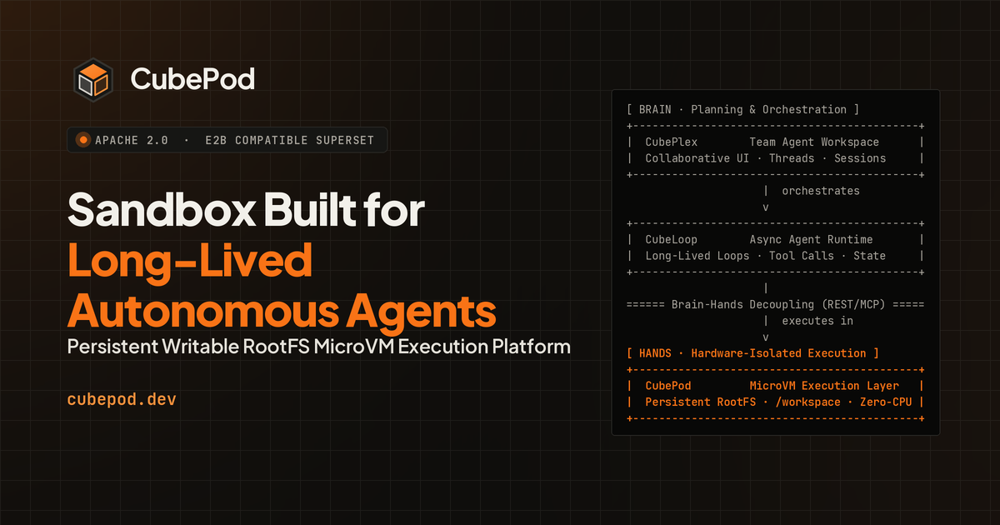

[English](README.md) · [中文文档](https://cubepod.dev/zh/) · [交互式 API 参考](https://cubepod.dev/api/) · [`llms.txt`](https://cubepod.dev/llms.txt)

CubePod 是一个专为长生命周期、高自主性 AI Agent 设计的开源云原生执行平台，具备**原生兼容 E2B** 与**原生 Kubernetes Runtime 调度**能力。**作为开源 CubePlex Agent 技术栈的核心组件**，CubePod 为 [**CubePlex**](https://github.com/cubeplexai/cubeplex)（团队 Agent 工作区）和 [**CubeLoop**](https://github.com/cubeplexai/cubeloop)（异步 Agent 运行时）提供持久化硬件隔离执行层，兼具秒级休眠/唤醒与全系统级持久化能力。

---

## 为什么选择 CubePod？

现代 AI Agent（DevOps Agent、软件工程助手、交互式数据分析师）需要广泛的 Shell 权限：它们会动态安装系统软件包（`apt`、`pip`、`npm`、Rust/C++ 编译器）、启动无头或交互式 GUI 浏览器，并使用特权凭证与外部 API 交互。

现有的沙箱方案存在四个根本性的架构局限：

1. **临时 RootFS（仅 `/workspace` 持久化）**：标准容器沙箱在休眠或重启时会丢弃对 `/usr`、`/etc` 和 `/var` 的修改。Agent 被迫反复重装工具链和依赖库，每次唤醒都会浪费数分钟。
2. **沉重的快照开销**：VM 内存快照（CRIU / VM dump）会产生 GB 级状态文件且对宿主机 CPU 架构敏感，而 OCI commit/export 方案需要数十秒向镜像仓库推送层。现代 Agent 遵循**“大脑与双手解耦（Decoupled Brain & Hand）”**模型——推理上下文保存在 Agent 框架中，这意味着沙箱只需在**休眠期间保持 100% 持久化磁盘状态且零 CPU/内存占用**即可。
3. **网络文件系统 I/O 瓶颈**：跨沙箱挂载 NFS 或 CephFS 时，由于数百万次小文件 RPC 往返，会导致 `npm install`、`pip install` 或 `git status` 出现灾难性的延迟。
4. **明文密钥暴露**：将真实 API 密钥注入容器环境变量，会使凭证暴露在不受信任的 LLM 生成代码或宿主机内存泄漏风险中。

CubePod 通过**双卷 CSI 裸块设备持久化（Dual-Volume CSI Raw Block）**、**Kata Containers MicroVM 隔离**、**零导出（Zero-Export）即时休眠**以及**内置零信任出口密钥库（Zero-Trust Egress Vault）**解决了上述挑战。

---

## CubePod vs. 上游 E2B 与标准沙箱

| 能力 / 维度 | 上游 E2B Cloud / 标准沙箱 | CubePod 开源平台 |
| :--- | :--- | :--- |
| **持久化方式** | **VM Pause 快照**（E2B）或**临时 Overlay**（标准容器，仅持久化 `/workspace`） | **块存储级 RootFS 持久化 + 独立 `/workspace` 卷** |
| **存储架构** | 快照耦合 RootFS 与状态（可选挂 E2B Volumes）或低速共享 NFS | **双 CSI 裸块 PVC**（`volumeMode: Block` $\to$ `virtio-blk` $\to$ Guest `ext4`），具备原生 NVMe-oF 速度 |
| **RootFS 与 Workspace 生命周期** | 绑定于同一 VM 快照或随容器重建整体重置 | **完全解耦**：递增 `rootfsGeneration` 即可重装系统镜像，同时完整保留 `/workspace` |
| **休眠与恢复** | 导出/恢复 VM 内存与磁盘快照或冷重启 VM | **零导出挂起**（`fsfreeze`，删除 Pod $\to$ 0 CPU/内存）与 **~1 秒跨节点挂载恢复** |
| **MicroVM 冷启动** | 标准 VM 启动延迟（数秒） | **预挂载 WarmPool（`PodWarmPool`）**：已预格式化 ext4 的空白 MicroVM 在 **< 50ms** 内认领 |
| **沙箱分叉（Fork）** | 不支持 / 全量卷拷贝 | **< 1 秒写时复制（CoW）Fork**：通过 CSI 块快照实现瞬时子 Agent 克隆 |
| **隔离边界** | 共享内核容器或云端黑盒 | **硬件级隔离 Kata MicroVM**（每个沙箱独占 Guest Linux 内核） |
| **密钥与出口安全** | 明文 API 密钥注入环境变量 | **零信任出口密钥库**：通过每 Pod mTLS 透明替换 `cpodref_` 占位符 |
| **交互式 GUI 与浏览器** | 端口映射且存在端口冲突风险 | **签名 Panel 反向代理**：支持路径/Token 鉴权的 HTTP、WebSocket 与 WebRTC（Chromium/Neko/ttyd） |
| **API 与生态** | 专有 API 与 SaaS 厂商锁定 | **100% 协议兼容的 E2B 超集**：无缝支持官方 E2B SDK 与 MCP |
| **部署模式** | 仅限专有云 | **100% 开源**：支持在 Kubernetes（Kata + CSI）或单机 Docker Compose 上自托管 |

---

## 系统架构

```text
+---------------------------------------------------------------------------------------+
|                        1. 接入层：Agent 平台与 SDK                                      |
|   CubePlex 平台  |  官方 E2B SDK (Python / JS)  |  CubePod SDK  |  MCP 客户端           |
+---------------------------------------------------------------------------------------+
                                           |
                                           v
+---------------------------------------------------------------------------------------+
|                   2. 控制与网关平面（无状态高可用）                                       |
|  cubepod-gateway (Go)               |  cubepod-controller (Go K8s Operator)           |
|  • 兼容 E2B 的 REST/SSE 路由         |  • 双块设备 PVC 与 WarmPool 生命周期管理          |
|  • 自动唤醒（Auto-Resume）流量拦截器   |  • 内存级每 Pod mTLS 证书签发                    |
|  • 签名 Panel 反向代理               |  • 零信任 Egress Sidecar 注入                     |
+---------------------------------------------------------------------------------------+
                                           |
                                           v
+---------------------------------------------------------------------------------------+
|                   3. 数据平面：硬件隔离 Kata MicroVM Pod                                |
|   +-------------------------------------------------------------------------------+   |
|   | Kata Guest Linux 内核（virtio-blk 直通挂载）                                     |   |
|   |                                                                               |   |
|   |  podd-init（PID 1 Rust 挂载器）：                                              |   |
|   |  1. 对裸块设备自动执行 e2fsck -p / mkfs.ext4                                    |   |
|   |  2. 组装 OverlayFS（lowerdir=基础镜像, upperdir=/dev/cubepod-rootfs）           |   |
|   |  3. 挂载 /workspace（/dev/cubepod-workspace）并执行 pivot_root                  |   |
|   |                                                                               |   |
|   |  容器合并后的 RootFS (/)                                                       |   |
|   |  • podd（Rust 守护进程 :49983）：命令执行、后台日志游标、归档同步                  |   |
|   |  • 桌面栈（按需懒加载）：Xorg + Chromium CDP + Neko WebRTC + ttyd                |   |
|   |  • Egress Sidecar：nftables 透明流量重定向 + mTLS 密钥库替换                     |   |
|   +-------------------------------------------------------------------------------+   |
+---------------------------------------------------------------------------------------+
                                           |
                                           v
+---------------------------------------------------------------------------------------+
|                    4. 持久化存储平面（CSI 裸块设备）                                     |
|  基础 OCI 镜像（只读）   |  RootFS Upper 块 PVC（精简配置） |  Workspace 块 PVC            |
|  (virtio-fs / EROFS)   |  (/dev/cubepod-rootfs -> ext4)  |  (/dev/cubepod-workspace)  |
|  存储后端：Longhorn V2 (SPDK NVMe-oF) / OpenEBS Mayastor / 本地 Loopback                |
+---------------------------------------------------------------------------------------+
```

---

## 核心架构亮点

### 1. 双卷持久化可写 RootFS
CubePod 通过配置两个独立的 CSI 裸块 PVC（`volumeMode: Block`）将系统依赖与用户文件解耦：
- **`rootfs-pvc`**：承载 OverlayFS 的 `upperdir` 和 `workdir`。保存由 `apt-get`、`pip` 或 `npm` 对 `/usr`、`/etc` 和 `/var` 产生的所有增量修改。
- **`workspace-pvc`**：直接挂载于 `/workspace`（属主为 `1000:1000`）。用于持久化源代码、产物和技能文件。

这种解耦实现了**无数据丢失的 RootFS 重置**：开发者或 Agent 框架只需递增 `rootfsGeneration`，即可清除损坏的操作系统环境或升级基础镜像，同时确保 `/workspace` 中的所有项目文件完好无损。

### 2. 零导出挂起与 ~1 秒跨节点恢复
- **挂起（Suspend）**：当 Agent 沙箱暂停或达到空闲超时时，`podd` 执行 `sync` + `fsfreeze` 刷写内核页缓存并静默文件系统事务。随后立即删除 Kata MicroVM Pod，将 CPU 与内存消耗降至**绝对零**。
- **恢复（Resume）**：任何传入请求（HTTP、命令执行或 Panel 访问）都会触发 `cubepod-gateway` 在**任意集群节点**上调度新的 MicroVM Pod。CSI 驱动重新挂载现有的裸块 PVC，`podd-init` 在 **~1 秒**内完成 ext4 文件系统挂载，无需在网络上传输数 GB 的内存状态。

### 3. 零宿主机侵入（`podd-init`）
标准 Kubernetes 无法在不修改宿主机 Kubelet 或 containerd 的情况下将裸块设备挂载为容器 RootFS。CubePod 通过 **Guest 内 RootFS 切换（In-Guest RootFS Pivot）** 绕过了这一限制：
- MicroVM 二进制文件（`podd-init` 和 `podd`）在 Pod 启动时通过初始化容器（`cubepod-podd`，`< 1MB`）填充到共享 `emptyDir` 卷中注入。
- `podd-init` 在 Kata Guest 内核中作为 PID 1 运行，挂载 `/dev/cubepod-rootfs` 和 `/dev/cubepod-workspace`，构建 OverlayFS，调用 `pivot_root(2)`，并将执行权移交给 `podd`。
- 用户容器镜像保持为标准 OCI 镜像，无需预置任何基础设施二进制文件。

### 4. 预挂载 WarmPool（`PodWarmPool`）
为了在不违反 Kubernetes Pod 卷不可变性约束的前提下实现亚 50ms 冷启动：
- 备用 MicroVM 在 `PodWarmPool` 中运行，预先创建并格式化精简配置的块设备，且已完成 ext4 切换。
- 当收到新沙箱请求时，`cubepod-controller` 在 **< 50ms** 内重新打标并移交备用 Pod 和卷的所有权，完全绕过容器调度和镜像拉取延迟。

### 5. 内置零信任出口与密钥库
- 敏感的外部凭证（如 GitHub Token、支付密钥）**永远不会进入沙箱文件系统、环境变量或进程内存**。
- 沙箱内部仅能看到不透明的 `cpodref_` 引用占位符。
- 所有出站流量均由 Guest 内的 Egress Sidecar 通过 `nftables` 透明拦截。Sidecar 会检查 TLS SNI、强制执行域名白名单，并通过专用的每沙箱 mTLS 通道向出口密钥库动态交换真实的 `cpodref_` 凭证。

---

## E2B 无缝兼容

CubePod 提供**与官方 E2B SDK 100% 协议级兼容的无缝互操作能力**（[CEP-0018](docs/enhancements/0018-e2b-protocol-compatibility/README.md)）。现有的 AI Agent 流水线（LangChain、LlamaIndex、AutoGen、OpenHands、Smolagents）无需修改代码即可接入 CubePod——只需将 `E2B_DOMAIN` 指向 `cubepod-gateway`。

### 1. 官方 Python SDK（`e2b`）—— 同步与异步

```bash
# 将上游 E2B SDK 指向你的 CubePod Gateway
export E2B_DOMAIN="localhost:8080"
export E2B_API_KEY="cpod_live_secret"
```

```python
# 同步执行
from e2b import Sandbox

with Sandbox.create("base", timeout=300) as sandbox:
    # 运行命令
    cmd = sandbox.commands.run("echo 'Hello from CubePod Kata MicroVM!'")
    print(cmd.stdout)  # "Hello from CubePod Kata MicroVM!"

    # 读写持久化状态文件
    sandbox.files.write("/workspace/agent_data.txt", "persistent state")
    content = sandbox.files.read("/workspace/agent_data.txt")
```

```python
# 异步执行（AsyncSandbox）
import asyncio
from e2b import AsyncSandbox

async def main():
    sandbox = await AsyncSandbox.create("base")
    try:
        cmd = await sandbox.commands.run("uname -a")
        print(cmd.stdout)
    finally:
        await sandbox.kill()

asyncio.run(main())
```

### 2. 官方代码解释器（`e2b-code-interpreter`）

CubePod 原生提供兼容 Jupyter 协议的换行分隔 JSON（NDJSON）流式输出以及富媒体显示格式（`png`、`svg`、`html`、`json`）：

```python
from e2b_code_interpreter import Sandbox

with Sandbox.create() as sandbox:
    code = """
import matplotlib.pyplot as plt
import pandas as pd
import numpy as np

# 1. 富表格 DataFrame 展示 (_repr_html_)
df = pd.DataFrame({"A": np.random.randn(5), "B": np.random.randn(5)})

# 2. 富图形 Matplotlib 图表捕获 (base64 PNG)
plt.figure()
plt.plot([1, 2, 3], [4, 5, 6], label="Trajectory")
plt.title("Agent Convergence")
plt.show()

df
"""
    execution = sandbox.run_code(code)

    # 获取富媒体输出
    for result in execution.results:
        if result.png:
            print("Chart captured! Base64 PNG length:", len(result.png))
        if result.html:
            print("HTML table captured:\n", result.html[:100], "...")
```

### 3. 多语言代码执行

CubePod 上的 `e2b-code-interpreter` 开箱即支持 6 种标准执行内核：

| 语言 | `language` 参数 | 执行内核 | 能力特性 |
| :--- | :--- | :--- | :--- |
| **Python** | `"python"`（默认） | `ipykernel` (IPython) | Matplotlib/Seaborn 图表、Pandas HTML 表格、LaTeX |
| **JavaScript** | `"javascript"` | `ijavascript` (Node.js) | Node.js 算法与 Web 数据处理 |
| **TypeScript** | `"typescript"` | `tslab` / `ts-node` | 带类型检查的 TypeScript 脚本执行 |
| **R** | `"r"` | `IRkernel` | 统计分析、`ggplot2` 绘图 |
| **Java** | `"java"` | `ijava` (JShell) | Java 类与 JVM 运行时执行 |
| **Bash** | `"bash"` | `bash_kernel` | 交互式 Shell 命令与流水线脚本 |

---

## 企业级超集能力

在标准 E2B 接口之上，CubePod 为关键任务型 Agent 平台提供了高吞吐量的企业级扩展能力：

- **1 秒写时复制沙箱分叉（`POST /sandboxes/{id}/fork`）**：利用 CSI 快照在 `< 1s` 内克隆运行中的沙箱及其双块存储卷，支持子 Agent 在完全隔离的环境中进行推测性代码执行分支。
- **独立 RootFS 重置**：在 `PodBox` CRD 或 API 中递增 `rootfsGeneration`，即可在 `apt` 或编译器更新损坏时重建系统层，同时保证 `/workspace` 中的用户代码 100% 不受影响。
- **无状态日志游标（`GET /commands/{pid}/logs?cursor={byte_offset}`）**：进程日志持久化保存在磁盘环形缓冲区中。网络中断后，任意网关副本或 Agent Worker 均可从任意字节偏移量重新连接并恢复日志流。
- **原子级技能归档同步（`POST /files/archive-sync`）**：在单次 `< 50ms` HTTP 调用中流式传输 `tar.gz` 负载并在内存中直接解压至 `/workspace/.skills`，精确保持 `uid:gid` 属主并原子清理已移除的工具。
- **签名 Panel 与 GUI 代理（`/panel/{jwt_token}/{path}`）**：基于路径和 JWT 鉴权的反向代理，支持为 Chromium CDP（`:9222`）、Neko 浏览器共享（`:8080`）和 ttyd Web 终端（`:7681`）提供 HTTP、WebSocket 及 WebRTC 流媒体转发。

---

## 仓库目录导航

| 路径 | 职责说明 | 技术栈 |
| :--- | :--- | :--- |
| [`docs/architecture.md`](docs/architecture.md) · [`中文`](docs/architecture_zh.md) | 平台架构规范与 CubePlex 集成蓝图 | Markdown / Mermaid |
| [`docs/enhancements/`](docs/enhancements/README.md) | CubePod 增强提案（CEPs） | CEP 规范 |
| [`api/v1alpha1/`](api/v1alpha1/types.go) | Kubernetes CRD 定义（`PodBox`、`PodTemplate`、`PodWarmPool`） | Go (`controller-gen`) |
| [`api/openapi/`](api/openapi/cubepod-v1.yaml) | 权威 E2B 兼容超集 OpenAPI 3.1 规范 | OpenAPI 3.1 |
| [`crates/podd-init/`](crates/podd-init/src/main.rs) | Guest 内 PID 1 裸块 `ext4` 修复/格式化器与 `OverlayFS` `pivot_root` 挂载器 | Rust（单线程、零 GC） |
| [`crates/podd/`](crates/podd/src/main.rs) | Guest 内命令执行、后台进程（`cursor` 日志）及 `tar.gz` 文件同步守护进程 | Rust (`tokio`, `axum`) |
| [`cmd/cubepod-controller/`](cmd/cubepod-controller/main.go) & [`pkg/controller/`](pkg/controller/) | Kubernetes Operator，负责调谐双块 PVC、WarmPool 与 Kata Pod | Go (`kubebuilder`, `client-go`) |
| [`cmd/cubepod-gateway/`](cmd/cubepod-gateway/main.go) & [`pkg/gateway/`](pkg/gateway/) | 控制平面网关、E2B 路由、自动唤醒及 Panel HTTP/WS/WebRTC 代理 | Go |
| [`cmd/cubepod-egress/`](cmd/cubepod-egress/main.go) & [`pkg/egress/`](pkg/egress/) | 零信任 mTLS `cpodref_` 密钥库与出口正向代理 Sidecar | Go |
| [`cmd/cubepod/`](cmd/cubepod/main.go) & [`pkg/client/`](pkg/client/) | 官方 Go 客户端 SDK 与 `cubepod` CLI | Go |
| [`sdks/python/`](sdks/python/) | 同步与异步 Python SDK（`cubepod`） | Python 3.11+ (`httpx`) |
| [`deploy/`](deploy/) | Helm Chart（`deploy/helm/cubepod`）、K8s 清单与本地 Docker Compose | Helm / K8s / Docker |

---

## 快速开始（构建与测试）

### 前置依赖

- Go 1.22+
- Rust 1.78+ (cargo)
- Docker / Podman（可选，用于容器镜像验证）

### 构建全部二进制文件

```bash
# 构建所有组件（podd-init、podd、controller、gateway、egress、cubepod CLI）
make build
```

### 运行测试

```bash
# 格式化并静态检查 Go 与 Rust 源码
make fmt
make vet

# 运行全部单元测试与集成测试
make test

# 运行多进程端到端集成测试套件（包含 E2B 无缝兼容与压力测试）
make test-e2e

# 运行官方 E2B Python SDK 与 Code Interpreter 兼容性测试套件
make test-e2b-compat
```

---

## 开源 CubePlex Agent 技术栈

基于**大脑与双手解耦（Brain-Hands Decoupling）**架构，CubePod 作为持久化硬件隔离执行层（**Hands**），为 [**CubePlex**](https://github.com/cubeplexai/cubeplex)（团队 Agent 工作区）和 [**CubeLoop**](https://github.com/cubeplexai/cubeloop)（异步 Agent 运行时与推理 **Brain**）提供底层支撑：

- [**CubePlex**](https://github.com/cubeplexai/cubeplex) — **大脑 / 工作区**：面向协作式多 Agent 工作流、会话与治理的团队 Agent 工作区。
- [**CubeLoop**](https://github.com/cubeplexai/cubeloop) — **大脑 / 运行时**：编排长周期、多模型自主执行循环的异步 Agent 运行时。
- [**CubePod**](https://github.com/cubeplexai/cubepod) — **双手 / 执行层**：持久化可写 RootFS MicroVM 执行底座，具备双 CSI 裸块持久化、`<50ms` WarmPool 认领、`~1s` CoW 分叉及零信任 `cpodref_` 出口安全。

---

## 开源协议

CubePod 是基于 [Apache License, Version 2.0](LICENSE) 协议开源的软件。

### 可复现的 kind 端到端测试

在 Linux Docker 宿主机上运行 `make test-kind-e2e`，即可将当前代码检出构建并部署到隔离的 kind 集群中，并使用两套官方 E2B SDK 验证真实沙箱运行。详见[环境要求、覆盖范围、诊断与本地复用说明](test/kind-e2e/README.md)。
无需 KVM 或预先存在的 Kubernetes 环境。
