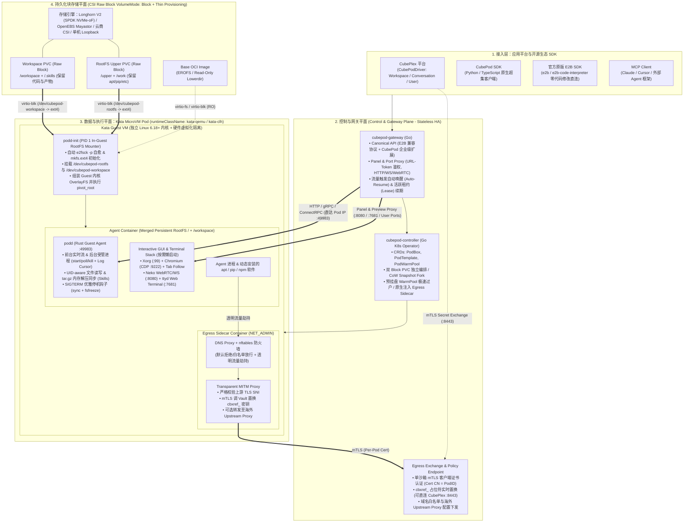
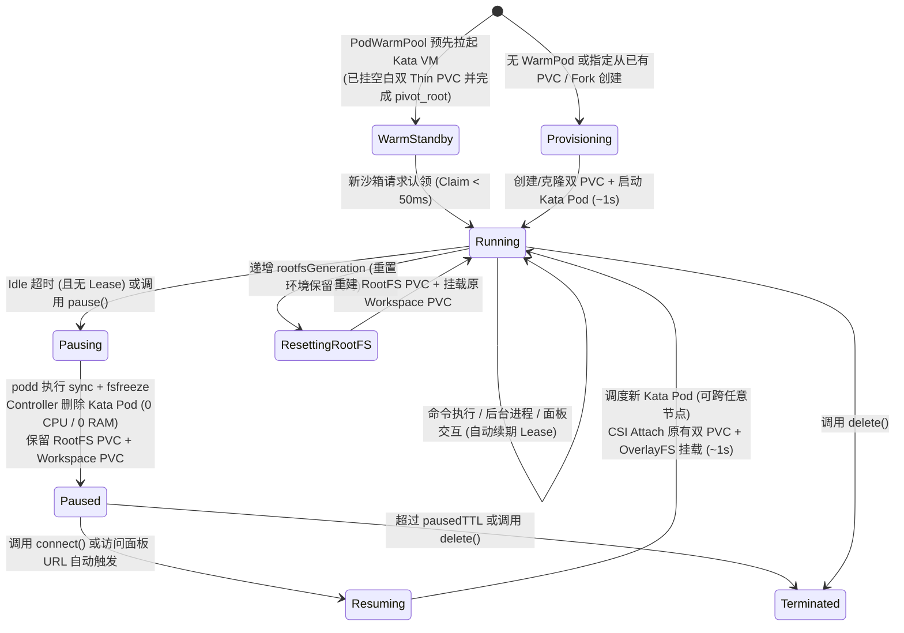

# CubePod 总体技术架构方案与演进蓝图 (Architecture Specification)

> **项目定位**：**CubePod** 是由 CubePlex 团队打造的开源、云原生、硬件级强隔离（Kata MicroVM）、全盘可写层持久化（Persistent Writable RootFS）且内置零信任出网网关（Zero-Trust Egress & Secret Vault）的 **全功能 AI Agent 持久化执行舱（Agent Execution Pod）平台**。
>
> **CubePlex 开源矩阵三剑客**：
> - **CubePlex**：面向团队工作空间的托管式 Agent 协同平台（The Workspace Platform）
> - **CubeLoop**：异步原生的多模型 Agent 运行时与检查点框架（The Brain / Agent Loop）
> - **CubePod**：秒级冬眠唤醒、全系统持久化的 MicroVM 安全执行环境（The Body / Execution Pod）

---

## 一、 背景、痛点与核心价值主张

### 1.1 业务背景与行业痛点
在现代 AI Agent（Code Interpreter、DevOps Agent、自主软件工程智能体）应用中，Agent 拥有高自由度的 Shell 执行权限，经常需要动态安装系统级依赖（如 `apt install`, `pip install`, `npm -g`, Rust/C++ 编译工具链等）、操作 GUI 浏览器、并携带敏感凭证访问外部 API。

现有容器与沙箱方案存在四大核心痛点：
1. **仅持久化 `/workspace`，系统环境易失**：一旦沙箱休眠或容器销毁，Agent 安装在 `/usr`、`/etc`、`/var` 的系统包全部丢失，下次唤醒必须重新安装，体验割裂且耗时长。
2. **全量快照（VM Memory Snapshot / CRIU / OCI Commit）太重**：
   - 传统 VM 内存快照或 KEP-5823 (CRIU) 包含完整的进程树与内存转储，体积庞大（数 GB）、跨节点传输慢，且对宿主机内核与 CPU 特性极度敏感。
   - 社区方案（如 `OpenSandbox` 或 `agent-sandbox` 的 SnapshotProvider）在 Pause 时将容器层打包导出为 OCI 镜像并推送到 Registry，停机导出耗时长达数十秒，占用大量网络带宽。
   - **本质洞察**：现代 Agent 采用“手脑分离”（Decoupled Brain & Hand）架构，会话上下文与推理状态已由外部 `CubeLoop` 持久化，**沙箱休眠时根本不需要保留内存状态，只需 100% 保留全盘文件系统状态**。
3. **分布式文件存储（NFS/CephFS）的小文件性能灾难**：若通过网络文件系统共享持久化目录，Agent 执行 `npm install`、`pip install`、`git status` 时会产生海量小文件元数据 RPC，I/O 延迟劣化数倍至数十倍。
4. **安全隔离与外部凭证泄漏矛盾**：标准 `runc` 容器共享宿主机内核，存在逃逸风险；而将用户的真实 API Key（如 `GITHUB_TOKEN`）注入沙箱环境变量，极易被大模型生成的不受信代码读取或外泄。

### 1.2 CubePod 的五大核心设计目标
1. **秒级冬眠与跨节点唤醒（0 秒导出，~1 秒挂载唤醒）**：无需打包/导出 Snapshot，停机即删 Pod（释放 100% CPU/RAM），启动即跨任意节点挂载恢复。
2. **全 RootFS + Workspace 双卷解耦持久化**：不仅保留 `/workspace`，还完整保留对 `/`（`/usr`, `/etc`, `/var`）的所有修改；同时支持**单独重置系统盘（或升级 Base Image）而无损保留 `/workspace` 数据**。
3. **原生本地磁盘级 I/O 性能 + 1 秒 CoW 克隆（Fork）**：基于 SPDK + NVMe-oF 分布式裸块设备（`volumeMode: Block`）与 `virtio-blk` 直通 Guest 内核原生 `ext4`，并支持利用存储层 Copy-on-Write 瞬间克隆分支沙箱。
4. **硬件级虚拟化 + 零信任网络（Zero-Trust Egress）**：默认基于 **Kata Containers (MicroVM)** 独立内核隔离，内置 DNS/NFTables 防火墙与 mTLS 透明 MITM 密钥置换（真实密钥永不进沙箱）。
5. **拥抱全球开源标准（E2B 超集协议 + K8s 原生 Operator + 单机 Docker 双模）**：对外原生兼容 **E2B SDK** 与 **MCP 协议**，对内为 CubePlex 提供零妥协的企业级扩展能力，且同时支持生产级 K8s 与本地单机 `docker-compose` 一键运行。

---

## 二、 CubePod 核心命名体系与架构全景

### 2.1 统一命名规范 (Nomenclature)

| 组件 / 概念 | 命名 | 说明 |
| :--- | :--- | :--- |
| **项目与品牌名** | **CubePod** | 寓意“AI Agent 的安全休眠与执行太空舱”，与 `CubePlex`、`CubeLoop` 构成完整矩阵，彻底规避与第三方沙箱撞名。 |
| **仓库与 SDK 包名** | `cubepod` | GitHub: `cubeplexai/cubepod`；Python: `pip install cubepod`；TS: `npm install @cubeplex/cubepod`。 |
| **沙箱内守护进程** | **`podd`** (`cubepod-daemon`) | 运行在沙箱内部的单二进制 Rust 守护进程（兼做容器 PID 1 `podd-init` 挂载器与命令/文件执行 Server）。 |
| **控制面网关** | **`cubepod-gateway`** | 无状态高可用 API 网关、E2B 协议路由器、以及浏览器/终端 WebSocket/WebRTC 反向代理。 |
| **K8s 控制器** | **`cubepod-controller`** | 管理沙箱全生命周期、双 Block PVC、预热池与 Egress 注入的 K8s Operator。 |
| **K8s CRD 资源** | `PodBox` (或 `Sandbox`)、`PodTemplate`、`PodWarmPool` | API Group: `pod.cubeplex.ai/v1alpha1`。 |

---

### 2.2 总体四层架构图



---

## 三、 核心存储与虚拟化设计：Persistent Writable RootFS

系统的核心设计哲学是：**将 MicroVM Pod 视为可随时销毁的纯临时算力，将 RootFS Upper Layer 与 Workspace 解耦为两个长期存在的持久化裸块设备（Raw Block PVC）。**

### 3.1 分层存储视图与双卷职责划分

```text
+-------------------------------------------------------------------------------+
|                            Kata MicroVM (Guest Kernel)                        |
|                                                                               |
|   +-----------------------------------------------------------------------+   |
|   |                  Container Merged RootFS (/) [OverlayFS]              |   |
|   |                                   |                                   |   |
|   |                 +-----------------+-----------------+                 |   |
|   |                 | (Read-Only)                       | (Read-Write)    |   |
|   |                 v                                   v                 |   |
|   |        +-----------------+                 +-----------------+        |   |
|   |        |    lowerdir     |                 | upperdir/workdir|        |   |
|   |        |  (Base Image)   |                 |  (Guest ext4)   |        |   |
|   |        +--------+--------+                 +--------+--------+        |   |
|   +-----------------|-----------------------------------|-----------------+   |
|                     |                                   |                     |
|                     |                          +--------+--------+            |
|                     |                          |   /workspace    |            |
|                     |                          |  (Guest ext4)   |            |
|                     |                          +--------+--------+            |
+---------------------|-----------------------------------|---------------------+
                      | (virtio-fs / EROFS)               | (virtio-blk 直通)
                      v                                   v
     +----------------------------------+   +-----------------------------------+
     |  Container Base Image (RO)       |   |  2x CSI Raw Block PVCs (Thin)     |
     |  Ubuntu 24.04 + podd + Browser   |   |  1. <id>-rootfs-pvc (10Gi Thin)   |
     |  (节点级共享缓存)                |   |  2. <id>-workspace-pvc (20Gi Thin)|
     +----------------------------------+   +-----------------------------------+
```

| 层级 | 挂载目标 | 属性 | 承载技术 | 独立生命周期语义 |
| :--- | :--- | :--- | :--- | :--- |
| **Base Layer** | `lowerdir` | 只读 (RO) | OCI Image (virtio-fs / EROFS) | 统一的基础系统与工具链，集群节点共享。升级镜像时直接替换底层只读层。 |
| **Upper Layer** | `upperdir` + `workdir` | 读写 (RW) | `rootfs-pvc` (`volumeMode: Block`) $\to$ `virtio-blk` $\to$ `ext4` | 保存 Agent 对 `/usr`, `/etc`, `/var` 的所有修改（`apt`/`pip`）。停机保留；**环境损坏或大版本升级时可单独格式化重建**。 |
| **Workspace** | `/workspace` | 读写 (RW) | `workspace-pvc` (`volumeMode: Block`) $\to$ `virtio-blk` $\to$ `ext4` | 保存用户项目代码、生成产物与 `/workspace/.skills`。**即使重置 Upper Layer，Workspace 数据依然 100% 完好保留**。 |

### 3.2 关键突破：零宿主机侵入的 `podd-init` In-Guest Overlay RootFS Pivot
在标准 Kubernetes 中，容器的初始 `/` 是由宿主机 `containerd` 准备的，而 `volumeDevices`（Raw Block PVC）是在容器 rootfs 就绪后才映射进容器内的（如 `/dev/cubepod-rootfs`）。
为了**无需魔改 Kubelet 或强制要求宿主机编译自定义 containerd snapshotter**，CubePod 采用 **In-Guest RootFS Pivot** 技术：

1. **Pod 启动与二进制动态注入（不污染业务镜像）**：
   - **`podd-init` 与 `podd` 绝不打入业务 Sandbox 镜像**：用户可直接指定任意标准 OCI 镜像（如 `ubuntu:24.04` 或现有的 `cubeplex-sandbox`）。
   - `cubepod-controller` 在创建 Pod 时，自动挂载一个内存 `emptyDir` 卷到 `/opt/cubepod/bin`，并由极轻量的 `podd-installer` `initContainer`（镜像 `cubepod-podd`，体积 `< 1MB`）将纯静态编译的 Rust 二进制 `podd-init` 和 `podd` 拷贝至 `/opt/cubepod/bin/`，然后将主容器 `command` 覆写为 `["/opt/cubepod/bin/podd-init", "/opt/cubepod/bin/podd"]`。
   - 同时，K8s 将 `rootfs-pvc` 和 `workspace-pvc` 通过 `volumeDevices` 以 `virtio-blk` 直通进 Kata Guest VM，路径分别为 `/dev/cubepod-rootfs` 和 `/dev/cubepod-workspace`。
2. **`podd-init` (PID 1) 自动自愈与挂载**：
   - 检查两块块设备的 ext4 Superblock：若是首次挂载的空白盘，自动执行极速 `mkfs.ext4` 并初始化目录结构（在 rootfs 盘创建 `/upper` 与 `/work`，将 workspace 盘属主设为 `1000:1000`）；若检测到上次非正常断电留下的 dirty 标记，自动执行 `e2fsck -p` 毫秒级修复。
   - 在 Kata Guest 内核中执行原生 OverlayFS 挂载与 `pivot_root`（同时将 `/opt/cubepod` `--rbind` 进新根，既保证 `pivot_root` 后能直接 `exec /opt/cubepod/bin/podd`，又不会把守护进程写入用户的持久化 `upperdir`）：
     ```bash
     mount -t ext4 -o noatime /dev/cubepod-rootfs /mnt/rootfs-upper
     mount -t overlay overlay \
       -o lowerdir=/,upperdir=/mnt/rootfs-upper/upper,workdir=/mnt/rootfs-upper/work \
       /mnt/newroot
     mount -t ext4 -o noatime /dev/cubepod-workspace /mnt/newroot/workspace
     # 迁移 /proc, /sys, /dev, /run, /opt/cubepod 及 K8s 注入的 /etc/resolv.conf, /etc/hosts
     pivot_root /mnt/newroot /mnt/newroot/.old_root
     exec /opt/cubepod/bin/podd
     ```
3. **启动 `podd` 服务**：完成 `pivot_root` 后，后续所有的命令执行、`apt install`、浏览器与终端进程完全运行在由 `virtio-blk` 裸块设备支撑的持久化根文件系统之上！

### 3.3 运行时与存储底座选型规范
1. **虚拟化运行时：Kata Containers (`kata-qemu` / `kata-clh` on `containerd`)**
   - 每个 CubePod 实例运行在拥有独立 Linux Guest Kernel 的轻量级 MicroVM 中。
   - **关键配置固化**（源自 CubePlex 实测经验）：在宿主机 `containerd` 的 Kata runtime 配置中，Helm Chart / 安装脚本默认确保开启 `privileged_without_host_devices = true`，避免特权容器透传宿主设备时引发 `/dev/full EEXIST` 错误；同时推荐 x86 架构开启嵌套虚拟化（`/dev/kvm`）。
2. **分布式块存储引擎：Longhorn V2 (SPDK) / OpenEBS Mayastor**
   - 抛弃传统内核 iSCSI 与 NFS，采用基于 **SPDK + NVMe-oF** 的现代高性能块存储。
   - **Thin Provisioning（精简置备）**：给每个沙箱声明 `10Gi` RootFS + `20Gi` Workspace，若实际写入 `100MB`，物理磁盘仅消耗 `100MB`。
   - **CoW Snapshot & Clone**：支持毫秒级零拷贝卷克隆，直接支撑 `CubePod` 的 **1 秒沙箱分支克隆（Fork）**。
   - **云与单机全适配**：底层既可使用裸金属 NVMe SSD，也可直接使用 AWS EBS / 阿里云 ESSD 云盘组建存储池；在单机 `docker-compose` 模式下，自动回退为宿主机稀疏 Loopback 文件（`truncate -s 10G` + `ext4`），保证上层架构 100% 统一。

---

## 四、 接口契约设计：E2B 兼容超集协议 (E2B-Compatible Superset)

为了最大化开源社区影响力并彻底摆脱 `OpenSandbox` 的历史包袱，CubePod 采用 **“E2B 兼容协议 + CubePod 企业级扩展”** 作为唯一标准对外契约。

### 4.1 为什么选择 E2B 超集协议？
- **零成本吸纳全球生态**：LangChain、LlamaIndex、OpenHands 等主流框架及海量开发者只需将 `E2B_DOMAIN` 指向 `cubepod-gateway`，无需修改一行代码即可直接用官方 `e2b` SDK 驱动 CubePod。
- **语义更优雅**：E2B 的 `Sandbox.connect(id)` 天然定义为“若沙箱处于 Paused 状态则自动唤醒并返回连接”，完美契合 CubePlex 在 `Sandbox.connect_or_resume()` 中的抽象设计；其文件接口也天然支持指定 `user` 身份。

### 4.2 CubePod 核心 API 矩阵（基础兼容 + 扩展能力）

| 模块 | E2B 标准兼容接口 (Control Plane & `podd` Data Plane) | CubePod 企业级增强扩展 (Cube Extensions) | 解决的 CubePlex 核心痛点 |
| :--- | :--- | :--- | :--- |
| **1. 生命周期管理** | • `POST /sandboxes` (创建)<br/>• `GET /sandboxes/{id}` (查询)<br/>• `POST /sandboxes/{id}/pause` (休眠)<br/>• `POST /sandboxes/{id}/connect` (连接或从休眠自动唤醒)<br/>• `POST /sandboxes/{id}/timeout` (续期 TTL)<br/>• `DELETE /sandboxes/{id}` (销毁) | • **双卷持久化参数**：支持绑定确定性的 `volume_key`（如 `ws-{ws}-user-{uid}`），区分 `pause`（删 Pod 留双盘）与 `reset_rootfs`（重置系统盘保留 `/workspace`）。<br/>• **瞬间克隆**：`POST /sandboxes/{id}/fork`（基于 CSI CoW 1 秒克隆出带完整系统软件和代码的新沙箱）。<br/>• **租约锁**：`POST /sandboxes/{id}/lease`（防止长任务执行中途被 Idle Reaper 误休眠）。 | 彻底解决系统依赖丢失、支持用户一键重置损坏环境而不丢代码、支持 Subagent 并行 Fork 沙箱。 |
| **2. 命令与进程执行 (`podd`)** | • 前台流式执行（实时推送 `stdout`/`stderr` chunk，进程退出立即关闭流，0 延迟）<br/>• 后台命令启动 (`background=true`)、进程列表、发送信号中断 (`kill` 整个进程组) | • **无状态游标日志拉取**：`GET /commands/{pid}/logs?cursor={byte_offset}`，输出持久化在沙箱 `/run/podd/procs/`，支持 CubePlex 任意后端 Worker 跨进程断线重连与增量读取。 | 彻底告别 OpenSandbox 1s 流延迟补丁，原生支撑 CubePlex 的受管后台任务 (`CommandCoordinator`)。 |
| **3. 文件与批量同步 (`podd`)** | • `GET/PUT /files`（支持传入 `user="cubeplex"` / `uid=1000` 直接以非 root 身份读写）<br/>• 目录树列表 (`list` / `search`) 与文件变更监听 (`watch`) | • **极速归档增量同步**：`POST /files/archive-sync`，单次请求上传 `tar.gz` 流并在内存中以指定 `uid:gid` 解压至目标路径（如 `/workspace/.skills`），同时根据传入的 `remove_paths` 原子清理已卸载目录。 | 彻底消灭上传文件后的二次 `chown` shell 调用；将 CubePlex 的 Skills 同步从 N 次 HTTP 压缩为 1 次 `<50ms` 调用。 |
| **4. 交互面板与端口代理** | • `get_host(port)`：返回 `<port>-<id>.<domain>` 子域名访问路由 | • **路径签名反向代理**：`GET/WS /sandboxes/{id}/proxy/{port}/{path}` 及 `/panel/{jwt_token}/{path}`，原生支持 HTTP、WebSocket、WebRTC 全双工转发。<br/>• **按需桌面激活**：`POST /sandboxes/{id}/desktop/start`（幂等拉起 Xorg + Chromium CDP `:9222` + Neko `:8080` + ttyd `:7681`）。 | 彻底解决 OpenSandbox Issue #949 端口模式冲突，完美支撑浏览器人机接管（过验证码/登录）与网页终端。 |
| **5. 零信任网络与密钥金库** | （原生 E2B 无此能力） | • **声明式网络策略**：`network_policy`（默认拒绝/允许、域名通配符白名单、海外 `upstream_proxy`）。<br/>• **占位符密钥绑定**：`secret_bindings`（将 `cbxref_...` 写入 `/run/cubepod/env.sh`，出网时由 Sidecar 校验 TLS SNI 并通过 mTLS 换取真实密钥）。 | 将 CubePlex 的 `egress-bundle` 内化为平台原生能力，消灭外挂 MutatingWebhook 维护成本。 |

---

## 五、 K8s 资源管理架构：自研 `cubepod-controller` Operator

在 Kubernetes 资源编排层，我们**在 CRD 概念上对齐 `kubernetes-sigs/agent-sandbox` 的优雅范式（Template + WarmPool + Instance），但核心 Controller 基于 Go `kubebuilder` 完全自研**。

### 5.1 为什么核心 Controller 必须自研而非直接套用上游 `agent-sandbox`？
1. **双 `volumeMode: Block` PVC 的独立生命周期**：我们需要同时管理 `rootfs-pvc` 和 `workspace-pvc`，并通过 `volumeDevices`（而非 `volumeMounts`）挂载，且支持“单独销毁重建 `rootfs-pvc` 而保留 `workspace-pvc`”，上游 `volumeClaimTemplates` 无法表达该语义。
2. **打破 K8s Pod Volume 不可变限制的“预挂盘 WarmPool”**：
   - K8s 中已 Running 的 Pod 无法动态修改 `spec.volumes`。上游 `agent-sandbox` 的 WarmPool 无法将新的 Block PVC 塞进已启动的 Warm Pod。
   - **自研 `PodWarmPool` 解法**：池中的每个待命 Kata MicroVM 在预热启动时，就已经预先创建并挂载好了两个空白的 Thin-Provisioned Block PVC（0 物理占用），且 `podd-init` 已经完成了 `mkfs.ext4` 与 `OverlayFS pivot_root`！当新沙箱请求到来时，Controller 直接将该 Warm Pod 及其名下的两块盘通过修改 Label/OwnerReference **瞬间过户（Claim）** 给目标 `PodBox`，实现 **`< 50ms` 的极致冷启动**！
3. **原生组装 Egress Sidecar 与 mTLS 证书（彻底告别外挂 MutatingWebhook）**：
   - 自研 Controller 在生成 Sandbox Pod Spec 时，直接在内存里签发 per-pod mTLS 客户端证书 Secret，并原生注入 Egress Sidecar 与 CA 信任环境变量，无需像过去那样额外部署和排障复杂的 `MutatingAdmissionWebhook`。

### 5.2 CRD 核心规范定义 (`pod.cubeplex.ai/v1alpha1`)

```yaml
# 1. 模板定义 (PodTemplate)
apiVersion: pod.cubeplex.ai/v1alpha1
kind: PodTemplate
metadata:
  name: cubeplex-ubuntu24-desktop
spec:
  runtimeClassName: kata-qemu
  image: ghcr.io/cubeplexai/cubepod-runtime:ubuntu24-desktop
  resources:
    requests: { cpu: "200m", memory: "512Mi" }
    limits:   { cpu: "2",    memory: "4Gi" }
  storage:
    storageClassName: longhorn-v2-block-thin
    rootfsSize: 10Gi
    workspaceSize: 20Gi
  egress:
    enabled: true
    exchangeUrl: "https://cubeplex-backend.cubeplex.svc:8443/api/v1/internal/egress/exchange"
---
# 2. 预热池定义 (PodWarmPool)
apiVersion: pod.cubeplex.ai/v1alpha1
kind: PodWarmPool
metadata:
  name: default-warm-pool
spec:
  templateRef: cubeplex-ubuntu24-desktop
  replicas: 3  # 常驻 3 个已完成 Kata 启动与双盘 ext4 pivot_root 的待命实例
---
# 3. 沙箱实例定义 (PodBox)
apiVersion: pod.cubeplex.ai/v1alpha1
kind: PodBox
metadata:
  name: cpod-ws-01-user-99
  namespace: cubepod-workloads
spec:
  templateRef: cubeplex-ubuntu24-desktop
  warmPoolRef: default-warm-pool
  desiredState: Running                 # Running | Paused (Paused 时删 Pod 释放算力，保留双 PVC)
  rootfsGeneration: 1                   # 递增此版本号即可重置系统盘 (/upper)，同时完好保留 /workspace
  forkFrom:                             # 可选：从父沙箱通过 CSI Volume Clone 1 秒克隆双盘
    podBoxName: ""
  lifecycle:
    idleTimeoutSeconds: 1800
    pausedTTLSeconds: 604800
    leaseExpiresAt: "2026-11-10T20:00:00Z"
  networkPolicy:
    defaultAction: Deny
    allowHosts: ["*.github.com", "pypi.org", "files.pythonhosted.org"]
    upstreamProxy: "http://clash.infra.svc:7890"
```

### 5.3 核心生命周期状态流转



---

## 六、 与 `~/cubeplex` 的无缝对接方案

在 `~/cubeplex` 中，沙箱抽象层（[`backend/cubeplex/sandbox/base.py`](file:///home/chris/cubeplex/backend/cubeplex/sandbox/base.py)）已经做了非常清晰的驱动隔离，且 `UserSandbox` 表已预留了 `provider` 字段。对接仅需以下三步：

1. **新增原生驱动 `backend/cubeplex/sandbox/cubepod.py`（约 300 行）**：
   - 实现 `Sandbox` 抽象基类的所有方法（`execute`, `start`, `poll`, `read_output`, `kill`, `upload`, `download`, `pause`, `connect_or_resume`, `get_browser_endpoint`, `get_terminal_endpoint`）。
   - 直接调用 `cubepod-gateway` 的 E2B 超集接口，**彻底移除 `opensandbox.py` 中的 SSE monkey-patch 和每次上传后的 `chown` 命令**。
2. **复用 CubePlex 现有 `:8443` mTLS Egress Exchange 服务**：
   - `cubepod-controller` 将 CubePlex 的 Egress CA 配置为信任根，为每个沙箱自动签发客户端证书（`CN = <pod_id>`），沙箱内的 Egress Sidecar 直接回调 CubePlex 现有的 `/api/v1/internal/egress/exchange` 与 `/proxy-config` 接口，**CubePlex 侧的 Sandbox Env Vault 与 Policy 业务代码一行都不用改**！
3. **解锁 CubePlex 全新产品特性**：
   - 在用户沙箱设置界面提供 **“重置系统环境（保留 `/workspace` 文件）”** 按钮。
   - 在 `LazySandbox._sync_skills` 中调用 `cubepod` 的 `/files/archive-sync` 接口，实现毫秒级 Skills 同步。
   - 为子智能体（Subagent）或分支对话提供基于 `fork` 的 **1 秒独立沙箱克隆**。

---

## 七、 代码仓库结构与分阶段落地路线图 (Roadmap)

### 7.1 `cube-agent-sandbox` (将重命名/演进为 `cubepod`) 仓库目录规划

```text
cubepod/
├── docs/
│   └── architecture.md         # 本总体技术架构方案与演进蓝图
├── api/
│   ├── v1alpha1/               # K8s CRD Go Types (PodBox, PodTemplate, PodWarmPool)
│   └── openapi/                # Canonical API (E2B Superset) OpenAPI 3.1 规范
├── crates/                     # Rust 工作空间 (负责沙箱内高性能超轻量组件)
│   ├── podd/                   # 沙箱内守护进程：podd-init (OverlayFS pivot_root) + 执行/文件 Server
│   └── egress-proxy/           # (可选进阶) 极轻量 Rust 透明 MITM 密钥置换代理
├── cmd/                        # Go 控制面入口
│   ├── cubepod-controller/     # K8s Operator 主程序
│   └── cubepod-gateway/        # 统一 API Server、Docker 单机引擎、Panel WS/WebRTC 反向代理
├── pkg/
│   ├── controller/             # Reconcilers (PodBox, WarmPool, PVC & Snapshot, mTLS Cert Minter)
│   ├── gateway/                # E2B 协议路由、Lease 管理、Auto-Resume 拦截器、反向代理
│   └── dockerprovider/         # 面向本地 docker-compose 开发的 Loopback ext4 沙箱运行时
├── images/
│   ├── base/                   # Ubuntu 24.04 + podd + Python/Node 基础镜像
│   ├── desktop/                # 叠加 Xorg + Neko + Chromium + ttyd 的全功能镜像
│   └── egress/                 # DNS + nftables + MITM Sidecar 镜像
├── deploy/
│   ├── helm/cubepod/           # 生产级 Helm Chart
│   └── docker-compose/         # 本地单机一键开发环境
└── sdks/
    ├── python/                 # `cubepod` Python Async SDK
    └── typescript/             # `@cubeplex/cubepod` TypeScript SDK
```

---

### 7.2 四阶段工程落地路线图

#### Phase 1: `podd-init` + Kata + 双块设备 OverlayFS 核心原型验证 (Week 1~2)
* **目标**：在单节点 K8s + Containerd + Kata 环境下，跑通不修改 Kubelet 的 In-Guest OverlayFS `pivot_root` 与秒级停启持久化。
* **交付物**：
  1. 编写 Rust 版 `podd-init`：自动检测 `/dev/cubepod-rootfs` 与 `/dev/cubepod-workspace`，执行 `e2fsck -p` / `mkfs.ext4`，挂载并组建 OverlayFS 后 `pivot_root`。
  2. 验证在 Kata MicroVM 内执行 `apt install -y htop` 并在 `/workspace` 创建文件 $\to$ 删除 Pod $\to$ 重新拉起新 Pod 挂载原块设备 $\to$ 验证 `htop` 与文件秒级恢复且可用。

#### Phase 2: `podd` 守护进程 + Longhorn V2 分布式块存储集成 (Week 3~4)
* **目标**：完成沙箱内全功能执行代理与跨节点块设备漂移。
* **交付物**：
  1. 完成 `podd` 核心 API：流式命令执行、受管后台进程（含 `cursor` 增量日志读取）、带 `uid:gid` 的文件读写、`tar.gz` 批量解压接口、以及 `SIGTERM` 优雅 `sync + fsfreeze`。
  2. 部署 3 节点 K8s + Longhorn V2 (SPDK)，验证 Thin Provisioning 实际磁盘占用、跨节点 Pod 重调度挂载延迟（目标 `< 1.5s`）以及基于 CSI Snapshot 的 1 秒卷克隆。

#### Phase 3: `cubepod-controller` + `cubepod-gateway` + Egress 内置化 (Week 5~6)
* **目标**：完成 K8s Operator、预热池、统一网关与零信任网络闭环，并支持本地 Docker 模式。
* **交付物**：
  1. 实现 `PodBox`、`PodTemplate`、`PodWarmPool` Operator（含预挂盘秒级过户与 per-pod mTLS 证书自动签发注入）。
  2. 实现 `cubepod-gateway`：暴露 E2B 超集 API、流量自动唤醒（Auto-Resume）与内置 Panel HTTP/WS/WebRTC 反向代理；同时提供基于 Loopback ext4 的本地 Docker 运行时。

#### Phase 4: 对接 CubePlex 全面切流与开源发布 (Week 7~8)
* **目标**：在 `~/cubeplex` 中上线 `CubePodDriver` 替换 `OpenSandbox`，并正式开源发布 `CubePod`。
* **交付物**：
  1. 在 CubePlex 中完成 `cubepod.py` 驱动对接与全量 E2E 测试验收（命令、后台任务、Skills 同步、Neko 浏览器接管、ttyd 终端、`:8443` 密钥置换）。
  2. 输出完整的性能基准测试报告（Benchmark）与中英文开源文档。
