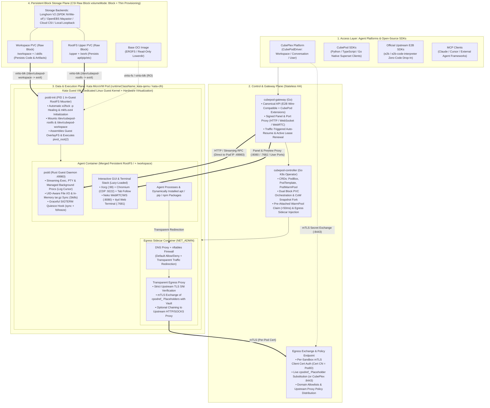
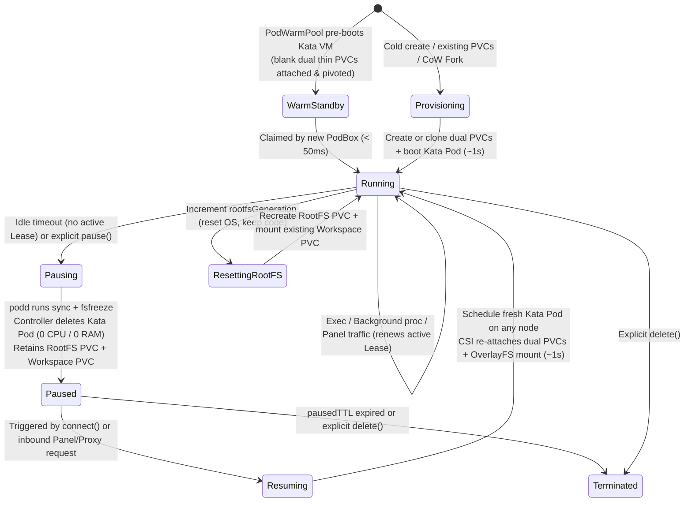

# CubePod Technical Architecture Specification & Blueprint

**English** · [简体中文](architecture_zh.md)

> **Positioning**: **CubePod** is an open-source, cloud-native AI Agent execution platform engineered by the CubePlex team. It combines hardware-isolated **Kata Containers MicroVMs**, **Dual-Volume Persistent Writable RootFS**, and a built-in **Zero-Trust Egress & Secret Vault** to provide persistent, instant-hibernating execution pods for high-autonomy AI agents.
>
> **The Open-Source CubePlex Agent Stack**:
> - [**CubePlex**](https://github.com/cubeplexai/cubeplex): Collaborative Team Agent Workspace Platform (*The Agent Workspace*)
> - [**CubeLoop**](https://github.com/cubeplexai/cubeloop): Async-native multi-model Agent Runtime & Checkpointing Framework (*The Brain / Agent Loop*)
> - **CubePod**: Instant-hibernating, full-system persistent MicroVM execution substrate (*The Body / Execution Pod*)

---

## 1. Background, Pain Points & Core Value Proposition

### 1.1 Operational Context & Industry Pain Points
Modern AI agents—code interpreters, DevOps operators, and autonomous software engineering agents—operate with broad shell privileges. During live sessions, they dynamically install system-level packages (`apt install`, `pip install`, `npm -g`, Rust/C++ toolchains), drive GUI browsers, and call external APIs on behalf of users.

Existing container and sandbox solutions suffer from four fundamental architectural limitations:
1. **Ephemeral RootFS (Only `/workspace` Persists)**: When a sandbox hibernates or a container restarts, system packages installed under `/usr`, `/etc`, and `/var` are discarded. Agents must repeatedly reinstall toolchains on every wakeup, adding minutes of latency and breaking stateful environments.
2. **Heavyweight Snapshot Overhead (VM Memory Snapshots / CRIU / OCI Commit)**:
   - Traditional VM memory snapshots and KEP-5823 (CRIU) capture full process trees and gigabyte-scale memory dumps that are slow to transfer across nodes and tightly coupled to host kernel/CPU features.
   - OCI layer-export approaches (e.g., `OpenSandbox` or `agent-sandbox` `SnapshotProvider`) tar and push container layers to a registry during pause, taking tens of seconds and saturating cluster network bandwidth.
   - **Core Insight**: Modern agent systems follow a **Decoupled Brain & Hand** architecture. Conversation context and reasoning state are already persisted externally by `CubeLoop`; **when a sandbox sleeps, it requires 0% memory state retention and 100% persistent disk state retention**.
3. **Small-File Metadata Bottlenecks on Shared Network Filesystems (NFS / CephFS)**: Backing agent workspaces with shared network filesystems triggers millions of metadata RPC round-trips during `npm install`, `pip install`, or `git status`, degrading I/O latency by an order of magnitude.
4. **Shared-Kernel Escape Risks vs. Plaintext Secret Exposure**: Standard `runc` containers share the host Linux kernel, while injecting real external credentials (e.g., `GITHUB_TOKEN`) into sandbox environment variables exposes plaintext secrets to untrusted LLM-generated code and prompt-injection exfiltration.

### 1.2 Five Core Design Goals
1. **Zero-Export Hibernation & ~1s Cross-Node Resumption**: No image commit or snapshot upload on pause—quiesce the filesystem (`fsfreeze`), delete the Pod (releasing 100% of CPU and RAM), and re-attach volumes on any cluster node in ~1 second upon wakeup.
2. **Decoupled Full RootFS + Workspace Persistence**: Persist all modifications to `/` (`/usr`, `/etc`, `/var`) alongside `/workspace` on two independent block volumes, enabling **independent RootFS resets or base-image upgrades while keeping `/workspace` 100% intact**.
3. **Native Local-Disk I/O & <1s Copy-on-Write Fork**: Deliver bare-metal NVMe speed via SPDK + NVMe-oF raw block volumes (`volumeMode: Block`) passed through `virtio-blk` to native guest `ext4`, with sub-second Copy-on-Write sandbox cloning (`fork`).
4. **Hardware Virtualization + Zero-Trust Egress**: Isolate every sandbox inside a **Kata Containers MicroVM** with a dedicated guest Linux kernel, paired with DNS/`nftables` egress enforcement and mTLS transparent secret substitution (`cpodref_` placeholders—real secrets never enter the sandbox).
5. **Open Ecosystem Compatibility (E2B Superset + K8s Operator + Single-Node Docker)**: Provide 100% wire-compatible drop-in support for upstream **E2B SDKs** and **MCP**, enterprise extensions for CubePlex, and unified execution across production Kubernetes and single-node `docker compose`.

---

## 2. Nomenclature & System Architecture Overview

### 2.1 Unified Nomenclature

| Component / Concept | Name | Description |
| :--- | :--- | :--- |
| **Project & Brand** | **CubePod** | The hardware-isolated hibernation and execution pod for AI agents, forming a cohesive stack alongside `CubePlex` and `CubeLoop`. |
| **Repository & SDK Packages** | `cubepod` | GitHub: `cubeplexai/cubepod`; Python: `pip install cubepod`; TypeScript: `npm install cubepod`. |
| **In-Guest Daemons** | **`podd-init`** & **`podd`** | Rust guest binaries injected at runtime: `podd-init` runs single-threaded as PID 1 to heal/mount block volumes and `pivot_root` into OverlayFS; `podd` serves command, process, PTY, and file sync APIs. |
| **Control-Plane Gateway** | **`cubepod-gateway`** | Stateless high-availability API gateway, E2B protocol router, auto-resume traffic interceptor, and signed HTTP/WebSocket/WebRTC panel proxy. |
| **Kubernetes Operator** | **`cubepod-controller`** | Reconciles sandbox lifecycles, dual raw block PVCs, pre-attached warm pools, CoW snapshots, and in-memory per-pod mTLS egress injection. |
| **Kubernetes CRDs** | `PodBox`, `PodTemplate`, `PodWarmPool` | API Group: `pod.cubeplex.ai/v1alpha1`. |

---

### 2.2 Four-Layer System Architecture



---

## 3. Core Storage & Virtualization Design: Persistent Writable RootFS

CubePod's core architectural principle is **treating the MicroVM Pod as disposable stateless compute while decoupling the RootFS Upper Layer and Workspace into two long-lived, independent CSI Raw Block PVCs**.

### 3.1 Layered Storage View & Dual-Volume Lifecycle Separation

```text
+-------------------------------------------------------------------------------+
|                            Kata MicroVM (Guest Kernel)                        |
|                                                                               |
|   +-----------------------------------------------------------------------+   |
|   |                  Container Merged RootFS (/) [OverlayFS]              |   |
|   |                                   |                                   |   |
|   |                 +-----------------+-----------------+                 |   |
|   |                 | (Read-Only)                       | (Read-Write)    |   |
|   |                 v                                   v                 |   |
|   |        +-----------------+                 +-----------------+        |   |
|   |        |    lowerdir     |                 | upperdir/workdir|        |   |
|   |        |  (Base Image)   |                 |  (Guest ext4)   |        |   |
|   |        +--------+--------+                 +--------+--------+        |   |
|   +-----------------|-----------------------------------|-----------------+   |
|                     |                                   |                     |
|                     |                          +--------+--------+            |
|                     |                          |   /workspace    |            |
|                     |                          |  (Guest ext4)   |            |
|                     |                          +--------+--------+            |
+---------------------|-----------------------------------|---------------------+
                      | (virtio-fs / EROFS)               | (virtio-blk direct)
                      v                                   v
     +----------------------------------+   +-----------------------------------+
     |  Container Base Image (RO)       |   |  2x CSI Raw Block PVCs (Thin)     |
     |  Ubuntu 24.04 + Toolchains       |   |  1. <id>-rootfs-pvc (10Gi Thin)   |
     |  (Node-level shared cache)       |   |  2. <id>-workspace-pvc (20Gi Thin)|
     +----------------------------------+   +-----------------------------------+
```

| Layer | Mount Target | Mode | Backing Mechanism | Independent Lifecycle Semantics |
| :--- | :--- | :--- | :--- | :--- |
| **Base Layer** | `lowerdir` | Read-Only (RO) | OCI Image (`virtio-fs` / EROFS) | Shared base OS and toolchains cached per node. Upgraded seamlessly by swapping the read-only image layer. |
| **Upper Layer** | `upperdir` + `workdir` | Read-Write (RW) | `rootfs-pvc` (`volumeMode: Block`) $\to$ `virtio-blk` $\to$ `ext4` | Captures all deltas to `/usr`, `/etc`, and `/var` (`apt`/`pip`/`npm`). Survives hibernation; **can be independently wiped/recreated on OS corruption or major image upgrades**. |
| **Workspace** | `/workspace` | Read-Write (RW) | `workspace-pvc` (`volumeMode: Block`) $\to$ `virtio-blk` $\to$ `ext4` | Stores user repositories, generated artifacts, and `/workspace/.skills`. **Remains 100% intact even when Upper Layer (`rootfsGeneration`) is reset**. |

### 3.2 Zero Host Intrusion: `podd-init` In-Guest Overlay RootFS Pivot
In standard Kubernetes, a container's initial `/` is prepared on the host by `containerd`, whereas `volumeDevices` (Raw Block PVCs) are mapped into the container *after* the rootfs is created (e.g., `/dev/cubepod-rootfs`).
To achieve persistent block-backed RootFS **without patching Kubelet or deploying custom host-level `containerd` snapshotters**, CubePod performs an **In-Guest RootFS Pivot**:

1. **Pod Bootstrap & Dynamic Binary Injection (Zero User-Image Pollution)**:
   - **`podd-init` and `podd` are never baked into user sandbox images**: users can run any unmodified OCI image (e.g., `ubuntu:24.04` or custom agent images).
   - When creating a Pod, `cubepod-controller` mounts an in-memory `emptyDir` at `/opt/cubepod/bin`, runs a `< 1MB` `podd-installer` `initContainer` (`cubepod-podd`) that copies the statically linked Rust binaries `podd-init` and `podd` into `/opt/cubepod/bin/`, and sets the main container entrypoint to `["/opt/cubepod/bin/podd-init", "/opt/cubepod/bin/podd"]`.
   - Kubernetes attaches `rootfs-pvc` and `workspace-pvc` via `volumeDevices` (`virtio-blk`) inside the Kata Guest VM at `/dev/cubepod-rootfs` and `/dev/cubepod-workspace`.
2. **Single-Threaded `podd-init` (PID 1) Auto-Healing & Mount**:
   - Inspects the `ext4` superblock on both raw block devices: unformatted blank volumes are initialized via `mkfs.ext4` (creating `/upper` and `/work` on the rootfs device and setting `1000:1000` ownership on `/workspace`); dirty journals from unclean shutdowns are repaired in milliseconds via `e2fsck -p`.
   - Assembles native OverlayFS inside the Kata Guest kernel and executes `pivot_root(2)` while bind-mounting `/opt/cubepod` into the new root—allowing `execvp("/opt/cubepod/bin/podd")` without writing infrastructure binaries into the user's persistent `upperdir`:
     ```bash
     mount -t ext4 -o noatime /dev/cubepod-rootfs /mnt/rootfs-upper
     mount -t overlay overlay \
       -o lowerdir=/,upperdir=/mnt/rootfs-upper/upper,workdir=/mnt/rootfs-upper/work \
       /mnt/newroot
     mount -t ext4 -o noatime /dev/cubepod-workspace /mnt/newroot/workspace
     # Migrate /proc, /sys, /dev, /run, /opt/cubepod and K8s-injected /etc/resolv.conf, /etc/hosts
     pivot_root /mnt/newroot /mnt/newroot/.old_root
     exec /opt/cubepod/bin/podd
     ```
3. **Handover to `podd`**: Once `pivot_root` completes, every subsequent command execution, `apt install`, browser session, and web terminal runs atop the persistent raw-block-backed root filesystem.

### 3.3 Runtime & Storage Substrate Specifications
1. **Virtualization Runtime: Kata Containers (`kata-qemu` / `kata-clh` on `containerd`)**
   - Every CubePod sandbox runs inside a dedicated lightweight MicroVM with its own guest Linux kernel.
   - **Required `containerd` Configuration**: Because `podd-init` mounts block devices and calls `pivot_root` inside the guest VM under a privileged container context, the host `containerd` Kata runtime stanza **must** set `privileged_without_host_devices = true` (automated by CubePod's Helm/node bootstrap scripts) to prevent host device passthrough collisions (`/dev/full: EEXIST`). Hardware virtualization (`/dev/kvm`, or nested KVM in cloud VMs) is required on x86_64/ARM64 hosts.
2. **Distributed Block Storage Engine: Longhorn V2 (SPDK) / OpenEBS Mayastor**
   - Replaces legacy kernel iSCSI and NFS with **SPDK + NVMe-oF** raw block storage.
   - **Thin Provisioning**: Provisioning `10Gi` RootFS + `20Gi` Workspace per sandbox consumes only actual written blocks (e.g., `100MB` on disk if `100MB` is dirtied).
   - **Copy-on-Write Snapshots & Clones**: Zero-copy CSI volume clones power CubePod's **<1s sandbox branching (`fork`)**.
   - **Cloud & Local Parity**: Runs over bare-metal NVMe SSDs, cloud block disks (AWS EBS / Alibaba Cloud ESSD), or sparse host loopback `ext4` files (`deploy/compose`) in single-node Docker mode without changing upper-layer APIs.

---

## 4. API Contract Design: E2B-Compatible Superset

To maximize ecosystem interoperability while eliminating legacy sandbox bottlenecks, CubePod exposes an **E2B Wire-Compatible API + Enterprise Superset Extensions** as its canonical contract.

### 4.1 Why an E2B Superset?
- **Zero-Code Ecosystem Adoption**: Existing agent frameworks (LangChain, LlamaIndex, OpenHands, AutoGen, Smolagents) connect to CubePod simply by pointing `E2B_DOMAIN` to `cubepod-gateway` using unmodified official `e2b` and `e2b-code-interpreter` SDKs.
- **Clean Wake-on-Connect Semantics**: E2B's `Sandbox.connect(id)` natively specifies automatic resumption when a sandbox is `Paused`, aligning directly with on-demand agent session lifecycles and non-root `user` file operations.

### 4.2 Core API Matrix (Base E2B Compatibility + CubePod Extensions)

| Domain | Standard E2B-Compatible Surface (Control Plane & `podd`) | CubePod Enterprise Extensions | Architectural Payoff |
| :--- | :--- | :--- | :--- |
| **1. Lifecycle Management** | • `POST /sandboxes` (create)<br/>• `GET /sandboxes/{id}` (inspect)<br/>• `POST /sandboxes/{id}/pause` (hibernate)<br/>• `POST /sandboxes/{id}/connect` (connect / auto-resume)<br/>• `POST /sandboxes/{id}/timeout` (extend TTL)<br/>• `DELETE /sandboxes/{id}` (destroy) | • **Dual-Volume Persistence Controls**: Deterministic `volume_key` binding; clean separation between `pause` (delete Pod, retain both PVCs) and `reset_rootfs` (recreate OS upper layer, preserve `/workspace`).<br/>• **Instant CoW Clone**: `POST /sandboxes/{id}/fork` (<1s CSI block clone of both RootFS and Workspace).<br/>• **Active Leases**: `POST /sandboxes/{id}/lease` prevents mid-task idle reaping. | Eliminates lost system dependencies, enables one-click OS recovery without data loss, and unlocks parallel sub-agent sandbox branching. |
| **2. Command & Process Execution (`podd`)** | • Real-time foreground streaming (`stdout`/`stderr` chunks flushed with zero artificial delay)<br/>• Managed background processes (`background=true`), process listing, process-group `kill`, and interactive PTY | • **Stateless Byte-Offset Log Cursors**: `GET /commands/{pid}/logs?cursor={byte_offset}` backed by persistent ring buffers under `/run/podd/procs/`, allowing any gateway or agent worker replica to resume log streaming after reconnects. | Eliminates SSE buffering workarounds and supports stateless HA background task coordinators. |
| **3. Filesystem & Archive Sync (`podd`)** | • `GET/PUT /files` with native `user="cubeplex"` (`1000:1000`) ownership<br/>• Directory listing, `mkdir`, and recursive filesystem `watch` | • **Atomic Skill Archive Sync**: `POST /files/archive-sync` streams a `tar.gz` payload unpacked in-memory with target `uid:gid` ownership (e.g., `/workspace/.skills`) while atomically pruning `remove_paths` in one `<50ms` call. | Eliminates follow-up `chown` shell round-trips and collapses N-file skill syncs into a single atomic HTTP request. |
| **4. Interactive Desktop & Panel Proxy** | • `get_host(port)`: subdomain routing (`<port>-<id>.<domain>`) | • **HMAC/JWT-Signed Path Reverse Proxy**: `GET/WS /sandboxes/{id}/proxy/{port}/{path}` and `/panel/{token}/{path}` with full-duplex HTTP, WebSocket, and WebRTC transport.<br/>• **Lazy Desktop Activation**: `POST /sandboxes/{id}/desktop/start` idempotently launches Xorg + Chromium CDP (`:9222`) + Neko (`:8080`) + `ttyd` (`:7681`). | Avoids dynamic host-port collisions and enables live human-in-the-loop browser takeover and web terminal access. |
| **5. Zero-Trust Network & Secret Vault** | *(Not available in upstream E2B)* | • **Declarative Network Policy**: `network_policy` (`Allow`/`Deny` default action, wildcard host rules, optional `upstream_proxy`).<br/>• **Opaque Secret Brokering**: `secret_bindings` inject `cpodref_...` placeholders into the guest; the egress sidecar verifies TLS SNI and exchanges placeholders over per-pod mTLS only for `allowedHosts`. | Keeps real API credentials out of sandbox memory/env and replaces fragile external `MutatingAdmissionWebhook` setups. |

---

## 5. Kubernetes Orchestration: Custom `cubepod-controller` Operator

At the Kubernetes control-plane layer, CubePod aligns conceptually with `kubernetes-sigs/agent-sandbox` (`PodTemplate` + `PodWarmPool` + `PodBox`), implemented via a purpose-built Go `kubebuilder` operator.

### 5.1 Why a Custom Operator Instead of Upstream `agent-sandbox`?
1. **Independent Lifecycle of Dual `volumeMode: Block` PVCs**: CubePod manages `rootfs-pvc` and `workspace-pvc` via raw `volumeDevices` (rather than filesystem `volumeMounts`) and supports destroying/recreating `rootfs-pvc` (`rootfsGeneration++`) while preserving `workspace-pvc`—semantics that standard `volumeClaimTemplates` cannot express.
2. **Pre-Attached Block `PodWarmPool` Bypassing Pod Volume Immutability**:
   - Kubernetes forbids mutating `spec.volumes` / `spec.volumeDevices` on a running Pod, preventing generic warm pools from dynamically attaching fresh block PVCs at claim time.
   - **CubePod's `PodWarmPool` Solution**: Each standby Kata MicroVM boots with two blank, thin-provisioned block PVCs (0 physical bytes consumed) already attached, `mkfs.ext4`-formatted, and `pivot_root`-mounted by `podd-init`. When a new sandbox is requested, `cubepod-controller` transfers ownership of the warm Pod and its two PVCs via label and `ownerReference` updates—achieving **`< 50ms` cold-start claims**.
3. **Webhook-Free Egress Sidecar & Per-Pod mTLS Provisioning**:
   - During Pod construction, `cubepod-controller` mints an ephemeral per-sandbox mTLS client certificate (`CN = <pod_id>`) in memory and injects the `cubepod-egress` sidecar and CA trust bundle directly into the Pod spec—eliminating `MutatingAdmissionWebhook` operational complexity.

### 5.2 Core CRD Specifications (`pod.cubeplex.ai/v1alpha1`)

```yaml
# 1. Sandbox Blueprint (PodTemplate)
apiVersion: pod.cubeplex.ai/v1alpha1
kind: PodTemplate
metadata:
  name: cubeplex-ubuntu24-desktop
spec:
  runtimeClassName: kata-qemu
  image: ghcr.io/cubeplexai/cubepod-runtime:ubuntu24-desktop
  resources:
    cpuRequest: "200m"
    cpuLimit: "2"
    memoryRequest: "512Mi"
    memoryLimit: "4Gi"
  storage:
    storageClassName: longhorn-v2-block-thin
    rootfsSize: 10Gi
    workspaceSize: 20Gi
  egress:
    enabled: true
    exchangeUrl: "https://cubepod-gateway.cubepod-system.svc:8443/v1/egress/exchange"
---
# 2. Pre-Attached Standby Pool (PodWarmPool)
apiVersion: pod.cubeplex.ai/v1alpha1
kind: PodWarmPool
metadata:
  name: default-warm-pool
spec:
  templateRef: cubeplex-ubuntu24-desktop
  replicas: 3  # Maintains 3 booted Kata VMs with pre-formatted & pivoted dual thin block PVCs
---
# 3. Sandbox Instance (PodBox)
apiVersion: pod.cubeplex.ai/v1alpha1
kind: PodBox
metadata:
  name: cpod-ws-01-user-99
  namespace: cubepod-workloads
spec:
  templateRef: cubeplex-ubuntu24-desktop
  warmPoolRef: default-warm-pool
  desiredState: Running                 # Running | Paused (Paused deletes Pod for 0 CPU/RAM, retains both PVCs)
  rootfsGeneration: 1                   # Increment to re-image OS (/upper) while preserving /workspace intact
  forkFrom:                             # Optional: <1s Copy-on-Write clone of both block PVCs from a parent PodBox
    podBoxName: ""
  lifecycle:
    idleTimeoutSeconds: 1800
    pausedTTLSeconds: 604800
    leaseExpiresAt: "2026-11-10T20:00:00Z"
  networkPolicy:
    defaultAction: Deny
    allowHosts: ["*.github.com", "pypi.org", "files.pythonhosted.org"]
    upstreamProxy: "http://proxy.infra.svc:7890"
```

### 5.3 Sandbox Lifecycle State Machine



---

## 6. Seamless Integration with [CubePlex](https://github.com/cubeplexai/cubeplex)

CubePlex's sandbox abstraction layer (`backend/cubeplex/sandbox/base.py`) isolates execution providers behind a clean driver interface:

1. **Native `CubePodDriver` (`backend/cubeplex/sandbox/cubepod.py`)**:
   - Implements `execute`, `start`, `poll`, `read_output`, `kill`, `upload`, `download`, `pause`, `connect_or_resume`, `get_browser_endpoint`, and `get_terminal_endpoint` directly against `cubepod-gateway`'s E2B superset API—removing legacy SSE buffering patches and post-upload `chown` invocations.
2. **Direct `:8443` mTLS Egress Vault Interoperability**:
   - `cubepod-controller` signs per-sandbox client certificates (`CN = <pod_id>`) trusted by the Egress Vault CA, allowing the in-pod Egress Sidecar to exchange `cpodref_` placeholders against either `cubepod-gateway` or CubePlex's internal `/api/v1/internal/egress/exchange` endpoint without changing upstream secret storage logic.
3. **Workspace-Level Capabilities Unlocked**:
   - One-click **"Reset System Environment (Keep `/workspace` Files)"** via `rootfsGeneration` increment.
   - Sub-50ms atomic skill synchronization via `POST /files/archive-sync`.
   - Sub-second isolated sandbox cloning (`fork`) for parallel sub-agent rollouts and conversation branching.

---

## 7. Repository Structure & Engineering Roadmap

### 7.1 `cubepod` Repository Layout

```text
cubepod/
├── docs/
│   ├── architecture.md         # Platform architecture specification & blueprint (English)
│   ├── architecture_zh.md      # Platform architecture specification & blueprint (Chinese)
│   └── enhancements/           # CubePod Enhancement Proposals (CEPs)
├── api/
│   ├── v1alpha1/               # Kubernetes CRD Go types (PodBox, PodTemplate, PodWarmPool)
│   └── openapi/                # Canonical E2B-superset OpenAPI 3.1 specification
├── crates/                     # Rust workspace (in-guest low-footprint components)
│   ├── podd-init/              # Single-threaded PID 1 mounter (e2fsck/mkfs.ext4 + OverlayFS pivot_root)
│   └── podd/                   # In-guest execution, PTY, cursor-log, and tar.gz sync daemon
├── cmd/                        # Go control-plane binaries & CLI entrypoints
│   ├── cubepod-controller/     # Kubernetes Operator entrypoint
│   ├── cubepod-gateway/        # Unified API server, local Docker driver, and Panel HTTP/WS/WebRTC proxy
│   ├── cubepod-egress/         # Zero-Trust mTLS cpodref_ secret exchange & egress proxy sidecar
│   └── cubepod/                # Official Go CLI
├── pkg/
│   ├── controller/             # Reconcilers (PodBox, WarmPool, PVC & Snapshot, mTLS Cert Minter)
│   ├── gateway/                # E2B router, Lease manager, Auto-Resume interceptor, Panel proxy
│   ├── egress/                 # DNS/nftables filtering and mTLS Secret Vault substitution
│   └── dockerprovider/         # Sparse loopback ext4 runtime for single-node Docker Compose
├── images/
│   ├── podd/                   # Runtime-injected static podd-init + podd init image (< 1MB)
│   ├── base/                   # Ubuntu 24.04 + Python/Node base workload image
│   ├── desktop/                # Lazy-loaded Xorg + Neko WebRTC + Chromium CDP + ttyd image
│   └── egress/                 # DNS + nftables + transparent mTLS proxy sidecar image
├── deploy/
│   ├── helm/cubepod/           # Production Helm chart
│   └── compose/                # Single-node local Docker Compose stack
└── sdks/
    ├── python/                 # Official Python Sync & Async SDK (`cubepod`)
    └── typescript/             # Official TypeScript/JavaScript SDK (`cubepod`)
```

---

### 7.2 Four-Phase Delivery Roadmap

#### Phase 1: `podd-init` + Kata + Dual-Block OverlayFS Core Prototype
* **Objective**: Validate host-unmodified in-guest OverlayFS `pivot_root` and instant pause/resume persistence on single-node Kubernetes + `containerd` + Kata Containers.
* **Deliverables**:
  1. Single-threaded Rust `podd-init` detecting `/dev/cubepod-rootfs` and `/dev/cubepod-workspace`, running `e2fsck -p` / `mkfs.ext4`, assembling OverlayFS, and executing `pivot_root(2)`.
  2. End-to-end verification: run `apt install -y htop` and write files under `/workspace` inside Kata $\to$ delete Pod $\to$ boot fresh Pod re-attaching the block volumes $\to$ confirm both `htop` and `/workspace` files survive in ~1 second.

#### Phase 2: `podd` Daemon + Distributed SPDK Block Storage Integration
* **Objective**: Complete the in-guest execution daemon and cross-node raw block mobility.
* **Deliverables**:
  1. `podd` core APIs: streaming execution, managed background processes with byte-offset `cursor` logs, UID/GID-aware file I/O, in-memory `tar.gz` archive sync, and graceful `SIGTERM` `sync + fsfreeze`.
  2. Multi-node Kubernetes + Longhorn V2 (SPDK) validation covering thin-provisioned disk usage, `< 1.5s` cross-node Pod reschedule mount latency, and `< 1s` CSI Copy-on-Write volume cloning.

#### Phase 3: `cubepod-controller` + `cubepod-gateway` + Built-In Zero-Trust Egress
* **Objective**: Deliver the Kubernetes Operator, pre-attached `PodWarmPool`, stateless HA gateway, zero-trust egress loop, and local Docker loopback parity.
* **Deliverables**:
  1. `PodBox`, `PodTemplate`, and `PodWarmPool` controllers with `< 50ms` pre-attached volume claiming and in-memory per-pod mTLS certificate injection.
  2. `cubepod-gateway` exposing the E2B-compatible superset API, traffic-triggered auto-resume, signed Panel HTTP/WS/WebRTC reverse proxy, and sparse loopback `ext4` Docker provider.

#### Phase 4: Production Cutover & Open-Source Release
* **Objective**: Ship `CubePodDriver` in production for CubePlex and publish full open-source artifacts, SDKs, Helm charts, and bilingual documentation.
* **Deliverables**:
  1. Full E2E verification across command streaming, background tasks, atomic skill sync, Chromium/Neko WebRTC takeover, `ttyd` web terminal, and `:8443` mTLS secret substitution.
  2. Public benchmark suites, official E2B SDK compatibility gates, and English/Chinese documentation site (`cubepod.dev`).
