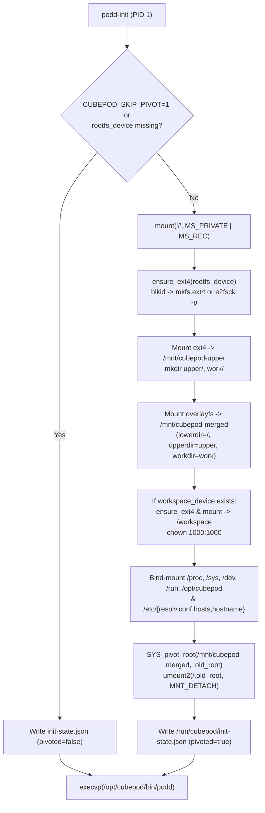

# CEP-0001: In-Guest Persistent OverlayFS Pivot and Loopback Verification (`podd-init`)

| Field | Value |
| :--- | :--- |
| **CEP Number** | `0001` |
| **Status** | `implementable` (`alpha`) |
| **Owning Area** | `runtime` |
| **Authors** | @xfgong |
| **Created** | 2026-11-10 |
| **Last Updated** | 2026-11-10 |

<!-- toc -->
- [Release Signoff Checklist](#release-signoff-checklist)
- [Summary](#summary)
- [Motivation](#motivation)
  - [Goals](#goals)
  - [Non-Goals](#non-goals)
- [Proposal](#proposal)
  - [User Stories](#user-stories)
  - [Notes / Constraints / Caveats](#notes--constraints--caveats)
  - [Risks and Mitigations](#risks-and-mitigations)
- [Design Details](#design-details)
  - [API / CRD / Wire Changes](#api--crd--wire-changes)
  - [Architecture & State Machine](#architecture--state-machine)
  - [Dual-Runtime Behavior (K8s Kata vs. Local Docker)](#dual-runtime-behavior-k8s-kata-vs-local-docker)
  - [Test Plan](#test-plan)
  - [Graduation Criteria](#graduation-criteria)
  - [Upgrade / Downgrade Strategy](#upgrade--downgrade-strategy)
- [Production Readiness Review Questionnaire (PRR)](#production-readiness-review-questionnaire-prr)
- [Implementation History](#implementation-history)
- [Drawbacks](#drawbacks)
- [Alternatives](#alternatives)
<!-- /toc -->

---

## Release Signoff Checklist

- [x] Enhancement scope, Goals, and Non-Goals are agreed upon (`provisional` -> `implementable`)
- [x] API / CRD (`pod.cubeplex.ai/v1alpha1`) and E2B-superset OpenAPI changes are specified
- [x] Dual-runtime behavior (Kubernetes Kata + CSI Block AND Local Docker Loopback) is defined
- [x] Security boundary (MicroVM isolation, UID/GID privilege separation, Egress secret safety) is reviewed
- [x] Test plan includes unit tests (`cargo test` / `go test`) and real invariant E2E tests
- [x] Production Readiness Review (PRR) section is complete

---

## Summary

`podd-init` is the single-threaded, zero-GC Rust PID 1 entrypoint injected at runtime into `/opt/cubepod/bin/podd-init` inside every CubePod sandbox container. Before handing execution over to `/opt/cubepod/bin/podd`, `podd-init` inspects the attached RootFS Upper block device (`/dev/cubepod-rootfs`) and Workspace block device (`/dev/cubepod-workspace`), auto-heals (`e2fsck -p`) or formats (`mkfs.ext4`) them, constructs a persistent `OverlayFS` merging the read-only Base Image (`/`) with the persistent `upperdir`/`workdir`, mounts `/workspace` with unprivileged ownership (`1000:1000`), bind-mounts `/opt/cubepod` so runtime binaries do not pollute the persistent upper layer, and performs `pivot_root(2)`.

---

## Motivation

Standard Kubernetes and Kata Containers prepare the container's `/` on the host via `containerd` snapshotters, while CSI `volumeMode: Block` PVCs (`volumeDevices`) are attached at `/dev/cubepod-*` after the initial rootfs is already mounted. Without an in-guest root pivot mechanism, preserving system-wide package installations (`apt`, `pip`, `/etc`) across Pod deletion requires either custom host `containerd` plugins or heavy OCI image snapshot exports.

### Goals

- Provide a production-grade, single-threaded Rust `podd-init` binary (`crates/podd-init`) with zero external crate dependencies beyond `libc`.
- Support configurable paths (`CUBEPOD_ROOTFS_DEV`, `CUBEPOD_WORKSPACE_DEV`, `CUBEPOD_LOWER_DIR`, `CUBEPOD_UPPER_MOUNT`, `CUBEPOD_MERGED_ROOT`, `CUBEPOD_UID`, `CUBEPOD_GID`, `CUBEPOD_DRY_RUN`) so every step of the mount/pivot pipeline can be unit-tested and integration-tested both with real ext4 loopback images and in unprivileged CI environments.
- Write a state marker file (`/run/cubepod/init-state.json`) recording whether `rootfs` and `workspace` devices were freshly formatted, auto-healed, or skipped, and the elapsed boot duration in milliseconds.
- Ensure `/opt/cubepod` is bind-mounted across `pivot_root` so injected binaries remain accessible without writing to the user's persistent `upperdir`.

### Non-Goals

- Modifying host `containerd` or Kubelet CRI code.
- Managing network firewall (`nftables`) rules inside `podd-init` (handled by the Egress sidecar).

---

## Proposal

### User Stories

#### Story 1: Persistent `apt` and `pip` Packages Across Suspend/Resume
As a CubePlex agent user, when my agent runs `apt-get install -y jq` and `/workspace` edits, and my sandbox is paused (Pod deleted) and later resumed on a different node, `podd-init` mounts the existing `rootfs-pvc` and `workspace-pvc` in `< 200ms` so `jq` and `/workspace` files are immediately present.

#### Story 2: Independent RootFS Reset Preserving `/workspace`
As a CubePlex user, when my system environment breaks and I click "Reset System Environment", the controller attaches a fresh `rootfs-pvc` while keeping my existing `workspace-pvc`. `podd-init` formats only the new `rootfs-pvc` with `mkfs.ext4` and mounts my existing `workspace-pvc` untouched.

### Notes / Constraints / Caveats

- `podd-init` MUST remain single-threaded prior to `pivot_root(2)` because Linux returns `EINVAL` if `pivot_root` is called from a multi-threaded process or if the mount propagation of `/` is shared (`MS_SHARED`). Therefore, `podd-init` MUST first set `/` mount propagation to `MS_PRIVATE | MS_REC` before mounting and pivoting.

### Risks and Mitigations

| Risk | Impact | Likelihood | Mitigation |
| :--- | :--- | :--- | :--- |
| Unclean VM termination leaves ext4 journal dirty | High | Med | `ensure_ext4` runs `e2fsck -p` on every boot and treats exit codes `0`, `1`, and `2` as clean/healed. |
| `pivot_root` fails with `EINVAL` due to `MS_SHARED` propagation on `/` | High | High | Explicitly call `libc::mount(null, "/", null, MS_PRIVATE \| MS_REC, null)` before assembling mounts. |
| `podd` binary lost after `pivot_root` because `/opt/cubepod` was mounted on old root | High | High | Bind-mount `/opt/cubepod` into `<merged_root>/opt/cubepod` before `pivot_root`. |

---

## Design Details

### API / CRD / Wire Changes

`podd-init` writes `/run/cubepod/init-state.json` (or `CUBEPOD_INIT_STATE_PATH`) after completing setup:

```json
{
  "pivoted": true,
  "rootfs_device": "/dev/cubepod-rootfs",
  "rootfs_action": "mounted",
  "workspace_device": "/dev/cubepod-workspace",
  "workspace_action": "mounted",
  "duration_ms": 42
}
```

### Architecture & State Machine



### Dual-Runtime Behavior (K8s Kata vs. Local Docker)

- **Kubernetes Production (`Kata + CSI Raw Block`)**: K8s attaches two `volumeMode: Block` PVCs at `/dev/cubepod-rootfs` and `/dev/cubepod-workspace`. `podd-init` formats/heals and pivots inside the Kata Guest VM kernel.
- **Local Development (`Docker + Loopback ext4`)**: `cubepod-gateway` / local runner creates sparse `.img` files formatted with `mkfs.ext4` (or loop devices / bind mounts) and passes them into the container. When no block device is attached, `podd-init` gracefully records `pivoted: false` and execs `podd`.

### Test Plan

- **Unit Tests (`cargo test -p podd-init`)**:
  - Config parsing from environment variables (`CUBEPOD_ROOTFS_DEV`, `CUBEPOD_WORKSPACE_DEV`, `CUBEPOD_UID`, `CUBEPOD_GID`, `CUBEPOD_INIT_STATE_PATH`).
  - Graceful fallback when block devices are absent or `CUBEPOD_SKIP_PIVOT=1` is set, verifying `init-state.json` is written accurately.
  - Overlay option string formatting and directory layout preparation (`upper`, `work`, `merged`, `workspace`) in a temporary directory using dry-run / mockable command runner.
  - Real `mkfs.ext4` + `blkid` + `e2fsck -p` test against a temporary sparse file (`truncate` / `set_len(64 * 1024 * 1024)`) verifying `ensure_ext4` formats an unformatted image file and subsequently detects and validates the `ext4` signature on the second run!

### Graduation Criteria

- **Alpha (`v0.1`)**: All unit tests and real sparse-file `ext4` formatting/healing tests pass via `cargo test -p podd-init` and `cargo clippy --workspace -- -D warnings`.

### Upgrade / Downgrade Strategy

`podd-init` is injected via `cubepod-podd` `initContainer` at Pod creation time. Upgrading `cubepod-podd` takes effect on the next Pod resume/start without touching data on `rootfs-pvc` or `workspace-pvc`.

---

## Production Readiness Review Questionnaire (PRR)

### Feature Enablement and Rollback
- Set `CUBEPOD_SKIP_PIVOT=1` on the container environment to bypass `pivot_root` immediately without deleting PVCs.

### Monitoring Requirements
- `/run/cubepod/init-state.json` exposes boot duration (`duration_ms`) and volume actions (`formatted` | `healed` | `mounted` | `skipped`), which `podd` serves on `GET /health`.

### Dependencies
- Requires `e2fsprogs` (`blkid`, `mkfs.ext4`, `e2fsck`) and `util-linux` (`mount`) in the guest environment.

### Troubleshooting
- If `podd-init` fails, container logs on stderr show `[podd-init] fatal error: ...` with the exact command and exit status.

---

## Implementation History

- `2026-11-10`: CEP-0001 drafted and marked `implementable` for `v0.1`.

---

## Drawbacks

- Requires the guest container inside the Kata VM to have `CAP_SYS_ADMIN` (or `privileged_without_host_devices = true` in Kata) to execute `mount` and `pivot_root`.

---

## Alternatives

### Alternative 1: Custom Host `containerd` Block Snapshotter
- **Description**: Write a custom `containerd` snapshotter plugin installed on every Kubernetes worker node.
- **Reason for Rejection**: High operational friction; breaks standard managed Kubernetes installations and cannot be deployed via a simple Helm chart.
