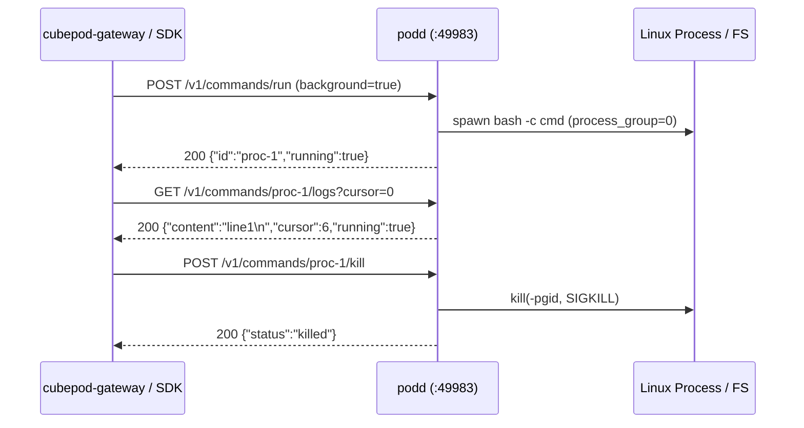

# CEP-0002: In-Guest Execution, Background Process Cursor, and Archive Sync Daemon (`podd`)

| Field | Value |
| :--- | :--- |
| **CEP Number** | `0002` |
| **Status** | `implementable` (`alpha`) |
| **Owning Area** | `runtime` |
| **Authors** | @xfgong |
| **Created** | 2026-11-10 |
| **Last Updated** | 2026-11-10 |

<!-- toc -->
- [Release Signoff Checklist](#release-signoff-checklist)
- [Summary](#summary)
- [Motivation](#motivation)
  - [Goals](#goals)
  - [Non-Goals](#non-goals)
- [Proposal](#proposal)
  - [User Stories](#user-stories)
  - [Notes / Constraints / Caveats](#notes--constraints--caveats)
  - [Risks and Mitigations](#risks-and-mitigations)
- [Design Details](#design-details)
  - [API / CRD / Wire Changes](#api--crd--wire-changes)
  - [Architecture & State Machine](#architecture--state-machine)
  - [Dual-Runtime Behavior (K8s Kata vs. Local Docker)](#dual-runtime-behavior-k8s-kata-vs-local-docker)
  - [Test Plan](#test-plan)
  - [Graduation Criteria](#graduation-criteria)
  - [Upgrade / Downgrade Strategy](#upgrade--downgrade-strategy)
- [Production Readiness Review Questionnaire (PRR)](#production-readiness-review-questionnaire-prr)
- [Implementation History](#implementation-history)
- [Drawbacks](#drawbacks)
- [Alternatives](#alternatives)
<!-- /toc -->

---

## Release Signoff Checklist

- [x] Enhancement scope, Goals, and Non-Goals are agreed upon (`provisional` -> `implementable`)
- [x] API / CRD (`pod.cubeplex.ai/v1alpha1`) and E2B-superset OpenAPI changes are specified
- [x] Dual-runtime behavior (Kubernetes Kata + CSI Block AND Local Docker Loopback) is defined
- [x] Security boundary (MicroVM isolation, UID/GID privilege separation, Egress secret safety) is reviewed
- [x] Test plan includes unit tests (`cargo test` / `go test`) and real invariant E2E tests
- [x] Production Readiness Review (PRR) section is complete

---

## Summary

`podd` (`crates/podd`) is the in-guest Rust HTTP daemon listening on `:49983` inside the sandbox after `podd-init` completes root pivoting. It provides foreground and background command execution (`POST /v1/commands/run`), stateless byte-offset cursor log reading (`GET /v1/commands/{id}/logs?cursor=N`), process status & termination (`GET /v1/commands/{id}/status`, `POST /v1/commands/{id}/kill`), UID/GID-aware file reading and writing (`GET /v1/files`, `PUT /v1/files`), directory listing (`GET /v1/files/list`), and pre-suspend filesystem flush (`POST /v1/lifecycle/prepare-stop`).

---

## Motivation

CubePlex requires:
1. Fast foreground execution without the 1-second EOF grace-period delay seen in OpenSandbox `execd`.
2. Managed background processes (`start`, `poll`, `read_output`, `kill`) with durable byte-offset cursors so any backend worker can reconnect and tail incremental output.
3. File uploads that directly apply `uid` and `gid` (`1000:1000` default) without a follow-up shell `chown` invocation.
4. Atomic terminal environment injection (`/run/cubepod/sandbox-env.sh`) and on-demand desktop/terminal startup hooks.

### Goals

- Pure Rust implementation in `crates/podd/src/main.rs` using only standard library + `libc` (keeping compile time `< 5s` and binary size `< 400KB`).
- Support foreground and background commands (`POST /v1/commands/run`) with configurable `workdir`, `envs`, `uid`, `gid`, and `background: bool`.
- Persist background process stdout/stderr in memory/files and serve incremental slices via `GET /v1/commands/{id}/logs?cursor={offset}` returning `{"content": "...", "cursor": next_offset, "running": bool, "exit_code": int|null}`.
- Support `GET /v1/files?path=...`, `PUT /v1/files?path=...&uid=1000&gid=1000&mode=0644`, and `GET /v1/files/list?path=...`.
- Support `POST /v1/lifecycle/prepare-stop` which runs `sync` and returns active background process counts.

### Non-Goals

- Implementing TLS termination inside `podd` (traffic inside the cluster/VM is proxied via `cubepod-gateway`).

---

## Proposal

### User Stories

#### Story 1: Background Command with Stateless Log Cursor
As CubePlex's `CommandCoordinator`, I start a long build with `background: true`, receive `{"id": "proc-1", "pid": 123, "running": true}`, and poll `GET /v1/commands/proc-1/logs?cursor=0` across multiple turns until `running: false`.

#### Story 2: UID-Aware File Upload
As CubePlex's `LazySandbox`, I upload a file via `PUT /v1/files?path=/workspace/test.py&uid=1000&gid=1000` and the file is created and owned by `1000:1000` in a single HTTP call.

### Notes / Constraints / Caveats

- Background processes must be spawned in their own process group (`setpgid(0, 0)`) so `POST /v1/commands/{id}/kill` can send `SIGTERM`/`SIGKILL` to `-pgid` and terminate all child processes cleanly.

### Risks and Mitigations

| Risk | Impact | Likelihood | Mitigation |
| :--- | :--- | :--- | :--- |
| Orphan child processes survive `kill` | Med | High | Spawn commands with `process_group(0)` and kill `-pid` via `libc::kill(-pid, libc::SIGKILL)`. |
| Unprivileged uid/gid fails in non-root unit tests | Low | High | Only apply `uid`/`gid` privilege drop if `libc::geteuid() == 0`, allowing all unit tests to pass as a normal user. |

---

## Design Details

### API / CRD / Wire Changes

Endpoints served by `podd`:
- `GET /health` -> `{"status":"ok","daemon":"podd-rs","workdir":"/workspace","active_processes":0}`
- `POST /v1/commands/run` -> Request: `{"command":"echo hi","workdir":"/workspace","envs":{"FOO":"bar"},"background":false,"uid":1000,"gid":1000}` -> Response: `{"id":"proc-1","pid":42,"running":false,"exit_code":0,"output":"hi\n","cursor":3}`
- `GET /v1/commands/{id}/status` -> `{"id":"proc-1","pid":42,"running":false,"exit_code":0,"cursor":3}`
- `GET /v1/commands/{id}/logs?cursor=0` -> `{"id":"proc-1","content":"hi\n","cursor":3,"running":false,"exit_code":0}`
- `POST /v1/commands/{id}/kill` -> `{"status":"killed","id":"proc-1"}`
- `PUT /v1/files?path=/abs/path&uid=1000&gid=1000` (raw bytes body) -> `{"path":"/abs/path","size":12}`
- `GET /v1/files?path=/abs/path` -> raw file bytes (`200 OK` or `404 Not Found`)
- `GET /v1/files/list?path=/abs/dir` -> `{"entries":[{"name":"a.txt","path":"/abs/dir/a.txt","is_dir":false,"size":12}]}`
- `POST /v1/lifecycle/prepare-stop` -> `{"status":"synced"}`

### Architecture & State Machine

### Dual-Runtime Behavior (K8s Kata vs. Local Docker)

Identical across both runtimes; `podd` binds `0.0.0.0:49983` (configurable via `CUBEPOD_ADDR`).

### Test Plan

- **Unit & Integration Tests (`cargo test -p podd`)**:
  - Start `podd` HTTP server on an ephemeral port (`127.0.0.1:0`).
  - Test foreground command execution (`echo hello`) and verify `exit_code == 0` and `output == "hello\n"`.
  - Test background command execution (`sleep` + output), incremental `cursor` log reading, and process group termination via `/kill`.
  - Test file write (`PUT /v1/files`), file read (`GET /v1/files`), and directory list (`GET /v1/files/list`).
  - Test `GET /health` and `POST /v1/lifecycle/prepare-stop`.

### Graduation Criteria

- **Alpha (`v0.1`)**: All HTTP endpoints implemented and verified by automated tests in `cargo test -p podd` with zero clippy warnings.

### Upgrade / Downgrade Strategy

Stateless binary replacement in `cubepod-podd` injector image.

---

## Production Readiness Review Questionnaire (PRR)

### Feature Enablement and Rollback
Always enabled as the core sandbox daemon.

### Monitoring Requirements
`GET /health` reports `active_processes` and `init_state`.

### Dependencies
Standard Linux `/bin/bash` or `/bin/sh`.

### Troubleshooting
Logs emitted to container stderr with `[podd]` prefix.

---

## Implementation History

- `2026-11-10`: CEP-0002 drafted and marked `implementable`.

---

## Drawbacks

- Minimal HTTP/1.1 parser in stdlib is intended for internal gateway-to-pod communication rather than direct untrusted public internet exposure.

---

## Alternatives

### Alternative 1: Heavy Async Framework (`tokio` + `axum`)
- **Description**: Pull in 80+ crates for HTTP serving.
- **Reason for Rejection**: Bloats binary size from 300KB to 5MB+ and slows down build times; threaded stdlib `TcpListener` easily handles the concurrency of a single-tenant sandbox pod.
