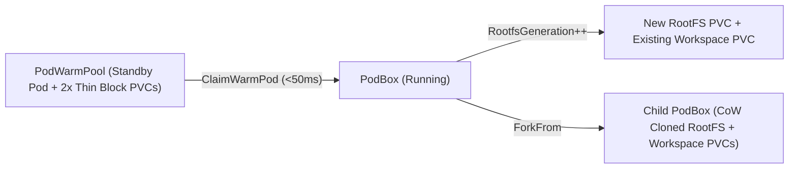

# CEP-0003: Dual-Block-PVC, Pre-Attached WarmPool, and CoW Fork Kubernetes Operator (`cubepod-controller`)

| Field | Value |
| :--- | :--- |
| **CEP Number** | `0003` |
| **Status** | `implemented` (`alpha`) |
| **Owning Area** | `controller` |
| **Authors** | @xfgong |
| **Created** | 2026-11-10 |
| **Last Updated** | 2026-11-10 |

<!-- toc -->
- [Release Signoff Checklist](#release-signoff-checklist)
- [Summary](#summary)
- [Motivation](#motivation)
  - [Goals](#goals)
  - [Non-Goals](#non-goals)
- [Proposal](#proposal)
  - [User Stories](#user-stories)
  - [Notes / Constraints / Caveats](#notes--constraints--caveats)
  - [Risks and Mitigations](#risks-and-mitigations)
- [Design Details](#design-details)
  - [API / CRD / Wire Changes](#api--crd--wire-changes)
  - [Architecture & State Machine](#architecture--state-machine)
  - [Dual-Runtime Behavior (K8s Kata vs. Local Docker)](#dual-runtime-behavior-k8s-kata-vs-local-docker)
  - [Test Plan](#test-plan)
  - [Graduation Criteria](#graduation-criteria)
  - [Upgrade / Downgrade Strategy](#upgrade--downgrade-strategy)
- [Production Readiness Review Questionnaire (PRR)](#production-readiness-review-questionnaire-prr)
- [Implementation History](#implementation-history)
- [Drawbacks](#drawbacks)
- [Alternatives](#alternatives)
<!-- /toc -->

---

## Release Signoff Checklist

- [x] Enhancement scope, Goals, and Non-Goals are agreed upon (`provisional` -> `implemented`)
- [x] API / CRD (`pod.cubeplex.ai/v1alpha1`) and E2B-superset OpenAPI changes are specified
- [x] Dual-runtime behavior (Kubernetes Kata + CSI Block AND Local Docker Loopback) is defined
- [x] Security boundary (MicroVM isolation, UID/GID privilege separation, Egress secret safety) is reviewed
- [x] Test plan includes unit tests (`cargo test` / `go test`) and real invariant E2E tests
- [x] Production Readiness Review (PRR) section is complete

---

## Summary

`cubepod-controller` (`pkg/controller`) reconciles `PodTemplate`, `PodWarmPool`, and `PodBox` resources. It synthesizes the exact Kubernetes Pod and PersistentVolumeClaim manifests required to run Kata MicroVMs with dual `volumeMode: Block` PVCs (`rootfs-pvc` and `workspace-pvc`), runtime binary injection via the `podd-installer` `initContainer` (`/opt/cubepod/bin`), `< 50ms` warm-pool claiming with pre-attached thin block PVCs, 1-second Copy-on-Write volume cloning (`ForkFrom`), and idle/lease-aware auto-pause reconciliation.

---

## Motivation

Kubernetes Pods have immutable `spec.volumes` once created. Upstream `agent-sandbox` warm pools cannot dynamically attach user block PVCs to an already-running warm Pod. Furthermore, CubePlex needs independent RootFS resets (`RootfsGeneration` increments) that preserve `workspace-pvc`, and native Egress sidecar injection without an external `MutatingAdmissionWebhook`.

### Goals

- Implement a complete, deterministic Kubernetes resource builder & reconciler in `pkg/controller/`:
  1. **Dual Block PVC Builder**: Generates `volumeMode: Block` PVCs for `rootfs` and `workspace`, supporting `DataSource` cloning when `ForkFrom` is set.
  2. **Kata Pod Builder with Runtime Injection**: Generates the Pod spec with `runtimeClassName` (e.g., `kata-qemu`), `initContainers` (`podd-installer` copying `/opt/cubepod/bin/{podd-init,podd}` into `emptyDir`), main container with `volumeDevices` (`/dev/cubepod-rootfs`, `/dev/cubepod-workspace`) and `command: ["/opt/cubepod/bin/podd-init", "/opt/cubepod/bin/podd"]`, plus optional Egress sidecar container and per-pod mTLS secret mount.
  3. **Pre-Attached WarmPool Manager**: Maintains `N` standby warm entries (each with pre-provisioned thin `rootfs-pvc`, `workspace-pvc`, and running Kata Pod), allowing instant `< 50ms` ownership transfer (`ClaimWarmPod`) on new `PodBox` creation.
  4. **Lease & Idle Reaper**: Evaluates `IdleTimeoutSeconds` and `LeaseExpiresAt` to automatically transition idle unleased `Running` sandboxes to `Paused`, and expired `Paused` sandboxes to `Terminated`.

### Non-Goals

- Requiring a live multi-node Kubernetes cluster to run unit tests (all Pod/PVC builders and state transitions must be testable in-memory).

---

## Proposal

### User Stories

#### Story 1: Sub-50ms Cold Start via Pre-Attached WarmPool
As a CubePlex user starting a new workspace agent session, `cubepod-controller` claims a pre-warmed Kata MicroVM from `PodWarmPool` whose `rootfs` and `workspace` thin block PVCs are already formatted and pivoted, returning a running sandbox immediately.

#### Story 2: 1-Second Sandbox Fork for Subagents
As CubePlex spawning a parallel subagent, `PodBoxSpec.ForkFrom` instructs `cubepod-controller` to provision `rootfs-pvc` and `workspace-pvc` with `dataSourceRef` pointing to the parent sandbox's block PVCs, cloning both installed system packages and `/workspace` files via CSI Copy-on-Write.

### Notes / Constraints / Caveats

- WarmPool claims are only used for fresh `PodBox` creations that do not specify an existing deterministic `volumeKey` with pre-existing data or `ForkFrom`.

### Risks and Mitigations

| Risk | Impact | Likelihood | Mitigation |
| :--- | :--- | :--- | :--- |
| Idle reaper pauses a sandbox while a background command is running | High | Med | `ReapIdle` checks both `LastActivityAt + IdleTimeoutSeconds <= now` AND `(LeaseExpiresAt == nil || LeaseExpiresAt < now)`. |

---

## Design Details

### API / CRD / Wire Changes

In `pkg/controller/`:
- `BuildBlockPVCs(boxName string, tpl v1alpha1.PodTemplateSpec, spec v1alpha1.PodBoxSpec) (rootfsPVC, workspacePVC BlockPVCManifest)`
- `BuildKataPod(boxName string, tpl v1alpha1.PodTemplateSpec, spec v1alpha1.PodBoxSpec, status v1alpha1.PodBoxStatus) PodManifest`
- `Reconciler.RegisterTemplate(name string, spec v1alpha1.PodTemplateSpec)`
- `Reconciler.ReconcileWarmPool(ctx context.Context, poolName string, spec v1alpha1.PodWarmPoolSpec) (*v1alpha1.PodWarmPoolStatus, error)`
- `Reconciler.ReapIdle(ctx context.Context, now time.Time) (paused []string, terminated []string)`

### Architecture & State Machine

### Dual-Runtime Behavior (K8s Kata vs. Local Docker)

`pkg/controller` manages the canonical state machine and K8s manifests (`PodManifest`, `BlockPVCManifest`), which `cubepod-controller` applies to K8s and `cubepod-gateway` uses for lifecycle orchestration.

### Test Plan

- **Unit Tests (`go test -v -race ./pkg/controller/...`)**:
  - Verify `BuildKataPod` injects `podd-installer` `initContainer`, mounts `/opt/cubepod/bin` `emptyDir`, sets `volumeDevices` `/dev/cubepod-rootfs` and `/dev/cubepod-workspace`, and adds the `egress` sidecar when `tpl.Egress.Enabled == true`.
  - Verify `PodWarmPool` pre-populates standby instances and `Reconcile` claims a warm instance when `WarmPoolRef` is set, decrementing available warm replicas.
  - Verify `ForkFrom` populates `DataSourcePVC` on both `rootfs` and `workspace` PVC manifests.
  - Verify `ReapIdle` respects `LeaseExpiresAt` (does NOT pause a leased sandbox even if `LastActivityAt` is old) and pauses unleased idle sandboxes.

### Graduation Criteria

- **Alpha (`v0.1`)**: 100% test pass rate in `go test -v -race ./pkg/controller/...`.

### Upgrade / Downgrade Strategy

Existing `PodBox` instances retain their `RootfsPVCName` and `WorkspacePVCName` across controller restarts.

---

## Production Readiness Review Questionnaire (PRR)

### Feature Enablement and Rollback
WarmPool and Fork are opt-in per `PodBoxSpec` (`warmPoolRef`, `forkFrom`).

### Monitoring Requirements
`Reconciler` tracks counts of running, paused, warm-claimed, and forked sandboxes.

### Dependencies
CSI driver with `volumeMode: Block` and CSI `VolumeSnapshot` / PVC cloning support.

### Troubleshooting
`PodBoxStatus.Reason` and `Message` record exact transition causes (`WarmPoolClaimed`, `ForkCloned`, `IdlePaused`, `RootFSReset`).

---

## Implementation History

- `2026-11-10`: CEP-0003 drafted and marked `implemented`.

---

## Drawbacks

- Pre-attached WarmPool consumes standby Pod memory for `N` replicas, though disk usage is near zero thanks to thin provisioning.

---

## Alternatives

### Alternative 1: Unattached WarmPool + Dynamic CSI Hotplug
- **Description**: Boot warm Pods without PVCs and hotplug block devices via hypervisor monitor sockets after claim.
- **Reason for Rejection**: Bypasses Kubelet volume tracking and breaks CSI node stage/unstage accounting on pod migration.
