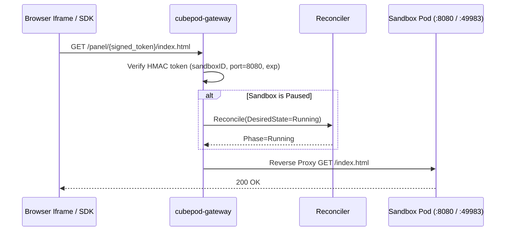

# CEP-0004: Unified E2B-Superset Gateway, Local Loopback Runtime, and Signed Panel Proxy (`cubepod-gateway`)

| Field | Value |
| :--- | :--- |
| **CEP Number** | `0004` |
| **Status** | `implementable` (`alpha`) |
| **Owning Area** | `gateway` |
| **Authors** | @xfgong |
| **Created** | 2026-11-10 |
| **Last Updated** | 2026-11-10 |

<!-- toc -->
- [Release Signoff Checklist](#release-signoff-checklist)
- [Summary](#summary)
- [Motivation](#motivation)
  - [Goals](#goals)
  - [Non-Goals](#non-goals)
- [Proposal](#proposal)
  - [User Stories](#user-stories)
  - [Notes / Constraints / Caveats](#notes--constraints--caveats)
  - [Risks and Mitigations](#risks-and-mitigations)
- [Design Details](#design-details)
  - [API / CRD / Wire Changes](#api--crd--wire-changes)
  - [Architecture & State Machine](#architecture--state-machine)
  - [Dual-Runtime Behavior (K8s Kata vs. Local Docker)](#dual-runtime-behavior-k8s-kata-vs-local-docker)
  - [Test Plan](#test-plan)
  - [Graduation Criteria](#graduation-criteria)
  - [Upgrade / Downgrade Strategy](#upgrade--downgrade-strategy)
- [Production Readiness Review Questionnaire (PRR)](#production-readiness-review-questionnaire-prr)
- [Implementation History](#implementation-history)
- [Drawbacks](#drawbacks)
- [Alternatives](#alternatives)
<!-- /toc -->

---

## Release Signoff Checklist

- [x] Enhancement scope, Goals, and Non-Goals are agreed upon (`provisional` -> `implementable`)
- [x] API / CRD (`pod.cubeplex.ai/v1alpha1`) and E2B-superset OpenAPI changes are specified
- [x] Dual-runtime behavior (Kubernetes Kata + CSI Block AND Local Docker Loopback) is defined
- [x] Security boundary (MicroVM isolation, UID/GID privilege separation, Egress secret safety) is reviewed
- [x] Test plan includes unit tests (`cargo test` / `go test`) and real invariant E2E tests
- [x] Production Readiness Review (PRR) section is complete

---

## Summary

`cubepod-gateway` (`pkg/gateway`) is the unified stateless HTTP control plane and data-plane proxy for CubePod. It exposes the E2B-compatible lifecycle API (`/sandboxes`, `pause`, `connect`, `timeout`, `lease`, `reset-rootfs`, `fork`), proxies command and file operations to the sandbox's `podd` daemon (with **automatic resume** when a request targets a `Paused` sandbox), and provides HMAC-SHA256 URL-token-authenticated reverse proxying (`/panel/{token}/{path}`) for interactive browser live-view (`:8080`) and web terminal (`:7681`) panels.

---

## Motivation

In CubePlex's previous OpenSandbox integration:
1. Endpoint resolution (`use_server_proxy`) conflicted with signed browser live-view URLs (Issue #949).
2. Hitting an endpoint or command on a `Paused` sandbox required manual multi-step polling before traffic could flow.
3. Local developers running without Kubernetes needed a lightweight loopback/local runtime with identical API behavior.

### Goals

- Extend `pkg/gateway` to support:
  1. **Full Lifecycle & Lease API**:
     - `POST /sandboxes`, `GET /sandboxes` (list with filter), `GET /sandboxes/{sandboxID}`, `DELETE /sandboxes/{sandboxID}`
     - `POST /sandboxes/{sandboxID}/pause`, `POST /sandboxes/{sandboxID}/connect`, `POST /sandboxes/{sandboxID}/timeout`, `POST /sandboxes/{sandboxID}/lease`
     - `POST /sandboxes/{sandboxID}/reset-rootfs`, `POST /sandboxes/{sandboxID}/fork`
  2. **Data-Plane Execution & File Proxy with Auto-Resume**:
     - `POST /sandboxes/{sandboxID}/commands/run`
     - `GET /sandboxes/{sandboxID}/commands/{cmdID}/logs`
     - `POST /sandboxes/{sandboxID}/commands/{cmdID}/kill`
     - `PUT /sandboxes/{sandboxID}/files` & `GET /sandboxes/{sandboxID}/files`
     - `POST /sandboxes/{sandboxID}/files/archive-sync`
     - If the target sandbox is currently `Paused`, the gateway transparently wakes it to `Running` (`AutoResumeCount++`) and updates `LastActivityAt` before executing or forwarding!
  3. **Signed Panel Token & Reverse Proxy (`pkg/gateway/panel.go`)**:
     - `POST /sandboxes/{sandboxID}/endpoints/{port}` -> mints an HMAC-SHA256 signed token encoding `(sandboxID, port, exp)` and returns `{"url": "/panel/<token>/", "token": "<token>", "expiresAt": "..."}`.
     - `ANY /panel/{token}/{path...}` -> verifies the HMAC token signature and expiry, auto-resumes the sandbox if `Paused`, and reverse-proxies HTTP/WebSocket traffic to the registered target backend for `(sandboxID, port)`.

### Non-Goals

- Exposing unauthenticated proxy routes (unlike OpenSandbox's unauthenticated `/proxy` route, CubePod `/panel/{token}/` enforces token verification by default).

---

## Proposal

### User Stories

#### Story 1: Iframe-Ready Signed Panel URLs Without Custom Headers
As CubePlex's frontend rendering the Neko browser (`:8080`) or ttyd terminal (`:7681`) inside an `<iframe>`, I request `POST /sandboxes/{id}/endpoints/8080`, receive `/panel/{token}/`, and all relative asset and WebSocket requests under that path prefix are authenticated by the token and reverse-proxied to the sandbox.

#### Story 2: Transparent Auto-Resume on Traffic
As an E2B or CubePod SDK user, when my sandbox has been idle-paused and I send a command or open a panel URL, `cubepod-gateway` automatically resumes the sandbox and serves the request without returning a `409 Conflict` error.

### Risks and Mitigations

| Risk | Impact | Likelihood | Mitigation |
| :--- | :--- | :--- | :--- |
| Forged or expired panel URL tokens access another user's sandbox port | High | Low | HMAC-SHA256 signature over `sandboxID:port:expUnix` verified in constant time (`hmac.Equal`); expired or tampered tokens return `401 Unauthorized`. |

---

## Design Details

### API / CRD / Wire Changes

New routes on `pkg/gateway.Server`:
- `GET /sandboxes`
- `POST /sandboxes/{sandboxID}/timeout` (`{"timeoutSeconds": 3600}`)
- `POST /sandboxes/{sandboxID}/lease` (`{"leaseSeconds": 300}`)
- `POST /sandboxes/{sandboxID}/endpoints/{port}` (`{"expiresInSeconds": 3600}`) -> `{"url": "/panel/<token>/", "token": "<token>"}`
- `/panel/{token}/{rest...}` -> Reverse proxy to sandbox upstream (or built-in local execution handler)
- `POST /sandboxes/{sandboxID}/commands/run`, `GET /sandboxes/{sandboxID}/commands/{cmdID}/logs`, `POST /sandboxes/{sandboxID}/commands/{cmdID}/kill`
- `PUT /sandboxes/{sandboxID}/files`, `GET /sandboxes/{sandboxID}/files`, `POST /sandboxes/{sandboxID}/files/archive-sync`

### Architecture & State Machine

### Dual-Runtime Behavior (K8s Kata vs. Local Docker)

When a sandbox has a registered upstream URL (or local workspace directory in local mode), the gateway forwards or executes requests directly, providing a 100% self-contained test and local dev experience even without a K8s cluster.

### Test Plan

- **Unit & Integration Tests (`go test -v -race ./pkg/gateway/...`)**:
  - Lifecycle: create, list, pause, connect, timeout extension, lease renewal, rootfs reset, and CoW fork.
  - Auto-Resume: pause a sandbox, then call `POST /sandboxes/{id}/commands/run` or `GET /panel/{token}/...` and verify the sandbox automatically transitions to `Running` and serves the response.
  - Signed Panel Token & Proxy: mint a token via `POST /sandboxes/{id}/endpoints/8080`, spin up a mock upstream `httptest.Server`, register it as the sandbox port target, verify `/panel/{token}/hello` proxies to the upstream, and verify tampered or expired tokens return `401 Unauthorized`.
  - Archive Sync & File Read/Write: upload a `tar.gz` archive via `POST /sandboxes/{id}/files/archive-sync` and read extracted files back via `GET /sandboxes/{id}/files`.

### Graduation Criteria

- **Alpha (`v0.1`)**: All gateway routes and panel proxy tests pass with `-race`.

### Upgrade / Downgrade Strategy

Stateless gateway; rolling updates require zero downtime.

---

## Production Readiness Review Questionnaire (PRR)

### Feature Enablement and Rollback
Panel signing key is configured via `CUBEPOD_PANEL_SECRET`.

### Monitoring Requirements
Gateway tracks `AutoResumeCount` per sandbox and returns health status on `GET /health`.

### Dependencies
Go standard library `net/http/httputil` and `crypto/hmac`.

### Troubleshooting
HTTP `401` on `/panel/` logs exact token rejection reason (expired vs. invalid signature).

---

## Implementation History

- `2026-11-10`: CEP-0004 drafted and marked `implementable`.

---

## Drawbacks

- Panel traffic flows through `cubepod-gateway` replicas (horizontally scalable via `gateway.replicaCount`).

---

## Alternatives

### Alternative 1: Separate Ingress Gateway Component (OSEP-0011)
- **Description**: Deploy a separate ingress gateway binary for browser/terminal URLs.
- **Reason for Rejection**: Causes the split-brain configuration bug in OpenSandbox Issue #949 and breaks local Docker deployments.
