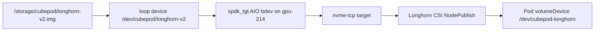

# CEP-0017: Longhorn V2 SPDK Block CSI Deployment and Live volumeMode Block Verification

| Field | Value |
| :--- | :--- |
| Stage | alpha |
| Status | implementable |
| Created | 2026-11-11 |
| Updated | 2026-11-11 |
| Owning Area | storage |

## Release Signoff Checklist

- [x] Enhancement issue / CEP filed and reviewed against the current test cluster (Kubernetes v1.27.8).
- [x] Design covers Production Kubernetes (`Kata + CSI Block`) and Local Development (`Docker + Loopback ext4`).
- [x] Test plan names the live invariant: a `volumeMode: Block` PVC on `longhorn-v2-block-thin` binds and the consumer sees an NVMe block device.
- [x] Graduation: `make test-k8s-longhorn-v2` passed on the live cluster on 2026-11-11. Kubelet on `gpu-214` advertised `hugepages-2Mi: 2Gi` after the pages were allocated, before the restart Pod ran, so kubelet was not restarted.
- [ ] Security review of the privileged Longhorn DaemonSet is recorded before this StorageClass becomes the default for CubePod sandboxes.

## Summary

Adds a pinned **Longhorn v1.8.2 V2 Data Engine** install and a live verification that a `volumeMode: Block` PVC is provisioned by SPDK and published to a Pod as an NVMe block device. The StorageClass name is `longhorn-v2-block-thin`, the same name the Helm chart already defaults to.

The current live suite stays on OpenEBS LVM-LocalPV (`cubepod-lvm-block`, `--runtime-class=none`). This CEP does not switch the running controller or gateway to the new class. An operator flips `-storage-class=longhorn-v2-block-thin` only after `make test-k8s-longhorn-v2` passes.

## Motivation

CEP-0016 proved the in-guest `ext4` + OverlayFS + `pivot_root` path against a loop-backed LVM logical volume that kubelet bind-mounts into a privileged `runc` container. That is not the production block path. The architecture calls for a CSI that exports a raw block volume and, under Kata, hands that host block device to the guest as `virtio-blk`. Longhorn V2 does the host half of that path: the V2 instance-manager runs `spdk_tgt`, stores replicas on a block disk, and exposes the volume to the node through NVMe-oF (`nvme-tcp`). Kubelet then maps that NVMe namespace into the Pod with `volumeDevices`.

### Goals

1. Install Longhorn v1.8.2 on the existing test cluster, restricted to the single worker that can host SPDK (`gpu-214`, kernel 7.0, containerd 2.2.2).
2. Back the V2 engine with one AIO block disk: an 80Gi sparse file on `/storage/cubepod/longhorn-v2.img`, attached as a loop device and linked at `/dev/cubepod/longhorn-v2`.
3. Publish StorageClass `longhorn-v2-block-thin` (`dataEngine: v2`, `numberOfReplicas: "1"`, `diskSelector: cubepod-v2`) without replacing the cluster default class `nfs-storage`.
4. Verify with `test/k8s-e2e/longhorn_v2_e2e_test.go` that a `volumeMode: Block` PVC binds, the Longhorn Volume CR reports `spec.dataEngine: v2`, and a consumer Pod can read the device at `/dev/cubepod-longhorn` and see it under the NVMe subsystem.

### Non-Goals

- Replacing `cubepod-lvm-block` as the storage class used by the already-running controller and gateway.
- Installing Kata (`kata-qemu` / `kata-clh`) in this CEP. The Pod contract (`volumeDevices`) is the same one Kata hotplugs as `virtio-blk`; the runtime switch stays a separate change.
- Deploying Mayastor on this cluster.
- Moving the control-plane nodes (kernel 5.15, `docker://24.0.7`) onto the V2 engine.
- Enabling Longhorn V1 iSCSI, replication greater than 1, or a backup target.

## Proposal

Pin Longhorn to the newest release that still runs on Kubernetes 1.27 and that already ships the SPDK V2 engine. Schedule every Longhorn pod onto nodes labeled `cubepod.io/longhorn-v2=true`. Give the engine one loop-backed block disk tagged `cubepod-v2`. Create volumes with one replica so a single worker is a valid placement. Prove the CSI publish path with a short-lived privileged Pod that consumes the PVC as a raw block device.



### User Stories

1. As a cluster operator, I want a documented install that puts Longhorn V2 only on `gpu-214`, so the control-plane nodes and the other tenants on that worker are not given a V2 instance-manager.
2. As a CubePod engineer, I want a live test that fails unless the bound volume is a Longhorn V2 NVMe block device, so a later flip of `-storage-class` is based on an observed publish path.

### Notes / Constraints / Caveats

- The test cluster API server is Kubernetes v1.27.8. Longhorn v1.13 requires Kubernetes >= 1.34. Longhorn v1.8.2 is the pin: it requires Kubernetes >= 1.25 and its V2 engine is present.
- V2 in v1.8.2 requires 1024 hugepages of 2Mi (2Gi) to be visible in the node's allocatable `hugepages-2Mi`. The kernel accepts the pages as soon as they are written to `/sys/kernel/mm/hugepages/hugepages-2048kB/nr_hugepages`. Kubelet on this cluster reads that value at start, so the storage node needs one kubelet restart before the V2 instance-manager can leave `Pending`.
- `spdk_tgt` polls. v1.8.2 reserves `v2DataEngineGuaranteedInstanceManagerCPU` (set to 1000m here) on the storage node for as long as the V2 engine is enabled.
- The AIO bdev driver, not the NVMe bdev driver, owns the loop disk. The file size is 80Gi, an exact multiple of 4096 bytes. SPDK AIO does not support TRIM on this disk.
- V2 `dataLocality: strict-local` is not supported. The class uses `best-effort` with `numberOfReplicas: "1"`.
- Control-plane nodes `k8s-test-207` and `k8s-test-208` have no taint and run `docker://24.0.7` on kernel 5.15. The Longhorn node selector keeps manager, CSI node plugin, and instance-manager off those nodes.

### Risks and Mitigations

| Risk | Mitigation |
| :--- | :--- |
| Kubelet restart on `gpu-214` restarts every Pod on that node, including workloads outside `cubepod-*`. | `install.sh` never restarts kubelet. The operator passes `CUBEPOD_RESTART_KUBELET=1` once. |
| A default Longhorn StorageClass would replace `nfs-storage` as the cluster default. | Helm `persistence.defaultClass` is `false`. The CubePod class is applied separately and has no default-class annotation. |
| V2 instance-manager scheduled onto a control-plane node or a node without the loop disk. | `global.nodeSelector` and `systemManagedComponentsNodeSelector` require `cubepod.io/longhorn-v2=true`. The class `diskSelector` is `cubepod-v2`. |
| Hugepage allocation pins 2Gi that other tenants on `gpu-214` can no longer use. | The node has 128Gi. The prep script allocates 1024 pages and does not raise the count further. |
| Loop device number changes across reboot and Longhorn keeps a stale `/dev/loopN` path. | The prep script maintains the stable symlink `/dev/cubepod/longhorn-v2` and a systemd unit that recreates it. |
| Leaving V1 enabled would start a second instance-manager and require `open-iscsi`. | `defaultSettings.v1DataEngine` is `false`. |

## Design Details

### API / CRD / Wire Changes

No CubePod CRD or OpenAPI change. The controller already takes `-storage-class`. After this CEP's test passes, the test manifest args change from `-storage-class=cubepod-lvm-block` to `-storage-class=longhorn-v2-block-thin`. Pod spec shape is unchanged: two `volumeMode: Block` PVCs, `volumeDevices` at `/dev/cubepod-rootfs` and `/dev/cubepod-workspace`.

StorageClass applied by this CEP:

```yaml
apiVersion: storage.k8s.io/v1
kind: StorageClass
metadata:
  name: longhorn-v2-block-thin
provisioner: driver.longhorn.io
allowVolumeExpansion: true
reclaimPolicy: Delete
volumeBindingMode: Immediate
parameters:
  numberOfReplicas: "1"
  staleReplicaTimeout: "2880"
  dataLocality: "best-effort"
  dataEngine: "v2"
  diskSelector: "cubepod-v2"
  fsType: ext4
```

`fsType` is used only when a consumer asks for a filesystem volume. CubePod PVCs set `volumeMode: Block`, so Longhorn publishes the NVMe namespace without making a filesystem.

### State Machine and Data Flow

1. `deploy/k8s/longhorn-v2/prep-node.sh` runs in the host mount namespace of `gpu-214`. It loads `nvme-tcp`, creates the sparse image, attaches a free loop device, points `/dev/cubepod/longhorn-v2` at it, writes 1024 into the 2Mi hugepage pool, and installs `cubepod-longhorn-loop.service`.
2. The operator restarts kubelet on that node. `kubectl describe node gpu-214` then shows `hugepages-2Mi: 2Gi`.
3. `install.sh` labels the node, installs chart `longhorn/longhorn` version `1.8.2` into namespace `longhorn-system`, applies the StorageClass, and merges a `diskType: block` disk named `v2-aio` onto `nodes.longhorn.io/gpu-214`.
4. A PVC with `storageClassName: longhorn-v2-block-thin` and `volumeMode: Block` causes the CSI provisioner to create a Longhorn Volume with `spec.dataEngine: v2` and one replica on `v2-aio`.
5. On attach, `spdk_tgt` exports the replica over `nvme-tcp`. The CSI node plugin connects that namespace and kubelet bind-mounts the resulting block device onto the Pod's `volumeDevices` path.
6. Under `runtimeClassName: kata-qemu` or `kata-clh` the same host block device is what the Kata shim hotplugs into the guest as `virtio-blk`. This CEP's test stops at the host NVMe device, because Kata is not installed on the cluster.

### Boundary Conditions and Failure Recovery

- Hugepages not allocatable: the V2 instance-manager stays `Pending` with a hugepage request it cannot meet. No volume is created. Recovery is to allocate the pages and restart kubelet, then delete the stuck instance-manager pod so Longhorn recreates it.
- Loop setup fails: the Longhorn disk stays unschedulable and the PVC stays `Pending`. The prep Job log prints the loop path and the hugepage count. Re-running the Job is safe; it reuses the existing image and loop association.
- Node reboot: `cubepod-longhorn-loop.service` reattaches the image and restores the symlink. Hugepages come back only if `vm.nr_hugepages=1024` still succeeds at boot. A full reboot of `gpu-214` also needs the kubelet to observe the pages again.
- PVC delete: reclaim policy is `Delete`, so the Longhorn volume and its replica are removed. The loop disk file is not deleted.
- Uninstall: `helm uninstall longhorn -n longhorn-system` leaves the loop image and the hugepage pool in place. Drop the pages by writing `0` to `nr_hugepages` only after every V2 volume is gone.

### Test Plan

Unit tests: none. The CubePod API is unchanged. `make test` skips the new test because it requires `CUBEPOD_K8S_LONGHORN_V2=1`.

Integration / E2E: `make test-k8s-longhorn-v2` runs `TestK8sLonghornV2Block` against the current kubeconfig.

The test creates a 1Gi `volumeMode: Block` PVC on `longhorn-v2-block-thin` in `cubepod-workloads`, waits until it is `Bound`, and checks:

- the PV provisioner is `driver.longhorn.io`;
- `volumes.longhorn.io` `spec.dataEngine` is `v2`;
- a privileged Pod with `volumeDevices.devicePath: /dev/cubepod-longhorn` reaches `Succeeded`;
- the Pod log reports a non-zero `blockdev --getsize64` and a successful 4KiB read;
- the published block device is an NVMe namespace, or a device-mapper node whose slave subsystem is `nvme`. Longhorn v1.8.2 puts a linear dm device on top of the `nvme-tcp` namespace before kubelet bind-mounts it.

The test deletes the Pod and the PVC before it returns.

### Graduation Criteria

- Alpha: chart values, StorageClass, node prep, and `TestK8sLonghornV2Block` exist, and the test passes once on `gpu-214`.
- Beta: the live controller and gateway run with `-storage-class=longhorn-v2-block-thin`, and `make test-k8s-e2e` passes on that class, including Pause / Auto-Resume and `ResetRootFS`.
- Stable: the same class is served by a replicated V2 disk (or Mayastor) on a cluster whose Kubernetes version is inside the upstream support window, with Kata `virtio-blk` verified inside the guest.

### Upgrade / Downgrade Strategy

Installing Longhorn does not rewrite existing `cubepod-lvm-block` PVCs. Sandboxes already bound to LVM keep those volumes. Downgrade is `helm uninstall` plus deletion of StorageClass `longhorn-v2-block-thin`. Workspace and RootFS data that was written to LVM is untouched. Data written later to a Longhorn V2 volume lives only on that volume; uninstalling Longhorn while those PVCs still exist deletes it if the reclaim policy has already run, and leaves unattached Longhorn volumes if the PVCs were retained. Do not uninstall while a CubePod sandbox still references the class.

### Dual-Runtime Behavior

- Production Kubernetes (`Kata + CSI Block`): this StorageClass is the host block provider. Kata maps the published NVMe device into the guest as `virtio-blk` at `/dev/cubepod-rootfs` and `/dev/cubepod-workspace`. `podd-init` then formats `ext4`, mounts OverlayFS, and calls `pivot_root`.
- Local Development (`Docker + Loopback ext4`): unchanged. `pkg/runtime` still bind-mounts sparse files. It does not talk to Longhorn.

## Production Readiness Review Questionnaire (PRR)

### Feature Enablement and Rollback

Enable by installing the chart and applying the StorageClass. CubePod ignores the class until `-storage-class` changes. Rollback of the verification path is deleting the test PVC. Rollback of the driver is `helm uninstall` after every Longhorn volume is deleted. `/workspace` data on `cubepod-lvm-block` is not on this driver.

### Rollout, Upgrade and Rollback Planning

Longhorn v1.8.2 cannot live-upgrade a V2 volume. A later chart upgrade requires every V2 volume to be detached first, which means every CubePod sandbox using the class must be paused or deleted. Paused sandboxes keep the volume detached, so they survive the upgrade as long as the volume CR is not deleted. The LVM class is unaffected.

### Monitoring Requirements

- `kubectl get pods -n longhorn-system` shows the V2 instance-manager `Running` on `gpu-214`.
- `kubectl get nodes.longhorn.io -n longhorn-system -o yaml` shows disk `v2-aio` with `allowScheduling: true` and a positive `storageAvailable`.
- The V2 instance-manager log contains `spdk_tgt`. A failed disk add logs an AIO open error against `/dev/cubepod/longhorn-v2`.
- The e2e Pod log line `OK size=... subsys=...nvme...` is the attach success signal.

### Dependencies

- Longhorn chart 1.8.2 and images under `longhornio/*:v1.8.2`.
- Kernel modules on the storage node: `nvme-tcp`, `nvme-fabrics`. `vfio-pci` and `uio_pci_generic` are loaded for the SPDK prerequisite check; the AIO loop disk does not bind a PCI device.
- 2Gi of 2Mi hugepages allocatable on the storage node.
- Host binaries used by the prep script: `truncate`, `losetup`, `modprobe`, `systemctl`.
- Kata is not a dependency of this CEP's test. It is a dependency of the production guest path.

### Scalability

One V2 instance-manager on one node reserves about one CPU core whether or not a volume is attached. Replica count is 1, so a volume does not fan out. CSI controller replicas are set to 1 so they fit on the single labeled node. This layout is a verification layout, not a multi-node production layout.

### Troubleshooting

- PVC `Pending` and the Longhorn volume event says the disk selector matched nothing: the node disk tag `cubepod-v2` is missing or the symlink is gone. Re-run the prep Job and re-apply the disk patch.
- Instance-manager `Pending` with `Insufficient hugepages-2Mi`: the pages are not in kubelet allocatable. Confirm `/proc/meminfo` shows `HugePages_Total: 1024`, then restart kubelet on `gpu-214`.
- Pod attach timeout: `nvme-tcp` is not loaded, or the instance-manager is not running. `dmesg` on the node shows the `nvme connect` result.

## Implementation History

- 2026-11-11: CEP opened. Longhorn v1.8.2 selected over Mayastor and over Longhorn v1.13 because of the cluster's Kubernetes version. Manifests, prep script, and `TestK8sLonghornV2Block` added.
- 2026-11-11: Installed on `gpu-214`. Hugepages became allocatable without a kubelet restart. `TestK8sLonghornV2Block` passed: 1Gi `volumeMode: Block` PVC bound, published device `dm-0` with slave `nvme0n1` (`/sys/class/nvme-subsystem`).
- 2026-11-11: Controller and gateway on the test cluster now use `-storage-class=longhorn-v2-block-thin` and `-runtime-class=none`. `TestK8sLiveE2E` passed in 99s: `podd-init` formatted both block devices and pivoted, Pause retained the PVCs, Auto-Resume mounted them, `ResetRootFS` kept `/workspace` and dropped the RootFS file, and teardown deleted the Pod and PVCs.

## Drawbacks

Longhorn v1.8.2 is outside upstream maintenance. The V2 engine in that release still requires hugepages and a polling `spdk_tgt`, so one shared worker permanently gives up 2Gi of memory and about one CPU core. A loop file on `/storage` is an AIO disk, not an NVMe SSD, so the test proves the NVMe-oF publish path and does not prove SPDK-on-NVMe performance. The install pulls `longhornio` images onto a cluster whose other images come from `hub.sensedeal.vip`.

## Alternatives

### OpenEBS Mayastor (Replicated PV Mayastor) 2.12

Rejected for this cluster. Mayastor 2.12.1 is tested on Kubernetes 1.32 and 1.35 and on kernel 6.8. This API server is 1.27.8. The io-engine still needs 2Gi of hugepages plus two exclusive CPU cores, and the project recommends three storage nodes. The only node here with a new enough kernel and containerd is `gpu-214`.

### Longhorn v1.13 V2 with hugepages disabled

Rejected. Current Longhorn requires Kubernetes >= 1.34. The ability to set `data-engine-hugepage-enabled` to false arrived in the 1.10 line, which also does not support 1.27. Staying on 1.8.2 keeps the install on a chart that can register its CRDs with this API server.

### Keep OpenEBS LVM-LocalPV as the only block verification

Rejected as the only path. LVM publishes a local device node into the `runc` container. It does not exercise SPDK, NVMe-oF, or the host block device that Kata later maps with `virtio-blk`. LVM stays in place until the Longhorn test is green and the controller args are switched.

### Give SPDK a physical NVMe on `gpu-214`

Not chosen for the first install. The node has other tenants and a large `/storage` filesystem. A dedicated NVMe, or an NVMe namespace, is the right disk once the publish path is proven. The loop disk is enough to show AIO replica placement and NVMe-oF attach.
