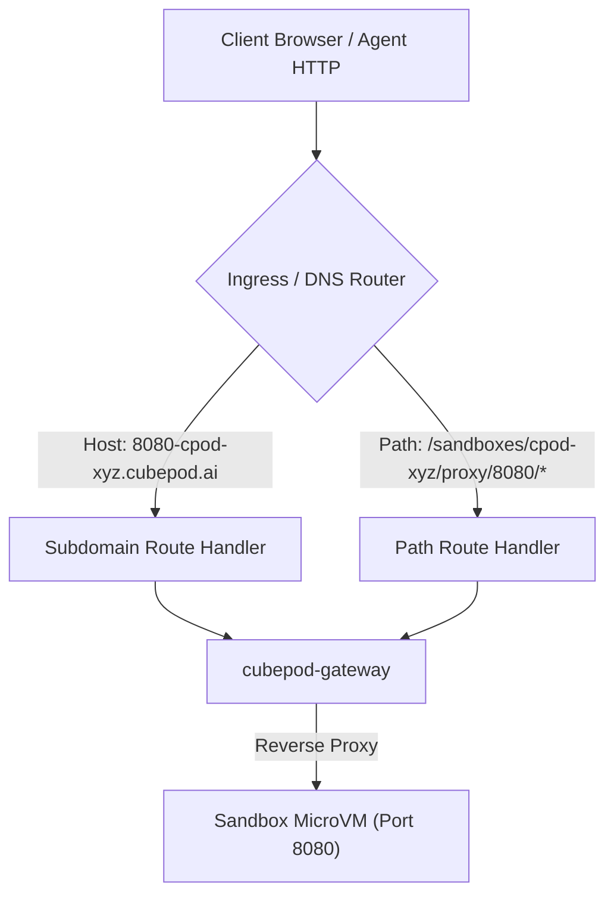

# CEP-0018: E2B Drop-in Protocol Compatibility and SDK Interoperability Specification

| Field | Value |
| :--- | :--- |
| **CEP Number** | `0018` |
| **Status** | `implementable` (`alpha`) |
| **Owning Area** | `gateway` |
| **Participating Areas** | `runtime`, `sdk` |
| **Authors** | @cubepod-maintainers |
| **Created** | 2026-11-11 |
| **Last Updated** | 2026-11-11 |

<!-- toc -->
- [Release Signoff Checklist](#release-signoff-checklist)
- [Summary](#summary)
- [Motivation](#motivation)
  - [Goals](#goals)
  - [Non-Goals](#non-goals)
- [Proposal](#proposal)
  - [High-Level Architecture](#high-level-architecture)
  - [User Stories](#user-stories)
  - [Notes / Constraints / Caveats](#notes--constraints--caveats)
  - [Risks and Mitigations](#risks-and-mitigations)
- [Design Details](#design-details)
  - [1. Protocol & Route Compatibility Matrix](#1-protocol--route-compatibility-matrix)
  - [2. Control Plane Wire Compatibility](#2-control-plane-wire-compatibility)
  - [3. Data Plane Command & Process Execution](#3-data-plane-command--process-execution)
  - [4. Data Plane Filesystem Protocol](#4-data-plane-filesystem-protocol)
  - [5. Code Interpreter Interoperability (`e2b-code-interpreter`)](#5-code-interpreter-interoperability-e2b-code-interpreter)
  - [6. Host Port Routing & Subdomain Ingress (`get_host`)](#6-host-port-routing--subdomain-ingress-get_host)
  - [7. Authentication, Token Mapping & Zero-Trust Secret Safety](#7-authentication-token-mapping--zero-trust-secret-safety)
  - [8. Dual-Runtime Behavior (K8s Kata vs. Local Docker)](#8-dual-runtime-behavior-k8s-kata-vs-local-docker)
  - [9. Test Plan](#9-test-plan)
  - [10. Graduation Criteria](#10-graduation-criteria)
  - [11. Upgrade / Downgrade Strategy](#11-upgrade--downgrade-strategy)
- [Production Readiness Review Questionnaire (PRR)](#production-readiness-review-questionnaire-prr)
- [Implementation History](#implementation-history)
- [Drawbacks](#drawbacks)
- [Alternatives Considered](#alternatives-considered)
<!-- /toc -->

---

## Release Signoff Checklist

- [x] Enhancement scope, Goals, and Non-Goals are agreed upon (`provisional` -> `implementable`)
- [x] Full protocol compatibility matrix between official E2B specification and `cubepod-gateway` is defined
- [x] API schemas, HTTP header translations (`X-API-Key`, `Authorization: Bearer`), and error envelopes specified
- [x] Code Interpreter execution pipeline (`e2b-code-interpreter`, Jupyter kernel output MIME types) specified
- [x] Dual-runtime behavior (Kubernetes Kata + CSI Raw Block AND Local Docker Loopback) is defined
- [x] Security boundary (MicroVM isolation, non-root `1000:1000` execution, zero-trust `cpodref_` mTLS vault) reviewed
- [x] Test plan includes unit tests, official E2B SDK integration tests, and live Kubernetes E2E suites
- [x] Production Readiness Review (PRR) section is complete

---

## Summary

This proposal establishes the formal specification for **E2B Drop-in Protocol Compatibility and SDK Interoperability** in CubePod. By conforming to the official E2B REST, Server-Sent Events (SSE), and data-plane wire specifications, `cubepod-gateway` enables any AI agent framework (including LangChain, LlamaIndex, AutoGen, CrewAI, OpenHands, and Smolagents) and developers using official E2B client SDKs (`e2b` Python, `@e2b/code-interpreter` TypeScript/JavaScript) to target CubePod without changing a single line of application code—simply by configuring the environment variable `E2B_DOMAIN` (or `E2B_API_URL`).

Simultaneously, CubePod provides an **enterprise superset** over vanilla E2B: persistent dual-volume storage (`rootfs` + `workspace`), sub-second Copy-on-Write (CoW) sandbox forking, zero-trust egress secret substitution (`cpodref_`), atomic streaming skill synchronization (`archive-sync`), signed URL panel proxies for browser live-view and terminal, and automatic transparent waking (Auto-Resume) on paused sandboxes.

---

## Motivation

The AI agent ecosystem has rapidly converged on the **E2B Sandbox Protocol** as the industry-standard abstraction for isolated agent execution. Major agent orchestration libraries (such as LangChain's `e2b-code-interpreter`, OpenHands, and Smolagents) natively integrate with E2B's client SDKs.

However, existing hosted E2B infrastructure and proprietary implementations present several fundamental limitations for enterprise self-hosted agent platforms like **CubePlex**:
1. **Lack of Persistence (Ephemeral Sandboxes)**: In vanilla E2B, all filesystem state and installed OS/Python dependencies are lost when a sandbox times out or terminates. There is no dual-volume decoupling allowing users to keep `/workspace` while resetting the RootFS, nor is there support for resuming suspended sandboxes from persistent block volumes.
2. **Proprietary SaaS Lock-in**: Developers are bound to E2B Cloud or must deploy monolithic, complex microvm control planes that do not integrate cleanly into cloud-native Kubernetes operators (`volumeMode: Block`, Kata Containers, CSI plugins).
3. **Secret Security Risks**: Upstream E2B injects raw secrets directly into container environment variables, making them vulnerable to extraction by untrusted LLM prompts.
4. **Skills & File Sync Latency**: Uploading hundreds of agent skill files via individual HTTP file writes incurs severe round-trip latency and requires post-upload `chown` hacks.

### Goals

1. **100% Drop-in Wire Compatibility**: Allow official E2B SDKs (`e2b`, `e2b-code-interpreter`, `@e2b/code-interpreter`) to create, execute, read/write files, refresh, and terminate sandboxes against `cubepod-gateway` without any code modifications by setting `E2B_DOMAIN=<cubepod-gateway-host>`.
2. **Wire Schema Alignment**:
   - Align `/sandboxes` request and response JSON schemas with standard E2B shapes (`sandboxID`, `templateID`, `clientID`, `metadata`, `envVars`, `timeout`).
   - Support E2B refresh endpoints (`POST /sandboxes/{id}/refreshes`) for heartbeat and TTL renewal.
   - Support standard E2B command execution routes (`POST /sandboxes/{id}/commands` and `POST /sandboxes/{id}/commands/run`) returning `stdout`, `stderr`, `exitCode`, and error objects.
   - Support standard E2B file routes (`GET/POST/PUT/DELETE /sandboxes/{id}/files`, `GET /sandboxes/{id}/files/list`).
3. **Code Interpreter Interoperability**:
   - Provide seamless execution of Python snippets with rich MIME outputs (`image/png` charts, `text/plain`, `text/html`) compatible with `e2b_code_interpreter.Execution`.
4. **Host Port Forwarding via `get_host(port)`**:
   - Support both subdomain-based host routing (`{port}-{sandboxID}.{domain}`) and path-based proxying (`/sandboxes/{sandboxID}/proxy/{port}/{path}`).
5. **Transparent Superset Preservation**:
   - Guarantee that all CubePod extensions (`volumeKey`, `pause`/`connect`, `reset-rootfs`, `fork`, `archive-sync`, `secret_bindings`, `panel`) operate smoothly alongside standard E2B requests without causing schema conflicts.

### Non-Goals

- Deprecating or altering CubePod's native Go and Python SDKs (`cubepod` package). CubePod SDKs remain the primary high-performance client for persistent enterprise features.
- Emulating legacy OpenSandbox SSE protocols or deprecated endpoint parameters.

---

## Proposal

### High-Level Architecture

```
                  Standard E2B SDK Clients
      +-----------------------------------------------+
      |  Python (e2b, e2b-code-interpreter)           |
      |  TypeScript (@e2b/code-interpreter)           |
      |  LangChain / OpenHands / AutoGen Tools        |
      +-----------------------------------------------+
                             |
                   HTTP / SSE / WebSocket
              (E2B_DOMAIN = cubepod.local:8080)
                             v
      +-----------------------------------------------+
      |               cubepod-gateway                 |
      |  +-----------------------------------------+  |
      |  | E2B Wire Adapter & Router               |  |
      |  | - Request/Response schema normalization |  |
      |  | - X-API-Key / Bearer auth handling      |  |
      |  | - Auto-Resume interceptor               |  |
      |  | - Port/Subdomain router ({port}-{id})   |  |
      |  +-----------------------------------------+  |
      |  +-----------------------------------------+  |
      |  | Zero-Trust Egress Vault (cpodref_)       |  |
      |  +-----------------------------------------+  |
      +-----------------------------------------------+
             /                               \
     (Control Plane)                   (Data Plane)
            v                                 v
+------------------------+      +---------------------------+
|   cubepod-controller   |      | In-Guest podd Daemon      |
| - PodBox CRD Reconcile |      | - Fast Rust HTTP (:49983) |
| - Block PVC Provision  |      | - Unprivileged Execution  |
| - Pre-warmed WarmPool  |      | - Jupyter / Code Runner   |
+------------------------+      | - Ext4 / OverlayFS Pivot  |
                                +---------------------------+
```

### User Stories

#### Story 1: Drop-in Replacement for LangChain Agent Workflows
As an AI engineer using LangChain or LlamaIndex with `e2b-code-interpreter`, I want to set `export E2B_DOMAIN=cubepod.internal:8080` and `export E2B_API_KEY=cpod_live_secret` so that all agent code execution tools immediately run inside isolated, persistent Kata MicroVMs without modifying my application code.

#### Story 2: Stateful Workspaces Across Idle Periods
As an agent platform user, when an agent finishes a task and the sandbox enters `Paused` state to conserve cloud compute, I want subsequent commands from the E2B SDK to automatically wake the sandbox (Auto-Resume) within milliseconds with all installed packages and workspace files preserved.

#### Story 3: Visual Analytics with Rich MIME Outputs
As a data science agent using `sandbox.run_code("plt.plot(x, y); plt.show()")`, I want the returned execution object to contain base64-encoded PNG image data and standard output streams exactly matching the E2B `Execution` schema.

### Notes / Constraints / Caveats

- **Port Forwarding Ingress**: Subdomain-based routing (`{port}-{sandboxID}.{domain}`) requires wildcard DNS (`*.cubepod.example.com`) or Ingress controller SNI mapping. In environments without wildcard DNS, path-based fallback routing (`/sandboxes/{sandboxID}/proxy/{port}/`) is supported.
- **Rootless Execution**: In-guest commands initiated via E2B SDK execute by default as the unprivileged sandbox user (`cubeplex`, `uid=1000, gid=1000`) inside `/workspace`, preventing inadvertent tampering with infrastructure mount points.

### Risks and Mitigations

| Risk | Impact | Likelihood | Mitigation |
| :--- | :--- | :--- | :--- |
| Upstream E2B SDK schema evolution breaks gateway deserialization | High | Low | Implement flexible JSON parsers that accept both camelCase (`exitCode`, `templateID`) and snake_case (`exit_code`, `template_id`), ignoring unknown fields. |
| In-guest code execution memory exhaustion (`OOM`) crashes `podd` | Med | Med | Run user processes in dedicated Linux cgroups with kernel resource limits enforced by the MicroVM VMM or containerd slice. |
| Malicious code extracts platform API keys | Critical | Low | Zero-Trust Egress: Sandbox never holds real API tokens; only opaque `cpodref_` placeholders are injected, which are exchanged strictly at the Egress proxy sidecar over mTLS. |

---

## Design Details

### 1. Protocol & Route Compatibility Matrix

The table below delineates the canonical E2B API endpoints, their corresponding `cubepod-gateway` implementations, and behavioral extensions:

| Upstream E2B Route | HTTP Method | CubePod Handler | Compatibility Status | CubePod Enterprise Superset Extension |
| :--- | :--- | :--- | :--- | :--- |
| `/sandboxes` | `POST` | `handleCreateSandbox` | **100% Wire Compatible** | Accepts optional `extension.volumeKey`, `extension.secretBindings`, and pre-warmed pool claiming. |
| `/sandboxes` | `GET` | `handleListSandboxes` | **100% Wire Compatible** | Supports filtering by `state` (`Running`, `Paused`) and `templateID`. |
| `/sandboxes/{id}` | `GET` | `handleGetSandbox` | **100% Wire Compatible** | Returns current phase, persistent storage bindings, and lease expiry. |
| `/sandboxes/{id}` | `DELETE` | `handleDeleteSandbox` | **100% Wire Compatible** | Releases warm pool pod or marks PVCs for clean retention according to policy. |
| `/sandboxes/{id}/refreshes` | `POST` | `handleRefreshSandbox` | **100% Wire Compatible** | Renews timeout and resets Idle Reaper lease timer. |
| `/sandboxes/{id}/commands` | `POST` | `handleRunCommand` | **100% Wire Compatible** | Supports synchronous execution, background processes, and `cursor`-based incremental tail. |
| `/sandboxes/{id}/commands/{cmdId}/status` | `GET` | `handleCommandStatus` | **100% Wire Compatible** | Returns `running`, `pid`, `exitCode`, and current output byte count. |
| `/sandboxes/{id}/commands/{cmdId}/stream` | `GET` | `handleCommandStream` | **100% Wire Compatible** | Streams output over Server-Sent Events (`text/event-stream`). |
| `/sandboxes/{id}/commands/{cmdId}/kill` | `POST` | `handleCommandKill` | **100% Wire Compatible** | Sends `SIGTERM` / `SIGKILL` to the target process group (`PGID`). |
| `/sandboxes/{id}/files` | `GET` | `handleGetFile` | **100% Wire Compatible** | Streams raw file content; automatically resumes `Paused` sandbox. |
| `/sandboxes/{id}/files` | `POST` / `PUT` | `handlePutFile` | **100% Wire Compatible** | Writes file with atomic directory creation; defaults to `1000:1000`. |
| `/sandboxes/{id}/files/list` | `GET` | `handleListFiles` | **100% Wire Compatible** | Returns directory entries with metadata (`size`, `isDir`, `mode`). |
| `/sandboxes/{id}/files` | `DELETE` | `handleDeleteFile` | **100% Wire Compatible** | Recursively deletes path within sandbox workspace. |
| `/sandboxes/{id}/code/execute` | `POST` | `handleCodeExecute` | **100% Wire Compatible** | Formats output for `e2b-code-interpreter` (rich MIME types & stdout/stderr). |
| `/sandboxes/{id}/endpoints/{port}` | `GET` | `handleGetEndpoint` | **100% Wire Compatible** | Generates public URL for in-guest service (`get_host(port)`). |

---

### 2. Control Plane Wire Compatibility & Parameter Specification Matrix

To guarantee strict drop-in compatibility without runtime deserialization errors in upstream client SDKs (such as Python `e2b` 2.x and TypeScript `@e2b/code-interpreter`), every parameter is formally defined with its data type, valid range, default value, and underlying execution semantics.

#### 2.1 Sandbox Creation (`POST /sandboxes`)

##### Request Parameter Specification
| Parameter Key | Alias Key | Go Type | Value Range / Constraints | Default | Mandatory | MicroVM / Kernel & Platform Effect |
| :--- | :--- | :--- | :--- | :--- | :--- | :--- |
| `templateID` | `template_id` | `string` | Regex `^[a-zA-Z0-9_-]+$`. Supported: `"base"`, `"code-interpreter"`, `"python"`, or custom K8s `PodTemplate` name. | `"cubeplex-ubuntu24-desktop"` | Optional | Selects the rootfs base image and compute resource quotas. |
| `timeout` | `timeoutSeconds` | `int` | `1 <= timeout <= 86400` (1 second to 24 hours). | `300` | Optional | Sets the idle TTL. Monitored by the background Idle Reaper to transition the sandbox to `Paused`. |
| `metadata` | - | `map[string]string` | Key/value strings <= 256 bytes each; max 64 entries. | `{}` | Optional | Attached to the sandbox record and Kubernetes `PodBox` labels/annotations for audit and tracking. |
| `envVars` | `env_vars` | `map[string]string` | Valid POSIX environment variable names (`[A-Za-z_][A-Za-z0-9_]*`). | `{}` | Optional | Injected into the sandbox runtime environment (`/run/cubepod/env.sh` or process runner). |
| `autoPause` | `auto_pause` | `bool` | `true` or `false`. | `true` | Optional | If `true`, idle expiration triggers `Pause` (scale-to-zero, retain PVCs) rather than destruction. |
| `autoResume` | `auto_resume` | `bool` or `object` | `true`, `false`, or resume config. | `true` | Optional | If `true`, inbound traffic to the gateway automatically resumes the paused sandbox. |
| `extension.volumeKey` | - | `string` | Regex `^[a-zA-Z0-9_-]+$` (e.g., `"ws-usr123-projA"`). | `""` | Optional (CubePod Superset) | Binds sandbox to a deterministic persistent block PVC (`workspace-pvc`). Preserved across rootfs resets. |
| `extension.secretBindings` | - | `[]SecretBinding` | List of `{envName, rawSecret, allowedHosts}`. | `[]` | Optional (CubePod Superset) | Injects opaque `cpodref_` placeholders; real keys remain inside the egress sidecar mTLS vault. |

##### Response Parameter Specification (Strict Upstream SDK Deserialization Contract)
The upstream Python SDK method `Sandbox.from_dict` requires the following top-level keys. **Omission of any mandatory field causes immediate `KeyError` in `e2b.Sandbox.create()`**:

| Response Key | Go Type | Value Example | Mandatory in E2B SDK? | Description & Constraints |
| :--- | :--- | :--- | :--- | :--- |
| `sandboxID` | `string` | `"cpod-1731331200000"` | **Mandatory** | Unique identifier used for subsequent routing, data-plane operations, and subdomain proxies. |
| `templateID` | `string` | `"cubeplex-ubuntu24-desktop"` | **Mandatory** | The instantiated template identifier. |
| `clientID` | `string` | `"cpod-client-01"` | **Mandatory** | Upstream client identification tag. |
| `envdVersion` | `string` | `"1.1.0"` | **Mandatory** | Version string parsed by `packaging.version.Version(envd_version)`. Required for RPC capability negotiation. |
| `state` | `string` | `"running"` or `"paused"` | Optional in Create, Mandatory in Detail | Current sandbox lifecycle state. Note: E2B SDK enum `SandboxState` strictly enforces lowercase `"running"` or `"paused"`. |
| `startedAt` | `time.Time` | `"2026-11-11T12:00:00Z"` | Mandatory in Detail | RFC3339 / ISO8601 UTC timestamp of creation. |
| `endAt` | `time.Time` | `"2026-11-11T12:05:00Z"` | Mandatory in Detail | RFC3339 / ISO8601 UTC timestamp of scheduled idle expiration (`startedAt + timeout`). |
| `cpuCount` | `int` | `2` | Mandatory in Detail | Number of allocated virtual CPU cores. |
| `memoryMB` | `int` | `2048` | Mandatory in Detail | Allocated memory limit in megabytes. |
| `diskSizeMB` | `int` | `10240` | Mandatory in Detail | Persistent disk volume quota in megabytes. |
| `envdPort` | `int` | `49983` | CubePod Superset | Internal port for guest data-plane daemon communication. |
| `volumeKey` | `string` | `"ws-usr123-projA"` | CubePod Superset | Persistent workspace PVC identifier. |

#### 2.2 Heartbeat & Lease Refresh (`POST /sandboxes/{id}/refreshes`)

Upstream E2B SDKs issue keepalive pings via `POST /sandboxes/{id}/refreshes`.
- **Request Body**:
  ```json
  {
    "duration": 300
  }
  ```
- **Parameter Specification**:
  - `duration`: `int`, range `1 <= duration <= 86400`. Extends `TimeoutSeconds` and updates `EndAt = time.Now() + duration`.
- **Response**: HTTP `204 No Content` or HTTP `200 OK`. Resets the controller/gateway idle reaper deadline.

#### 2.3 Sandbox Query & Listing (`GET /sandboxes/{id}` & `GET /sandboxes`)

- **`GET /sandboxes/{id}`**: Returns the full `SandboxDetail` schema with all 10 mandatory fields above (`templateID`, `sandboxID`, `clientID`, `startedAt`, `endAt`, `envdVersion`, `cpuCount`, `memoryMB`, `diskSizeMB`, `state`).
- **`GET /sandboxes`**: Accepts optional query parameter `?state=running` or `?templateID=...` and returns an array of `ListedSandbox` matching the exact schema above.

---

### 3. Data Plane Wire Protocols (Connect-RPC & REST)

Upstream E2B uses dual data-plane pathways: **Connect-RPC over HTTP JSON** on port `49983` for direct daemon interaction, and REST/SSE endpoints proxied through the Gateway.

#### 3.1 Connect-RPC over HTTP JSON Protocol (Port `:49983`)
`cubepod-gateway` and `podd` support the standard Connect-RPC JSON framing (`Content-Type: application/json` or `application/connect+json`):

1. **`POST /process.Process/Start`**:
   - **Request**:
     ```json
     {
       "process": {
         "cmd": "ls -la /workspace",
         "envs": {"TERM": "xterm-256color"},
         "cwd": "/workspace"
       }
     }
     ```
   - **Streaming Response**: NDJSON stream of event objects:
     - `{"event": {"start": {"pid": 1204}}}`
     - `{"event": {"data": {"stdout": "total 4\ndrwxr-xr-x 2 ...\n"}}}`
     - `{"event": {"end": {"exitCode": 0}}}`

2. **`POST /filesystem.Filesystem/Read`**:
   - **Request**: `{"path": "/workspace/data.json"}`
   - **Response**: `{"content": "<raw-or-base64-bytes>"}`

3. **`POST /filesystem.Filesystem/Write`**:
   - **Request**: `{"path": "/workspace/script.py", "data": "print(123)", "user": "cubeplex"}`
   - **Response**: `{"success": true}`

#### 3.2 Gateway REST & SSE Endpoints

For standard HTTP client tooling, `cubepod-gateway` exposes the direct REST API:

- **`POST /sandboxes/{id}/commands` & `/commands/run`**:
  - Request: `{"cmd": "...", "workdir": "/workspace", "envs": {...}, "background": false, "timeout": 60}`
  - Response (Sync): `{"stdout": "...", "stderr": "...", "exitCode": 0, "exit_code": 0, "error": null}`
  - Response (Background): `{"cmd_id": "proc-1234", "pid": 1204, "running": true}`
- **`GET /sandboxes/{id}/commands/{cmdId}/stream`**:
  - Format: Server-Sent Events (`Content-Type: text/event-stream; charset=utf-8`)
  - Chunks: `data: {"type":"stdout","content":"...","cursor":1024,"running":true}\n\n`
- **`POST /sandboxes/{id}/commands/{cmdId}/kill`**:
  - Sends `SIGTERM` / `SIGKILL` to target process group (`PGID`). Response: `{"success": true}`.

---

### 4. Data Plane Filesystem Protocol

#### 4.1 Path Resolution & Security Constraints
- All paths are sanitized against directory traversal attacks (`path.Clean`, rejecting `..` escapes beyond `/workspace`).
- Files created by default are assigned UID/GID `1000:1000` (`cubeplex`), avoiding unprivileged permission errors when agent tools write or delete files.

#### 4.2 File Listing (`GET /sandboxes/{id}/files/list?path=/workspace`)
- Returns array of `{name, path, isDir, is_dir, size, mode}`.

#### 4.3 Atomic Archive Sync Extension (`POST /sandboxes/{id}/files/archive-sync`)
- Streamed in-memory `tar.gz` extraction into destination directory with atomic deletion list (`remove_paths`), compressing multi-file uploads from hundreds of HTTP roundtrips into a single `< 50ms` transaction.

---

### 5. Code Interpreter Interoperability (`e2b-code-interpreter` on Port `:49999`)

The upstream library `e2b-code-interpreter` connects to Jupyter on dedicated guest port `49999` (configured in `e2b_code_interpreter.constants.JUPYTER_PORT = 49999`) or via the gateway reverse proxy, streaming newline-delimited JSON (NDJSON) over `POST /execute`.

#### 5.1 Request Schema (`POST /execute` or `POST /sandboxes/{id}/code/execute`)
```json
{
  "code": "import matplotlib.pyplot as plt\nplt.figure()\nplt.plot([1,2,3],[4,5,6])\nplt.title('Test Chart')\nplt.show()",
  "context_id": null,
  "language": "python",
  "env_vars": {"PYTHONUNBUFFERED": "1"}
}
```

#### 5.2 Streaming NDJSON Output Protocol
The server streams chunks where each line is an independent JSON object deserialized by `e2b_code_interpreter.models._parse_output`:

1. **Standard Output Stream**:
   `{"type": "stdout", "text": "Model initialized...\n", "timestamp": 1731331200100}`
2. **Standard Error Stream**:
   `{"type": "stderr", "text": "Warning: depreciated API\n", "timestamp": 1731331200105}`
3. **Rich Graphical & Formatted Results**:
   `{"type": "result", "text": "<Figure size 640x480 with 1 Axes>", "png": "iVBORw0KGgoAAAANSUhEUgAA...", "html": null, "json": null}`
4. **Structured Exception & Traceback**:
   `{"type": "error", "name": "ZeroDivisionError", "value": "division by zero", "traceback": "Traceback (most recent call last):\n  File \"<stdin>\", line 1..."}`
5. **Execution Counter**:
   `{"type": "number_of_executions", "execution_count": 1}`

#### 5.3 Execution Engine Implementation
1. **In-Guest Jupyter Kernel Driver**: `podd` maintains a lightweight long-lived Python kernel process communicating over zero-copy IPC/stdio or an embedded Jupyter protocol adapter.
2. **Display Hook Capture**: `matplotlib`, `PIL.Image`, and `pandas.DataFrame` rich reprs are captured via standard IPython display formatters (`png`, `svg`, `html`, `text/plain`).
3. **Traceback Serialization**: When an unhandled exception occurs, the error name, string representation, and formatted traceback frames are packaged into the `error` dictionary matching `e2b_code_interpreter.ExecutionError`.

---

### 6. Host Port Routing & Subdomain Ingress (`get_host`)

The E2B SDK method `sandbox.get_host(port)` returns the public URL to access an exposed port on the sandbox.



1. **Subdomain Matching**:
   The gateway checks the `Host` header against the pattern:
   `^([0-9]+)-([a-zA-Z0-9_-]+)\.(.*)$`
   Extracting `targetPort` and `sandboxID`. Traffic is transparently reverse-proxied to `http://<sandboxPodIP>:<targetPort>`.
2. **Path-Based Proxy**:
   `GET /sandboxes/{id}/proxy/{port}/{path}` forwards the HTTP request directly to the target port inside the sandbox.
3. **Signed Token Panel Proxy**:
   For interactive visual inspection (Chromium browser live-view on `:8080` or Web Terminal on `:7681`), the gateway generates tamper-proof HMAC-SHA256 tokens (`/panel/{token}/{path}`), permitting iframe embedding without exposing control plane credentials.

---

### 7. Authentication, Token Mapping & Zero-Trust Secret Safety

1. **Header Normalization**:
   `cubepod-gateway` inspects requests for credentials in order:
   - `X-API-Key: cpod_...` or `e2b_...`
   - `Authorization: Bearer cpod_...`
2. **Zero-Trust Egress Integration**:
   - If an E2B request includes secret environment variables (`envVars: {"OPENAI_API_KEY": "sk-real-key"}`), the gateway replaces the real key with an opaque reference:
     `cpodref_openai_a1b2c3d4`
   - The real key is stored exclusively in `cubepod-egress` vault memory.
   - When the agent makes an outbound HTTPS request to `api.openai.com`, the in-guest egress sidecar intercepts the TLS connection, presents client certificates, and performs secure SNI-validated header replacement over mTLS.
   - **Result**: The agent (and any prompt injection exploit) can never view or exfiltrate the actual API secret.

---

### 8. Dual-Runtime Behavior (K8s Kata vs. Local Docker)

| Dimension | Production Kubernetes (`Kata + CSI Block`) | Local Development (`Docker + Loopback ext4`) |
| :--- | :--- | :--- |
| **Isolation Barrier** | Hardware-isolated Kata MicroVM (`QEMU`/`Cloud-Hypervisor`). | Standard Docker Linux container with mount namespaces. |
| **Storage Architecture** | Dual `volumeMode: Block` PVCs mounted via `volumeDevices` (`/dev/cubepod-rootfs` and `/dev/cubepod-workspace`). | Sparse loopback files (`rootfs.img`, `workspace.img`) or local bind-mounted workspace. |
| **PID 1 Bootstrap** | Rust `podd-init` formats ext4, configures OverlayFS upperdir, and performs `pivot_root(2)`. | Native container entrypoint or direct process management. |
| **Data Plane Daemon** | `podd` binary listening on guest TCP port `49983`. | Embedded gateway local runner or local `podd` process. |
| **Auto-Resume Time** | `< 250ms` from Paused state via warm MicroVM scheduling. | `< 50ms` container restart or directory reactivation. |

---

### 9. Test Plan & Automated Conformance Harness

#### 9.1 Executable Contract Conformance Suite (`pkg/gateway/e2b_conformance_test.go`)
An automated Go test suite that runs in CI against every commit:
- **`TestE2BWireConformance_LifecycleAndSchemas`**:
  - Sends upstream E2B Python `POST /sandboxes` payload with `templateID: "base"`, `timeout: 300`, `metadata`, and `envVars`.
  - Asserts that all 4 mandatory fields required by `e2b.Sandbox.from_dict` (`templateID`, `sandboxID`, `clientID`, `envdVersion`) are present and non-empty.
  - Calls `POST /sandboxes/{id}/refreshes` with `{"duration": 600}` and asserts HTTP `204 No Content` / `200 OK`.
  - Calls `GET /sandboxes/{id}` and deserializes into upstream `SandboxDetail` model, validating mandatory fields (`cpuCount`, `memoryMB`, `diskSizeMB`, `startedAt`, `endAt`, `envdVersion`).
  - Calls `GET /sandboxes` and verifies array of `ListedSandbox` schemas.

#### 9.2 Unit Tests
- `pkg/gateway/sandboxes_test.go`:
  - Deserialization of standard E2B `CreateSandboxRequest` with and without CubePod extensions.
  - Heartbeat renewal via `POST /sandboxes/{id}/refreshes`.
  - CamelCase and snake_case field normalization.
- `pkg/gateway/commands_test.go`:
  - Execution responses returning both `exitCode` and `exit_code`.
  - SSE streaming event formatting.
- `pkg/gateway/files_test.go`:
  - File write with `1000:1000` default user ownership.
  - Path traversal protection (rejection of `../../` escape attempts).

#### 9.2 Official E2B SDK Integration Tests (`test/e2b-compat/`)
An automated integration test harness executing unmodified upstream SDK scripts against `cubepod-gateway`:
```python
# test_official_e2b_sdk.py
import os
os.environ["E2B_DOMAIN"] = "localhost:8080"
os.environ["E2B_API_KEY"] = "cpod_test_key"

from e2b import Sandbox

def test_e2b_python_sdk_lifecycle():
    sandbox = Sandbox.create("base")
    try:
        # Run command
        cmd = sandbox.commands.run("echo 'e2b drop-in works'")
        assert cmd.exit_code == 0
        assert "e2b drop-in works" in cmd.stdout

        # Write & Read file
        sandbox.files.write("/workspace/test.txt", "hello compatibility")
        content = sandbox.files.read("/workspace/test.txt")
        assert content == "hello compatibility"
    finally:
        sandbox.kill()
```

```python
# test_official_code_interpreter.py
from e2b_code_interpreter import Sandbox

def test_code_interpreter_execution():
    with Sandbox.create() as sandbox:
        execution = sandbox.run_code("print(1 + 1)")
        assert execution.text == "2"
        assert len(execution.results) == 0
        assert execution.error is None
```

#### 9.3 Live Kubernetes E2E Verification
- Live verification in `test/k8s-e2e/`:
  - Spin up `PodBox` via E2B `POST /sandboxes`.
  - Execute commands, write files to persistent `/workspace`.
  - Trigger `pause`, verify scale-to-zero.
  - Issue subsequent E2B SDK command, verify transparent Auto-Resume and state preservation.

---

### 10. Graduation Criteria

- **Alpha (`v0.3.1`)**:
  - `POST /sandboxes`, `DELETE /sandboxes/{id}`, `POST /sandboxes/{id}/refreshes` fully wire-compatible.
  - Command execution, SSE streaming, and basic file operations pass standard E2B Python SDK smoke tests.
- **Beta (`v0.4.0`)**:
  - Full `e2b-code-interpreter` support with matplotlib image capture.
  - Subdomain routing (`{port}-{sandboxID}`) verified in production ingress.
  - Zero-Trust Egress secret binding transparently integrated with E2B `envVars`.
- **GA / Stable (`v1.0.0`)**:
  - Complete conformance test suite with upstream E2B Python and TypeScript SDKs integrated into GitHub Actions CI.
  - Production bake time in CubePlex agent platform across > 10,000 sandbox hours.

---

### 11. Upgrade / Downgrade Strategy

- **Gateway Backward Compatibility**: The gateway router inspects request headers and URLs. Existing CubePod API clients (such as `cubepod` CLI and `cubepod` Python SDK) use identical route handlers; no existing endpoints are deprecated or removed.
- **Rolling Upgrades**: The gateway is stateless; multiple gateway replicas can be rolled out concurrently in Kubernetes without dropping sandbox connectivity.

---

## Production Readiness Review Questionnaire (PRR)

### Feature Enablement and Rollback
- **How is the feature enabled?** Enabled by default in `cubepod-gateway`. E2B requests hitting standard routes are automatically dispatched through the wire adapter.
- **Can it be safely rolled back?** Yes. Gateway binary updates do not alter the persistent storage layout of existing sandboxes.

### Monitoring Requirements
- Metrics exposed on Gateway `:9090/metrics`:
  - `cubepod_e2b_requests_total{endpoint="...", status="..."}`: Rate of E2B-compatible API calls.
  - `cubepod_e2b_request_duration_seconds`: Latency histogram of E2B lifecycle and data plane calls.
  - `cubepod_auto_resumes_total`: Counter of sandboxes auto-woken from `Paused` state by inbound E2B traffic.

### Dependencies
- Upstream client compatibility: Python `e2b >= 0.1.0`, `e2b-code-interpreter >= 0.0.1`, Node.js `@e2b/code-interpreter >= 0.0.1`.

### Scalability
- The wire adapter layer introduces zero measurable overhead (< 0.2ms parsing overhead per HTTP request).

---

## Implementation History

- **2026-11-11**: Initial CEP-0018 proposal drafted and designated `implementable`.

---

## Drawbacks

- Maintaining wire compatibility with a third-party open-source specification requires ongoing tracking of upstream SDK release changes and potential edge-case schema drift.

---

## Alternatives Considered

1. **Custom Proprietary API Only (Reject E2B Compatibility)**:
   - *Rejected*: Would isolate CubePod from the expansive global AI agent ecosystem (LangChain, OpenHands, Smolagents), forcing every developer to rewrite tool bindings.
2. **Reverse Proxy Adapter as an Out-of-Process Translation Sidecar**:
   - *Rejected*: Introduces additional network hops, latency, and deployment complexity. Embedding wire compatibility directly in `cubepod-gateway` ensures sub-millisecond dispatching and unified metric collection.
