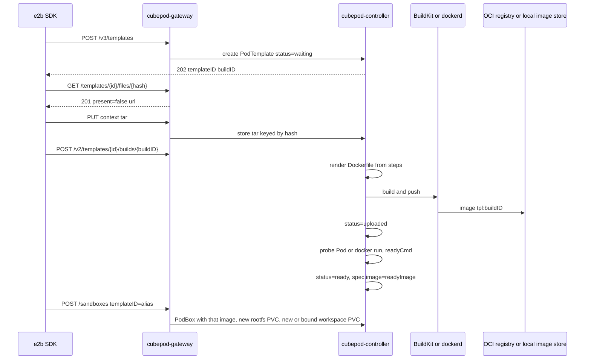
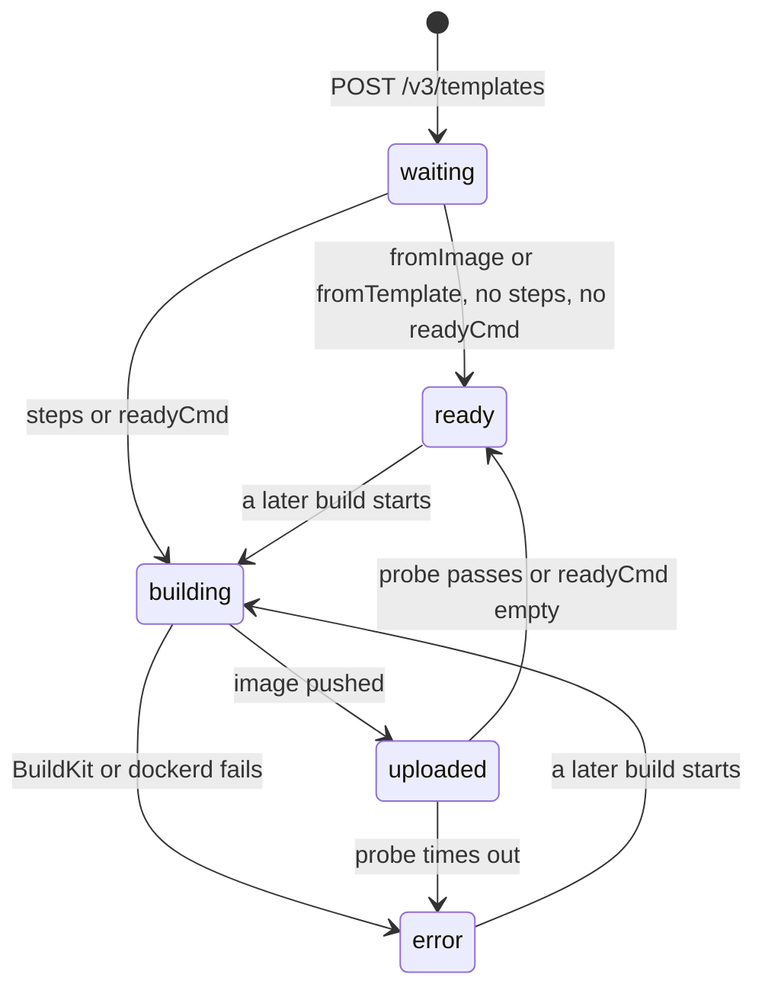

# CEP-0019: E2B-Compatible Template Catalog and OCI Image Builds

| Field | Value |
| :--- | :--- |
| **CEP Number** | `0019` |
| **Status** | `provisional` (`alpha`) |
| **Owning Area** | `gateway` |
| **Participating Areas** | `controller`, `runtime`, `sdk` |
| **Authors** | @cubepod-maintainers |
| **Created** | 2026-11-12 |
| **Last Updated** | 2026-11-12 |

<!-- toc -->
- [Release Signoff Checklist](#release-signoff-checklist)
- [Summary](#summary)
- [Motivation](#motivation)
  - [Goals](#goals)
  - [Non-Goals](#non-goals)
- [Proposal](#proposal)
  - [Prior Art](#prior-art)
  - [User Stories](#user-stories)
  - [Notes / Constraints / Caveats](#notes--constraints--caveats)
  - [Risks and Mitigations](#risks-and-mitigations)
- [Design Details](#design-details)
  - [API / CRD / Wire Changes](#api--crd--wire-changes)
  - [Architecture & State Machine](#architecture--state-machine)
  - [BuildKit translation](#buildkit-translation)
  - [Sandbox resolution](#sandbox-resolution)
  - [Dual-Runtime Behavior (K8s Kata vs. Local Docker)](#dual-runtime-behavior-k8s-kata-vs-local-docker)
  - [Boundary Conditions & Failure Recovery](#boundary-conditions--failure-recovery)
  - [Test Plan](#test-plan)
  - [Graduation Criteria](#graduation-criteria)
  - [Upgrade / Downgrade Strategy](#upgrade--downgrade-strategy)
- [Production Readiness Review Questionnaire (PRR)](#production-readiness-review-questionnaire-prr)
- [Implementation History](#implementation-history)
- [Drawbacks](#drawbacks)
- [Alternatives Considered](#alternatives-considered)
<!-- /toc -->

---

## Release Signoff Checklist

- [ ] Enhancement scope, Goals, and Non-Goals are agreed upon (`provisional` -> `implementable`)
- [ ] API / CRD (`cubepod.io/v1alpha1` `PodTemplate`) and E2B template OpenAPI changes are specified
- [ ] Dual-runtime behavior (Kubernetes Kata + CSI Block AND Local Docker Loopback) is defined
- [ ] Security boundary (rootless BuildKit, registry credentials stay out of image layers and out of the sandbox, UID 1000 default, `/workspace` untouched) is reviewed
- [ ] Test plan includes unit tests (`go test`) and a pinned `e2b` SDK conformance test
- [ ] Production Readiness Review (PRR) section is complete

---

## Summary

CubePod can already start a sandbox from an image name (`POST /sandboxes` with `templateID`), but it has no template catalog that the official E2B SDK can list, inspect, or build. `GET /templates` returns three hardcoded cards (`id`, `name`, `image`, `description`) wrapped in `{"templates":[...]}`. The official `e2b` SDK expects a template resource with `templateID`, builds, aliases, tags, and a Dockerfile-shaped build.

This CEP adds that resource on top of the existing `PodTemplate` CRD. A template resolves to an OCI image plus CPU, memory, and rootfs size. Registering an image that already exists in a registry is the Alpha path and does not run a builder. The Beta path accepts the E2B build request (`fromImage` or `fromTemplate`, plus `steps`) and builds an OCI image with rootless BuildKit. The image is the read-only lower layer. Each sandbox still gets its own OverlayFS upper on `rootfs-pvc`, and `/workspace` stays on `workspace-pvc`. `podd-init` and `podd` stay out of the image and are injected at Pod start, as they are today.

---

## Motivation

CEP-0018 aligns sandbox create, commands, and files with the E2B wire protocol. Template management is the remaining gap that blocks `Template.build`, `Template.list`, and `Sandbox.create("my-alias")` from the official SDK.

What exists today:

- `GET /templates` (`pkg/gateway/server.go`, `handleListTemplates`) encodes the `defaultTemplates` slice. It does not read Kubernetes.
- `POST /sandboxes` copies `templateID` onto `PodBox.spec.templateRef`. The reconciler uses a registered `PodTemplate` when one is in memory. Otherwise `defaultTemplate` treats the string as an OCI image reference and fills in Kata runtime class, `1`/`2` CPU, `2Gi`/`4Gi` memory, `10Gi` rootfs, and `20Gi` workspace (`pkg/controller/reconciler.go`).
- The aliases `base`, `code-interpreter`, `code-interpreter-v1`, and `python` are rewritten to `cubeplex-ubuntu24-desktop` before that lookup.
- `PodTemplate` (`api/v1alpha1/types.go`, CRD `deploy/helm/cubepod/crds/cubepod.io_podtemplates.yaml`) stores `image`, resources, storage, and egress. It has no aliases, build status, start command, or public flag. The CRD has no `status` subresource.
- Python `list_templates()` calls `GET /templates` and accepts either a JSON array or the wrapped object. The Go client and `cubepod` CLI have no template command.

Workarounds that are not enough:

- Passing an image name as `templateID` works for operators who already pushed an image. The official SDK never does this. It creates a template, uploads a context tar, starts a build, and polls status.
- Hand-writing `PodTemplate` manifests is a cluster-admin path. It is invisible to `e2b` and has no build logs.

### Goals

- Alpha: with feature gate `E2BTemplateAPI` enabled, the official SDK can list templates, get one by id or alias, delete it, and mark it public. It can register a template whose only base is an existing OCI image (`fromImage`, empty `steps`) and then `Sandbox.create` that alias. Create responses use that template's `cpuCount`, `memoryMB`, and `diskSizeMB` instead of the hardcoded `2` / `2048` / `10240`.
- Alpha: the three built-in images stay resolvable. `base`, `code-interpreter`, `code-interpreter-v1`, and `python` still start `cubeplex-ubuntu24-desktop`.
- Beta: `Template.build` against a pinned `e2b` SDK version completes for a Dockerfile subset (`FROM`, `RUN`, `COPY`, `WORKDIR`, `USER`, `ENV`, start command, ready command). The build pushes an OCI image. Sandboxes created afterwards use that image. A failed rebuild leaves the previous ready image in place.
- Both phases keep the dual-volume rule. A template build or a template delete never formats, resizes, or deletes an existing sandbox's `rootfs-pvc` or `workspace-pvc`.
- Both phases behave in Production Kubernetes (Kata + CSI raw block) and in local Docker + loopback ext4.

### Non-Goals

- Porting the E2B template manager (Firecracker boot, systemd and `envd` layers, memory snapshot, `userfaultfd` page prefetch). That pipeline produces a paused VM snapshot. CubePod boots an OCI image through containerd and Kata, then `podd-init` pivots onto a per-sandbox ext4 upper.
- Baking `podd-init`, `podd`, or `envd` into the template image.
- Turning a live sandbox into a template (`docker commit`, CSI snapshot of the upper). E2B treats that as a sandbox snapshot, which CEP-0018 already distinguishes from a template. A later CEP can cover it.
- Multi-tenant `teamID`, cross-project public templates, and E2B tag-group pagination. The deprecated `teamID` field is accepted and ignored. `public` is stored and returned.
- Dockerfile instructions E2B itself skips (`EXPOSE`, `VOLUME`, `ARG` build-args beyond the cache-bust this CEP inserts).
- Multi-architecture images. Builds target the node's amd64 userspace, which is the Kata guest architecture this cluster runs.
- Replacing `cubepod` SDK template helpers. They gain the new calls. The official `e2b` SDK remains the conformance client.
- A highly available builder. Beta runs a single builder replica. Shared object storage for context tars is a Stable item.

---

## Proposal

Speak the E2B template HTTP API at the gateway. Persist the template as a `PodTemplate`. Produce an OCI image, either by recording a registry reference (Alpha) or by building one with BuildKit (Beta). Resolve `templateID` on sandbox create through that record.

The build input is the same recipe E2B already documents as a Dockerfile subset ([Defining a template](https://docs.e2b.dev/template/defining-template), [Base image](https://docs.e2b.dev/template/base-image)). The artifact is the OCI image Kubernetes, Kata, ignite, and Docker Sandboxes already run. BuildKit is the builder those communities use for rootless, cacheable image builds. E2B's per-step cache key (base hash + step type + args + `filesHash`, see `e2b-dev/infra` `packages/orchestrator/internal/template/build/phases/steps/hash.go`) maps onto BuildKit's instruction cache plus a content-addressed context tar. `force: true` maps to BuildKit `--no-cache`.

`kubernetes-sigs/agent-sandbox` uses the same split we already have: a template is a reusable pod recipe that points at an image (`SandboxTemplate`), and a warm pool (`SandboxWarmPool`) stamps pods from it. CubePod already has `PodTemplate` and `PodWarmPool`. This CEP extends `PodTemplate` instead of adding a second template CRD.

E2B's `startCmd` is captured inside a memory snapshot, so the process is already running when a sandbox resumes. CubePod does not snapshot guest memory on template build. `podd` starts `startCmd` once after `pivot_root`, and the ready command is a localhost probe. A long-running server comes up on every boot. A one-shot command runs again on every boot. That is the same outcome operators get from a container `CMD`, and it is the outcome [kubernetes-sigs/agent-sandbox](https://github.com/kubernetes-sigs/agent-sandbox) and Docker Sandboxes provide. It is not a resumed Firecracker snapshot.

### Prior Art

| Source | What it does | What this CEP takes |
| :--- | :--- | :--- |
| E2B API, docs as of 2026-11-12 (`docs.e2b.dev` OpenAPI) | Catalog, alias lookup, create (`POST /v3/templates` returns 202 with `templateID` and `buildID`), `GET /templates/{templateID}/files/{hash}` returns `{present,url,headers}`, `POST /v2/templates/{templateID}/builds/{buildID}` with `TemplateBuildStartV2`, poll status, read logs, tags | The wire protocol the official SDK speaks. Status enum `waiting`, `building`, `uploaded`, `ready`, `error`. |
| E2B template manager (`e2b-dev/infra`, orchestrator build role) | Pull an OCI image, inject a systemd layer and `envd`, boot Firecracker, run each step in the guest, snapshot memory and disk, upload the snapshot | The step list and the `filesHash` context tar. Not the snapshot artifact. |
| E2B SDK note on `setEnvs` / `set_envs` (E2B commit `1ebc6df`) | Variables set on the template exist only while the build runs | Build-time env is applied to `RUN` steps and is not written to the image `Config.Env`. Sandbox env still comes from `POST /sandboxes` `envVars`. |
| BuildKit (`moby/buildkit`) | Rootless daemon, registry cache, Dockerfile frontend, context streamed by the client | The Beta builder. A failed instruction fails the build. Cache scope is the cluster registry. |
| `kubernetes-sigs/agent-sandbox` `SandboxTemplate` | Image, `runtimeClassName`, resources, and a warm pool are the template. Users do not get a second build API. | Keep one template CRD. Do not invent a parallel `SandboxTemplate`. |
| Docker Sandboxes | Custom templates are `docker build` of an OCI image and a registry push (or `docker image save` plus load) | Local mode uses the Docker daemon the local runtime already uses. Production does not mount `docker.sock` into the builder or into sandboxes. |
| Kata / containerd | The Pod's container image is an OCI image unpacked by the snapshotter. The guest rootfs is that snapshot plus whatever the agent mounts. | The built image is `PodTemplate.spec.image`. `podd-init` keeps mounting the block upper on top. |

### User Stories

#### Story 1: Register an image the cluster can already pull

As a CubePlex operator, I want `POST /v2/templates` with alias `python-tools` and a follow-up start-build of `fromImage: python:3.13` and no steps, so that `Sandbox.create("python-tools")` from the official SDK pulls `python:3.13` and sizes the MicroVM from the template's CPU and memory.

#### Story 2: Build a template from a recipe

As an agent author using `e2b.Template`, I want `Template.build` of `from_python_image("3.13").copy("requirements.txt", "/home/user/").run_cmd("pip install -r /home/user/requirements.txt")` to finish against `E2B_DOMAIN` pointing at `cubepod-gateway`, so the next sandbox has those packages in the lower image and an empty writable upper.

#### Story 3: Rebuild without touching workspaces

As a cluster operator, I want a rebuilt template to affect only sandboxes created after the build reaches `ready`. Existing `rootfs-pvc` uppers and every `workspace-pvc` stay as they are. Warm-pool standbys keep the image they were stamped with until the pool is scaled or recreated.

#### Story 4: Local development without a registry

As a developer running `docker-compose`, I want the same API to `docker build` into the local daemon when no registry is configured, so `pkg/runtime` starts a container from that local tag.

### Notes / Constraints / Caveats

- Kubernetes object names are DNS-1123. An alias such as `ubuntu:24.04` or `my-template:v1` cannot be `metadata.name`. The object name is a slug (`ubuntu-24-04`). The E2B name and tags live in `spec.names`. Lookup is by `status.templateID`, `metadata.name`, or any entry in `spec.names`.
- `GET /templates` in the E2B API returns a JSON array, not an object. Official clients will not read `{"templates":[...]}`. The feature gate switches this response. With the gate off, the handler stays the current stub so existing gateway tests keep passing.
- E2B `diskSizeMB` on the template resource is an output. The input that sizes the disk is `minFreeDiskMb` on `POST /v3/templates` ([Build](https://docs.e2b.dev/template/build)). CubePod does not grow an ext4 image inside BuildKit. It sets `spec.storage.rootfsSize` to at least `minFreeDiskMb` (MiB converted to a Kubernetes quantity, minimum `10Gi`) on the per-sandbox upper block device. `workspaceSize` stays on its own field and defaults to `20Gi`.
- `COPY` steps require a context tar whose SHA-256 is `filesHash` (`^[0-9a-f]{64}$`). E2B's `GET /templates/{templateID}/files/{hash}` returns 201 `{present, url, headers}`. When `present` is true the SDK skips the upload. The URL we return is an internal upload endpoint on the gateway, not a third-party object store.
- Two registry credentials stay separate. `fromImageRegistry` (`registry`, `aws`, or `gcp`) is only the pull credential for the base image named in the build request. The controller writes it to Secret `cubepod-template-src-<buildID>`, passes that Secret only to the BuildKit session, and deletes it when the build reaches `ready` or `error`. The registry that stores `<registry>/cubepod-templates/...` is different. Helm sets `templateBuild.registry.pushSecret` and `templateBuild.registry.pullSecret` (they may name the same Secret). The controller uses the push Secret for the BuildKit push and never creates or deletes it from the client request. Every sandbox Pod and the build probe Pod sets `imagePullSecrets` to the pull Secret. A node that has not cached the image can still pull it. Neither Secret is mounted as a file in the sandbox, passed as image `ENV`, or written into build logs. Sandbox secrets remain `cpodref_` placeholders (CEP-0005).
- A template build must not place files at `/workspace`. `COPY` / `ADD` destinations and `WORKDIR` values of `/workspace` or a path under it return 400 before BuildKit starts. The CEP does not name a replacement directory. Any other path in the image is left as the recipe wrote it. At runtime `workspace-pvc` is mounted on `/workspace`, so anything a `RUN` step still wrote there is hidden for the life of the sandbox. The workspace volume is not seeded from the image.
- Template `ENV` steps are build-time only, matching the current E2B SDK contract. They are prefixed onto each following `RUN`. They are not committed as image environment. A user who needs runtime env sets `envVars` on sandbox create.
- `USER` is stored on the template. When it is unset, agent commands and uploaded files stay `cubeplex` `1000:1000`. When it is set, `podd` runs agent commands and writes uploads as that user. `podd` does the ownership change. The image build does not require a follow-up `chown` in the sandbox shell.
- The builder runs on a normal `runc` node. It does not run as a Kata MicroVM. Kata node pools often lack the user namespaces a rootless BuildKit daemon wants, and a build must not take a warm-pool slot.
- Build-time `ENV` values can still leak through shell history inside a `RUN` layer if the Dockerfile author echoes them. The gateway rejects a step whose args contain a registry password or a `cpodref_` raw secret. It does not try to scan arbitrary `RUN` scripts for other secrets.

### Risks and Mitigations

| Risk | Impact | Likelihood | Mitigation |
| :--- | :--- | :--- | :--- |
| Official SDK cannot parse `GET /templates` | High | High today | Gate-on response is the E2B array. Conformance test decodes it with the pinned SDK models. |
| Rebuild replaces the image out from under a running sandbox | High | Med | `status.readyImage` changes only when the new build is `ready`. Running Pods keep the image they started with. The upper block device is not rewritten. |
| Build context or registry password lands in the sandbox or in logs | High | Med | Context PVC is mounted only by the controller. The source-pull Secret is deleted at the end of the build. The destination pull Secret is cluster config and is not logged. The log scrubber drops header values and known secret strings. |
| A rebuilt template is handed out from a warm standby that still runs the previous image | High | Med | When `readyImage` changes, unclaimed standbys for that template are deleted and the pool stamps new ones. `ClaimWarmPod` rejects an entry whose image does not match the current `readyImage`. Claimed sandboxes and their PVCs stay. |
| Files baked at `/workspace` disappear once the workspace volume mounts | High | Med | `COPY` and `WORKDIR` onto `/workspace` are rejected. The workspace volume is not seeded from the image. |
| `RUN` as root during build produces root-owned files the sandbox user cannot write | Med | High | Documented. Default sandbox user remains `1000:1000`. Authors who `USER` another account get that account for agent exec. The probe runs the ready command as that user. |
| BuildKit cache grows without bound on the node | Med | Med | Cache PVC has a size limit in Helm. Eviction is BuildKit's own GC (`gckeepstorage`). Cache loss only slows the next build. |
| Controller restarts mid-build | Med | Med | Build phase is on the CR. On restart the controller reattaches to the BuildKit job / local build record. If the job is gone, the build becomes `error` and `readyImage` is unchanged. |
| `startCmd` semantic differs from an E2B memory snapshot | Med | High | Stated in the proposal. Ready command runs against a freshly started process. Templates that depend on in-memory state captured at snapshot time are out of scope. |
| Deleting a template strands a warm pool | Med | Med | Delete returns 409 when a `PodWarmPool` or a non-terminated `PodBox` references the template. `?force=true` removes the catalog row only. Volumes are not deleted. |
| Context tar hash does not match the bytes | Med | Low | Upload handler hashes the body. Mismatch returns 400 and does not keep the object. |

---

## Design Details

### API / CRD / Wire Changes

Feature gate `E2BTemplateAPI` (default **off**). Gateway flag `--feature-gate=E2BTemplateAPI=true`, Helm `featureGates.e2bTemplateAPI`. With the gate off, no new route is registered and `GET /templates` stays the current stub. The gate is read by `cubepod-gateway` and `cubepod-controller` only. `podd` has no gate. It runs `CUBEPOD_START_CMD` when the controller sets that variable on the Pod, and it does nothing when the variable is absent.

#### `PodTemplate` spec additions

All new fields are optional. `spec.image` stays required so existing objects still validate. For a template that is only `waiting`, `spec.image` is set to the placeholder `cubepod.io/unbuilt:waiting`. Sandbox create rejects that placeholder with 409 `template is not ready`.

```go
// Additions to PodTemplateSpec in api/v1alpha1/types.go.
type PodTemplateSpec struct {
    // existing: RuntimeClassName, Image, PoddImage, Resources, Storage, Egress

    // Names are the E2B aliases and tags ("my-template", "my-template:v1", "ubuntu:24.04").
    Names []string `json:"names,omitempty"`
    // CPUCount, MemoryMB, and DiskSizeMB are the E2B resource view.
    // The controller also writes Resources and Storage.rootfsSize from them.
    CPUCount   int32 `json:"cpuCount,omitempty"`
    MemoryMB   int32 `json:"memoryMB,omitempty"`
    DiskSizeMB int32 `json:"diskSizeMB,omitempty"`
    Public     bool  `json:"public,omitempty"`
    // StartCmd is launched by podd after pivot_root. It is not the container entrypoint.
    StartCmd string `json:"startCmd,omitempty"`
    // ReadyCmd is probed during the build and after each sandbox start. Empty skips the probe.
    ReadyCmd string `json:"readyCmd,omitempty"`
    // RunAsUser overrides the sandbox command uid. 0 means "unset" and podd uses 1000.
    RunAsUser int64 `json:"runAsUser,omitempty"`
    // RunAsUsername is set when USER is not numeric. podd resolves it inside the image.
    RunAsUsername string `json:"runAsUsername,omitempty"`
}
```

#### `PodTemplate` status

The CRD gains `subresources.status`. Existing objects get an empty status.

```go
type PodTemplateStatus struct {
    TemplateID    string `json:"templateID,omitempty"`
    ReadyBuildID  string `json:"readyBuildID,omitempty"`
    ReadyImage    string `json:"readyImage,omitempty"`
    LatestBuildID string `json:"latestBuildID,omitempty"`
    // BuildStatus is the E2B enum for LatestBuildID:
    // waiting, building, uploaded, ready, error.
    BuildStatus string `json:"buildStatus,omitempty"`
    Reason      string `json:"reason,omitempty"`
    Public      bool   `json:"public,omitempty"`
}

// PodTemplate is the cluster object. The shape matches PodBox in this package.
// This module does not run controller-gen, so these structs are hand-written.
type PodTemplate struct {
    APIVersion string            `json:"apiVersion,omitempty"`
    Kind       string            `json:"kind,omitempty"`
    Metadata   ObjectMeta        `json:"metadata"`
    Spec       PodTemplateSpec   `json:"spec"`
    Status     PodTemplateStatus `json:"status,omitempty"`
}

// PodTemplateList is the list returned by the CRD.
type PodTemplateList struct {
    APIVersion string        `json:"apiVersion,omitempty"`
    Kind       string        `json:"kind,omitempty"`
    Metadata   ObjectMeta    `json:"metadata,omitempty"`
    Items      []PodTemplate `json:"items"`
}
```

`api/v1alpha1/types.go` today has `PodTemplateSpec` only. `Reconciler.templates` is an in-memory `map[string]PodTemplateSpec` updated by `RegisterTemplate`. Nothing lists `podtemplates.cubepod.io`. This CEP adds `PodTemplate` and `PodTemplateList` beside `PodBox`. `KubeClient` gains `ListPodTemplates`, `GetPodTemplate`, `CreatePodTemplate`, and `UpdatePodTemplateStatus`. `RESTKubeClient` talks to the CRD. `MemoryKubeClient` serves unit tests and the local JSON catalog. On start, and on each resync, the controller lists the CRD and rebuilds the map keyed by `metadata.name`, `status.templateID`, and every `spec.names` entry. `RegisterTemplate` stays as the write path for tests. The gateway reads templates only through the reconciler.

`spec.image` is updated to `status.readyImage` only when a build enters `ready`. Until then the reconciler that stamps Pods reads `status.readyImage` when it is non-empty, and falls back to `spec.image` for objects created by hand with no status.

Printer columns: `Image` (`.status.readyImage`), `Build` (`.status.buildStatus`), `Age`.

#### Alias index

The controller indexes `status.templateID`, `metadata.name`, and every `spec.names` entry. A second template that claims an existing name is rejected with 409. The index is rebuilt from the API list on controller start.

#### Routes

Alpha and Beta share the catalog. Rows marked Beta return **501** `template build is not enabled` in Alpha, with body `{"code":501,"message":"..."}`.

| Phase | Method | Path | Behavior |
| :--- | :--- | :--- | :--- |
| Alpha | `GET` | `/templates` | JSON array of E2B template objects. Query `teamID` is ignored. More than 5000 ready-or-latest rows returns 400, matching E2B's v1 cap. |
| Alpha | `GET` | `/templates/{templateID}` | One template plus its latest build in `builds`. Unknown id returns 404. |
| Alpha | `GET` | `/templates/aliases/{alias}` | 200 with the same object when the alias exists, 404 when it does not. |
| Alpha | `DELETE` | `/templates/{templateID}` | Deletes the CR when nothing references it. 409 when a live PodBox or WarmPool references it. `?force=true` deletes the CR anyway and does not delete volumes. |
| Alpha | `PATCH` | `/templates/{templateID}` and `/v2/templates/{templateID}` | Body `{"public":true}`. Response `{"names":[...]}` for the v2 route. |
| Alpha | `POST` | `/templates`, `/v2/templates`, `/v3/templates` | Create. 202 and the v3 response shape below. `Idempotency-Key` is honored in Beta; Alpha stores the key on the CR and replays the same 202 when the body hash matches. |
| Alpha | `POST` | `/v2/templates/{templateID}/builds/{buildID}` | Start build. Empty `steps` and a `fromImage` or `fromTemplate` marks the build `ready` without BuildKit. Non-empty `steps` is Beta. |
| Beta | `GET` | `/templates/{templateID}/files/{hash}` | 201 `{"present":bool,"url":"...","headers":{}}`. `present: true` when that tar is already stored. |
| Beta | `PUT` | the `url` returned above | Raw tar body. Gateway streams it to the controller. |
| Beta | `GET` | `/templates/{templateID}/builds/{buildID}/status` | `{logs, logEntries, templateID, buildID, status, reason}`. Query `logsOffset`, `limit` (default 100, max 100), `level`. |
| Beta | `GET` | `/templates/{templateID}/builds/{buildID}/logs` | `{logs:[{timestamp, message, level}]}`. Query `cursor`, `limit`, `direction`, `level`. |
| Beta | `GET` | `/v2/templates` | Same objects as v1, with `nextToken` pagination, page size 100. |
| Stable | `POST` / `DELETE` / `GET` | E2B tag routes under `/tags` | Assign, delete, and list tags. Alpha and Beta encode tags as `spec.names` entries of the form `name:tag` on the create body (`name`, `tags`). |

`POST /v3/templates` request (the fields the SDK sends):

```json
{
  "name": "my-template",
  "tags": ["v1"],
  "alias": "my-template",
  "cpuCount": 2,
  "memoryMB": 2048,
  "minFreeDiskMb": 2048
}
```

`name` may contain one colon tag (`my-template:v1`). That tag is appended to `tags`. `alias` is the deprecated name and is used when `name` is empty.

Response 202:

```json
{
  "templateID": "tpl_8f3a0c",
  "buildID": "bld_1c2d",
  "public": false,
  "aliases": ["my-template"],
  "names": ["my-template", "my-template:v1"],
  "tags": ["v1"]
}
```

`templateID` is `tpl_` plus 8 lowercase hex chars from a random source. `buildID` is `bld_` plus 8 hex chars. Both are stored on the CR. The object name is the slug of the primary name, truncated to 63 characters. A collision on the slug with a different template id returns 409.

`POST /v2/templates/{templateID}/builds/{buildID}` body is E2B `TemplateBuildStartV2`:

```json
{
  "fromImage": "python:3.13",
  "fromTemplate": "",
  "fromImageRegistry": {"type": "registry", "username": "ci", "password": "secret"},
  "force": false,
  "startCmd": "python -m http.server 8080",
  "readyCmd": "curl -sf http://127.0.0.1:8080/",
  "steps": [
    {"type": "USER", "args": ["1000"]},
    {"type": "COPY", "args": ["requirements.txt", "/home/user/requirements.txt"], "filesHash": "<64 lowercase hex>"},
    {"type": "RUN", "args": ["pip install -r /home/user/requirements.txt"]}
  ]
}
```

Exactly one of `fromImage` and `fromTemplate` is non-empty. `fromTemplate` must name a template whose `buildStatus` is `ready`. The builder uses that template's `readyImage` as `FROM`. Unknown `steps[].type` returns 400. The types this CEP implements are the uppercase forms the E2B orchestrator dispatches on: `RUN`, `COPY`, `WORKDIR`, `USER`, `ENV`. `ADD` is accepted as `COPY`. A step with `force: true` and every step after it skips the cache.

List item shape (every field the E2B list schema marks required, so the official client can decode the array):

```json
{
  "templateID": "tpl_8f3a0c",
  "buildID": "bld_1c2d",
  "cpuCount": 2,
  "memoryMB": 2048,
  "diskSizeMB": 10240,
  "public": false,
  "aliases": ["my-template"],
  "names": ["my-template", "my-template:v1"],
  "createdAt": "2026-11-12T00:00:00Z",
  "updatedAt": "2026-11-12T00:00:00Z",
  "createdBy": null,
  "lastSpawnedAt": null,
  "spawnCount": 0,
  "buildCount": 1,
  "envdVersion": "cubepod-podd",
  "buildStatus": "ready"
}
```

`envdVersion` is the constant `cubepod-podd`. CubePod does not run `envd`. The field is present because E2B marks it required. `createdBy` is null. `spawnCount` increments when a sandbox is created from this template. `diskSizeMB` is the rootfs quantity converted to MiB.

`GET /templates` with the gate off is unchanged:

```json
{"templates":[{"id":"cubeplex-ubuntu24-desktop","name":"...","image":"...","description":"..."}]}
```

#### Seeded templates

On startup the controller ensures three `PodTemplate` objects if they are absent. It does not overwrite an object the user has edited.

| Object name | `spec.names` | `spec.image` | Ready |
| :--- | :--- | :--- | :--- |
| `cubeplex-ubuntu24-desktop` | `cubeplex-ubuntu24-desktop`, `base`, `code-interpreter`, `code-interpreter-v1`, `python` | `cubeplex-ubuntu24-desktop:latest` | yes |
| `ubuntu-24-04` | `ubuntu:24.04` | `ubuntu:24.04` | yes |
| `debian-12` | `debian:12` | `debian:12` | yes |

CPU `2`, memory `2048`, rootfs `10Gi`, workspace `20Gi`, matching `defaultTemplate` today.

#### CLI and SDKs

- `cubepod template list|get|create|delete` call the gateway routes above. `create` in Alpha takes `--from-image` and `--alias`.
- Go `pkg/client` gains the same four calls.
- Python `list_templates()` already accepts an array. It keeps accepting the wrapped object. New methods cover get, create-from-image, and delete. Beta adds `build_template` only as a thin helper. The conformance path is the official `e2b.Template.build`.

#### Sandbox create resource fields

`handleCreateSandbox` today writes `CPUCount: 2`, `MemoryMB: 2048`, `DiskSizeMB: 10240`. With the gate on, those three fields come from the resolved template. With the gate off they stay hardcoded.

### Architecture & State Machine



Build phases on `status.buildStatus`:



A transition to `building` does not clear `readyImage` or `readyBuildID`. Sandbox create and warm-pool stamping read `readyImage` only.

`podd-init` still `exec`s `/opt/cubepod/bin/podd`, so `podd` is PID 1. The template image's `ENTRYPOINT` is not used. When the Pod env `CUBEPOD_START_CMD` is set, `podd` starts that command once as the template user and does not restart it after it exits. stdout and stderr are appended to `/var/log/cubepod/start-cmd.log` on the rootfs upper, mode `0644`, owned by the template user. The exit code is written to `/var/log/cubepod/start-cmd.status`. `podd` reaps `startCmd` and any children it leaves behind, because those `SIGCHLD` signals are delivered to PID 1. The log lives on the rootfs upper: `reset-rootfs` removes it, and the workspace volume is not involved.

The build probe polls `readyCmd` inside the short-lived probe Pod. On sandbox create, the gateway polls the same command through `podd` until it exits 0 or `templateBuild.probeTimeout` (default 120s) elapses. On timeout the PodBox phase becomes `Failed` and the API returns **503**:

```json
{
  "code": 503,
  "message": "template ready command timed out",
  "sandboxID": "cpod-1",
  "logPath": "/var/log/cubepod/start-cmd.log"
}
```

The sandbox is not deleted, so the file API can read that log. An empty `readyCmd` skips the probe. The gateway's existing `podd` health wait still runs.

### BuildKit translation

The controller renders a Dockerfile in memory. It does not write it into the user's workspace. The paths in the example are only there to show the translation. Any path other than `/workspace` is acceptable.

```dockerfile
FROM python:3.13
USER 1000
COPY requirements.txt /home/user/requirements.txt
RUN pip install -r /home/user/requirements.txt
```

Rules:

| Step `type` | Dockerfile | Notes |
| :--- | :--- | :--- |
| `ENV` | none | Accumulated and prefixed on later `RUN` lines as `KEY=VAL`. Not an image `ENV`. |
| `WORKDIR` | `WORKDIR` | A value of `/workspace` or a path under it returns 400. |
| `USER` | `USER` | Also stored on `spec.runAsUser` or `spec.runAsUsername`. |
| `COPY` | `COPY` | Context is the tar for this step's `filesHash`, unpacked as the BuildKit context. Missing tar returns 400 before the build starts. A destination of `/workspace` or a path under it returns 400. |
| `RUN` | `RUN` | Prefixed with the accumulated build-time env. A `RUN` that writes under `/workspace` is not rejected by parsing the shell. Those files are hidden once `workspace-pvc` mounts, and they are not copied into the volume. |
| `startCmd` | not a `CMD` | Passed to `podd` through the Pod env. |
| `readyCmd` | not a `RUN` | Probe after push. |

`force: true` on the build request invokes BuildKit with no cache. `force: true` on a single step inserts

```dockerfile
ARG CUBEPOD_CACHEBUST=<buildID>
```

immediately before that instruction, which invalidates that instruction and every instruction after it. Earlier instructions stay cached. This matches E2B's `skipCache()` placement.

Layer cache in production uses BuildKit's registry cache, ref `<registry>/cubepod-templates/<slug>-cache`. Local Docker uses the daemon's normal layer cache.

The rendered Dockerfile and the context tars are deleted after the build reaches `ready` or `error`, except the content-addressed tar store keeps objects for `contextTTL` (default 24h) so a retry with the same `filesHash` gets `present: true`.

### Sandbox resolution

With the gate on, `POST /sandboxes` resolves `templateID` in this order:

0. An empty `templateID` is rewritten to `base` before the steps below. Today's gateway treats `""` the same as `base`, `code-interpreter`, `code-interpreter-v1`, and `python` (`pkg/gateway/sandboxes.go`). Leaving the empty string to fall through to step 5 would return 404.
1. Alias index hit with `buildStatus=ready` (or a non-empty `readyImage`): use `readyImage`, CPU, memory, rootfs size, `startCmd`, `readyCmd`, and run-as user.
2. Alias index hit without `readyImage`: **409** `template is not ready`.
3. No hit, and the string is one of `base`, `code-interpreter`, `code-interpreter-v1`, `python`: use the seeded `cubeplex-ubuntu24-desktop` template. This preserves CEP-0018.
4. No hit, and the string contains `/` or `:`, so it looks like an OCI reference: keep today's `defaultTemplate` behavior and stamp a Pod from that image. This keeps `templateID: "ghcr.io/org/app:1.2"` working without a catalog row.
5. Otherwise **404** `template not found`.

With the gate off, step 0 still runs, and steps 1, 2, and 5 are skipped. The current rewrite plus `defaultTemplate` stays.

Warm-pool create uses the same resolver. A pool bound to a template that is not ready is rejected.

### Dual-Runtime Behavior (K8s Kata vs. Local Docker)

**Kubernetes Production (Kata + CSI raw block)**

- Catalog state is the `PodTemplate` CR in the workload namespace.
- Alpha from-image registration does not start a pod. The next sandbox Pod uses `spec.image` / `status.readyImage` as the container image. containerd pulls it. `podd-init` mounts the new `rootfs-pvc` block device as the OverlayFS upper and mounts `workspace-pvc` on `/workspace`. Neither volume is copied from the template.
- Beta runs a rootless BuildKit Deployment (`moby/buildkit`, rootless image, non-root, `seccompProfile: RuntimeClass`, no privileged flag, no `docker.sock`, no Kata `runtimeClassName`). Helm value `templateBuild.buildkit.address` defaults to `tcp://cubepod-buildkit.cubepod-system.svc:1234`. A NetworkPolicy allows only the controller to connect.
- The controller is the BuildKit client (`buildctl` in-process via the BuildKit Go client, or a sidecar binary in the controller image). It streams the context from a RWO PVC `cubepod-template-context` mounted only by the controller. Gateway uploads go to `POST /internal/v1/template-builds/context/{hash}` on the controller, the same style as `/internal/v1/egress/exchange`.
- While `templateBuild.enabled=true`, the controller Deployment is `replicas: 1` because the context PVC is RWO. Stable removes this cap by storing tars in an object store.
- The pushed image reference is `<registry>/cubepod-templates/<slug>:<buildID>`. BuildKit pushes it with `templateBuild.registry.pushSecret`. Sandbox Pods and the probe Pod list `templateBuild.registry.pullSecret` under `imagePullSecrets`. That pull Secret is created by the cluster install, not by the build request, and the controller does not delete it. `fromImageRegistry` is a different, build-scoped Secret used only to pull the base image. It is not attached to sandbox Pods.
- The ready probe is a short-lived runc Pod, not a Kata PodBox. It uses the new image, an `emptyDir` for writable space, no `rootfs-pvc`, and no `workspace-pvc`. The probe command starts `startCmd` in the background and polls `readyCmd` against localhost. The controller deletes the Pod when the probe finishes. A probe failure does not allocate a CSI volume.
- Sandbox Pods that are created after `ready` still go through Kata, `podd-init`, and the dual block PVCs. `CUBEPOD_START_CMD` is set on that Pod only.

**Local Development (Docker + loopback ext4)**

The reconciler is the builder in both modes. `cmd/cubepod-gateway` already constructs that reconciler in-process for local runs, and the HTTP handlers do not shell out. `pkg/runtime` is the Docker client the reconciler calls. It does not decide when a build starts.

- Catalog state is a JSON file under the local state dir (`${CUBEPOD_STATE}/templates/<templateID>.json`) with the same fields as the CR status. The in-process reconciler writes it through `MemoryKubeClient`. There is no Kubernetes API.
- Alpha from-image registration records the image name. The reconciler then asks `pkg/runtime` to `docker run` that name, as it does today.
- Beta, when no registry is configured, the reconciler calls `pkg/runtime` to `docker build` on the host Docker socket the local driver already uses. The tag is `cubepod-templates/<slug>:<buildID>`. The context dir is `${CUBEPOD_STATE}/template-context/<hash>/`. This socket is not mounted into sandbox containers.
- The probe is the reconciler calling `pkg/runtime` for `docker run --rm` of that tag, with a local scratch upper and no loopback file attached for the workspace. The container is removed after the probe.
- When a local registry is configured, the same reconciler path pushes and `pkg/runtime` pulls, same as production.

### Boundary Conditions & Failure Recovery

| Condition | Result |
| :--- | :--- |
| BuildKit or dockerd returns non-zero | `buildStatus=error`, `reason` is the last non-empty log line. `readyImage` unchanged. Context tar kept until TTL. |
| Controller process dies while `building` | On start, if the BuildKit job or the recorded local build pid is still running, keep watching. If it is gone, set `error` with reason `builder disappeared`. |
| Gateway dies during tar upload | Client retries `PUT`. The hash check replaces a partial file only after the full body matches. A partial file is named `*.partial` and is not `present`. |
| Idempotency-Key replay with the same body hash | Return the stored 202 body and the same ids. Do not start a second build. |
| Idempotency-Key replay with a different body | 409 `idempotency_request_mismatch`. |
| Probe exceeds `templateBuild.probeTimeout` (default 120s) | `error`. Probe Pod or container is deleted. |
| Node disk full on the cache PVC | BuildKit fails the build. User workspace PVCs are a different volume. |
| Registry push succeeds and the process dies before status update | On restart, if the image tag exists (`crictl`/`docker manifest inspect` or registry HEAD), move `uploaded` and resume the probe. |
| Delete while a build is `building` | 409. The build is left running until it finishes, then the operator deletes. |
| Base image pull requires auth and `fromImageRegistry` is missing | Build fails with `error`. The message says the pull was unauthorized and does not include credentials. |

### Test Plan

- **Unit tests** (`cargo test` in `crates/podd`):
  - `CUBEPOD_START_CMD` unset: `podd` does not spawn a start process.
  - `CUBEPOD_START_CMD` set: the command runs once as the configured uid, stdout and stderr land in `/var/log/cubepod/start-cmd.log`, the exit code lands in `start-cmd.status`, and the process is not restarted.
  - A child that exits is reaped. `podd` does not leave a zombie.
- **Unit tests** (`go test` in `pkg/gateway`, `pkg/controller`):
  - Gate off: `GET /templates` body is still the wrapped three-entry stub.
  - Gate on: list decodes as a JSON array with the required E2B fields. Seeded aliases resolve.
  - Create from `fromImage` with empty steps sets `ready` and does not invoke the builder interface.
  - Create with steps and the Beta builder disabled returns 501.
  - Alias collision returns 409. Unknown step type returns 400. Both `fromImage` and `fromTemplate` set returns 400. Neither set returns 400.
  - `filesHash` that is not 64 hex chars returns 400. Upload whose SHA-256 does not match the path returns 400 and leaves `present` false.
  - Rebuild failure does not change `readyImage`. Sandbox create during `building` still uses the old image.
  - Delete of a template referenced by a PodBox returns 409 and the CR remains.
  - Dockerfile renderer: `ENV` does not appear as an `ENV` instruction. `RUN` lines contain the prefix. A step `force` inserts `ARG CUBEPOD_CACHEBUST` before that step only.
  - Idempotency replay returns the same `templateID` and `buildID`.
  - Log scrubber removes a fixture password.
  - `defaultTemplate` fallback still accepts `ghcr.io/org/app:1` when the gate is on and the name is not in the catalog.
  - `base` still resolves to `cubeplex-ubuntu24-desktop`. An empty `templateID` resolves to the same template when the gate is on.
  - `COPY` or `WORKDIR` of `/workspace` returns 400 and does not call the builder.
  - A `readyImage` change deletes unclaimed warm entries for that template and `ClaimWarmPod` will not return an entry stamped with the previous image. A claimed PodBox and its PVCs remain.
  - The sandbox Pod manifest references `templateBuild.registry.pullSecret`. The source-pull Secret name is absent from that manifest.
- **Integration / E2E**:
  - Local Docker: `POST` a from-image template, `POST /sandboxes` with the alias, `podd` answers health, a file written under `/workspace` is still there after `reset-rootfs`. The template image id does not change that file.
  - Local Docker Beta: build `FROM busybox`, `RUN echo cube > /etc/cubepod-build`, probe with `readyCmd` of `true`. New sandbox `cat /etc/cubepod-build` prints `cube`. A second sandbox has an empty upper and does not see a file written in the first sandbox's upper.
  - Kubernetes: the same two flows against the test cluster. The build Pod is not Kata. The sandbox Pod is Kata (or the cluster's configured runtime class) and has two PVCs. Deleting the template CR does not delete those PVCs.
  - Conformance: with `E2B_DOMAIN` pointed at the gateway, the pinned `e2b` Python SDK `Template.build` of an image-only recipe (Alpha) and of a `run_cmd` plus `copy` recipe (Beta) returns, and `Sandbox.create(alias)` runs a command. The test records the SDK version in the test file.

### Graduation Criteria

- **Alpha (`v0.4.0`)**: Gate off by default. Gate on passes the catalog tests, from-image registration, sandbox resource fields, seeded aliases, and the local plus Kubernetes from-image E2E. Delete cannot remove a referenced template. No BuildKit Deployment is installed unless `templateBuild.enabled=true`, and Alpha Helm leaves that false.
- **Beta (`v0.5.0`)**: Gate still off by default. `Template.build` conformance passes on local Docker and on the test cluster. A failed rebuild keeps the previous image. Probe Pods are garbage-collected. Registry credentials do not appear in gateway logs or in `docker history` / image config of the built image. Metrics below are exported.
- **Stable (`v1.0.0`)**: Gate on by default after a CubePlex bake in which a template rebuild did not modify an existing workspace PVC (verified by a checksum of a marker file). Controller can run with more than one replica, with context tars in object storage. Tag routes match the pinned SDK. Rollback of the gate is still supported.

### Upgrade / Downgrade Strategy

- CRD change is additive: new optional spec fields and a status subresource. Old controllers ignore unknown fields. New controllers tolerate objects with no status and use `spec.image`.
- Upgrading the gateway with the gate off does not change `GET /templates` or sandbox create. Enabling the gate changes `GET /templates` to an array. The Python SDK accepts both. A client that only parses the wrapped object must be updated before the gate is turned on. One release of the gateway documents this in the Helm values comment.
- Disabling the gate hides the new routes and restores the stub list. `PodTemplate` objects, sandbox PVCs, and running Pods are left in place. Images already pulled stay pulled.
- Downgrade of the controller to a build that does not know status: sandbox stamping falls back to `spec.image`. This CEP writes `spec.image` when a build becomes ready, so a downgrade still boots the last ready image.
- No migration of `rootfs-pvc` or `workspace-pvc`. Rootfs generation is not bumped by a template build.
- Base-image rollout of a template is a new build id. Existing sandboxes keep their upper. Operators who want a clean lower start a new sandbox or call the existing reset-rootfs API, which replaces the upper and still keeps `/workspace`.

---

## Production Readiness Review Questionnaire (PRR)

### Feature Enablement and Rollback

Helm `featureGates.e2bTemplateAPI` and `templateBuild.enabled`. Rollback is setting the gate to false and redeploying the gateway. Rollback does not delete `PodTemplate` objects and does not touch sandbox PVCs. A build in flight is marked `error` on controller restart if the builder is scaled to zero.

### Rollout, Upgrade and Rollback Planning

Gateway and controller roll independently. In-flight sandbox Pods are not restarted by a template rollout. Paused sandboxes keep their PVCs and, on resume, boot the image they were created with (`PodBox` stores the resolved image in an annotation `cubepod.io/resolved-image` written at create time). They do not silently jump to a newer template build.

When `status.readyImage` changes, the controller deletes unclaimed warm-pool entries whose stamped image differs. That delete removes the standby Pod and the unused rootfs and workspace PVCs that the pool created for it. Those volumes were never bound to a user sandbox. `ClaimWarmPod` checks the entry image against the current `readyImage` and returns an error instead of handing out a stale standby. The warm-pool reconciler then creates replacements from the new image until `replicas` is met. A PodBox that was already claimed, and every PVC it owns, is left in place.

### Monitoring Requirements

- `cubepod_templates{status}` gauge, replacing the hardcoded `cubepod_gateway_templates_total` value of 3 when the gate is on. With the gate off the old metric stays.
- `cubepod_template_builds_total{result="ready|error"}` counter.
- `cubepod_template_build_duration_seconds` histogram.
- Controller log line `template build finished` with `templateID`, `buildID`, `result`, and no registry headers.
- Health: BuildKit Deployment readiness is included in the controller's `/healthz` only when `templateBuild.enabled=true`. A down builder fails new builds and does not fail sandbox create for templates that are already `ready`.

### Dependencies

- Production builds: rootless BuildKit, an OCI registry the nodes can pull (Harbor, Zot, the `registry` image, or an external registry), containerd, and the existing Kata runtime plus CSI block driver for the sandboxes themselves. The builder does not depend on Longhorn or on a particular CSI.
- Local builds: the Docker daemon already required by `pkg/runtime`.
- No new kernel module. Overlay and ext4 requirements are unchanged from CEP-0001.

### Scalability

- Catalog reads are CR list calls. The 5000-row v1 cap returns 400 and points clients at `GET /v2/templates`.
- One build at a time per controller replica in Beta, queued on the controller work queue. A second build for the same template returns 409 while `latest` is `waiting` or `building`.
- BuildKit cache PVC default `20Gi`. Sandbox density is unchanged because builds do not consume warm-pool slots or CSI attach slots on the Kata nodes.
- Context tar limit default `512Mi` per hash. Larger uploads are 413.

### Troubleshooting

| Symptom | What to look at | Recovery |
| :--- | :--- | :--- |
| `GET /templates` is still the wrapped stub | Gate is off | Enable `E2BTemplateAPI` and restart the gateway |
| SDK polls `building` until timeout | BuildKit Pod logs, controller log `template build` | Fix the recipe. `readyImage` of the previous build is still used for create |
| Sandbox 409 `template is not ready` | `kubectl get podtemplate -o yaml` status | Wait for `ready`, or create from an alias that has `readyImage` |
| `COPY` 400 missing context | `present` was false and the PUT did not complete | Re-run the SDK build. The client uploads again |
| Probe `error` with a good image push | Probe Pod logs before deletion, also status `reason` | `readyCmd` must succeed against localhost with no dependency on `podd` |
| Alias 409 | Two templates claim the same `spec.names` entry | Delete or rename one. Force-delete does not delete volumes |
| Sandbox create 503 `template ready command timed out` | `/var/log/cubepod/start-cmd.log` inside that sandbox | Fix `startCmd` or `readyCmd`. The sandbox stays so the log can be read. It is phase `Failed`. |
| Build 400 on `/workspace` | The `COPY` or `WORKDIR` path | Put the files on any path other than `/workspace`. The workspace volume is the sandbox's own PVC. |

---

## Implementation History

- 2026-11-12: Proposal drafted (`provisional`). Prior art reviewed against the E2B OpenAPI on `docs.e2b.dev`, the E2B template manager in `e2b-dev/infra`, BuildKit, `kubernetes-sigs/agent-sandbox` `SandboxTemplate`, and Docker Sandboxes OCI templates.
- 2026-11-12: Review revisions. Source-pull credentials are build-scoped. The template registry pull Secret stays on sandbox Pods. Template steps must not use `/workspace`, and no other directory is prescribed. `PodTemplate` and `PodTemplateList` are specified, and the in-memory map is filled from the CRD. A new `readyImage` retires unclaimed warm standbys. An empty `templateID` becomes `base`. `startCmd` logs, reaping, and the create-time 503 are specified. Local builds are driven by the in-process reconciler through `pkg/runtime`. `podd` is not a feature-gate component. `GET /templates/{templateID}/files/{hash}` stays **201**, which is the status in the E2B OpenAPI.

---

## Drawbacks

- Two artifacts now exist for "what a sandbox boots": the OCI image and the per-sandbox upper. Operators who expect an E2B-style resumed snapshot will see a fresh `startCmd` on every create. That difference has to stay visible in the docs.
- `GET /templates` cannot keep a single body shape that satisfies both the official SDK and the old wrapped stub. The gate exists because of that.
- A single-replica controller while builds are enabled is an operational limit. It is the cost of not adding an object store in Beta.
- Rootless BuildKit is another Deployment to patch and to give disk to. Clusters that only want to pin existing images never need it, which is why Alpha does not install it.
- Matching E2B's build-time-only `ENV` means a Dockerfile `ENV` author who switches from `docker build` to `Template.build` will not see those variables at runtime. This CEP follows the SDK contract, not `docker build`.

---

## Alternatives Considered

1. **Port the E2B template manager and store Firecracker snapshots.** Rejected. The open-source builder pulls an image, injects systemd and `envd`, boots Firecracker, and uploads a memory-and-disk snapshot (`e2b-dev/infra` orchestrator template build). CubePod's lower layer is an OCI image unpacked by containerd, PID 1 is `podd-init` injected from `emptyDir`, and the writable layer is a CSI block volume. A snapshot store would be a second rootfs implementation beside OverlayFS, and it would bake a guest agent into the image, which the repository invariants forbid. Self-hosted E2B stacks also require `/dev/kvm` on the build host and a copy of that control plane. That is a different product.

2. **Keep the current behavior and document "push an image, pass its name as templateID".** Rejected as the whole fix. It remains the fallback in step 4 of sandbox resolution, because it is useful. It does not implement list, alias, build status, or `Template.build`.

3. **Add a new CRD copied from `kubernetes-sigs/agent-sandbox` `SandboxTemplate`.** Rejected. That project is the right reference for "a template is a pod recipe plus an image, and a warm pool stamps it". CubePod already has `PodTemplate` and `PodWarmPool` for that. A second CRD would split the image reference the reconciler reads.

4. **Build with Kaniko.** Rejected. Kaniko is unmaintained. BuildKit is the rootless builder Kubernetes and Docker tooling use, including registry-backed layer cache. A Job-per-build Kaniko pod also cannot share a warm cache without extra registry round trips, which BuildKit's daemon already does.

5. **Commit a running sandbox (`docker commit` or a CSI snapshot of `rootfs-pvc`) and call that a template.** Rejected for this CEP. The upper can contain workspace-adjacent writes, shell history, and files the agent downloaded. E2B separates that artifact (sandbox snapshot) from a template rebuilt from a recipe. CSI snapshots are also driver-specific (Longhorn versus loopback) and would not exist in local Docker the same way. A later CEP can add an explicit snapshot API.

6. **Run the build steps inside a Kata PodBox and snapshot the upper block device.** Rejected. It couples template build latency to CSI attach, risks leaving a half-written ext4 if the Pod is killed, and copies the upper into the next sandbox's lower by a driver-specific clone. BuildKit already produces a content-addressed image the node can pull. The per-sandbox upper stays empty at create, which is the dual-volume model.

7. **Write template `ENV` into the image config so it matches `docker build`.** Rejected for the E2B-compatible path. The current `e2b` SDK documents those variables as build-time only. Runtime env stays on `POST /sandboxes`. Authors who want image-level env can put an explicit `RUN` that writes a file the process reads.
