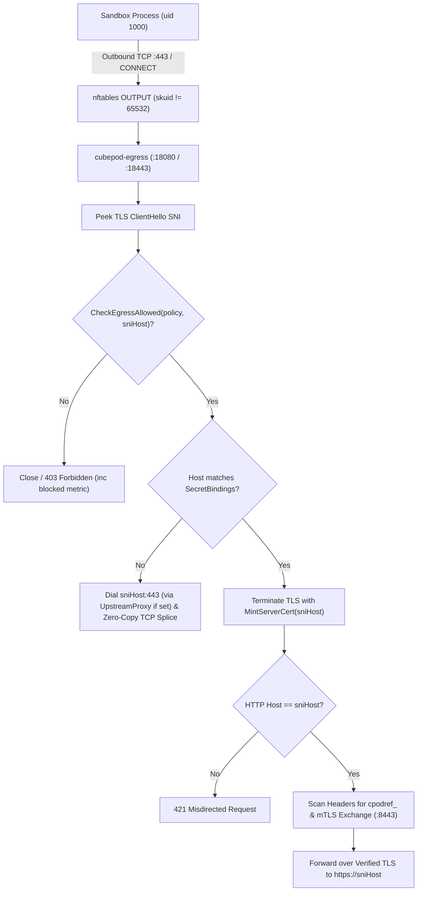

# CEP-0020: Transparent Zero-Trust Egress Interception, Selective HTTPS MITM, and Per-Pod mTLS Secret Lifecycle

| Field | Value |
| :--- | :--- |
| **CEP Number** | `0020` |
| **Status** | `implementable` (`alpha`) |
| **Owning Area** | `egress` |
| **Participating Areas** | `controller`, `gateway` |
| **Authors** | @cubepod-maintainers |
| **Created** | 2026-11-13 |
| **Last Updated** | 2026-11-13 |

<!-- toc -->
- [Release Signoff Checklist](#release-signoff-checklist)
- [Summary](#summary)
- [Motivation](#motivation)
  - [Goals](#goals)
  - [Non-Goals](#non-goals)
- [Proposal](#proposal)
  - [User Stories](#user-stories)
  - [Notes / Constraints / Caveats](#notes--constraints--caveats)
  - [Risks and Mitigations](#risks-and-mitigations)
- [Design Details](#design-details)
  - [API / CRD / Wire Changes](#api--crd--wire-changes)
  - [Architecture & State Machine](#architecture--state-machine)
  - [Boundary Conditions & Failure Recovery](#boundary-conditions--failure-recovery)
  - [Dual-Runtime Behavior (K8s Kata vs. Local Docker)](#dual-runtime-behavior-k8s-kata-vs-local-docker)
  - [Test Plan](#test-plan)
  - [Graduation Criteria](#graduation-criteria)
  - [Upgrade / Downgrade Strategy](#upgrade--downgrade-strategy)
- [Production Readiness Review Questionnaire (PRR)](#production-readiness-review-questionnaire-prr)
- [Implementation History](#implementation-history)
- [Drawbacks](#drawbacks)
- [Alternatives](#alternatives)
<!-- /toc -->

---

## Release Signoff Checklist

- [x] Enhancement scope, Goals, and Non-Goals are agreed upon (`provisional` -> `implementable`)
- [x] API / CRD (`pod.cubeplex.ai/v1alpha1`) and Egress sidecar flags/env contracts are specified
- [x] Dual-runtime behavior (Kubernetes Kata + CSI Block AND Local Docker Loopback) is defined
- [x] Security boundary (MicroVM isolation, UID/GID privilege separation, Egress secret safety) is reviewed
- [x] Test plan includes unit tests (`go test ./pkg/egress/...`) and end-to-end HTTPS secret swap tests
- [x] Production Readiness Review (PRR) section is complete

---

## Summary

CEP-0005 and CEP-0009 introduced the `cpodref_` placeholder vault and an explicit HTTP forward proxy (`cubepod-egress`). However, two critical gaps block production zero-trust workloads: (1) `EgressProxy.handleConnect` currently tunnels HTTPS `CONNECT` streams as opaque TCP bytes without TLS SNI inspection or `cpodref_` header substitution, meaning `https://api.github.com` requests carrying `Authorization: Bearer cpodref_...` transmit the literal placeholder instead of the exchanged secret; and (2) `cubepod-controller` mounts Secret `<box>-egress-mtls` in Pod manifests when `Egress.Enabled=true`, but does not yet mint or delete that Kubernetes `Secret` via `egress.CA`, nor enforce kernel-level `nftables` transparent redirection for processes that ignore `HTTP_PROXY`/`HTTPS_PROXY`.

This CEP completes the zero-trust egress data-plane and control-plane loop:
1. **Selective HTTPS MITM & SNI Passthrough (`pkg/egress`)**: `cubepod-egress` inspects outbound TLS `ClientHello` SNI on both `CONNECT` and transparent `:18443` listeners, enforces `CheckEgressAllowed` against the verified SNI host, performs on-the-fly TLS termination (via an ephemeral per-sandbox MITM CA trusted inside the sandbox) **only** for destinations matching `SecretBindings` (or `MITMHosts`) to swap `cpodref_` headers over mTLS, and streams all other allowed HTTPS hosts via zero-copy TLS passthrough.
2. **Transparent `nftables` + DNS Interception (`images/egress`, `cmd/cubepod-egress`)**: Within the shared Pod network namespace, the egress sidecar runs as a dedicated UID (`65532`) with `CAP_NET_ADMIN`, installs `nftables` `OUTPUT` NAT rules redirecting sandbox UID `!= 65532` TCP `:80`/`:443` and UDP/TCP `:53` traffic to `cubepod-egress` (blocking direct raw-IP bypass when `DefaultAction == Deny`), and optionally chains outbound connections through `UpstreamProxy`.
3. **Automated Per-Pod mTLS Secret Lifecycle (`pkg/controller`)**: Before creating a Pod with `Egress.Enabled=true`, `cubepod-controller` mints an ECDSA P-256 client certificate (`CN=<boxName>`) and an ephemeral sandbox MITM CA, writes `<boxName>-egress-mtls` + public CA bundle into Kubernetes, injects `SSL_CERT_FILE` / `NODE_EXTRA_CA_CERTS` / `REQUESTS_CA_BUNDLE` into the main container, and garbage-collects the Secret when the sandbox pauses or terminates.

---

## Motivation

Real-world AI agents use `curl`, `git`, Python `httpx`/`requests`, Node `fetch`, and `gh` CLI over **HTTPS** (`:443`), not plaintext HTTP (`:80`). Furthermore:
- Malicious or hallucinated LLM code inside a sandbox can unset `HTTPS_PROXY=""` or dial raw TCP sockets directly, bypassing an explicit-only proxy unless `nftables` enforces network-namespace redirection.
- Conversely, terminating TLS on *every* outbound HTTPS connection (e.g., `pypi.org`, `registry.npmjs.org`) wastes CPU and breaks clients with strict certificate pinning when no `cpodref_` secret is bound to those domains.
- CubePlex (`~/cubeplex`) already exposes an mTLS secret exchange service on `:8443` expecting per-sandbox client certificates (`CN = <sandbox_id>`). Automating Secret issuance in `cubepod-controller` eliminates external `MutatingAdmissionWebhook` operational complexity.

### Goals

- Swap `cpodref_` placeholders inside **HTTPS (`:443`)** headers transparently by terminating TLS with a per-sandbox MITM leaf certificate **only** when the target SNI host matches at least one `SecretBinding.AllowedHosts` pattern (or explicit `MITMHosts`), then re-encrypting to the upstream origin (validating real upstream TLS certificates and matching upstream SNI to the HTTP `Host` header to prevent domain fronting).
- Enforce `NetworkPolicySpec` (`DenyHosts`, `AllowHosts`, `DefaultAction`) on TLS `ClientHello` SNI for both explicit `CONNECT` (`:18080`) and transparent TLS (`:18443`) connections, performing zero-copy TCP/TLS passthrough when allowed and no secret binding applies.
- Provide a built-in DNS forwarder (`:18053`) and `nftables` bootstrap script (`egress-init.sh`) in `images/egress` so unprivileged sandbox processes (`1000:1000` or `0:0` in the main container) cannot bypass policy by ignoring `HTTPS_PROXY`.
- Support outbound `UpstreamProxy` (`http://host:port` HTTP `CONNECT` chaining) in `EgressProxy` for restricted regional clusters accessing overseas APIs.
- Mint, mount, and clean up `<box>-egress-mtls` Kubernetes Secrets automatically in `cubepod-controller`.

### Non-Goals

- Inspecting or rewriting non-HTTP binary protocols inside TLS (e.g., SSH `:22` or custom binary RPCs). Non-HTTP/TLS ports are blocked by `nftables` when `DefaultAction == Deny`.
- Persisting the ephemeral per-sandbox MITM CA private key to `rootfs-pvc` or `workspace-pvc`. It lives strictly in memory / `tmpfs` (`Secret` volume) inside the `egress` sidecar container and never enters the main sandbox container's filesystem.
- HTTP/3 (QUIC over UDP `:443`). `nftables` drops outbound UDP `:443` so browsers and `curl` cleanly fall back to TCP TLS 1.2/1.3 HTTP/1.1 or HTTP/2.

---

## Proposal

Split the Egress subsystem cleanly into two composable layers so data-plane verification and controller wiring can evolve independently:

1. **Data-Plane (`pkg/egress`, `cmd/cubepod-egress`, `images/egress`)**:
   - Peek at the TLS `ClientHello` record (`peekClientHelloSNI`) before deciding between **Passthrough** and **Selective MITM**.
   - Maintain an LRU/map cache of leaf server certificates minted on demand via `mitmCA.MintServerCert([]string{sniHost}, 24*time.Hour)`.
   - On MITM connections, terminate client TLS, run the standard HTTP request loop (`http.ReadRequest` / `http.Server`), verify `normalizeHost(req.Host) == sniHost` (rejecting mismatches with `421 Misdirected Request`), replace `cpodref_` tokens via `exchangeSecret` over mTLS, and forward to `https://<sniHost>` using standard system Root CAs (and `UpstreamProxy` if set).
   - Provide transparent HTTP (`:18081`) and TLS (`:18443`) listeners plus DNS filter (`:18053`) alongside the existing `:18080` explicit proxy.
2. **Control-Plane (`pkg/controller`)**:
   - `KubeClient` adds `EnsureSecret` and `DeleteSecret`.
   - When `tpl.Egress.Enabled` is true, `Reconciler` generates:
     - `egress-mtls` Secret (mounted **only** into the `egress` sidecar at `/etc/cubepod/certs`): `tls.crt`, `tls.key` (mTLS client cert for Vault), `ca.crt` (Vault Root CA), `mitm-ca.crt`, `mitm-ca.key`, and `policy.json`.
     - `egress-public-ca` ConfigMap/Secret key (mounted read-only into the `sandbox` container at `/etc/cubepod/ca/mitm-ca.crt` with `SSL_CERT_FILE`, `REQUESTS_CA_BUNDLE`, `NODE_EXTRA_CA_CERTS`, `CURL_CA_BUNDLE` pointing to a merged CA bundle).

### User Stories

#### Story 1: Transparent HTTPS GitHub API Call with `cpodref_`
As an autonomous coding agent running `curl -H "Authorization: Bearer $GITHUB_TOKEN" https://api.github.com/user` (where `GITHUB_TOKEN=cpodref_...`), I want `cubepod-egress` to verify `sniHost == "api.github.com"`, swap `cpodref_...` for my real GitHub PAT via mTLS against the Vault, and return the JSON response—even if my script unsets `HTTPS_PROXY`.

#### Story 2: Zero-Overhead Public Package Downloads
As an agent running `pip install torch` from `files.pythonhosted.org` (an allowed host with no `cpodref_` binding), I want `cubepod-egress` to validate the `ClientHello` SNI against `AllowHosts` and splice the raw TCP stream without MITM decryption overhead.

#### Story 3: Domain-Fronting Exfiltration Prevention
As a security engineer, if untrusted code connects via TLS with `SNI=api.github.com` (allowed for `GITHUB_TOKEN`) or dials an attacker's IP while setting HTTP header `Host: evil.example.com` (or vice versa), `cubepod-egress` must detect the SNI-vs-Host mismatch or upstream certificate failure and block the request `403`/`421` before exchanging or transmitting any secret.

### Notes / Constraints / Caveats

- **Loop Prevention in Shared Network Namespace**: In Kubernetes (including Kata MicroVMs, where all containers inside a Pod share the Guest VM network namespace), `nftables` `OUTPUT` rules match `meta skuid != 65532` (`cubepod-egress` UID). The `sandbox` container runs infrastructure hooks as `0` and workloads as `1000` (never `65532`), guaranteeing zero routing loops without requiring custom `fwmark` kernel modules.
- **MITM CA Private Key Isolation**: `mitm-ca.key` is mounted exclusively in the `egress` container (`/etc/cubepod/certs/mitm-ca.key`, `0400`). Only the public certificate `mitm-ca.crt` is visible inside the `sandbox` container. Even root (`uid=0`) inside the `sandbox` container cannot read another container's mount namespace.
- **ALPN Negotiation**: For Selective MITM, `cubepod-egress` advertises `NextProtos: []string{"http/1.1"}` on the client-facing TLS listener so `curl`, Go `net/http`, Python `httpx`, and Node `undici` negotiate HTTP/1.1 cleanly without HTTP/2 frame multiplexing complexity in Alpha.

### Risks and Mitigations

| Risk | Impact | Likelihood | Mitigation |
| :--- | :--- | :--- | :--- |
| Domain fronting: `ClientHello` SNI says `api.github.com`, inner HTTP `Host` says `attacker.com` (or dials attacker IP) | High | Med | 1) Enforce `normalizeHost(req.Host) == sniHost` (`421` on mismatch); 2) Dial upstream exclusively via verified DNS/UpstreamProxy to `sniHost:443` with strict X.509 `ServerName: sniHost` verification—never forward MITM traffic to an unverified raw IP. |
| Sandbox process unsets `SSL_CERT_FILE` | Low | Med | `podd-init` / init hook appends `mitm-ca.crt` to `/etc/ssl/certs/ca-certificates.crt` on the overlay upper (or bind-mounts a merged bundle) in addition to setting standard env vars. |
| `nftables` locks out `podd` control plane (`:49983`) | High | Low | `nftables` only hooks outbound `OUTPUT` TCP `:80`, `:443`, and `:53` (excluding loopback `127.0.0.0/8` and cluster Pod/Service CIDRs for `:49983` inbound responses via `ct state established,related accept`). |
| QUIC (`UDP :443`) bypasses TCP `:443` interception | Med | High | `egress-init.sh` explicitly `reject`s outbound UDP `:443` when `DefaultAction == Deny` or MITM bindings exist, forcing standard RFC-compliant fallback to TCP `:443`. |

---

## Design Details

### API / CRD / Wire Changes

No breaking changes to `api/v1alpha1`. `EgressProxyConfig` in `pkg/egress/proxy.go` gains MITM CA, `UpstreamProxy`, and transparent/DNS listener support:

```go
type EgressProxyConfig struct {
    SandboxID       string
    Policy          v1alpha1.NetworkPolicySpec
    ExchangeURL     string
    ExchangeHandler http.Handler
    ClientTLSConfig *tls.Config
    MITMCA          *CA               // Ephemeral CA for selective HTTPS MITM
    UpstreamRootCAs *x509.CertPool    // Optional override for testing upstream TLS origins
    Transport       http.RoundTripper // Base transport (auto-configured with UpstreamProxy if nil)
}
```

New CLI flags / env vars on `cmd/cubepod-egress`:
- `--addr` (`:18080`): Explicit HTTP & `CONNECT` proxy listener.
- `--transparent-http-addr` (`""` or `:18081`): Transparent HTTP listener (reads `Host` header).
- `--transparent-tls-addr` (`""` or `:18443`): Transparent TLS listener (peeks `ClientHello` SNI).
- `--dns-addr` (`""` or `:18053`): Policy-enforcing DNS forwarder (returns `REFUSED` for denied hosts).
- `--mitm-ca-cert` / `--mitm-ca-key`: Optional PEM files for selective HTTPS MITM (auto-generated in memory if omitted and `--enable-mitm` is set).
- `--policy-file` (`CUBEPOD_POLICY_FILE`): JSON file containing `v1alpha1.NetworkPolicySpec` (with SIGHUP / mtime reload).
- `--upstream-proxy` (`CUBEPOD_UPSTREAM_PROXY`): Optional upstream HTTP `CONNECT` proxy URL.

### Architecture & State Machine



### Boundary Conditions & Failure Recovery

- **Vault Unreachable / Timeout**: `exchangeSecret` enforces a 10s timeout and fails closed (`403 Forbidden`), never leaking the `cpodref_` token upstream and never falling back to plaintext.
- **Non-TLS Traffic on `:443` / Missing SNI**: If `peekClientHelloSNI` cannot parse a valid TLS `ClientHello` with a non-empty DNS `server_name` extension, the connection is rejected (`400`/`403`) because raw-IP HTTPS cannot be validated against domain allowlists.
- **Sidecar Restart**: `cubepod-egress` is stateless across connections; Kubernetes restarts the container in-place, `egress-init.sh` idempotently flushes/re-applies table `inet cubepod_egress`, and active secrets remain in the mounted `Secret` volume.

### Dual-Runtime Behavior (K8s Kata vs. Local Docker)

- **Kubernetes Production (`Kata + CSI Raw Block`)**: `cubepod-controller` creates Secret `<box>-egress-mtls`, injects the `egress` sidecar container (`runAsUser: 65532`, `capabilities.add: ["NET_ADMIN"]` via an `egress-init` initContainer or ambient cap wrapper), and configures CA bundle trust inside the Kata MicroVM guest network namespace.
- **Local Development (`Docker + Loopback ext4`)**: `pkg/runtime` launches a companion `cubepod-egress` container attached to `--network container:<sandbox-container>` (or configures `HTTP_PROXY`/`HTTPS_PROXY` + `SSL_CERT_FILE` pointing to the local `EgressProxy` instance when running rootless without `NET_ADMIN`).

### Test Plan

- **Unit & Integration Tests (`pkg/egress`)**:
  - `TestHTTPSConnectSelectiveMITMSecretSwap`: Real `httptest.NewTLSServer` upstream verifying `Authorization: Bearer ghp_real_secret` arrived over HTTPS when client dialed through `EgressProxy` (`HTTPS_PROXY`) using `cpodref_...` and trusted `mitmCA.CertPool()`.
  - `TestHTTPSConnectPassthroughWithoutMITM`: Allowed host with no `SecretBinding` tunnels end-to-end using the upstream server's original X.509 certificate (proving zero MITM termination).
  - `TestTransparentTLSListenerSNIAndSwap`: Client dials transparent TLS listener directly (`ServerName: "api.github.com"`) without `CONNECT`; verifies SNI extraction, policy allow/deny, and `cpodref_` header replacement.
  - `TestDomainFrontingHostMismatchRejected`: TLS `SNI=api.github.com` with inner HTTP `Host: evil.com` returns `421`/`403` and performs zero Vault exchanges.
  - `TestDNSFilterAllowAndDeny`: UDP DNS queries against `DNSServer` resolve allowed domains and return `RcodeRefused` for denied domains.

### Graduation Criteria

- **Alpha (`v0.5.0`)**: Selective HTTPS MITM, transparent TLS/HTTP listeners, DNS filter, `egress-init.sh` `nftables` wrapper, and `cubepod-controller` Secret issuance merged and covered by unit + E2E tests behind `TransparentEgress`.
- **Beta (`v0.6.0`)**: Enabled by default on `PodTemplate` with `Egress.Enabled=true`; Prometheus metrics (`cubepod_egress_*`) exported; verified against live CubePlex `:8443` exchange endpoint.
- **Stable (`v1.0.0`)**: HTTP/2 ALPN support on MITM connections and production bake in CubePlex multi-tenant clusters.

### Upgrade / Downgrade Strategy

- Fully backward-compatible: existing `PodBox` instances without `Egress.Enabled` do not run the sidecar, and neither `rootfs-pvc` nor `workspace-pvc` formats change. Disabling `TransparentEgress` reverts `cubepod-egress` to explicit `:18080` proxy mode.

---

## Production Readiness Review Questionnaire (PRR)

### Feature Enablement and Rollback
- **How can this feature be enabled / disabled in a live cluster?** Set `spec.egress.enabled: true/false` on `PodTemplate` or toggle `--transparent-egress` on `cubepod-controller`.
- **Does disabling or rolling back corrupt `/workspace` or `RootFS` block volumes?** No. All certificates and `nftables` rules are ephemeral to the compute Pod.

### Rollout, Upgrade and Rollback Planning
- Existing running sandboxes keep their current sidecar Pod until next `pause`/`resume` cycle. Newly resumed sandboxes pick up the updated sidecar image automatically.

### Monitoring Requirements
- `cubepod-egress` exposes `/metrics` and structured JSON logs recording `cubepod_egress_requests_total{mode="mitm|passthrough|http",decision="allow|deny"}` and `cubepod_egress_secret_exchanges_total{result="ok|denied|error"}` (never logging secret values or headers).

### Dependencies
- Linux kernel `nf_tables` inside the Kata Guest kernel (`6.1+`) and `nft` binary in `images/egress` (`alpine:3.20` `nftables` package).

### Scalability
- Certificate generation uses ECDSA P-256 (~0.2ms per cert) with per-domain in-memory caching inside each sidecar; Passthrough mode uses `io.Copy` (`splice(2)` on Linux) with near-zero memory overhead.

### Troubleshooting
- Operators inspect `kubectl logs <pod> -c egress` to view blocked SNI hosts or failed mTLS exchange status codes.

---

## Implementation History

- `2026-11-13`: Initial CEP drafted and marked `implementable` for `v0.5.0`.

---

## Drawbacks

- Selective TLS MITM requires injecting the ephemeral MITM CA public cert into the sandbox's trust store; static binaries compiled with hardcoded/pinned CAs that ignore `/etc/ssl/certs/ca-certificates.crt` will reject MITM on secret-bound domains (though non-secret domains still work via Passthrough).

---

## Alternatives

### Alternative 1: Terminate TLS for Every Outbound Domain (Full MITM)
- **Description**: Decrypt and re-encrypt 100% of `:443` traffic regardless of whether secrets are bound.
- **Reason for Rejection**: Unnecessary CPU/latency penalty during large `pip`/`npm`/`git` downloads and breaks tools with certificate pinning on public CDNs.

### Alternative 2: Host-Level eBPF Cgroup Socket Filter
- **Description**: Run a privileged DaemonSet on Kubernetes nodes intercepting TLS via eBPF uprobes.
- **Reason for Rejection**: Cannot see inside hardware-isolated **Kata MicroVM** guest kernels from the host kernel, violating CubePod's MicroVM architecture.
