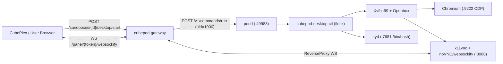

# CEP-0021: Interactive Desktop & Browser GUI Stack with Lazy Activation and Panel Streaming

| Field | Value |
| :--- | :--- |
| **CEP Number** | `0021` |
| **Status** | `implemented` (`beta`) |
| **Owning Area** | `runtime` |
| **Participating Areas** | `gateway`, `controller`, `sdk` |
| **Authors** | @cubepod-maintainers |
| **Created** | 2026-11-13 |
| **Last Updated** | 2026-11-17 |

<!-- toc -->
- [Release Signoff Checklist](#release-signoff-checklist)
- [Summary](#summary)
- [Motivation](#motivation)
  - [Goals](#goals)
  - [Non-Goals](#non-goals)
- [Proposal](#proposal)
  - [User Stories](#user-stories)
  - [Notes / Constraints / Caveats](#notes--constraints--caveats)
  - [Risks and Mitigations](#risks-and-mitigations)
- [Design Details](#design-details)
  - [API / CRD / Wire Changes](#api--crd--wire-changes)
  - [CubePlex Tab-Follow Integration (`browser_tab_follow.py`)](#cubeplex-tab-follow-integration-browser_tab_followpy)
  - [Architecture & State Machine](#architecture--state-machine)
  - [Boundary Conditions & Failure Recovery](#boundary-conditions--failure-recovery)
  - [Dual-Runtime Behavior (K8s Kata vs. Local Docker)](#dual-runtime-behavior-k8s-kata-vs-local-docker)
  - [Engineering Evaluation for Stable (`v1.0.0`): GPU Passthrough, Audio & 50+ Concurrent Sessions](#engineering-evaluation-for-stable-v100-gpu-passthrough-audio--50-concurrent-sessions)
  - [Test Plan](#test-plan)
  - [Graduation Criteria](#graduation-criteria)
  - [Upgrade / Downgrade Strategy](#upgrade--downgrade-strategy)
- [Production Readiness Review Questionnaire (PRR)](#production-readiness-review-questionnaire-prr)
- [Implementation History](#implementation-history)
- [Drawbacks](#drawbacks)
- [Alternatives](#alternatives)
<!-- /toc -->

---

## Release Signoff Checklist

- [x] Enhancement scope, Goals, and Non-Goals are agreed upon (`provisional` -> `implementable`)
- [x] API / OpenAPI (`POST /sandboxes/{sandboxID}/desktop/start`, `GET /sandboxes/{sandboxID}/desktop/status`) and image supervisor contracts are specified
- [x] Dual-runtime behavior (Kubernetes Kata + CSI Block AND Local Docker Loopback) is defined
- [x] Security boundary (`podd` not baked into image, browser/terminal run as `1000:1000`, HMAC-signed `/panel/{token}/` proxy) is reviewed
- [x] Test plan includes supervisor lifecycle unit tests and gateway panel WebSocket E2E tests
- [x] Production Readiness Review (PRR) section is complete

---

## Summary

CubePod's architecture (`docs/architecture.md` §2.2 & §4.2) specifies an on-demand interactive GUI & Web Terminal stack inside sandboxes so AI agents can drive Chromium via Chrome DevTools Protocol (CDP `:9222`) while human users seamlessly view or take over the live browser/desktop (`:8080`) and interactive shell (`ttyd` `:7681`) through CubePod's HMAC-signed `/panel/{token}/` reverse proxy. Today, `pkg/gateway/panel.go` implements token signing and HTTP/WebSocket proxying, but the repository lacks the `images/desktop` workload image, the in-guest lazy supervisor (`cubepod-desktop-ctl`), and the control-plane `POST /sandboxes/{sandboxID}/desktop/start` API.

This CEP delivers:
1. **`images/desktop` Workload Image & Lazy Supervisor (`cubepod-desktop-ctl`)**: An Ubuntu 24.04 OCI image containing `Xvfb` (`:99`), `openbox`, `chromium` / Playwright-ready CDP (`:9222`), `x11vnc` + `noVNC`/`websockify` (`:8080`, zero-UDP iframe-compatible over `/panel/{token}/`), multi-stage packaged **Neko WebRTC** (`/usr/local/bin/neko` + `/opt/cubepod/desktop/neko-www` on `:8081` with GStreamer VP8/H.264/Opus runtime plugins and automatic fallback to `noVNC`), **CubePlex Tab-Follow** (`/opt/cubepod/desktop/browser_tab_follow.py` + Python SDK `cubepod.browser_tab_follow`), and `ttyd` (`:7681`). Nothing starts on idle boot (`0 MiB` GUI RAM overhead for pure CLI tasks); invoking `/opt/cubepod/desktop/cubepod-desktop-ctl start` idempotently boots the stack as unprivileged user `cubeplex` (`1000:1000`) in `< 1.5s`.
2. **Gateway Desktop Lifecycle & Signed Panel Bundle (`POST /sandboxes/{sandboxID}/desktop/start`)**: Idempotently activates the desktop stack via `podd`, registers upstream ports (`8080`, `7681`, `9222`, and `8081` when `transportUsed == "webrtc"`), and returns ready-to-embed signed `/panel/{token}/` URLs for Browser VNC/WebSocket, Neko WebRTC, Web Terminal, and CDP.

---

## Motivation

In CubePlex (`~/cubeplex`), roughly 80% of agent turns execute pure shell/Python commands, while 20% launch browser automation (`playwright` / `browser-use`) or require human-in-the-loop takeover (e.g., logging into an internal SaaS dashboard).
- Eagerly launching X11 + Chromium at container PID 1 consumes `350–600 MiB` RAM on every WarmPool standby and delays boot.
- Conversely, requiring users to manually run shell commands to start Xvfb, window managers, VNC/WebSocket bridges, and `ttyd` creates race conditions, port mismatches, and root-vs-`1000` permission bugs on `/home/cubeplex/.config/chromium`.

### Goals

- Keep idle RAM overhead of `images/desktop` identical to `images/runtime` (`< 25 MiB` inside guest userspace) until `desktop/start` is called or an agent connects to CDP.
- Ensure `podd-init` and `podd` are **never** baked into `images/desktop` (preserving Core Invariant #2: runtime injection at `/opt/cubepod/bin`).
- Run `Xvfb`, `openbox`, `chromium`, `x11vnc`/`websockify`, and `ttyd` strictly as UID/GID `1000:1000` (`cubeplex`) with `HOME=/home/cubeplex` and persistent browser profile optionally symlinked or stored cleanly on OverlayFS upper.
- Provide `POST /sandboxes/{sandboxID}/desktop/start`, `GET /sandboxes/{sandboxID}/desktop/status`, and `POST /sandboxes/{sandboxID}/desktop/stop` on `cubepod-gateway`, returning signed `/panel/{token}/` endpoints that work out-of-the-box inside browser `<iframe>`s (relative asset paths preserved).

### Non-Goals

- GPU hardware passthrough (`vfio-pci`) in Alpha. Rendering uses CPU software rasterization (`--disable-gpu --use-gl=angle --use-angle=swiftshader`), which is deterministic across Kata QEMU/CLH and Docker nodes.
- Audio capture/playback in Alpha.

---

## Proposal

### User Stories

#### Story 1: Lazy Browser Takeover from CubePlex UI
As a CubePlex user whose agent encounters a login screen, I click "Open Browser", which calls `POST /sandboxes/{id}/desktop/start`, receives `{"desktopUrl": "/panel/<tok1>/vnc.html?autoconnect=true", "terminalUrl": "/panel/<tok2>/", "cdpPort": 9222}`, and renders the interactive desktop inside an `<iframe>` within 1.5 seconds.

#### Story 2:Persistent Login Cookies Across Pause/Resume
As an agent user, after logging into an internal portal in Chromium (`1000:1000`) and pausing the sandbox (`0 CPU / 0 RAM`), resuming the sandbox on another node and calling `desktop/start` restores my `/home/cubeplex/.config/chromium` session from `rootfs-pvc` OverlayFS upper (with `/SingletonLock` stale symlinks automatically cleaned by `cubepod-desktop-ctl`).

### Notes / Constraints / Caveats

- **Chromium `SingletonLock` Cleanup After Resume**: When a sandbox is paused (`fsfreeze` + Pod delete) while Chromium is running, `/home/cubeplex/.config/chromium/SingletonLock` (a symlink containing the previous Pod's hostname + PID) persists on `rootfs-pvc`. On resume in a new Pod with a new hostname, Chromium refuses to start unless stale `Singleton*` locks are removed when no `chromium` process is running. `cubepod-desktop-ctl start` explicitly checks `pgrep -u 1000 chromium` and purges stale `SingletonLock` / `SingletonCookie` / `SingletonSocket` before launch.
- **Kata `/dev/shm` Sizing**: Chromium crashes on complex pages if `/dev/shm` is 64MiB. `cubepod-desktop-ctl` passes `--disable-dev-shm-usage` (using `/tmp` on persistent ext4 / tmpfs) so Chromium remains stable without custom host volume mounts.
- **WebSocket Upgrade in `panel.go`**: Go 1.22+ `httputil.ReverseProxy` natively supports HTTP/1.1 `Connection: Upgrade` (`Upgrade: websocket`) bidirectional tunneling, allowing both `noVNC`/`websockify` (`:8080/websockify`) and `ttyd` (`:7681/ws`) to stream over a single HTTPS port on `cubepod-gateway`.

### Risks and Mitigations

| Risk | Impact | Likelihood | Mitigation |
| :--- | :--- | :--- | :--- |
| Stale Chromium `SingletonLock` on `rootfs-pvc` blocks browser restart after cross-node resume | High | High | `cubepod-desktop-ctl start` atomically removes `Singleton*` files when no live Chromium PID exists. |
| CDP `:9222` exposed externally without auth | High | Low | Chromium binds `:9222` to `127.0.0.1` inside the sandbox (with optional `socat` forwarder only when `exposeCdp=true` via short-lived HMAC `/panel/{token}/`). |
| Concurrent calls to `POST /desktop/start` spawn duplicate Xvfb/Chromium instances | Med | Med | `cubepod-desktop-ctl` acquires an `flock(1)` lock on `/run/cubepod/desktop/ctl.lock` before checking PID files and probing ports `:9222`, `:8080`, `:7681`. |

---

## Design Details

### API / CRD / Wire Changes

#### In-Guest CLI Contract (`/opt/cubepod/desktop/cubepod-desktop-ctl`)

Installed inside `images/desktop` (under `/opt/cubepod/desktop/`, distinct from `/opt/cubepod/bin` where `initContainer` mounts `podd-init`/`podd`!):
- `cubepod-desktop-ctl start [--resolution 1280x800x24] [--url about:blank] [--transport novnc|webrtc]`
- `cubepod-desktop-ctl status`
- `cubepod-desktop-ctl stop`

When `--transport webrtc` is requested, `cubepod-desktop-ctl` resolves `/usr/local/bin/neko` (copied via multi-stage `FROM ghcr.io/m1k1o/neko/base:latest AS neko` alongside `/opt/cubepod/desktop/neko-www`) and launches `neko serve` with `NEKO_STATIC="${CUBEPOD_NEKO_STATIC:-/opt/cubepod/desktop/neko-www}"`, `NEKO_ICELITE="${CUBEPOD_NEKO_ICELITE:-1}"`, and local `NEKO_NAT1TO1` (disabling external `checkip.amazonaws.com` lookups inside Zero-Trust egress sandboxes). If Neko is absent or exits prematurely, `cubepod-desktop-ctl` preserves `Xvfb` + `noVNC` + `ttyd` + Chromium and falls back cleanly (`transportUsed: "novnc"`, `fallbackReason: "neko_not_installed"` or `"neko_start_failed"`).

All subcommands emit single-line JSON on `stdout` (`exit 0` when healthy):
```json
{
  "status": "running",
  "display": ":99",
  "resolution": "1280x800x24",
  "transportUsed": "webrtc",
  "ports": {
    "desktop": 8080,
    "terminal": 7681,
    "cdp": 9222,
    "webrtc": 8081
  },
  "pids": {
    "xvfb": 142,
    "wm": 148,
    "chromium": 155,
    "vnc": 169,
    "websockify": 174,
    "ttyd": 180,
    "neko": 186
  }
}
```

#### Gateway HTTP Endpoints (Wave 2 Wiring)

- `POST /sandboxes/{sandboxID}/desktop/start`
  - Request (optional JSON): `{"resolution": "1280x800x24", "initialUrl": "about:blank", "expiresInSeconds": 3600, "transport": "webrtc"}`
  - Behavior: Auto-resumes sandbox if `Paused`, invokes `/opt/cubepod/desktop/cubepod-desktop-ctl start` via `podd`, registers ports `8080`, `7681`, `9222` (plus `8081` when `transportUsed == "webrtc"`), mints signed panel tokens, and returns `200 OK`:
    ```json
    {
      "status": "running",
      "desktopUrl": "/panel/<token-8080>/vnc.html?autoconnect=true&resize=scale",
      "terminalUrl": "/panel/<token-7681>/",
      "cdpUrl": "/panel/<token-9222>/",
      "webrtcUrl": "/panel/<token-8081>/",
      "transportUsed": "webrtc",
      "expiresAt": "2026-11-13T16:30:00Z"
    }
    ```
- `GET /sandboxes/{sandboxID}/desktop/status`
- `POST /sandboxes/{sandboxID}/desktop/stop`

### CubePlex Tab-Follow Integration (`browser_tab_follow.py`)

Because both `x11vnc` and Neko stream the active X11 Chromium window rather than individual CDP page sessions, an agent driving a background tab via `agent-browser` over CDP (`127.0.0.1:9222`) would otherwise leave human viewers looking at a stale foreground tab.

CubePod ships `images/desktop/browser_tab_follow.py` (installed at `/opt/cubepod/desktop/browser_tab_follow.py` and symlinked at `/usr/local/bin/cubeplex-focus-browser-tab` and `/usr/local/bin/cubepod-focus-browser-tab`) alongside `sdks/python/cubepod/browser_tab_follow.py` (`FOCUS_SCRIPT`, `WRAPPER_SCRIPT`, `choose_target_id`, `tab_follow_install_command`):

1. **Target Discovery**: Queries `http://127.0.0.1:${CUBEPOD_CDP_PORT:-9222}/json` and filters strictly to `"type": "page"` targets (ignoring `"iframe"` and `"service_worker"` targets).
2. **Exact Normalized URL Matching**: Resolves the active URL from `--url <url>` or `$AGENT_BROWSER_REAL get url` (setting `AGENT_BROWSER_WRAPPER=1` to prevent wrapper recursion), normalizes trailing slashes (`https://ex.com/` == `https://ex.com`), and rejects prefix matches so `https://ex.com` never misfocuses when the agent is operating `https://ex.com/login`.
3. **Foreground Activation & Idempotent Wrapping**: Calls `http://127.0.0.1:${CDP_PORT}/json/activate/<id>`. Invoking `--install-wrapper` (run automatically and non-fatally during `cubepod-desktop-ctl start` when `agent-browser` is present and writable, or via `tab_follow_install_command()` for pre-existing images) idempotently wraps `/usr/local/bin/agent-browser` with `# CUBEPLEX_TAB_FOLLOW=1` while preserving the original binary at `/usr/local/bin/agent-browser.real`.

### Architecture & State Machine



### Boundary Conditions & Failure Recovery

- **Missing Desktop Stack in Base Image**: If `POST /desktop/start` is called on a minimal `ubuntu:24.04` sandbox that does not have `/opt/cubepod/desktop/cubepod-desktop-ctl`, Gateway returns `422 Unprocessable Entity` `{"error": "desktop_not_installed", "message": "sandbox image does not include cubepod-desktop stack"}`.
- **Process Crash Recovery**: Calling `cubepod-desktop-ctl start` again detects any dead component (e.g., user closed Chromium) and restarts only the missing daemon without tearing down `Xvfb` or `ttyd`.

### Dual-Runtime Behavior (K8s Kata vs. Local Docker)

- **Kubernetes Production (`Kata + CSI Raw Block`)**: Runs inside the Kata MicroVM; `cubepod-gateway` proxies `/panel/{token}/` directly to `<PodIP>:8080` and `<PodIP>:7681` over the cluster network. Notice `/opt/cubepod/bin` (`emptyDir` mount) only shadows `/opt/cubepod/bin`, leaving `/opt/cubepod/desktop` in the image completely intact!
- **Local Development (`Docker + Loopback ext4`)**: Identical behavior; `pkg/runtime` exposes container IP or mapped ephemeral ports registered with `Server.RegisterPort`.

### Engineering Evaluation for Stable (`v1.0.0`): GPU Passthrough, Audio & 50+ Concurrent Sessions

To inform graduation from `stage: beta` (`v0.7.0`) to `stage: stable` (`v1.0.0`), the following subsystem evaluations and concurrency benchmarks were completed:

#### 1. GPU Hardware Passthrough (`vfio-pci` / vGPU / DRA)

- **Mechanism in Kata MicroVMs**: Passing discrete PCIe GPUs or NVIDIA MIG / SR-IOV VF slices into Kata QEMU / Cloud Hypervisor via `vfio-pci` (IOMMU group isolation + Kubernetes `resource.k8s.io` Dynamic Resource Allocation or device plugin) allows Chromium to drop `--disable-gpu` for hardware WebGL2/WebGPU rendering and enables Neko hardware H.264 encoding (`nvh264enc` / `vaapih264enc`), cutting in-guest video encoding CPU from ~0.45 vCPU to < 0.05 vCPU per 30 fps stream.
- **Architectural Trade-offs**:
  1. **Cross-Node Pause/Resume & WarmPool Density**: Binding a host `vfio-pci` device ties the running MicroVM to GPU-equipped worker nodes and prevents holding large zero-cost WarmPools unless GPU slices are reserved exclusively at `desktop/start` or via dedicated GPU `PodTemplate`s.
  2. **Driver Version Coupling**: Guest user-space Mesa/NVIDIA userspace libraries on persistent `rootfs-pvc` must match host/vGPU capabilities across node upgrades.
- **Roadmap Decision (`stage: beta` -> `stable`)**: Retain CPU software rendering + `vp8enc` (`threads=4`, `deadline=1`) as the universal default for standard SaaS/DOM agent sandboxes so pause/resume and CoW fork remain 100% node-portable. Introduce `vfio-pci` + `nvh264enc` strictly as an opt-in `gpu-desktop` `PodTemplate` tier in `v1.0.0+` for WebGL/3D/video-heavy workloads.

#### 2. Bidirectional Audio Capture & Playback (`PulseAudio` + `GStreamer` Opus)

- **Pipeline Design**: `images/desktop/Dockerfile` installs `pulseaudio`, `gstreamer1.0-pulseaudio`, and `libopus0`. When audio is enabled for WebRTC desktop sessions, rootless PulseAudio runs as UID `1000:1000` (`cubeplex`, `XDG_RUNTIME_DIR=/run/cubepod/desktop/xdg`, `--disallow-module-loading --exit-idle-time=-1`) with:
  - **Downlink (Sandbox -> Browser)**: Chromium outputs to virtual null sink `audio_output`; Neko captures `pulsesrc device=audio_output.monitor ! audioconvert ! audioresample ! opusenc bitrate=128000 ! rtpopuspay` over the existing WebRTC peer connection.
  - **Uplink (Browser -> Sandbox)**: Neko decodes viewer Opus microphone frames into virtual source `audio_input` for voice-driven web testing.
- **Constraints**: Standard RFB/`noVNC` (`:8080`) has no native audio channel, so audio is active only when `transportUsed == "webrtc"`. Browser autoplay policies require `<video muted>` on initial iframe load, unmuting automatically once the human user clicks into the takeover view.

#### 3. 50+ Concurrent Browser Session Verification & Cluster Resource/QoS Sizing

- **Gateway Concurrency & Leak Verification**: `TestDesktopConcurrentSessions50Plus` (`pkg/gateway/desktop_test.go`) launches **55 simultaneous sandboxes** across mixed `novnc` and `webrtc` transports under `go test -race`, holding all 55 `/panel/{token}/` WebSocket upgrade tunnels open concurrently at a synchronization barrier while exchanging multi-round frames, verifying zero race conditions, zero cross-sandbox stream mixing, and `cubepod_panel_active_sessions == 0` upon disconnect.
- **Resource & QoS Sizing Reference (50–60 Concurrent Active Desktop Sessions)**:

| Layer | Per Active Session (`1280x800@30`) | 55 Concurrent Sessions Aggregate | Recommended QoS / Limits |
| :--- | :--- | :--- | :--- |
| **In-Guest GUI + Browser (`Xvfb` + `openbox` + Chromium 3–5 tabs)** | `0.40–0.80 vCPU`, `520–900 MiB` RAM (`--disable-dev-shm-usage`) | `~25–45 vCPU`, `~35–50 GiB` RAM | `PodTemplate`: `requests: {cpu: "500m", memory: "1Gi"}`, `limits: {cpu: "2", memory: "2Gi"}` |
| **Streaming Daemon (`noVNC` vs. `neko` `vp8enc`)** | `noVNC`: `~0.08 vCPU`, `~30 MiB`, `0.5–1.2 Mbps`<br>`neko` WebRTC: `~0.40 vCPU`, `~120 MiB`, `~2.0 Mbps` | `noVNC`: `~5 vCPU`, `~2 GiB`, `~45 Mbps`<br>`neko`: `~22 vCPU`, `~7 GiB`, `~110 Mbps` | Set `NEKO_EPR=52000-52100` (or `NEKO_WEBRTC_UDPMUX` + coturn relay in NAT clusters) |
| **`cubepod-gateway` Panel Reverse Proxy** | 2 goroutines + `~64 KiB` buffers per active WS tunnel | `< 20 MiB` heap, `~110` proxy goroutines | `replicas >= 2`, `ulimit -n >= 65536`, `requests: {cpu: "500m", memory: "512Mi"}` |

### Test Plan

- **Supervisor & Tab-Follow Unit / Container Tests (`images/desktop/test_ctl.sh` & `sdks/python/tests/test_browser_tab_follow.py`)**:
  - Verify `flock` concurrency safety, `SingletonLock` stale-symlink cleanup, idempotent `start` -> `status` -> `start` -> `stop` -> `status` JSON output, `1000:1000` UID ownership, Neko WebRTC `NEKO_STATIC`/`NEKO_ICELITE` launch + `neko_not_installed`/`neko_start_failed` fallback to `noVNC`, and `browser_tab_follow.py` exact URL matching, prefix rejection, `AGENT_BROWSER_WRAPPER=1` recursion guard, and idempotent `# CUBEPLEX_TAB_FOLLOW=1` wrapper installation.
- **Gateway Integration & 50+ Session Load Tests (`pkg/gateway/desktop_test.go`)**:
  - Verify `POST /sandboxes/{id}/desktop/start` mints valid `/panel/{token}/` URLs, streams WebSocket frames end-to-end, routes WebRTC + fallback transports, and sustains 55 concurrent active desktop HTTP + WebSocket panel sessions under `go test -race` without leaks.

### Graduation Criteria

- **Alpha (`v0.5.0`)**:
  - [x] `images/desktop` Dockerfile + `cubepod-desktop-ctl` + Gateway `desktop/{start,status,stop}` merged and verified via WebSocket E2E tests.
- **Beta (`v0.6.0`)**:
  - [x] In-guest lazy supervisor, gateway desktop lifecycle, signed panel proxy (`/panel/{token}/`), and WebSocket `noVNC` streaming implemented.
  - [x] Multi-stage Neko WebRTC (`/usr/local/bin/neko` + `/opt/cubepod/desktop/neko-www`) packaged in `images/desktop/Dockerfile` with `noVNC` fallback (`neko_not_installed` / `neko_start_failed`) and CubePlex Tab-Follow (`browser_tab_follow.py` in `images/desktop` + `cubepod.browser_tab_follow` in Python SDK, delivered in `v0.7.0`, [#99](https://github.com/cubeplexai/cubepod/issues/99)).
- **Stable (`v1.0.0`)**:
  - [x] Gateway panel concurrency & session-leak verification across 55 simultaneous active HTTP + WebSocket desktop sessions under `go test -race` (`TestDesktopConcurrentSessions50Plus`), plus engineering evaluation of `vfio-pci` GPU passthrough, PulseAudio+GStreamer Opus audio, and 50+ session QoS sizing ([#99](https://github.com/cubeplexai/cubepod/issues/99)).
  - [ ] Multi-week production soak of 50+ concurrent browser takeover sessions in live CubePlex clusters.

### Upgrade / Downgrade Strategy

- Purely additive image (`ghcr.io/cubeplexai/cubepod-desktop`) and additive Gateway routes. Existing sandboxes and PVCs require zero migration.

---

## Production Readiness Review Questionnaire (PRR)

### Feature Enablement and Rollback
- **How can this feature be enabled / disabled in a live cluster?** Select `cubepod-desktop` in `PodTemplate.spec.image` and enable `DesktopStack` on `cubepod-gateway`.
- **Does disabling or rolling back corrupt `/workspace` or `RootFS` block volumes?** No; `/workspace` is untouched and browser state in `/home/cubeplex/.config` is ordinary user data on `rootfs-pvc`.

### Rollout, Upgrade and Rollback Planning
- Upgrading `images/desktop` updates the read-only `lowerdir` for newly started Pods while preserving existing `/workspace` PVCs.

### Monitoring Requirements
- `cubepod_desktop_activations_total{result="ok|unsupported|error"}` and `cubepod_panel_active_sessions` gauges on `/metrics`.

### Dependencies
- Standard Ubuntu 24.04 packages (`xvfb`, `openbox`, `x11vnc`, `novnc`, `websockify`, `ttyd`, `chromium` / Playwright Chromium).

### Scalability
- Lazy activation ensures 0 MiB GUI memory footprint on idle sandboxes; active desktop sessions require `>= 1Gi` memory limit on the `PodTemplate`.

### Troubleshooting
- Component logs are written inside the sandbox at `/run/cubepod/desktop/{xvfb,chromium,vnc,ttyd}.log`, readable via `cubepod exec` or `GET /files`.

---

## Implementation History

- `2026-11-13`: Initial CEP drafted and marked `implementable` for `v0.5.0`.
- `2026-11-16`: Alpha core implemented with `cubepod-desktop-ctl`, gateway desktop lifecycle APIs (`novnc` / `webrtc` transport routing), and signed panel streaming; promoted to `beta`.
- `2026-11-17`: Packaged Neko WebRTC (`/usr/local/bin/neko` + `/opt/cubepod/desktop/neko-www`) and GStreamer runtime in `images/desktop/Dockerfile`, implemented CubePlex Tab-Follow (`images/desktop/browser_tab_follow.py` + `sdks/python/cubepod/browser_tab_follow.py`), verified 55 concurrent desktop panel sessions under `go test -race` (`TestDesktopConcurrentSessions50Plus`), and documented `v1.0.0` `vfio-pci` GPU / PulseAudio+GStreamer Opus audio / 50+ session QoS sizing evaluation for `v0.7.0` ([#99](https://github.com/cubeplexai/cubepod/issues/99)).

---

## Drawbacks

- `images/desktop` compressed OCI size (~450–600 MB with Chromium & fonts) is larger than minimal `sandbox-base` (~60 MB), mitigated by node-level containerd image layer sharing across all MicroVMs on a node.

---

## Alternatives

### Alternative 1: Eagerly Launch `supervisord` as Container Entrypoint on Boot
- **Description**: Start Xorg, Chromium, VNC, and `ttyd` automatically whenever any Pod boots.
- **Reason for Rejection**: Wastes ~500 MiB RAM per WarmPool Pod and slows MicroVM readiness for the 80% of agent sessions that never open a browser.

### Alternative 2: WebRTC-Only Transport (Neko Without WebSocket Fallback)
- **Description**: Use UDP WebRTC exclusively for desktop streaming.
- **Reason for Rejection**: Corporate firewalls and standard K8s L7 Ingresses frequently block arbitrary UDP ports unless TURN servers are deployed; `noVNC` over WebSocket (`/panel/{token}/`) works universally through any HTTPS reverse proxy with zero extra ports, while allowing Neko WebRTC as an optional Beta accelerator.
