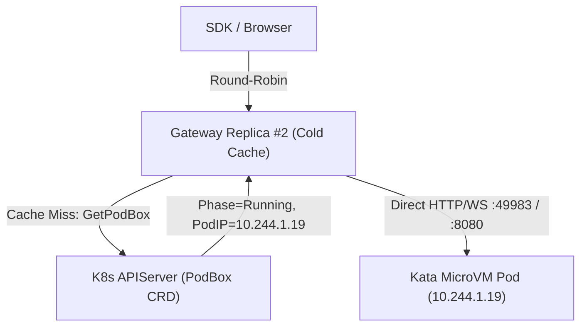

# CEP-0022: Crash-Consistent Multi-Generation CoW Fork and Stateless Multi-Replica Gateway HA

| Field | Value |
| :--- | :--- |
| **CEP Number** | `0022` |
| **Status** | `implementable` (`alpha`) |
| **Owning Area** | `controller` |
| **Participating Areas** | `gateway`, `storage`, `runtime` |
| **Authors** | @cubepod-maintainers |
| **Created** | 2026-11-13 |
| **Last Updated** | 2026-11-13 |

<!-- toc -->
- [Release Signoff Checklist](#release-signoff-checklist)
- [Summary](#summary)
- [Motivation](#motivation)
  - [Goals](#goals)
  - [Non-Goals](#non-goals)
- [Proposal](#proposal)
  - [User Stories](#user-stories)
  - [Notes / Constraints / Caveats](#notes--constraints--caveats)
  - [Risks and Mitigations](#risks-and-mitigations)
- [Design Details](#design-details)
  - [API / CRD / Wire Changes](#api--crd--wire-changes)
  - [Architecture & State Machine](#architecture--state-machine)
  - [Boundary Conditions & Failure Recovery](#boundary-conditions--failure-recovery)
  - [Dual-Runtime Behavior (K8s Kata vs. Local Docker)](#dual-runtime-behavior-k8s-kata-vs-local-docker)
  - [Test Plan](#test-plan)
  - [Graduation Criteria](#graduation-criteria)
  - [Upgrade / Downgrade Strategy](#upgrade--downgrade-strategy)
- [Production Readiness Review Questionnaire (PRR)](#production-readiness-review-questionnaire-prr)
- [Implementation History](#implementation-history)
- [Drawbacks](#drawbacks)
- [Alternatives](#alternatives)
<!-- /toc -->

---

## Release Signoff Checklist

- [x] Enhancement scope, Goals, and Non-Goals are agreed upon (`provisional` -> `implementable`)
- [x] API / CRD (`pod.cubeplex.ai/v1alpha1`) and Controller-Gateway sync contracts are specified
- [x] Dual-runtime behavior (Kubernetes Kata + CSI Block AND Local Docker Loopback) is defined
- [x] Security boundary and filesystem consistency (`sync` + `fsfreeze` around live block clone) are reviewed
- [x] Test plan includes unit tests and multi-replica Gateway routing E2E tests
- [x] Production Readiness Review (PRR) section is complete

---

## Summary

Two architectural gaps currently prevent horizontal scaling and production sub-agent cloning:
1. **Multi-Generation & Crash-Consistent CoW Fork**: `BuildBlockPVCs` in `pkg/controller/manifests.go` hardcodes `DataSourcePVC = "<parent>-rootfs-pvc"`, which clones a stale or deleted volume when the parent sandbox has incremented `rootfsGeneration > 1` (`<parent>-rootfs-gen<N>-pvc`). Furthermore, cloning a mounted `ext4` block device without briefly quiescing writes (`prepare-stop` / `fsfreeze`) leaves dirty uncommitted page cache in the parent guest kernel, and local Docker runtime (`pkg/runtime`) lacks sparse loopback image cloning (`cp --reflink=auto --sparse=always`).
2. **Stateless Multi-Replica Gateway HA**: `cubepod-gateway` stores `s.sandboxes`, `s.commands`, and `s.endpoints` in process memory. In a 2+ replica Kubernetes Deployment behind a Service load balancer, a `GET /sandboxes/{id}` or `/panel/{token}/` request landing on Replica B after `POST /sandboxes` ran on Replica A returns `404 Not Found` unless Replica B dynamically resolves and caches sandbox state from Kubernetes `PodBox` CRDs / Controller.

This CEP fixes both problems so `POST /sandboxes/{id}/fork` produces filesystem-consistent clones across any `rootfsGeneration` in both Kubernetes CSI Block and Docker Loopback modes, and `cubepod-gateway` operates cleanly at `replicas >= 2` with zero sticky-session requirement.

---

## Motivation

### Goals

- Resolve exact parent `RootfsPVCName` and `WorkspacePVCName` from `PodBoxStatus` (supporting arbitrary `rootfsGeneration >= 1`) during `ForkFrom`, supporting both direct CSI PVC-to-PVC clone (`dataSource.kind: PersistentVolumeClaim`) and CSI `VolumeSnapshot` clone (`snapshot.storage.k8s.io/v1`) depending on CSI driver capability.
- Trigger brief in-guest `sync` + `fsfreeze` (with automatic 2s unfreeze safety timeout in `podd`) when forking a `Running` parent sandbox so the cloned `ext4` block volumes contain all flushed writes cleanly.
- Implement Copy-on-Write (`cp --reflink=auto --sparse=always`) loopback image cloning in `pkg/runtime/docker.go` for local single-node `fork`.
- Enable stateless multi-replica `cubepod-gateway` HA: on cache miss (or periodic watch/poll), any gateway replica reconstructs `SandboxRecord` and upstream `<PodIP>:<port>` targets directly from `PodBox` CRD status + annotations (`cubepod.io/metadata-*`, `cubepod.io/template-id`, `cubepod.io/timeout-seconds`), and proxies command logs/status directly to `<PodIP>:49983` rather than relying on gateway-local `s.commands` buffers.

### Non-Goals

- Cross-cluster or cross-region volume replication.
- Distributed Raft/etcd state inside `cubepod-gateway`—Kubernetes `PodBox` CRDs remain the single source of truth.

---

## Proposal

### User Stories

#### Story 1: Forking a Sandbox After RootFS Reset
As an agent orchestrator, after resetting `sbx-parent` to `rootfsGeneration: 2` and installing `ripgrep`, calling `POST /sandboxes/sbx-parent/fork` clones `sbx-parent-rootfs-gen2-pvc` and `sbx-parent-workspace-pvc` so the child sandbox immediately has both `ripgrep` and `/workspace` files.

#### Story 2: Rolling Restart or Horizontal Scale-Out of `cubepod-gateway`
As a cluster SRE running 3 replicas of `cubepod-gateway` behind a round-robin Kubernetes Service, I can kill any gateway Pod mid-session while agents continue calling `Sandbox.connect`, `commands.run`, and `/panel/{token}/` without `404` errors or dropped background processes.

### Notes / Constraints / Caveats

- **`fsfreeze` Deadlock Safety**: If `cubepod-gateway` crashes while a parent sandbox is frozen during `fork`, an indefinite `fsfreeze -f` would hang the parent VM. Therefore `podd` implements `POST /v1/lifecycle/quiesce` with a mandatory bounded kernel/thread timer (`maxFreezeMs`, default `1500ms`) that unconditionally calls `FIFITHAW` (`ioctl`) even if the caller disconnects before sending `thaw`.
- **XFS / Btrfs / APFS Reflink in Local Mode**: On Linux hosts backed by XFS (`reflink=1`) or Btrfs, `cp --reflink=auto --sparse=always` clones a `10Gi` sparse loopback file in `< 5ms` with zero physical block duplication; on `ext4` hosts without reflink, `--sparse=always` copies only allocated non-zero extents (`~50–200ms` for typical `100MB` deltas).

### Risks and Mitigations

| Risk | Impact | Likelihood | Mitigation |
| :--- | :--- | :--- | :--- |
| Parent VM stays frozen if Controller crashes mid-fork | High | Low | `podd` auto-thaws after `maxFreezeMs` (`1500ms`) on an independent monotonic timer thread. |
| Duplicate `ext4` filesystem UUID on cloned block devices on the same host kernel | Med | Med | Inside Kata MicroVMs, each sandbox has its own isolated Guest Linux kernel so identical `ext4` UUIDs never collide; in `runc` privileged container Block mode (`runtimeClassName=none`), `podd-init` passes `-o nouuid` / `tune2fs -U random` when `CUBEPOD_FORKED=1` on first boot. |
| Concurrent `Auto-Resume` from two Gateway replicas creates duplicate Pods | Med | Med | `EnsurePod` and `PodBox` CRD updates are idempotent (`409 AlreadyExists` adopts the active Pod IP and waits for `Running`). |

---

## Design Details

### API / CRD / Wire Changes

1. **`PodBox` Annotations for Stateless Gateway Reconstruction**:
   - `cubepod.io/template-id`: Original E2B `templateID`
   - `cubepod.io/timeout-seconds`: Requested TTL
   - `cubepod.io/volume-key`: Optional deterministic volume key
   - `cubepod.io/forked-from`: Parent sandbox ID (when forked)
2. **`podd` Bounded Quiesce Endpoint**:
   - `POST /v1/lifecycle/quiesce` (`{"maxFreezeMs": 1500}`) -> `syncfs` + `ioctl(FIFREEZE)` + background watchdog thread -> `POST /v1/lifecycle/thaw` (`ioctl(FITHAW)`).
3. **Gateway Miss-Through Lookup (`resolveSandbox(ctx, sandboxID)`)**:
   - All Gateway handlers replace raw `s.sandboxes[sandboxID]` map reads with `s.getOrLoadSandbox(r.Context(), sandboxID)`, which falls back to `s.reconciler.SyncBoxFromKube(ctx, sandboxID)` on cache miss when `livePodRouting` / `KubeClient` is active.
   - Panel proxy (`handlePanelProxy`) computes `http://<PodIP>:<claims.Port>` directly from `PodBoxStatus.PodIP` whenever `s.endpoints[sandboxID][port]` is empty, making `/panel/{token}/` 100% stateless across replicas!

### Architecture & State Machine

### Boundary Conditions & Failure Recovery

- **Deleted Sandbox Across Replicas**: If Replica A deletes `sbx-1`, Replica B's next request verifies liveness on upstream error or periodic `SyncFromKube` (`5s` interval) and evicts terminated entries from memory.
- **Forking a `Paused` Sandbox**: Since no Pod is running and `prepare-stop` already flushed the filesystem before pause, `fork` skips `quiesce` and immediately clones the quiescent PVCs.

### Dual-Runtime Behavior (K8s Kata vs. Local Docker)

- **Kubernetes Production (`Kata + CSI Raw Block`)**: Quiesces live `podd` (`1500ms` bounded), creates child PVCs with `dataSource` referencing the parent's active `status.rootfsPVCName` (`<parent>-rootfs-gen<N>-pvc`) and `status.workspacePVCName`, thaws parent once CSI binds/snapshots, and boots the child Kata MicroVM.
- **Local Development (`Docker + Loopback ext4`)**: Quiesces parent container, runs `cp --reflink=auto --sparse=always` on `<parent>/rootfs.ext4` and `<parent>/workspace.ext4`, thaws parent, and boots the child Docker container mounted onto the cloned loopback files.

### Test Plan

- **Unit Tests**:
  - `TestForkSandboxWithRootfsGeneration2`: Verifies `BuildBlockPVCs` uses `status.RootfsPVCName` (`*-gen2-pvc`) instead of `*-rootfs-pvc`.
  - `TestStatelessGatewayMultiReplicaFailover`: Instantiates **two independent `gateway.Server` instances** (`gw1`, `gw2`) backed by a shared `KubeClient`: creates sandbox, runs background command, and mints `/panel/{token}/` on `gw1`, then queries sandbox, streams logs with `?cursor=`, and proxies `/panel/{token}/` through `gw2` without prior state sharing!
- **Integration / E2E Tests**:
  - Docker loopback `fork` E2E verifying isolated mutations between parent and child after fork.

### Graduation Criteria

- **Alpha (`v0.5.0`)**: Multi-gen `ForkFrom`, Docker sparse reflink fork, bounded `quiesce`/`thaw`, and stateless `gw1`->`gw2` failover merged and tested.
- **Beta (`v0.6.0`)**: Helm chart defaults `gateway.replicas: 2` with PodDisruptionBudget; CSI `VolumeSnapshot` mode verified on Longhorn V2 SPDK.
- **Stable (`v1.0.0`)**: Zero-downtime Gateway rolling updates verified under continuous load in CubePlex.

### Upgrade / Downgrade Strategy

- Existing `PodBox` CRDs without the new optional annotations fall back gracefully to default metadata (`templateID: "base"`). No PVC data migration required.

---

## Production Readiness Review Questionnaire (PRR)

### Feature Enablement and Rollback
- **How can this feature be enabled / disabled in a live cluster?** Scale `gateway.replicas` back to `1` or toggle `StatelessGatewayHA`.
- **Does disabling or rolling back corrupt `/workspace` or `RootFS` block volumes?** No.

### Rollout, Upgrade and Rollback Planning
- Rolling update of `cubepod-gateway` seamlessly hands active sandboxes to new Pods via `PodBox` CRD reconstruction.

### Monitoring Requirements
- `cubepod_sandbox_forks_total{mode="pvc_clone|snapshot|loopback",result="ok|error"}`, `cubepod_sandbox_fork_duration_seconds`, and `cubepod_gateway_crd_resyncs_total`.

### Dependencies
- CSI driver with `CLONE_VOLUME` or `CREATE_DELETE_SNAPSHOT` capability (Longhorn V2 SPDK, OpenEBS LVM-LocalPV / Mayastor, AWS EBS CSI).

### Scalability
- Periodic `ListPodBoxes` resync (`5s`) plus on-miss `GetPodBox` adds minimal APIServer load (`< 2 QPS` for 1,000 sandboxes).

### Troubleshooting
- Check `PodBox.status.reason` (`ForkingVolumes`, `Running`) and `kubectl describe pvc <child>-rootfs-pvc` for CSI `ProvisioningSucceeded` events.

---

## Implementation History

- `2026-11-13`: Initial CEP drafted and marked `implementable` for `v0.5.0`.

---

## Drawbacks

- Slightly higher APIServer read rate on cold cache misses compared to single-process in-memory routing, easily bounded via short TTL negative caching (`1s`) for non-existent sandbox IDs.

---

## Alternatives

### Alternative 1: Redis / PostgreSQL External Session Store for `cubepod-gateway`
- **Description**: Introduce Redis or Postgres to store `SandboxRecord` and port mappings across Gateway replicas.
- **Reason for Rejection**: Adds an extra stateful database dependency to operate and back up, whereas Kubernetes CRDs (`PodBox`) already persist sandbox state in `etcd`.

### Alternative 2: Sticky Ingress Sessions (`ip_hash` / Cookie Affinity)
- **Description**: Pin clients to a single Gateway replica at the load balancer.
- **Reason for Rejection**: Fails on Gateway Pod restarts/scale-down and breaks server-to-server SDK calls from multi-worker backends like CubePlex.
