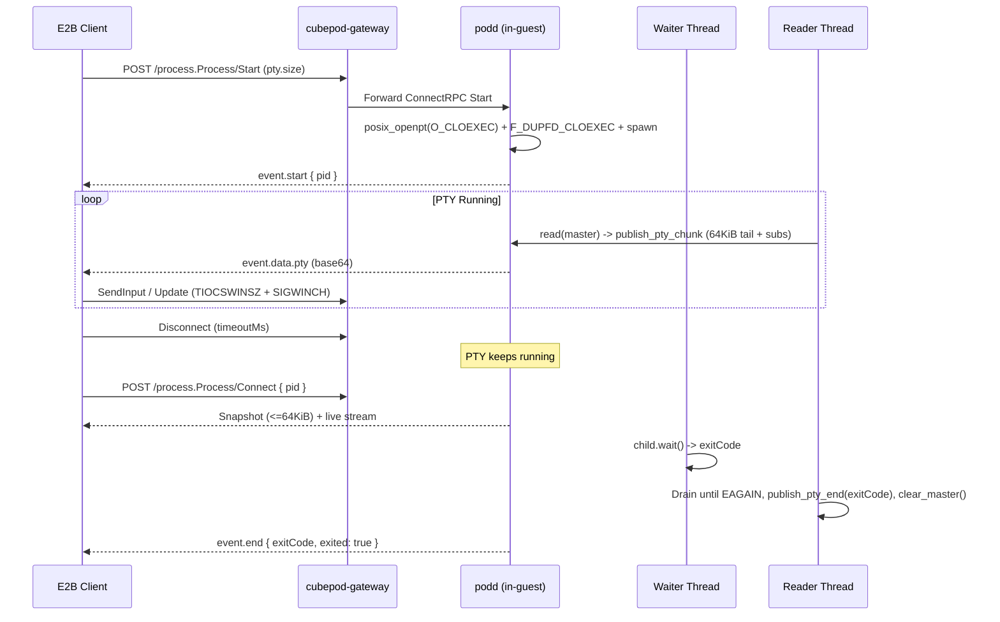

# CEP-0023: E2B Interactive PTY Execution, Streaming I/O, Resize, and Reconnect

| Field | Value |
| :--- | :--- |
| **CEP Number** | `0023` |
| **Stage** | `beta` |
| **Status** | `implemented` |
| **Created** | `2026-11-15` |
| **Updated** | `2026-11-17` |
| **Owning Area** | `runtime` (`podd`), `gateway` (`cubepod-gateway`) |

<!-- toc -->
- [Release Signoff Checklist](#release-signoff-checklist)
- [Summary](#summary)
- [Motivation](#motivation)
  - [Goals](#goals)
  - [Non-Goals](#non-goals)
- [Proposal](#proposal)
  - [User Stories](#user-stories)
  - [Notes / Constraints / Caveats](#notes--constraints--caveats)
  - [Risks and Mitigations](#risks-and-mitigations)
- [Design Details](#design-details)
  - [API / Wire Changes](#api--wire-changes)
  - [State Machine & Data Flow](#state-machine--data-flow)
  - [Boundary Conditions & Failure Recovery](#boundary-conditions--failure-recovery)
  - [Test Plan](#test-plan)
  - [Graduation Criteria](#graduation-criteria)
  - [Upgrade / Downgrade Strategy](#upgrade--downgrade-strategy)
- [Production Readiness Review Questionnaire (PRR)](#production-readiness-review-questionnaire-prr)
- [Implementation History](#implementation-history)
- [Drawbacks](#drawbacks)
- [Alternatives](#alternatives)
<!-- /toc -->

---

## Release Signoff Checklist

- [x] Enhancement scope, Goals, and Non-Goals are defined
- [x] ConnectRPC wire compatibility with official E2B 2.64 Python and TypeScript SDKs is specified
- [x] Dual-runtime behavior (Kubernetes `Kata + CSI Block` via `podd` and Local Development `Docker / Gateway Local Fallback`) is documented
- [x] Security boundaries (fd lifetime, `O_CLOEXEC`, sandbox isolation, env sanitization, credential separation) are reviewed
- [x] Unit and concurrency/race tests cover PTY lifecycle, isolation, and edge cases
- [x] Production Readiness Review (PRR) questionnaire is complete

---

## Summary

This proposal specifies **E2B-compatible interactive pseudo-terminal (PTY)** execution across CubePod's in-guest daemon (`podd`) and API gateway (`cubepod-gateway`). Official E2B 2.64 Python and TypeScript SDKs can create real OS PTY sessions, send keystrokes (`SendInput`, `StreamInput`), resize terminal windows (`Update`), reconnect to running or recently exited PTYs with bounded output replay (`Connect`), list running processes (`List`), and deliver signals (`SendSignal`).

Client stream disconnects do not terminate the PTY process; the PTY continues running until it exits or receives an explicit `SendSignal`, matching upstream `envd` semantics.

---

## Motivation

Prior to this enhancement, CubePod's ConnectRPC `/process.Process/*` surface only supported non-interactive pipe execution (`Start` with stdout/stderr pipes) and lacked PTY allocation, bidirectional input, window resizing, and live reconnect replay. Interactive AI coding agents (e.g., terminal-based coding assistants, `vim`, `htop`, REPLs) require a controlling TTY (`isatty() == true`), `SIGWINCH` resize propagation, and session reconnects.

### Goals

1. **Real OS PTY Allocation**: Allocate a real master/slave PTY pair with `setsid()` and `TIOCSCTTY`, defaulting `TERM` to `xterm-256color` and default dimensions to `80x24`.
2. **Official E2B 2.64 Wire Compatibility**: Support `Start` (with `pty.size`), `SendInput`, `StreamInput`, `Update`, `Connect`, `List`, and `SendSignal` over ConnectRPC (`application/connect+json` and `application/json`), emitting `exitCode` (camelCase) in `end` frames.
3. **Disconnect-Safe Lifecycle & Bounded Replay**: Keep PTYs alive when `Start` or `Connect` HTTP streams disconnect; maintain a 64 KiB replay tail and per-subscriber bounded queues (`64` chunks) that fail slow consumers with `resource_exhausted` rather than blocking the PTY.
4. **Dual-Runtime Parity**: Implement the same semantics in `podd` (for Kubernetes `Kata + CSI Block` and Docker with `podd`) and in `cubepod-gateway` local fallback mode.

### Non-Goals

- **`CloseStdin` for PTY**: Closing stdin half-duplex on a single bidirectional PTY master fd is not supported; `CloseStdin` returns `501 Not Implemented` (`unimplemented`).
- **Server-Side Idle Kill Timeout**: `timeoutMs` in ConnectRPC requests is a client stream deadline, not a server-side process kill timer.
- **Persistent PTY State Across Sandbox Pause/Snapshot**: Running PTYs are in-memory processes and are terminated on `prepare_stop` / `kill_all_managed`.

---

## Proposal

### User Stories

- **Story 1 (Interactive Agent Terminal)**: As an AI agent using the official E2B SDK (`sandbox.pty.create`), I can launch `/bin/bash -i -l`, send commands via `SendInput` or `StreamInput`, resize the terminal via `Update`, and receive raw terminal output frames (`event.data.pty`).
- **Story 2 (Reconnect Without Data Loss)**: As a client whose network connection drops or whose `Start` timeout expires, I can call `Connect` with the PTY's `pid` or `tag` to receive the last 64 KiB of output plus seamless live streaming without gaps or duplicates.
- **Story 3 (Multi-Tenant Local Gateway)**: As a developer running `cubepod-gateway` in local mode with multiple sandboxes, sandbox B cannot list, read, type into, resize, or kill sandbox A's PTY processes.

### Notes / Constraints / Caveats

- **Dual-Runtime Awareness**:
  - **Production Kubernetes (`Kata + CSI Block`)**: `cubepod-gateway` forwards all `/process.Process/*` ConnectRPC requests directly to the sandbox pod's `podd` HTTP daemon (`shouldForwardConnectRPC`). `podd` allocates the PTY inside the Kata MicroVM guest, applies `configure_command_credentials` (defaulting to `cubeplex` `1000:1000`), and manages `OwnedFd` lifetimes.
  - **Local Development (`Docker + Loopback ext4` / Gateway Local Mode)**: When a sandbox runs with `podd` (Docker runtime), requests forward to `podd` identically. When running in gateway-local fallback mode (no `poddURL`), `cubepod-gateway` allocates the OS PTY on the host via `/dev/ptmx` (`openOSPTY`), scopes all lookups by `sandboxID`, and sanitizes the child environment via `safeSandboxEnv` (never inheriting `os.Environ()`).
- **Zero-Trust Secret Safety**: Neither `podd` nor gateway local mode injects host/gateway environment secrets (`os.Environ()`) into PTY processes. Only `PATH`, `HOME`, `LANG=C.UTF-8`, `TERM=xterm-256color`, and explicitly requested `envs` (which may contain `cpodref_` placeholders) are passed.
- **No Gzip Magic-Byte Sniffing**: `unpack_all_connect_frames` honors only declared `Content-Encoding: gzip` and the Connect per-frame compression flag (`flag & 0x01 != 0`), never sniffing `0x1f 0x8b` magic bytes.

### Risks and Mitigations

| Risk / Failure Mode | Impact | Mitigation |
| :--- | :--- | :--- |
| Raw fd closed while another thread calls `write`/`ioctl`/`read` | Input or ioctl sent to a reused fd belonging to another client or file | `podd` wraps the PTY master in `Arc<OwnedFd>` behind a `Mutex<Option<Arc<OwnedFd>>>`; `SendSignal` only signals, and the fd is closed only when the last `Arc` drops. |
| Background child (`sleep &`) holds slave fd open after shell exits | Reader never sees `EIO`, zombie never reaped, `End` event never sent | `podd` reaps `child.wait()` in a dedicated waiter thread; once `child` exits, the reader drains buffered bytes until `EAGAIN`, publishes `End`, and clears the master. |
| Concurrent `fork`/`exec` inherits PTY slave fds | Other child processes pin the PTY open indefinitely | All PTY fds (`posix_openpt`, slave `open`, and `F_DUPFD_CLOEXEC`) are opened with `O_CLOEXEC` atomically. |
| Cross-sandbox PID/tag lookup in gateway local mode | Tenant B can read, write, resize, or kill Tenant A's PTY | `findLocalCommandEntry` and `List` strictly filter by `entry.sandboxID == rec.SandboxID`. |
| Gateway `os.Environ()` leaked into local PTYs | Host credentials (`E2B_API_KEY`, `KUBECONFIG`) exposed to sandbox | `safeSandboxEnv` constructs a minimal safe environment instead of copying `os.Environ()`. |
| Slow subscriber blocks PTY reader or drops bytes silently | PTY stalls or corrupts output for other subscribers | Each subscriber has a bounded queue (`64`); overflow drops only that subscriber and ends its stream with `resource_exhausted`. |
| Unbounded process registry growth | Memory leak from 64 KiB replay tails of exited PTYs | Exited entries are pruned after a 5-minute grace period or when exited count exceeds `256`. |

---

## Design Details

### API / Wire Changes

All endpoints are served under `/process.Process/*` (and `/sandboxes/{sandboxID}/process.Process/*` on the gateway):

- `POST /process.Process/Start`: Accepts `process.{cmd, args, envs, cwd, uid, gid, user}`, optional `id`, `tag`, and `pty.size.{cols, rows}`. Rejects duplicate client-supplied `id` with `409 Conflict` (`already_exists`). Streams Connect frames: `event.start.pid`, `event.data.pty` (base64), `event.end.{exitCode, exited: true}`, and end-of-stream `{}`.
- `POST /process.Process/SendInput`: Accepts `process` selector (`pid` or `tag`) and `input.pty` / `input.stdin` (base64). Rejects invalid base64 with `400 invalid_argument`. Writes all bytes with non-blocking `EAGAIN`+`poll` retry (5s timeout in `podd`), returning `500 internal` on failure.
- `POST /process.Process/StreamInput`: Client-streaming ConnectRPC frames (`event.start` selector, `event.data` base64 input). Buffers HTTP/1.1 request body, unpacks Connect frames honoring per-frame compression (`flag & 1`), and writes all bytes.
- `POST /process.Process/Update`: Accepts `process` selector and `pty.size.{cols, rows}`. Applies `TIOCSWINSZ` and sends `SIGWINCH` to the process group and pid.
- `POST /process.Process/Connect`: Accepts `process` selector. Atomically snapshots the 64 KiB replay tail and subscribes under the same locks as publish (no gaps, no duplicates). For running non-PTY processes, streams new output and waits for actual exit before emitting `event.end`.
- `POST /process.Process/List`: Returns running processes (scoped to `rec.SandboxID` in gateway local mode) with `pid`, `tag`, and `config.{cmd, args, envs, cwd}`.
- `POST /process.Process/SendSignal`: Sends `SIGTERM` or `SIGKILL` to `-pid` and `pid` without prematurely marking `running = false` or closing the master fd.
- `POST /process.Process/CloseStdin`: Returns `501 Not Implemented` (`unimplemented`).

### State Machine & Data Flow

### Boundary Conditions & Failure Recovery

- **Client Disconnect**: Dropping the `Start` or `Connect` TCP stream removes only that subscriber; the PTY process continues running and `Connect` can reattach later.
- **Process Ignores `SIGTERM`**: `SendSignal(SIGTERM)` delivers the signal only; `running` remains `true` until `child.wait()` observes exit.
- **Background Child Holding Slave**: When the main shell exits, the waiter thread unblocks `child.wait()`, causing the reader thread to drain buffered output until `EAGAIN`, publish `End`, and drop the master `Arc<OwnedFd>`.
- **Sandbox Stop (`prepare_stop`)**: `kill_all_managed` sends `SIGKILL` to all managed process groups and signals readers to exit.

### Test Plan

- **Unit Tests (`cargo test -p podd --locked`)**:
  - `test_pty_start_isatty_resize_bidirectional_and_kill`
  - `test_pty_reconnect`, `test_pty_start_disconnect_does_not_kill`, `test_pty_exit_code_nonzero`
  - `test_pty_stream_input`, `test_pty_process_list`, `test_pty_kill_all_managed`
  - `test_pty_replay_bounded_snapshot_has_no_gap_or_dup`, `test_pty_subscriber_overflow_sets_flag`, `test_pty_slow_start_consumer_ends_with_resource_exhausted`
  - `test_pty_background_child_holding_slave_publishes_end_and_reaps`
  - `test_pty_concurrent_send_input_and_kill_safe`
  - `test_pty_send_signal_trapped_sigterm_stays_running`
  - `test_process_connect_running_non_pty_waits_for_exit`
  - `test_pty_rejects_invalid_base64_and_duplicate_id`, `test_unpack_all_connect_frames_no_gzip_sniff`, `test_pty_close_stdin_returns_unimplemented`
- **Gateway Tests (`go test -race ./pkg/gateway/... -count=1`)**:
  - `TestConnectRPC_PTY_Connect_And_Multibyte_And_ExitCode`, `TestConnectRPC_PTY_StreamInput`, `TestConnectRPC_PTY_Forwarding`
  - `TestConnectRPC_PTY_SandboxIsolation_And_EnvSanitization`
  - `TestConnectRPC_PTY_ConcurrentSendInputAndKill_NoRace`
  - `TestConnectRPC_Process_ConnectRunningNonPTY_WaitsForExit`

### Graduation Criteria

- **Alpha (`v0.5.0`)**:
  - [x] All unit and `-race` tests pass in `podd` and `cubepod-gateway`; official E2B 2.64 SDK wire shapes verified.
- **Beta (`v0.6.0`)**:
  - [x] Live Kubernetes (`Kata + CSI Block`) and Docker E2E suite exercises `sandbox.pty.create` / `connect` / `resize` / `kill` end-to-end (`TestK8sLiveE2EPTY`).
  - [x] Official E2B extended SDK suites verified (`test/e2b-compat/test_official_e2b_extended.py` and TypeScript suite).
- **Stable (`v1.0.0`)**:
  - [ ] Multi-day soak testing with concurrent interactive terminals and `prepare_stop` cleanup (tracked in [#104](https://github.com/cubeplexai/cubepod/issues/104)).

### Upgrade / Downgrade Strategy

- Purely additive in-memory process management and ConnectRPC handlers; no CRD schema or `/workspace` / `rootfs-upper` PVC layout changes. Rolling back `podd` or `cubepod-gateway` has zero impact on persisted storage.

---

## Production Readiness Review Questionnaire (PRR)

- **Feature Enablement and Rollback**: Always enabled as part of the E2B ConnectRPC `/process.Process/*` surface. Rollback is a standard binary downgrade with no persistent state migration.
- **Rollout, Upgrade and Rollback Planning**: In-flight PTYs live in `podd` (inside the pod) or `cubepod-gateway` memory and terminate if the daemon restarts; `/workspace` data is unaffected.
- **Monitoring Requirements**: ConnectRPC HTTP status codes (`200`, `400`, `404`, `409`, `500`, `501`) and `resource_exhausted` stream termination frames.
- **Dependencies**: Linux `/dev/ptmx` (`devpts`) and `posix_openpt`/`TIOCSWINSZ`/`TIOCSCTTY` ioctls (standard in both Kata guest kernels and host Linux).
- **Scalability**: Bounded by `64 KiB` replay buffer per PTY and `256` retained exited entries (5-minute grace).
- **Troubleshooting**: Use `POST /process.Process/List` to inspect active PTYs (`pid`, `tag`, `cmd`, `cwd`) and `SendSignal` (`SIGKILL`) to terminate stuck sessions.

---

## Implementation History

- `2026-11-15`: Initial implementation in `crates/podd` and `pkg/gateway`, followed by review hardening (`OwnedFd` lifetime, atomic `O_CLOEXEC`, waiter thread reaping, gateway sandbox isolation, `safeSandboxEnv`, and regression tests).
- `2026-11-17`: Promoted to `beta`. Live Kubernetes E2E suite (`TestK8sLiveE2EPTY`) and official E2B extended SDK suites (`test/e2b-compat/test_official_e2b_extended.py` and TypeScript suite) verified; multi-day concurrent interactive PTY soak testing tracked in [#104](https://github.com/cubeplexai/cubepod/issues/104).

---

## Drawbacks

- `StreamInput` in `podd` and `cubepod-gateway` buffers the HTTP/1.1 request body before parsing Connect frames, which is suitable for interactive keystroke bursts but not for multi-megabyte continuous binary streaming over a single `StreamInput` call.
- Exited PTY replay buffers (`<= 64 KiB`) remain in memory for up to 5 minutes (capped at 256 entries) to support post-exit `Connect`.

---

## Alternatives

- **WebSocket-Only PTY**: Rejected because official E2B 2.64 SDKs use ConnectRPC over HTTP (`POST /process.Process/*`), not WebSockets.
- **Closing Master Fd on `SendSignal`**: Rejected because it races with concurrent `SendInput`/`Update`/`read` callers (risking fd-reuse corruption) and turns `SIGTERM` into an immediate `SIGHUP`.
