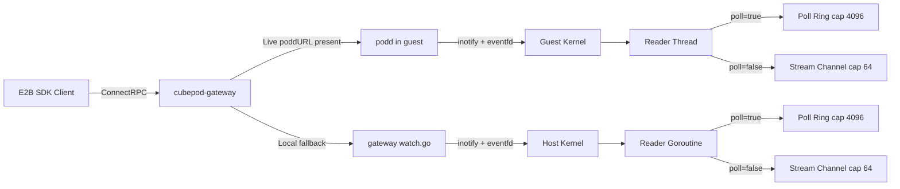

# CEP-0024: E2B Filesystem Directory Watching and MakeDir Compatibility

| Field | Value |
| :--- | :--- |
| **CEP Number** | `0024` |
| **Status** | `implemented` |
| **Stage** | `beta` |
| **Owning Area** | `gateway` |
| **Participating Areas** | `runtime` |
| **Authors** | @xfgong |
| **Created** | 2026-11-15 |
| **Updated** | 2026-11-17 |

<!-- toc -->
- [Release Signoff Checklist](#release-signoff-checklist)
- [Summary](#summary)
- [Motivation](#motivation)
  - [Goals](#goals)
  - [Non-Goals](#non-goals)
- [Proposal](#proposal)
  - [User Stories](#user-stories)
  - [Notes / Constraints / Caveats](#notes--constraints--caveats)
  - [Risks and Mitigations](#risks-and-mitigations)
- [Design Details](#design-details)
  - [API / Wire Changes](#api--wire-changes)
  - [State Machine & Data Flow](#state-machine--data-flow)
  - [Path Resolution, Symlink Containment, and Ownership](#path-resolution-symlink-containment-and-ownership)
  - [Dual-Runtime Awareness](#dual-runtime-awareness)
  - [Boundary Conditions & Failure Recovery](#boundary-conditions--failure-recovery)
  - [Test Plan](#test-plan)
  - [Graduation Criteria](#graduation-criteria)
  - [Upgrade / Downgrade Strategy](#upgrade--downgrade-strategy)
- [Production Readiness Review Questionnaire (PRR)](#production-readiness-review-questionnaire-prr)
- [Implementation History](#implementation-history)
- [Drawbacks](#drawbacks)
- [Alternatives](#alternatives)
<!-- /toc -->

---

## Release Signoff Checklist

- [x] Enhancement scope, Goals, and Non-Goals are agreed upon
- [x] ConnectRPC wire compatibility for `WatchDir`, `CreateWatcher`, `GetWatcherEvents`, `RemoveWatcher`, and `MakeDir` verified
- [x] Dual-runtime behavior (Kubernetes `Kata + CSI Block` and Local `Docker + Loopback ext4` / gateway local fallback) documented
- [x] Security invariants verified: symlink containment, `/proc`/`/dev`/`/sys` and network-mount refusal, `cubeplex` (`1000:1000`) directory ownership, per-sandbox watcher caps, and idle poll TTL
- [x] Unit and multi-process tests added in Rust (`podd`) and Go (`pkg/gateway`)
- [x] Production Readiness Review (PRR) section complete

---

## Summary

This proposal specifies CubePod's implementation of the official E2B `filesystem.Filesystem` ConnectRPC directory-watching and directory-creation RPCs:

- **Streaming watch**: `POST /filesystem.Filesystem/WatchDir` (`application/connect+json` server stream)
- **Polling watch**: `POST /filesystem.Filesystem/CreateWatcher`, `GetWatcherEvents`, and `RemoveWatcher` (unary ConnectRPC)
- **Directory creation**: `POST /filesystem.Filesystem/MakeDir` (unary ConnectRPC)

Both `podd` (inside the sandbox guest) and `cubepod-gateway` (forwarding to `podd` in live sandbox mode, or executing in local fallback mode when `poddURL` is absent) implement identical wire semantics, inotify event mapping, overflow handling, and path-safety rules.

---

## Motivation

Official E2B Python (`e2b`) and TypeScript (`@e2b/code-interpreter`, `e2b`) SDKs implement `sandbox.files.watch_dir(...)` / `sandbox.files.watchDir(...)` and `sandbox.files.make_dir(...)` / `sandbox.files.makeDir(...)` over ConnectRPC (`/filesystem.Filesystem/*`). Without these endpoints:
1. Agent frameworks and IDE integrations that watch `/workspace` or `/home/user` for live file changes fail with `404` / `unimplemented`.
2. SDKs that call `make_dir` before writing files fail or hit permission mismatches if directories are created as `root` instead of `cubeplex` (`1000:1000`).

### Goals

1. **ConnectRPC Wire Compatibility**: Support `WatchDir`, `CreateWatcher`, `GetWatcherEvents`, `RemoveWatcher`, and `MakeDir` with official `application/connect+json` framing and unary Connect JSON error codes (`not_found`, `invalid_argument`, `already_exists`, `resource_exhausted`).
2. **Accurate Overflow & Lifecycle Semantics**: Never silently drop events. Surface kernel `IN_Q_OVERFLOW`, poll-ring overflow, subscriber queue overflow, and inotify `ENOSPC`/`EMFILE`/`ENFILE` as `resource_exhausted`. Emit a clean `{}` end-stream frame on server-side stop and periodic `{"keepalive":{}}` frames on quiet streams.
3. **Security & Privilege Separation**: Prevent symlink escapes and `/proc`/`/dev`/`/sys` or unauthorized network/FUSE watches; chown newly created `MakeDir` directories in `podd` to the resolved user (defaulting to `cubeplex` `1000:1000`); enforce per-sandbox watcher caps and idle poll expiration.

### Non-Goals

- Synthesizing missed events during the Linux inotify recursive `mkdir` + `inotify_add_watch` race window.
- Watching network or FUSE mounts by default without `allowNetworkMounts: true`.
- Replacing `podd`'s `/v1/files` upload/download REST endpoints (covered by CEP-0018).

---

## Proposal

### User Stories

1. **As an E2B SDK user**, I can call `files.watch_dir("/home/user", recursive=True)` or `files.watch_dir("/workspace")` and receive `CREATE`, `WRITE`, `REMOVE`, `RENAME`, and `CHMOD` events as files are modified.
2. **As an E2B SDK user**, I can call `files.make_dir("/home/user/project/src")` and immediately write files into the created directory as the default `cubeplex` (`1000:1000`) user without permission errors.
3. **As a cluster operator**, a misbehaving sandbox or abandoned poll watcher cannot exhaust host or guest `fs.inotify.max_user_instances` or memory because watchers are capped per sandbox (`16`), idle poll watchers expire (`300s`), and `WatchDir` streams do not buffer into a poll ring.

### Notes / Constraints / Caveats

- **Linux `inotify` recursive race**: When a new subdirectory is created under a recursive watch, `inotify_add_watch` is called after `IN_CREATE | IN_ISDIR` is read. Files created inside the new subdirectory before `inotify_add_watch` returns are not queued by the kernel and are not synthesized by scanning.
- **Renamed watched subdirectories**: If a watched subdirectory is renamed while armed, the `watches` map retains the original relative prefix until `IN_IGNORED` or watcher removal.
- **Extra JSON fields**: `MakeDir` and `entry` payloads include `isDir` and `is_dir` alongside proto fields (`name`, `type`, `path`, `size`, `mode`, `permissions`); Connect JSON clients with `ignoreUnknownFields` ignore them.

### Risks and Mitigations

| Risk | Impact | Mitigation |
| :--- | :--- | :--- |
| Stream `WatchDir` killed after 256 events | Long-lived streams fail with `resource_exhausted` even when client keeps up | Poll ring (`pending`, cap `4096`) is only populated for `poll: true` (`CreateWatcher`) watchers; `WatchDir` (`poll: false`) delivers strictly via subscriber channels. |
| `inotify` fd close/reuse TOCTOU race | `stop()` closing `fd` while reader thread is between `fd` check and `poll`/`read` can read an unrelated socket | Reader thread/goroutine exclusively owns and closes `fd` on loop exit. `stop()` signals shutdown via `eventfd` (`EFD_CLOEXEC \| EFD_NONBLOCK`). |
| `MakeDir` creates `root:root` directories in `podd` | `cubeplex` (`1000:1000`) agent processes cannot write into SDK-created directories (Invariant 4) | `podd` `handle_make_dir` resolves ownership via `resolve_file_ownership` and calls `chown_if_root` on each newly created directory. |
| Symlink escape out of `/workspace` or into `/proc` | Agent creates symlink `/workspace/l -> /etc` or `/proc` and watches/creates outside allowed tree | Deepest existing ancestor is canonicalized (`canonicalize_deepest_ancestor` / `EvalSymlinks`) before containment, `/proc`/`/dev`/`/sys`, and `statfs` mount checks. |
| Host `fs.inotify.max_user_instances` exhaustion in gateway local mode | One tenant opens many poll watchers and starves other tenants | Per-sandbox watcher cap (`16`), lazy reaping of idle poll watchers (`300s` TTL), and `ENOSPC`/`EMFILE`/`ENFILE`/`ENOMEM` mapped to `resource_exhausted`. |

---

## Design Details

### API / Wire Changes

All five endpoints are served under `/filesystem.Filesystem/*` on both `podd` (`:49983`) and `cubepod-gateway`:

1. **`POST /filesystem.Filesystem/MakeDir`** (unary):
   - Request: `{"path": "<dir>"}`
   - Response (`200 OK`): `{"entry": {"name", "type": "FILE_TYPE_DIRECTORY", "path", "size", "mode", "permissions", "isDir": true, "is_dir": true}}`
   - Errors: `already_exists` (`409`) if directory exists; `invalid_argument` (`400`) if path or parent is a non-directory file, empty, or escapes confinement.
2. **`POST /filesystem.Filesystem/CreateWatcher`** (unary, `poll: true`):
   - Request: `{"path", "recursive", "includeEntry", "allowNetworkMounts"}`
   - Response (`200 OK`): `{"watcherId": "w<n>"}`
3. **`POST /filesystem.Filesystem/GetWatcherEvents`** (unary):
   - Request: `{"watcherId": "w<n>"}`
   - Response (`200 OK`): `{"events": [{"name", "type", "entry"?}]}` (drains poll ring, updates `last_poll`)
   - Errors: `not_found` (`404`) if missing/expired/stopped; `resource_exhausted` (`429`) if ring (`4096`) or kernel `IN_Q_OVERFLOW` occurred.
4. **`POST /filesystem.Filesystem/RemoveWatcher`** (unary):
   - Request: `{"watcherId": "w<n>"}`
   - Response (`200 OK`): `{}`
5. **`POST /filesystem.Filesystem/WatchDir`** (server stream, `poll: false`, `application/connect+json`):
   - First frame (`flag=0x00`): `{"start":{}}`
   - Event frames (`flag=0x00`): `{"filesystem":{"name","type","entry"?}}`
   - Keepalive frames (`flag=0x00`): `{"keepalive":{}}` every `15s` when idle
   - Clean server-stop end frame (`flag=0x02`): `{}` on `RemoveWatcher`, `prepare_stop`, `stop_all`, or sandbox deletion
   - Error end frame (`flag=0x02`): `{"error":{"code":"...","message":"..."}}`

#### Inotify Event Mapping (aligned with `fsnotify` / `envd`)

| Linux `inotify` Mask | E2B Event Type | Notes |
| :--- | :--- | :--- |
| `IN_CREATE \| IN_MOVED_TO` | `EVENT_TYPE_CREATE` | Matches `fsnotify` (destination of rename is `Create`) |
| `IN_MOVED_FROM` | `EVENT_TYPE_RENAME` | Source of rename |
| `IN_DELETE \| IN_DELETE_SELF` | `EVENT_TYPE_REMOVE` | |
| `IN_ATTRIB` | `EVENT_TYPE_CHMOD` | |
| `IN_MODIFY` | `EVENT_TYPE_WRITE` | `IN_CLOSE_WRITE` is not subscribed to avoid duplicate `WRITE` events |

### State Machine & Data Flow

### Path Resolution, Symlink Containment, and Ownership

- **`podd` (in-guest)**: `podd` runs inside the sandbox trust boundary. Relative paths and `/workspace/...` paths are confined to canonicalized `workdir` (default `/workspace`); explicit non-`/workspace` absolute paths (e.g. `/home/user`) are permitted just like `files.write`. Deepest existing ancestor is canonicalized before checking `/proc`, `/dev`, `/sys` and `statfs` network/FUSE mount magic (`nfs`, `cifs`, `smb`, `smb2`, `fuse`, `9p`, `ceph` refused unless `allowNetworkMounts: true`). Newly created `MakeDir` directories are chowned via `chown_if_root(path, uid, gid)` using `resolve_file_ownership` (defaulting to `cubeplex` `1000:1000`).
- **`cubepod-gateway` (local fallback)**: Mirrors `resolveFilePath` by re-rooting non-`/workspace` absolute paths (such as `/home/user`) under `rec.WorkspaceDir`, while rejecting `/workspace/..` and relative `..` escapes. Deepest existing ancestor is canonicalized via `filepath.EvalSymlinks` and verified to remain inside canonicalized `WorkspaceDir`, preventing container-written symlinks from resolving on the host. `rec.WorkspaceDir` initialization is synchronized under `s.mu`.

### Dual-Runtime Awareness

- **Production Kubernetes (`Kata + CSI Block`)**: `cubepod-gateway` proxies all `/filesystem.Filesystem/*` ConnectRPC requests directly to `podd` inside the Kata MicroVM over the pod network. `podd` watches the guest's OverlayFS `/workspace` (CSI Block volume) or guest rootfs (`/home/user`) using the guest kernel's `inotify` subsystem. On `/v1/prepare-stop`, `podd` calls `watchers.stop_all()`, cleanly ending active `WatchDir` streams before `sync(2)` and snapshot/quiesce.
- **Local Development (`Docker + Loopback ext4`)**: When a Docker container runs `podd`, `cubepod-gateway` forwards to `podd` just as in Kubernetes. When running in gateway local-fallback mode (without `poddURL`), `pkg/gateway/watch.go` runs in-process on the host against `rec.WorkspaceDir` (with non-`/workspace` paths re-rooted under `WorkspaceDir`) and cleans up all sandbox watchers on `DELETE /sandboxes/{id}`.

### Boundary Conditions & Failure Recovery

- **Slow stream consumer**: Per-subscriber bounded queue (`64`) fails only that subscriber with `resource_exhausted`; other subscribers and the watcher remain healthy.
- **Idle poll watchers**: `POLL_WATCHER_IDLE_TTL = 300s` lazily reaps abandoned `CreateWatcher` instances on `create` and `get` calls.
- **Subdirectory `EACCES` during recursive walk**: Skipped without failing the recursive watch; `ENOSPC`/`EMFILE`/`ENFILE`/`ENOMEM` propagate as `resource_exhausted`.

### Test Plan

- **Rust unit & HTTP tests (`crates/podd/src/watch.rs`, `crates/podd/src/tests.rs`)**:
  - Stream watcher > `WATCH_RING_CAP` events without overflow; poll ring overflow (`resource_exhausted`); kernel `IN_Q_OVERFLOW`; slow subscriber isolation.
  - Clean `{}` end-stream frame on `RemoveWatcher` / `stop_all`; `prepare_stop` cleanup.
  - `MakeDir` official error semantics (`already_exists`, `invalid_argument` on file/file-parent), explicit absolute paths, symlink escape rejection, `/proc`/`/sys`/`/dev` refusal.
  - Watcher cap + idle poll TTL reaping; `IN_MOVED_TO` -> `EVENT_TYPE_CREATE` and `IN_CLOSE_WRITE` exclusion.
- **Go unit & race tests (`pkg/gateway/local_watch_pty_test.go`, `pkg/gateway/connectrpc_test.go`)**:
  - Same coverage under `go test -race`: stream > `watchRingCap`, poll ring overflow, `resolveWatchPath` `/home/user` re-rooting + symlink escape rejection, watcher cap + TTL, `mapInotify`, sandbox delete cleanup.

### Graduation Criteria

- **Alpha (`v0.5.0`)**:
  - [x] Implemented in `podd` and `cubepod-gateway` with unit/multi-process tests passing (`cargo test -p podd`, `go test -race ./pkg/gateway/...`).
- **Beta (`v0.6.0`)**:
  - [x] Verified against official Python and TypeScript E2B SDKs in CI and live Kubernetes Kata cluster (`TestK8sLiveE2EWatchAndMakeDir`).
- **Stable (`v1.0.0`)**:
  - [ ] Baked in CubePlex production with Prometheus watcher/stream metrics (active watchers, emitted events, `IN_Q_OVERFLOW` / queue overflows; tracked in [#103](https://github.com/cubeplexai/cubepod/issues/103)).

### Upgrade / Downgrade Strategy

No CRD or persistent on-disk schema changes. Watchers are ephemeral in-memory kernel resources; rolling `podd` or `cubepod-gateway` cleanly closes streams and clients reconnect.

---

## Production Readiness Review Questionnaire (PRR)

- **Feature Enablement and Rollback**: Always enabled as part of E2B ConnectRPC compatibility; no `/workspace` format changes, so rollback is a standard binary downgrade.
- **Rollout, Upgrade and Rollback Planning**: In-flight `WatchDir` streams receive connection close or clean `{}` end-stream frames during `prepare_stop` / pod termination.
- **Monitoring Requirements**: ConnectRPC HTTP status/error codes (`429 resource_exhausted`, `404 not_found`, `400 invalid_argument`) and gateway logs.
- **Dependencies**: Linux kernel `inotify` and `eventfd` syscalls (standard in both Kata guest kernel and Docker host kernel).
- **Scalability**: Bounded to `16` watchers per sandbox, `4096` events per poll ring, and `64` events per stream subscriber; `300s` idle poll TTL bounds leaked poll watchers.
- **Troubleshooting**: `resource_exhausted` with `"too many active watchers"` indicates sandbox watcher cap (`16`); `"inotify_init1: Too many open files"` indicates host/guest `fs.inotify.max_user_instances` saturation.

---

## Implementation History

- `2026-11-15`: Initial implementation in `crates/podd/src/watch.rs`, `pkg/gateway/watch.go`, and `pkg/gateway/connectrpc.go`; review hardening (stream/poll separation, `eventfd` fd-ownership, `MakeDir` chown, symlink containment, path alignment, watcher caps/TTL, clean end-stream/keepalive frames, `fsnotify` event mapping) and CEP-0024 documented.
- `2026-11-17`: Promoted to `beta`. Live Kubernetes Kata E2E tests (`TestK8sLiveE2EWatchAndMakeDir`) and official Python/TypeScript SDK test suites verified; remaining Stable watcher/stream metrics tracked in [#103](https://github.com/cubeplexai/cubepod/issues/103).

---

## Drawbacks

- Maintaining parallel inotify implementations in Rust (`podd`) and Go (`pkg/gateway` local fallback) requires keeping event mapping and path semantics synchronized across both codebases.

---

## Alternatives

- **Polling directory trees (`stat` loop)**: Rejected due to high CPU/I/O overhead and missed transient events.
- **Host `fanotify`**: Rejected because `fanotify` requires `CAP_SYS_ADMIN` and does not work inside unprivileged containers or without elevated privileges.
- **Using `notify` / `fsnotify` external crate/module**: Rejected in `podd` to preserve `podd`'s zero-external-dependency Rust build (`libc` only); `golang.org/x/sys/unix` in gateway avoids extra transitive dependencies while matching `fsnotify` event semantics.
