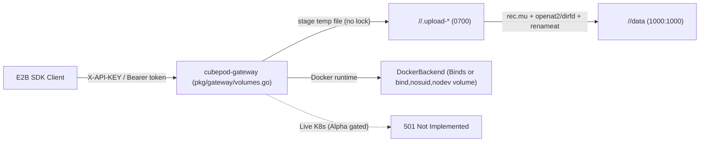

# CEP-0025: Official E2B 2.64.0 Volume API, Durable Store, and Sandbox Mounts

| Stage | Status | Created | Updated | Owning Area |
| :--- | :--- | :--- | :--- | :--- |
| `stable` | `implemented` | `2026-11-15` | `2026-11-18` | `storage` (`gateway`, `runtime`, `controller`) |

## Table of Contents

- [Release Signoff Checklist](#release-signoff-checklist)
- [Summary](#summary)
- [Motivation](#motivation)
  - [Goals](#goals)
  - [Non-Goals](#non-goals)
- [Proposal](#proposal)
  - [User Stories](#user-stories)
  - [Notes / Constraints / Caveats](#notes--constraints--caveats)
  - [Risks and Mitigations](#risks-and-mitigations)
- [Design Details](#design-details)
  - [API / CRD / Wire Changes](#api--crd--wire-changes)
  - [State Machine & Data Flow](#state-machine--data-flow)
  - [Security & Concurrency Model](#security--concurrency-model)
  - [Boundary Conditions & Failure Recovery](#boundary-conditions--failure-recovery)
  - [Test Plan](#test-plan)
  - [Graduation Criteria](#graduation-criteria)
  - [Upgrade / Downgrade Strategy](#upgrade--downgrade-strategy)
- [Production Readiness Review Questionnaire (PRR)](#production-readiness-review-questionnaire-prr)
- [Implementation History](#implementation-history)
- [Drawbacks](#drawbacks)
- [Alternatives](#alternatives)

---

## Release Signoff Checklist

- [x] Enhancement design documented in `docs/enhancements/0025-e2b-volumes/`
- [x] Official E2B 2.64.0 Volume management and `/volumecontent` REST routes implemented
- [x] Symlink-safe fd-based content API (`openat2` / `O_NOFOLLOW` dirfd walk + `fchown`/`fchmod`) verified
- [x] On-disk UID/GID (`1000:1000`) and mode (`& 0o777`) invariants enforced; `nosuid,nodev` on Docker bind volumes
- [x] Live Kubernetes runtime gated (`501 Not Implemented`) unless `K8sE2BVolumeMounts` + shared RWX PVC are configured ([CEP-0026](../0026-k8s-kata-e2b-volumes/README.md))
- [x] GA envelope encryption (`KMSProvider`: `LocalKEKProvider` + `HTTPKMSProvider`) for volume content tokens (`encryptedToken` + `kmsKeyID`) with legacy plaintext migration (`pkg/volume/kms.go`)
- [x] GA tenant API-key rotation (`POST /volumes/rotate-key` + `Store.RotateAPIKey`) backed by `tenants.json` keyring with RWX `flock` + atomic temp-file rename
- [x] GA multi-tenant volume-count & byte quotas (`MaxVolumesPerTenant`, `MaxBytesPerTenant` / `CUBEPOD_E2B_MAX_TENANT_BYTES`), `Store.CapacityStats()`, Prometheus metrics, and `deploy/monitoring/e2b-volumes-alerts.yaml`
- [x] Unit and regression tests passing (`go test -race ./pkg/volume/... ./pkg/gateway/... ./pkg/controller/... ./pkg/runtime/...`)

---

## Summary

CEP-0025 adds support for the official E2B 2.64.0 Volume API (`POST/GET /volumes`, `GET/DELETE /volumes/{volumeID}`), the authenticated Volume Content API (`/volumecontent/{volumeID}/file|dir|path`), and sandbox creation `volumeMounts` attachment in `cubepod-gateway` and `pkg/runtime`. Volumes are stored in a durable gateway-local directory (`pkg/volume`) isolated per API-key tenant and mounted into Docker sandboxes at creation time.

In **Alpha**, `volumeMounts` is active on the **Local Development (`Docker`)** runtime and explicitly **gated off (`501 Not Implemented`) on live Kubernetes (`Kata + CSI`)** until a shared-storage backend bridges the gateway content API and Kata microVM pods across `pivot_root`. See **[CEP-0026](../0026-k8s-kata-e2b-volumes/README.md)** for the follow-up Kubernetes/Kata integration design.

---

## Motivation

Official E2B 2.64.0 SDKs (`Volume.create`, `Volume.write_file`, `Sandbox.create(volume_mounts=...)`) allow agents and orchestrators to pre-populate reusable datasets out-of-band and mount them into sandboxes at arbitrary paths (distinct from CubePod's `/workspace` `VolumeKey`). Without these endpoints, E2B SDK volume workflows fail against `cubepod-gateway`.

### Goals

1. Implement E2B 2.64.0 Volume management (`/volumes`, including `POST /volumes/rotate-key` in `v0.7.0`) and content (`/volumecontent/{volumeID}/...`) HTTP APIs.
2. Isolate volume data per tenant via a durable keyring (`tenants.json` decoupling canonical `tnt_<id>` ownership from raw `sha256(X-API-KEY)`), envelope-encrypt content tokens at rest via `KMSProvider` (`LocalKEKProvider` or `HTTPKMSProvider`), protect against symlink TOCTOU host-root escapes, and enforce AGENTS.md Invariant 4 (`1000:1000` `cubeplex` ownership, no setuid/uid=0 on disk).
3. Enforce multi-tenant volume-count (`MaxVolumesPerTenant`) and storage-byte (`MaxBytesPerTenant` / `CUBEPOD_E2B_MAX_TENANT_BYTES`) quotas, exporting capacity and quota-rejection Prometheus metrics with automated RWX capacity alerts.
4. Attach mounted volumes to Docker sandboxes (`HostConfig.Binds` or `nosuid,nodev` named Docker bind volumes) while keeping `/workspace` and `/rootfs-upper` strictly independent (Invariant 1).
5. Record `PodBoxSpec.E2BVolumeMounts` and controller manifest plumbing (`e2bvol-<id>` / shared RWX PVC in [CEP-0026](../0026-k8s-kata-e2b-volumes/README.md)).

### Non-Goals

1. **Live Kubernetes Kata + CSI shared volume content in CEP-0025 itself**: Covered separately in [CEP-0026](../0026-k8s-kata-e2b-volumes/README.md) (`K8sE2BVolumeMounts` + shared RWX PVC).

---

## Proposal

### User Stories

1. **As an E2B SDK user (local Docker runtime)**, I can create a named volume, upload files via `Volume.write_file`, launch a sandbox with `volumeMounts: [{name, path}]`, and read/write those files inside the sandbox while keeping `/workspace` separate.
2. **As a cluster operator**, I get a clear `501 Not Implemented` error if a client requests `volumeMounts` on a live Kubernetes (`Kata + CSI`) deployment in Alpha, rather than silent data divergence between the gateway and the pod.

### Notes / Constraints / Caveats

- **Dual-Runtime Behavior**:
  - **Local Development (`Docker + Loopback ext4`)**: Supported in Alpha. Volume bytes live under `<stateDir>/e2b-volumes/<id>/data` (`0700` parent, `1000:1000` `data/`). When `CUBEPOD_E2B_DOCKER_VOLUMES=1`, `pkg/volume` provisions a named Docker `local` bind volume (`o: "bind,nosuid,nodev"`) verified on 409 conflict.
  - **Production Kubernetes (`Kata + CSI Block`)**: Gated off in Alpha. When `livePodRouting && runtime == nil`, `POST /sandboxes` with non-empty `volumeMounts` returns `501 Not Implemented`, and `ensureE2BVolumePVC` skips creating `e2bvol-<id>` PVCs. Controller manifest helpers (`applyOfficialVolumeMounts`, `ValidateOfficialVolumeMounts`) and CRD schema (`PodBoxSpec.E2BVolumeMounts`) are present and unit-tested with `MemoryKubeClient`, but unreachable on live K8s until Beta.
- **Test-only Docker Flags**: `CUBEPOD_DOCKER_INJECT_BIN=0` and `CUBEPOD_DOCKER_BIND_STORAGE=0` in `cmd/cubepod-gateway/main.go` are **test-only** overrides for local compose harnesses; they emit a warning log and must never be disabled in production (AGENTS.md Invariants 1 & 2).

### Risks and Mitigations

| Risk | Impact | Mitigation |
| :--- | :--- | :--- |
| Symlink TOCTOU race by sandbox code modifying `data/` while gateway runs as root | Host-root file overwrite, `chmod`/`chown` escape | All `pkg/volume` content ops use `openDataRoot` (`O_DIRECTORY\|O_NOFOLLOW`), `openat2(RESOLVE_BENEATH\|RESOLVE_NO_SYMLINKS)` with `O_NOFOLLOW` dirfd walk fallback, `fstatat(AT_SYMLINK_NOFOLLOW)`, and `fchown`/`fchmod` on open fds. |
| API `uid=0` or `mode=04755` planting setuid-root binaries | Privilege escalation inside sandbox | On-disk ownership is always `1000:1000` (`defaultDataUID:defaultDataGID`); mode is masked to `0o777` on disk and in `attrs.json`. Requested `uid`/`gid` are stored as metadata only. Docker bind volumes mount `nosuid,nodev`. |
| Slow upload or Docker call blocking all tenants | Gateway DoS | `WriteFile` streams to a private `0700` temp file outside `data/` with no lock held, then commits under per-volume `rec.mu`. `Store.mu` is released around Docker Engine HTTP calls. `http.MaxBytesReader` caps uploads (default 64 MiB -> `413`). |
| Unbounded volume creation per API key | Disk exhaustion | `MaxVolumesPerTenant` (default 64) returns `ErrLimitExceeded` (`429 Too Many Requests`). |
| Stale `mounts.json` after gateway crash | `Delete` blocked forever with `409 Conflict` | `Store.ReconcileMounts` prunes unknown sandbox IDs on `ConfigureVolumes` startup. |
| Volume mounted over `/rootfs-upper` or reserved paths | Violates Invariant 1 / breaks container | `reservedVolumeMounts` includes `/rootfs-upper`, `/workspace`, `/opt/cubepod`, `/mnt/cubepod`, `/proc`, `/sys`, `/dev`, `/etc`, `/bin`, `/sbin`, `/usr`, `/lib`, `/lib64`, `/root`, `/boot`, `/run`. Path-segment validation rejects `..` while permitting filenames like `/mnt/a..b`. |

---

## Design Details

### API / CRD / Wire Changes

- **Management API (`X-API-KEY`)**:
  - `POST /volumes` (`201`): creates volume, returns `{volumeID, name, token}`.
  - `POST /volumes/rotate-key` (`200`, *Added in v0.7.0*): accepts header `X-API-Key: <newKey>` and body `{"previousApiKey": "<oldKey>"}`, migrates all volume & mount ownership to a canonical tenant ID in `tenants.json`, revokes `<oldKey>`, and returns `{"rotatedVolumes": N}`.
  - `GET /volumes` (`200`): lists tenant volumes (tokens omitted).
  - `GET /volumes/{volumeID}` (`200`): returns `{volumeID, name, token}`.
  - `DELETE /volumes/{volumeID}` (`204`, `409` if mounted).
- **KMS Envelope Encryption (`pkg/volume/kms.go`, *Added in v0.7.0*)**:
  - `KMSProvider` (`KeyID()`, `Wrap(ctx, plaintext)`, `Unwrap(ctx, wrapped)`) supports `LocalKEKProvider` (`CUBEPOD_VOLUMES_KEK`, 32-byte base64 or 64-hex AES-256-GCM) and `HTTPKMSProvider` (`CUBEPOD_VOLUMES_KMS_URL`, optional `CUBEPOD_VOLUMES_KMS_TOKEN`, TLS 1.2+ and redirect-blocking hardening).
  - When configured, each volume token is encrypted under a random 256-bit DEK with AES-256-GCM bound to `volumeID` as AAD, the DEK is wrapped via `KMSProvider.Wrap` outside `Store.mu`, and `meta.json` stores `encryptedToken` + `kmsKeyID` with plaintext `token` omitted on disk. Legacy plaintext `meta.json` records are automatically migrated to envelope encryption on `Store.Open`.
- **Content API (`Authorization: Bearer <token>`, constant-time compare)**:
  - `GET /volumecontent/{volumeID}/file?path=...`
  - `PUT /volumecontent/{volumeID}/file?path=...&uid=...&gid=...&mode=...&force=...` (`http.MaxBytesReader`, `413` on overflow)
  - `GET /volumecontent/{volumeID}/dir?path=...&depth=...`
  - `POST /volumecontent/{volumeID}/dir?path=...&uid=...&gid=...&mode=...&force=...`
  - `GET /volumecontent/{volumeID}/path?path=...`
  - `PATCH /volumecontent/{volumeID}/path?path=...` (JSON `{uid, gid, mode}`)
  - `DELETE /volumecontent/{volumeID}/path?path=...`
- **Sandbox Create (`api/openapi/cubepod-v1.yaml`)**: `volumeMounts: [{name, path}]`.
- **CRD (`api/v1alpha1/types.go`, `deploy/helm/cubepod/crds/cubepod.io_podboxes.yaml`)**: `PodBoxSpec.VolumeMounts` (`maxItems: 32`, `volumeID` `^[a-f0-9]{32}$`, `pvcName` `^vol-[a-f0-9]{32}$`, `path` `^/.+`).

### State Machine & Data Flow

### Security & Concurrency Model

1. **Tenant Keyring & API-Key Rotation**: Unrotated keys resolve to `sha256("cubepod-volume-v1\x00" + apiKey)`. Calling `Store.RotateAPIKey(oldKey, newKey)` (`POST /volumes/rotate-key`) mints or reuses an opaque canonical `tnt_<id>` tenant identifier in `<dir>/tenants.json` (protected by `flock` on `.store.lock` and `0600` temp-file + `fsync` + `rename`), migrates all volume `meta.json` and `mounts.json` records, revokes `oldKey` (`401 Unauthorized` on subsequent management/mount calls), and rejects collisions onto existing tenants (`409 Conflict`).
2. **Envelope Encryption & Secret Redaction**: `LocalKEKProvider` and `HTTPKMSProvider` implement `String()`, `GoString()`, and `slog.LogValuer` redaction so KEKs and KMS bearer tokens never appear in logs or error strings (AGENTS.md Invariant 3). KMS `Wrap` runs outside `Store.mu` so external KMS latency cannot stall concurrent volume operations.
3. **Locking & Multi-Tenant Quotas**: `Store.mu` protects in-memory maps (`vols`, `byName`, `mounts`, `tenantKeys`) and is never held across `io.Copy`, HTTP KMS calls, or Docker Engine HTTP calls. Per-sandbox gateway locking is decoupled via `acquireSandboxLock` in `pkg/gateway/sandboxes.go` so slow runtime starts and pauses lock only the affected sandbox. Per-tenant volume count (`MaxVolumesPerTenant`, default 64) and regular-file byte quota (`MaxBytesPerTenant` via `CUBEPOD_VOLUMES_MAX_TENANT_BYTES`, serialized per-tenant without blocking other tenants) return `ErrLimitExceeded` (`429 Too Many Requests`) and increment `cubepod_volume_quota_rejections_total`.

### Boundary Conditions & Failure Recovery

- **Gateway crash**: `meta.json`, `attrs.json`, and `mounts.json` are written atomically (`0600` temp file + `fsync` + `rename`). On restart, `ReconcileMounts` clears stale sandbox mount records.
- **K8s future design (Beta)**: To enable `volumeMounts` on Kubernetes Kata + CSI, the gateway content API must read/write the same shared storage (e.g., RWX PVC or `podd` proxy) rather than gateway-local disk, `podd-init` must preserve non-`/workspace` mount points across `pivot_root`, and forked sandboxes must clone or share read-only rather than sharing an RWO PVC.

### Test Plan

- **Unit & Concurrency Tests (`pkg/volume/store_test.go`)**:
  - Symlink escape rejection across `WriteFile`, `OpenFile`, `Patch`, `MakeDir`, `ListDir`, `Stat`, `Remove`.
  - Concurrent symlink-swap race test (`TestStore_ConcurrentSymlinkSwapRace`).
  - Setuid/uid=0 stripping on disk + metadata preservation (`TestStore_StripsSetuidAndPreservesMetadata`).
  - Per-tenant quota, `/mnt/a..b` vs `/../escape`, `ReconcileMounts`, and `ensureBindVolume` `bind,nosuid,nodev` + 409 device verification.
- **Gateway & Controller/Runtime Tests (`pkg/gateway/volumes_test.go`, `pkg/controller/manifests_test.go`, `pkg/runtime/runtime_test.go`)**:
  - Live K8s `501` gating and no PVC creation (`TestVolumeLiveK8sGatedOff`).
  - `413` upload size limit and `429` tenant cap.
  - `ValidateVolumeMounts` error propagation (no silent drop) and `/rootfs-upper` rejection.
  - Docker `BuildRunArgs` `--cpus` (`NanoCPUs`) and `EngineAPI` volume mount.

### Graduation Criteria

- **Alpha (`v0.4.0`)**:
  - [x] Local Docker runtime supported; symlink-safe fd I/O, upload caps, tenant quota, and `nosuid,nodev` verified; live K8s gated off with `501`.
- **Beta (`v0.6.0`)**:
  - [x] Shared CSI/Kata volume content backend and `podd-init` `pivot_root` mount preservation implemented (via [CEP-0026](../0026-k8s-kata-e2b-volumes/README.md)).
  - [x] Per-sandbox gateway locking implemented via `acquireSandboxLock` in `pkg/gateway/sandboxes.go`.
- **GA / Stable (`v0.7.0`)**:
  - [x] External KMS / local KEK envelope encryption (`encryptedToken` + `kmsKeyID`) with legacy plaintext migration, `POST /volumes/rotate-key` (`tenants.json` RWX `flock` keyring), multi-tenant byte & count quota enforcement (`CUBEPOD_VOLUMES_MAX_TENANT_BYTES`), `Store.CapacityStats()` Prometheus metrics, and `deploy/monitoring/volumes-alerts.yaml` `PrometheusRule` alerts (live Kubernetes Kata + RWX CSI cluster run tracked in [CEP-0026](../0026-k8s-kata-e2b-volumes/README.md)).

### Upgrade / Downgrade Strategy

- `PodBoxSpec.VolumeMounts` is an optional field (`omitempty`); existing `PodBox` CRs, `/workspace` PVCs, and `/rootfs-upper` PVCs are unaffected.
- Existing `meta.json` records with plaintext `token` continue working unmodified when KMS is unset, and are transparently migrated on disk to `encryptedToken` + `kmsKeyID` as soon as `CUBEPOD_VOLUMES_KEK` or `CUBEPOD_VOLUMES_KMS_URL` is configured.

---

## Production Readiness Review Questionnaire (PRR)

- **Feature Enablement and Rollback**: Enabled via `CUBEPOD_VOLUMES_DIR` (or `stateDir/volumes`). Removing the dir config disables routes without affecting `/workspace`.
- **Rollout, Upgrade and Rollback Planning**: Atomic JSON metadata (`meta.json`, `attrs.json`, `mounts.json`, `tenants.json`) coordinated with `flock` survives gateway restarts and multi-replica RWX rollouts; `ReconcileMounts` cleans stale mounts on startup.
- **Monitoring Requirements**:
  - Gateway `/metrics` exports `cubepod_volumes_storage_capacity_bytes`, `cubepod_volumes_storage_used_bytes`, `cubepod_volumes_storage_available_bytes`, `cubepod_volumes_total`, `cubepod_volume_quota_rejections_total`, `cubepod_volume_mounts_total`, and `cubepod_volume_mount_errors_total`.
  - `deploy/monitoring/volumes-alerts.yaml` defines `CubePodVolumesRWXNearFull` (80% warning / 90% critical), `CubePodVolumesMountErrors`, and `CubePodVolumesQuotaRejections`.
- **Dependencies**: Linux `openat2` (with `O_NOFOLLOW` dirfd walk fallback for older kernels), `unix.Statfs` / `unix.Flock`, optional external HTTPS KMS endpoint, and Docker Engine API for named bind volumes.
- **Scalability**: Per-volume locking, per-tenant byte-quota locking, and off-lock `WriteFile` staging + KMS wrapping prevent one slow upload or KMS request from blocking other tenants; `MaxVolumesPerTenant` and `MaxBytesPerTenant` bound disk usage.
- **Troubleshooting**: Inspect `<volumes>/<id>/meta.json`, `mounts.json`, and `tenants.json`; check `cubepod_volume_quota_rejections_total` for `429` quota throttling; restart gateway to reconcile stale mounts.

---

## Implementation History

- **2026-11-15**: Implemented E2B 2.64.0 Volume store, gateway REST API, Docker runtime mounts, CRD/controller plumbing, security hardening (symlink-safe fd I/O, `1000:1000` + `0o777` masking, per-volume locks, upload/tenant caps, K8s Alpha gating), and CEP-0025.
- **2026-11-17**: Promoted to `beta`. Per-sandbox gateway locking (`acquireSandboxLock` in `pkg/gateway/sandboxes.go`) and Kubernetes shared RWX backend (via [CEP-0026](../0026-k8s-kata-e2b-volumes/README.md)) implemented.
- **2026-11-18**: Graduated CEP-0025 to `stable` (`v0.7.0`) with `KMSProvider` envelope encryption (`LocalKEKProvider` + `HTTPKMSProvider` + legacy plaintext migration), `POST /volumes/rotate-key` (`tenants.json` RWX `flock` keyring), `MaxBytesPerTenant` (`CUBEPOD_VOLUMES_MAX_TENANT_BYTES`), `Store.CapacityStats()` Prometheus gauges/counters, and `deploy/monitoring/volumes-alerts.yaml`.
- **2026-11-21**: Standardized internal/deployment naming to clean `volumes` / `volumeMounts` / `VolumeMounts` / `CUBEPOD_VOLUMES_*` / `cubepod_volume*` identifiers across CRD, Helm, env vars, and metrics (no legacy aliases retained).

---

## Drawbacks

- Maintaining a gateway-local volume store in Alpha limits `volumeMounts` to single-gateway Docker deployments until Beta shared-storage support lands.

---

## Alternatives

1. **Direct `os.Lstat` + path-based `os.Open`/`os.Chown`**: Rejected due to TOCTOU symlink-swap races when sandboxes share `data/` read-write.
2. **Exposing live K8s `vol-<id>` PVCs in Alpha**: Rejected because gateway-local `data/` and Kata pod PVCs would hold diverging copies of data and `podd-init` `pivot_root` drops non-`/workspace` mounts.
