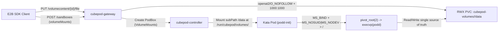

# CEP-0026: Kubernetes Kata & CSI Block Integration for Official E2B Volumes

| Stage | Status | Created | Updated | Owning Area |
| :--- | :--- | :--- | :--- | :--- |
| `beta` | `implemented` | `2026-11-15` | `2026-11-18` | `storage` (`controller`, `gateway`, `runtime`) |

## Table of Contents

- [Release Signoff Checklist](#release-signoff-checklist)
- [Summary](#summary)
- [Motivation](#motivation)
  - [Goals](#goals)
  - [Non-Goals](#non-goals)
- [Proposal](#proposal)
  - [User Stories](#user-stories)
  - [Notes / Constraints / Caveats](#notes--constraints--caveats)
  - [Risks and Mitigations](#risks-and-mitigations)
- [Design Details](#design-details)
  - [Problem Analysis](#problem-analysis)
  - [Architecture & Storage Options](#architecture--storage-options)
  - [API / CRD / Wire Changes](#api--crd--wire-changes)
  - [In-Guest `podd-init` `pivot_root` Mount Propagation](#in-guest-podd-init-pivot_root-mount-propagation)
  - [Fork & Lifecycle Semantics](#fork--lifecycle-semantics)
  - [State Machine & Data Flow](#state-machine--data-flow)
  - [Boundary Conditions & Failure Recovery](#boundary-conditions--failure-recovery)
  - [Test Plan](#test-plan)
  - [Graduation Criteria](#graduation-criteria)
  - [Upgrade / Downgrade Strategy](#upgrade--downgrade-strategy)
- [Production Readiness Review Questionnaire (PRR)](#production-readiness-review-questionnaire-prr)
- [Implementation History](#implementation-history)
- [Drawbacks](#drawbacks)
- [Alternatives](#alternatives)

---

## Release Signoff Checklist

- [x] Enhancement design documented in `docs/enhancements/0026-k8s-kata-e2b-volumes/`
- [x] Shared RWX volume store backend integrated between `cubepod-gateway` and Kata Pods (including Helm `volumes.rwxStorageClassName` auto-enabling `K8sVolumeMounts`)
- [x] `podd-init` single-threaded `pivot_root` volume mount propagation with `MS_NOSUID | MS_NODEV` implemented (`crates/podd-init/src/main.rs`)
- [x] `PodBoxSpec.VolumeMounts` controller staging mount + `CUBEPOD_VOLUME_MOUNTS` / `/etc/cubepod/volume-mounts.json` implemented (`pkg/controller/manifests.go`, `crates/podd-init/src/main.rs`)
- [x] `ForkFrom` interaction with `VolumeMounts` enforced and unit-tested (`pkg/gateway/volumes_test.go`)
- [x] GA envelope encryption (`KMSProvider`), tenant API-key rotation (`POST /volumes/rotate-key` + RWX `flock` `tenants.json`), multi-tenant volume/byte quotas (`CUBEPOD_VOLUMES_MAX_TENANT_BYTES`), RWX capacity Prometheus metrics, and `deploy/monitoring/volumes-alerts.yaml` delivered (`v0.7.0`)
- [ ] Live Kubernetes Kata + CSI E2E tests (`make test-k8s-e2e`) passing *(verified skip-safe on active `longhorn-v2-block-thin` cluster via `CUBEPOD_K8S_E2E=1 go test -v ./test/k8s-e2e/ -run TestK8sLiveVolumeMountsAndFork` without mutating live workloads; full end-to-end RWX execution awaits a cluster profile configured with `volumes.rwxStorageClassName`)*
- [x] Security invariants verified (AGENTS.md Invariants 1, 2, 3, and 4: reserved-path lexical rejection, single-threaded `podd-init`, `1000:1000` ownership, and `MS_NOSUID | MS_NODEV` remounts)

---

## Summary

CEP-0026 lifts the `501 Not Implemented` Kubernetes gate introduced in [CEP-0025](../0025-e2b-volumes/README.md) so that official E2B 2.64.0 `volumeMounts` work end-to-end on production **Kubernetes (`Kata + CSI`)** clusters while preserving **Local Development (`Docker + Loopback ext4`)** parity.

The design solves three blockers that prevented Kubernetes support in CEP-0025: (1) eliminating split-brain between `cubepod-gateway`'s local `data/` directory and Pod PVCs by backing `/volumecontent` and Kata Pod mounts with a single shared `ReadWriteMany` (RWX) PVC (`cubepod-volumes` using `subPath: <volumeID>/data`), (2) staging controller volume mounts at `/run/cubepod/volumes/<volumeID>` and propagating them into the merged OverlayFS root inside single-threaded `podd-init` prior to `pivot_root(2)` with `MS_NOSUID | MS_NODEV`, and (3) defining explicit attach/conflict semantics when `ForkFrom` is combined with `VolumeMounts`.

---

## Motivation

In [CEP-0025](../0025-e2b-volumes/README.md), CubePod implemented the official E2B 2.64.0 `/volumes`, `/volumecontent/{volumeID}/...`, and `POST /sandboxes` `volumeMounts` APIs for the local Docker runtime. However, `pkg/gateway/volumes.go` (`isKubeVolumeMountsUnsupported`) explicitly returns `501 Not Implemented` whenever `livePodRouting && runtime == nil` (the live Kubernetes control plane), and `ensureVolumePVC` skips PVC creation.

Without Kubernetes Kata integration, E2B SDK workflows that pre-populate datasets via `Volume.write_file` and attach them to sandboxes via `Sandbox.create(volume_mounts=...)` cannot run in production CubePlex Kubernetes clusters.

### Goals

1. **Single Source of Truth**: Ensure `cubepod-gateway` `/volumecontent` reads/writes and Kata Pod `volumeMounts` access the exact same underlying volume bytes without split-brain or stale copies.
2. **Preserve `pivot_root` & OverlayFS Isolation**: Propagate dynamic `VolumeMounts` into the post-`pivot_root` sandbox root inside `podd-init` without breaking `podd-init`'s single-threaded PID 1 invariant (AGENTS.md Invariant 2) or coupling `/workspace` and `/rootfs-upper` (AGENTS.md Invariant 1).
3. **Security & Ownership Parity**: Enforce `nosuid,nodev` at the VFS mount boundary inside the guest and preserve `1000:1000` (`cubeplex`) ownership (AGENTS.md Invariant 4).
4. **Multi-Sandbox & Fork Safety**: Support concurrent read/write attachment across sandboxes (and gateway HA replicas) and define deterministic `ForkFrom` behavior.
5. **Dual-Runtime Consistency**: Keep local Docker (`HostConfig.Binds` / `bind,nosuid,nodev` named volumes) working identically with zero API divergence.

### Non-Goals

1. **Per-file POSIX ACL translation inside guest**: Requested `uid`/`gid` from `PUT /volumecontent` remain stored in gateway `attrs.json` metadata only; on-disk files remain `1000:1000` (same as CEP-0025).
2. **CoW block cloning of E2B volumes on `ForkFrom`**: E2B volumes are independent, reusable datasets—not per-sandbox RootFS/Workspace block volumes. Forking a sandbox does not CoW-clone an attached E2B volume.
3. **Raw Block (`volumeMode: Block`) CSI for E2B volumes**: E2B `/volumecontent` is a file/directory HTTP API served by `cubepod-gateway`; raw block devices cannot be concurrently mounted read-write by both the gateway and multiple Kata Pods without a cluster filesystem.

---

## Proposal

### User Stories

1. **As an E2B SDK user on CubePlex (Kubernetes + Kata)**, I can create a volume with `Volume.create()`, upload training data or tools via `Volume.write_file()`, launch one or more Kata sandboxes with `volumeMounts: [{name, path}]`, and immediately read/write those files inside the sandbox at `path` while `/workspace` remains isolated.
2. **As a CubePlex operator running multi-replica `cubepod-gateway` (CEP-0022)**, any gateway replica can serve `/volumecontent/{volumeID}/...` and attach volumes to `PodBox` CRs without restarting gateway Pods when new volumes are created.
3. **As a security reviewer**, untrusted sandbox workloads cannot mount an E2B volume over `/workspace`, `/rootfs-upper`, `/opt/cubepod`, `/proc`, `/etc`, or plant setuid-root binaries that escalate privileges inside the Kata guest.

### Notes / Constraints / Caveats

- **Dual-Runtime Behavior**:
  - **Production Kubernetes (`Kata + CSI`)**: `cubepod-gateway` mounts a shared `ReadWriteMany` (RWX) PVC (`cubepod-volumes`) at `CUBEPOD_VOLUMES_DIR`. `cubepod-controller` mounts the same RWX PVC into each Kata Pod using `subPath: <volumeID>/data` at `/run/cubepod/volumes/<volumeID>` and passes mount specs to `podd-init` via `/etc/cubepod/volume-mounts.json` (or `CUBEPOD_VOLUME_MOUNTS`). `podd-init` validates and bind-mounts each staging path into `<merged_root>/<targetPath>` with `MS_NOSUID | MS_NODEV` before `pivot_root(2)`.
  - **Local Development (`Docker + Loopback ext4`)**: Unchanged from CEP-0025 (`pkg/volume` writes to `<stateDir>/volumes/<id>/data`, mounted directly into Docker at `m.Path` with `bind,nosuid,nodev`). When running Kubernetes `volumeMode: Filesystem` without `pivot_root` (`CUBEPOD_SKIP_PIVOT=1`), `podd-init` skips `pivot_root` and bind-mounts `/run/cubepod/volumes/<volumeID>` directly onto `m.Path` with `MS_NOSUID | MS_NODEV` (or `applyVolumeMounts` mounts at `m.Path` when `CUBEPOD_SKIP_PIVOT=1`).
- **Kata VirtioFS / `subPath` Constraint**: Kata Containers (`kata-qemu`) shares container `VolumeMounts` into the guest VM via `virtio-fs` (`virtiofsd`). Mounting a single RWX PVC with `subPath: <volumeID>/data` exposes only that volume's `data/` directory into the guest at `/run/cubepod/volumes/<volumeID>`, preventing guest access to sibling tenants' directories or gateway `meta.json`/`attrs.json`.
- **Single-Threaded `podd-init` Constraint**: `podd-init` MUST remain strictly single-threaded prior to `pivot_root(2)` and `execvp(3)` (AGENTS.md Invariant 2). All JSON parsing and `mount(2)` syscalls run synchronously on the main thread.

### Risks and Mitigations

| Risk | Impact | Mitigation |
| :--- | :--- | :--- |
| Guest escapes `subPath` via symlinks created by sandbox code | Cross-tenant read/write on shared RWX PVC | Gateway `pkg/volume` continues using `openat2(RESOLVE_BENEATH\|RESOLVE_NO_SYMLINKS)` / `O_NOFOLLOW` dirfd walks; `virtiofsd` + Kata VM boundary confines guest to its `subPath` mount; `meta.json` and `attrs.json` reside outside `<id>/data`. |
| `VolumeMounts` target path overlaps `/workspace`, `/rootfs-upper`, or system dirs | Violates Invariant 1 or breaks container boot | Validated at 3 layers: gateway (`pkg/volume`), controller (`ValidateVolumeMounts`), and `podd-init` (canonical lexical check before `mount(2)`). |
| Setuid binary or device node placed on RWX volume via `/volumecontent` or another sandbox | Privilege escalation inside Kata guest | Gateway masks disk mode to `0o777` and `1000:1000`; `podd-init` remounts every volume bind mount with `MS_BIND \| MS_REMOUNT \| MS_NOSUID \| MS_NODEV`. |
| Multi-replica `cubepod-gateway` concurrent `WriteFile` / `Delete` on RWX | Metadata race (`meta.json`, `mounts.json`) | Gateway `Store` uses `flock`/`O_EXCL` lockfile or atomic temp-file + `rename` on RWX POSIX filesystem; `Delete` checks active `PodBox` references in K8s API in addition to local `mounts.json`. |
| RWX StorageClass unavailable in cluster | `K8sVolumeMounts` cannot provision shared PVC | Feature gate `K8sVolumeMounts` defaults to `false` in Alpha until operator configures `volumes.rwxStorageClassName`; when unset, gateway returns `501 Not Implemented`. |

---

## Design Details

### Problem Analysis

In CEP-0025 (#67), `pkg/gateway/volumes.go` gated off Kubernetes `volumeMounts` (`501 Not Implemented`) for three concrete technical reasons:

1. **Gateway-Local vs. Pod PVC Split-Brain**:
   `pkg/volume.Store` writes uploaded files to `CUBEPOD_VOLUMES_DIR/<id>/data` on the `cubepod-gateway` Pod's local filesystem. Meanwhile, `ensureVolumePVC` in `pkg/gateway/volumes.go` sketched creating an empty `ReadWriteOnce` PVC `vol-<id>` that was never attached to the gateway Pod. Consequently, files uploaded via `PUT /volumecontent/{id}/file` would never appear inside `vol-<id>` when mounted by a Kata Pod.

2. **`podd-init` `pivot_root(2)` Drops Arbitrary Container Mounts**:
   In `crates/podd-init/src/main.rs` (lines 280–406), `podd-init` mounts the RootFS Upper block device, assembles an OverlayFS at `cfg.merged_root_path`, mounts `/dev/cubepod-workspace` at `<merged>/workspace`, and explicitly bind-mounts only `["proc", "sys", "dev", "run", "opt/cubepod", "etc/cubepod"]` (plus `etc/resolv.conf`, `etc/hosts`, `etc/hostname`, and the composed CA bundle) before calling `pivot_root(&cfg.merged_root_path, &old_root)` and lazily unmounting `/.old_root`.
   If `applyVolumeMounts` in `pkg/controller/manifests.go` mounts `vol-<id>` directly at `m.Path` (e.g., `/mnt/data`), that mount lives on the pre-pivot container rootfs and is **detached and discarded** inside `/.old_root` as soon as `pivot_root` completes.

3. **RWO Multi-Attach and `ForkFrom` Conflicts**:
   Standard CSI block/filesystem `ReadWriteOnce` (RWO) PVCs can only be attached to a single node at a time. Attaching an E2B volume to two sandboxes scheduled on different nodes—or forking a `PodBox` via `ForkFrom`—would stall Pod scheduling indefinitely in `ContainerCreating` (`Multi-Attach error for volume`).

### Architecture & Storage Options

We evaluated three storage architectures to bridge `cubepod-gateway` (`/volumecontent`) and Kata Pods (`volumeMounts`):

| Option | Mechanism | Multi-Node / Fork | Gateway HA | Complexity | Verdict |
| :--- | :--- | :--- | :--- | :--- | :--- |
| **A. Shared RWX PVC (`cubepod-volumes`) + `subPath`** | Single cluster-wide `ReadWriteMany` PVC (Longhorn RWX / SeaweedFS / NFS) mounted in `cubepod-gateway` and in Kata Pods via `subPath: <volumeID>/data` | Native multi-node RWX; multiple sandboxes and forks share seamlessly | Native (all gateway replicas mount same RWX PVC) | Low (no sidecars, no Pod restarts) | **Recommended** |
| **B. Per-Volume RWX PVC (`vol-<id>`) + Content Proxy Pod** | Each `POST /volumes` creates `vol-<id>` RWX PVC; gateway proxies `/volumecontent` to an on-demand helper Pod mounting `vol-<id>` | Native multi-node RWX | Native | High (cold-start latency per volume upload, helper Pod lifecycle/GC) | Deferred / Optional |
| **C. Per-Volume RWO PVC + CSI `VolumeSnapshot` Clone** | Gateway writes to RWO PVC via helper Pod; sandbox creation clones a CSI snapshot per sandbox | Forks/multi-sandbox get isolated CoW snapshots | Complex (detach before snapshot/attach) | Very High (diverges from E2B shared mutable volume semantics) | Rejected |

**Selected Design (Option A)**:
- A cluster-wide RWX PVC (default name `cubepod-volumes`, configurable via Helm `volumes.pvcName` / `volumes.rwxStorageClassName`) is mounted into `cubepod-gateway` at `/var/lib/cubepod/volumes` (`CUBEPOD_VOLUMES_DIR`).
- `pkg/volume.Store` stores tenant volume metadata at `<dir>/<volumeID>/meta.json` and `<dir>/<volumeID>/attrs.json`, and file contents at `<dir>/<volumeID>/data/...`.
- When a `PodBox` is created with `VolumeMounts`, `cubepod-controller` mounts the `cubepod-volumes` PVC into the Kata Pod with `subPath: <volumeID>/data` at the **staging path** `/run/cubepod/volumes/<volumeID>`.
- Because `cubepod-gateway` and every Kata Pod mount the exact same RWX PVC, `/volumecontent` API calls and in-sandbox filesystem operations read and write the single source of truth immediately, with no sync lag or split-brain.

### API / CRD / Wire Changes

1. **`api/v1alpha1/types.go` (`VolumeMount`)**:
   Retain `VolumeID`, `PVCName`, and `Path`. When using the shared RWX PVC model, `PVCName` is set to the shared RWX claim name (e.g. `cubepod-volumes`) or `vol-<volumeID>` when per-volume RWX PVCs are enabled, and `SubPath` (optional field `subPath,omitempty`) defaults to `<volumeID>/data` when `PVCName` is the shared claim.
   ```go
   type VolumeMount struct {
       VolumeID string `json:"volumeID"`
       PVCName  string `json:"pvcName"`
       SubPath  string `json:"subPath,omitempty"`
       Path     string `json:"path"`
   }
   ```
2. **`pkg/gateway/volumes.go`**:
   - Replace `isKubeVolumeMountsUnsupported()`'s blanket `true` when `livePodRouting && runtime == nil` with a capability check: return `501 Not Implemented` **only** if `K8sVolumeMounts` is disabled or no RWX PVC is configured (`s.volumesSharedPVC == ""`).
   - In `ensureVolumePVC`: when using the shared RWX PVC (`cubepod-volumes`), no per-volume PVC creation is needed; `st.NotePVC(volumeID, s.volumesSharedPVC, ns)` records the shared claim.
3. **`pkg/controller/manifests.go` (`applyVolumeMounts`)**:
   - Mount each volume at staging path `/run/cubepod/volumes/<volumeID>` (with `SubPath: <volumeID>/data` when using the shared PVC) instead of `m.Path`.
   - Pass the mount mapping to `podd-init` via `CUBEPOD_VOLUME_MOUNTS` env var (JSON array, compact) or `/etc/cubepod/volume-mounts.json` (mounted from a per-PodBox ConfigMap or Pod annotation/DownwardAPI):
     ```json
     [
       {
         "volume_id": "0123456789abcdef0123456789abcdef",
         "staging_path": "/run/cubepod/volumes/0123456789abcdef0123456789abcdef",
         "target_path": "/mnt/dataset"
       }
     ]
     ```

### In-Guest `podd-init` `pivot_root` Mount Propagation

In `crates/podd-init/src/main.rs`, after mounting `/workspace` (step 4) and bind-mounting `proc`, `sys`, `dev`, `run`, `opt/cubepod`, `etc/cubepod` (step 5), and **strictly before** `pivot_root(2)` (step 6):

1. **Single-Threaded Read & Validate**:
   On the single main thread (preserving AGENTS.md Invariant 2), `podd-init` reads `CUBEPOD_VOLUME_MOUNTS` (or `/etc/cubepod/volume-mounts.json` if present).
   For each entry `{ volume_id, staging_path, target_path }`:
   - Verify `staging_path` starts with `/run/cubepod/volumes/` and exists as a directory.
   - Normalize `target_path` lexically: must start with `/`, contain no `..` or `.` segments, and must not equal or be a prefix/child of any reserved path (`/workspace`, `/rootfs-upper`, `/opt/cubepod`, `/mnt/cubepod`, `/proc`, `/sys`, `/dev`, `/run`, `/etc`, `/bin`, `/sbin`, `/usr`, `/lib`, `/lib64`, `/root`, `/boot`). This guarantees Dual-Volume Independence (AGENTS.md Invariant 1).
2. **Create Target & Bind-Mount with `MS_NOSUID | MS_NODEV`**:
   - Compute `dst = cfg.merged_root_path.join(target_path.strip_prefix("/"))`.
   - `fs::create_dir_all(&dst)` and `chown_path(&dst, cfg.default_uid, cfg.default_gid)` (`1000:1000`).
   - Call `libc::mount(staging_path, dst, NULL, MS_BIND, NULL)`.
   - Immediately remount read-write with security flags:
     `libc::mount(NULL, dst, NULL, MS_BIND | MS_REMOUNT | MS_NOSUID | MS_NODEV, NULL)`.
   - Note: Because `/run` is already `--rbind` mounted into `<merged_root>/run` in step 5, or if `podd-init` unmounts/hides `/run/cubepod/volumes` inside `<merged_root>/run` after binding, sandbox processes only see the volume at `target_path` (not duplicated under `/run/cubepod/volumes`). To prevent `/run/cubepod/volumes` from leaking into `<merged_root>/run`, `podd-init` performs E2B bind-mounts from `/run/cubepod/volumes/<id>` **after** `--rbind /run <merged_root>/run` and then `umount2(<merged_root>/run/cubepod/volumes, MNT_DETACH)` (if present) prior to `pivot_root`.
3. **`pivot_root(2)` & `execvp(3)`**:
   `podd-init` calls `pivot_root(&cfg.merged_root_path, &old_root)`, lazily unmounts `/.old_root`, and `execvp(3)`s `/opt/cubepod/bin/podd`. All E2B mounts remain active at `target_path` inside the new root.
4. **Non-Pivot (`CUBEPOD_SKIP_PIVOT=1`) Mode**:
   When `CUBEPOD_SKIP_PIVOT=1` (e.g., `volumeMode: Filesystem` without Kata), `podd-init` skips `pivot_root` and directly bind-mounts `staging_path` onto `target_path` with `MS_BIND` + `MS_BIND | MS_REMOUNT | MS_NOSUID | MS_NODEV`.

### Fork & Lifecycle Semantics

1. **`ForkFrom` Interaction**:
   - `PodBoxSpec.ForkFrom` (CEP-0022) CoW-clones the `RootFS Upper` and `Workspace` block PVCs. It does **not** clone persistent volumes.
   - When `POST /sandboxes/{id}/fork` (or `ForkFrom` in `PodBoxSpec`) is invoked on a sandbox that has `VolumeMounts`:
     - On **RWX-backed** K8s clusters (and local Docker): the forked sandbox inherits the same `VolumeMounts` (explicitly re-attaching the shared RWX volume) and increments the volume's active mount reference (`st.AttachMount(forkedID, ...)`), unless the caller explicitly specifies a different `volumeMounts` list.
     - If an **RWO-backed** volume is ever present, `ForkFrom` MUST return `409 Conflict` (`"cannot fork sandbox with RWO per-volume PVC on Kubernetes"`) to prevent CSI multi-attach deadlocks.
2. **PVC & Mount Reference Lifecycle**:
   - `DELETE /volumes/{volumeID}` checks both `mounts.json` and active `PodBox` CRs (via `reconciler.KubeClient()`) before deleting `<dir>/<volumeID>`; any active reference returns `409 Conflict`.
   - Deleting/killing a `PodBox` releases its mount record (`st.DetachSandbox(sandboxID)`).
   - The shared RWX PVC `cubepod-volumes` has `Retain` reclaim policy by default and is never deleted when individual volumes or sandboxes are removed.

### State Machine & Data Flow



### Boundary Conditions & Failure Recovery

- **Missing staging directory in `podd-init`**: If `/run/cubepod/volumes/<id>` does not exist when `CUBEPOD_VOLUME_MOUNTS` lists it, `podd-init` fails fast with a non-zero exit code before `pivot_root` so the Pod enters `CrashLoopBackOff` / `Failed` rather than booting with a silent empty directory.
- **Gateway Pod restart**: `pkg/volume.Store` reloads `<dir>/<id>/meta.json` and reconciles `mounts.json` against active `PodBox` CRs on startup.
- **Unclean Kata Pod kill**: Because persistent volumes are POSIX RWX filesystems mounted via `virtiofsd`, killing the Kata VM does not require `e2fsck` on the volume (unlike block `/workspace`), and `PodBox` deletion cleans up the mount reference.

### Test Plan

- **Unit Tests (Rust & Go)**:
  - `crates/podd-init`: Unit tests for `CUBEPOD_VOLUME_MOUNTS` parsing, lexical path normalization, reserved-path overlap rejection (`/workspace`, `/workspace/sub`, `/rootfs-upper`, `/etc`), and `CUBEPOD_SKIP_PIVOT=1` bind-mount behavior.
  - `pkg/controller/manifests_test.go`: Verify `applyVolumeMounts` mounts at `/run/cubepod/volumes/<volumeID>` with `SubPath: <volumeID>/data` and populates `CUBEPOD_VOLUME_MOUNTS`.
  - `pkg/gateway/volumes_test.go`: Verify `501` when `K8sVolumeMounts` is disabled / no RWX PVC configured, and `201` + `PodBox` creation when enabled; verify `ForkFrom` inheritance on RWX and `409` on RWO.
- **Integration / E2E Tests**:
  - `make test-e2e`: Local Docker loopback + `podd-init` `CUBEPOD_VOLUME_MOUNTS` bind-mount verification.
  - `make test-k8s-e2e`: Live Kubernetes Kata + RWX CSI test: `Volume.create` -> `Volume.write_file` -> `Sandbox.create(volume_mounts=...)` -> verify file readable/writable inside Kata sandbox -> verify `nosuid,nodev` in `/proc/mounts` -> verify `/workspace` unaffected -> `ForkFrom` inherits mount -> `Sandbox.kill` -> `Volume.delete`.

### Graduation Criteria

- **Alpha (`v0.6.0`)**: Behind `K8sVolumeMounts` feature gate (default `false`); requires `volumes.rwxStorageClassName` in Helm; unit tests and local E2E passing.
- **Beta (`v0.7.0`)**: Auto-enabled when `volumes.rwxStorageClassName` is configured; gateway multi-replica `flock` + atomic rename locking (`tenants.json`, `meta.json`, `mounts.json`), KMS envelope encryption, API-key rotation (`POST /volumes/rotate-key`), multi-tenant volume/byte quotas, RWX capacity Prometheus metrics, and `PrometheusRule` alerting (`deploy/monitoring/volumes-alerts.yaml`) implemented and verified under `go test -race`. Live `TestK8sLiveVolumeMountsAndFork` execution remains pending an RWX-enabled Kubernetes test cluster profile.
- **GA (`v1.0.0`)**: Live `TestK8sLiveVolumeMountsAndFork` passing on a dedicated Kata + RWX CSI (Longhorn RWX / SeaweedFS / NFS) cluster profile plus production bake time in CubePlex.

### Upgrade / Downgrade Strategy

- `VolumeMount.SubPath` is optional (`omitempty`); existing `PodBox` CRs without `VolumeMounts` are unaffected.
- Disabling `K8sVolumeMounts` restores the CEP-0025 `501 Not Implemented` gate for new `POST /sandboxes` requests with `volumeMounts` without affecting running sandboxes or `/workspace` PVCs.

---

## Production Readiness Review Questionnaire (PRR)

- **Feature Enablement and Rollback**: Controlled via feature gate `K8sVolumeMounts` and Helm `volumes.rwxStorageClassName`. Setting the gate to `false` immediately returns `501` for new K8s `volumeMounts` without touching `/workspace` or `rootfs-upper` PVCs.
- **Rollout, Upgrade and Rollback Planning**: Running or `Paused` Kata Pods without `VolumeMounts` are unaffected. Pods with `VolumeMounts` continue running during controller/gateway rolling upgrades because mounts are already established inside the guest.
- **Monitoring Requirements**:
  - Metrics: `cubepod_volume_mounts_total`, `cubepod_volume_mount_errors_total`, `cubepod_volume_quota_rejections_total`, `cubepod_volumes_storage_capacity_bytes`, `cubepod_volumes_storage_used_bytes`, `cubepod_volumes_storage_available_bytes`, `cubepod_volumes_total`, `cubepod_podd_init_volume_bind_duration_ms`.
  - Alerting (`deploy/monitoring/volumes-alerts.yaml`): `CubePodVolumesRWXNearFull` (80% warning / 90% critical), `CubePodVolumesMountErrors`, and `CubePodVolumesQuotaRejections`.
  - Structured `slog` / `eprintln!` logs on staging mount failures and `ForkFrom` conflicts.
- **Dependencies**: Kubernetes CSI driver supporting `ReadWriteMany` (e.g., Longhorn RWX, SeaweedFS CSI, or NFS CSI), Kata Containers (`kata-qemu` with `virtiofsd`), and Linux `mount(2)` (`MS_BIND`, `MS_NOSUID`, `MS_NODEV`).
- **Scalability**: Using a single shared RWX PVC (`cubepod-volumes`) with `subPath` avoids creating/attaching hundreds of CSI volumes per node, keeping CSI attach/detach concurrency constant (`O(1)` PVC per node/gateway).
- **Troubleshooting**: Inspect `PodBox.spec.volumeMounts`, `kubectl logs <kata-pod>` for `[podd-init]` mount errors, and `/proc/mounts` inside the guest to confirm `nosuid,nodev`.

---

## Implementation History

- **2026-11-15**: Drafted CEP-0026 (`provisional`, `alpha`) as the Kubernetes Kata & CSI follow-up to CEP-0025.
- **2026-11-16**: Core engineering and security invariant items implemented and unit-tested across `crates/podd-init`, `pkg/controller`, `pkg/gateway`, and Helm (`volumes.rwxStorageClassName` auto-enabling `K8sVolumeMounts`, plus Prometheus bind-duration metrics).
- **2026-11-18**: Delivered `v0.7.0` KMS envelope encryption (`LocalKEKProvider` + `HTTPKMSProvider`), `POST /volumes/rotate-key` (`tenants.json` with RWX `flock` + atomic rename), multi-tenant byte/count quotas (`CUBEPOD_VOLUMES_MAX_TENANT_BYTES`), Gateway RWX capacity/quota Prometheus metrics, and `deploy/monitoring/volumes-alerts.yaml`. Executed non-disruptive `TestK8sLiveVolumeMountsAndFork` verification against the live `longhorn-v2-block-thin` cluster (`SKIP` because the active shared-workload cluster profile has no RWX volume PVC configured; live RWX CSI pass remains `[ ]` awaiting an isolated RWX cluster profile).
- **2026-11-21**: Renamed internal CRD/Helm/env/metric identifiers cleanly from `e2bVolume*`/`K8sE2BVolumeMounts`/`CUBEPOD_E2B_*` to `volume*`/`K8sVolumeMounts`/`CUBEPOD_VOLUMES_*` without retaining legacy aliases.

---

## Drawbacks

- Requires a `ReadWriteMany` (RWX) CSI StorageClass in Kubernetes clusters that enable `K8sVolumeMounts`; clusters with only RWO block CSI cannot use this feature until a per-volume content-access proxy is added.
- Multi-replica `cubepod-gateway` deployments must coordinate `meta.json` / `mounts.json` updates over the shared RWX POSIX filesystem.

---

## Alternatives

1. **Per-Volume RWO PVC (`vol-<id>`) + CSI `VolumeSnapshot` Clone**: Rejected because RWO PVCs cannot be simultaneously attached to `cubepod-gateway` and a Kata Pod (or multiple Kata Pods), and CSI snapshot cloning breaks E2B's shared mutable volume semantics.
2. **Per-Volume RWX PVC + On-Demand Content-Access Helper Pod**: Rejected as the primary design because spinning up an ephemeral Pod on `PUT /volumecontent` adds seconds of cold-start latency and Pod GC complexity compared to mounting one shared RWX PVC in `cubepod-gateway`.
3. **Gateway `podd` Proxy for `/volumecontent` Without Shared Storage**: Rejected because `/volumecontent` must work before any sandbox exists (`Volume.create` -> `Volume.write_file` -> `Sandbox.create`).
