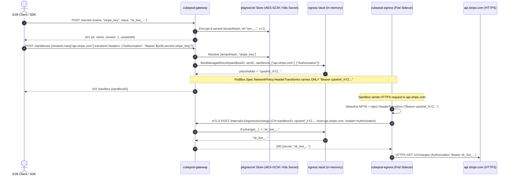

# CEP-0027: Official E2B Secrets API and Zero-Trust Secret Store Integration

| Stage | Status | Created | Updated | Owning Area |
| :--- | :--- | :--- | :--- | :--- |
| `alpha` | `implemented` | `2026-11-15` | `2026-11-15` | `gateway` |

## Table of Contents

- [Release Signoff Checklist](#release-signoff-checklist)
- [Summary](#summary)
- [Motivation](#motivation)
  - [Goals](#goals)
  - [Non-Goals](#non-goals)
- [Proposal](#proposal)
  - [User Stories](#user-stories)
  - [Notes / Constraints / Caveats](#notes--constraints--caveats)
  - [Risks and Mitigations](#risks-and-mitigations)
- [Design Details](#design-details)
  - [API / CRD / Wire Changes](#api--crd--wire-changes)
  - [State Machine & Data Flow](#state-machine--data-flow)
  - [Boundary Conditions & Failure Recovery](#boundary-conditions--failure-recovery)
  - [Test Plan](#test-plan)
  - [Graduation Criteria](#graduation-criteria)
  - [Upgrade / Downgrade Strategy](#upgrade--downgrade-strategy)
- [Production Readiness Review Questionnaire (PRR)](#production-readiness-review-questionnaire-prr)
- [Implementation History](#implementation-history)
- [Drawbacks](#drawbacks)
- [Alternatives](#alternatives)

---

## Release Signoff Checklist

- [x] Enhancement is scoped clearly with explicit Goals and Non-Goals.
- [x] API / OpenAPI / CRD changes preserve backward compatibility with existing `extension.secretBindings` and `pkg/egress`.
- [x] Security boundary (MicroVM isolation, UID/GID privilege separation, Zero-Trust `cpodref_` egress secret safety) is reviewed.
- [x] Dual-runtime behavior (Production Kubernetes `Kata + CSI Block` and Local Development `Docker + Loopback ext4`) is specified.
- [x] Test plan includes unit tests (`go test -race`) and integration/E2E verification of write-only semantics, rotation, revocation, and HTTPS header injection.
- [x] Graduation criteria for Alpha, Beta, and Stable are defined.

---

## Summary

CEP-0027 adds the official E2B Secrets management API (`POST /secrets`, `GET /secrets`, `GET /secrets/{secretID}`, `POST /secrets/{secretID}`, `DELETE /secrets/{secretID}`) and a tenant-scoped, encrypted durable secret store (`pkg/secret`) to `cubepod-gateway`. It bridges E2B's `Secret.create` / `Secret.fill('name')` (`${e2b.secrets.<name>}`) workflow directly into CubePod's existing Zero-Trust Egress Vault (`pkg/egress.Vault`) and transparent mTLS egress sidecar (`cubepod-egress`).

Real secret values remain **strictly write-only** at the control plane and **never** enter the sandbox Pod, `PodBox` CRD, container environment variables, `policy.json`, or logs. Instead, references to stored secrets are resolved at `POST /sandboxes` into per-sandbox `cpodref_` placeholders scoped to explicit destination SNI hosts and HTTP headers, and swapped in-flight by `cubepod-egress` over per-sandbox mTLS.

---

## Motivation

CubePod already implements zero-trust egress secret swapping via `pkg/egress.Vault` (`cpodref_` placeholders) and `extension.secretBindings` (CEP-0005, CEP-0009, CEP-0020). However, two gaps prevent drop-in compatibility with official E2B SDKs (`e2b` Python/TS `Secret` / `AsyncSecret` classes) and production multi-sandbox secret management:

1. **Missing `/secrets` CRUD Surface**: Official E2B clients expect `/secrets` endpoints to store, list, rotate (versioned `POST /secrets/{secretID}`), and delete tenant secrets once, rather than embedding `rawSecret` in every `POST /sandboxes` payload.
2. **Missing `${e2b.secrets.<name>}` Resolution & E2B `network.rules` Transform Support**: E2B SDKs reference stored secrets via `Secret.fill('name')` (`${e2b.secrets.<name>}`) inside `network.rules.<host>.transform.headers` (and/or `extension.secretBindings`). CubePod's gateway and `cubepod-egress` do not yet resolve tenant secret references into `cpodref_` placeholders or apply `transform.headers` on outbound HTTPS requests.

### Goals

1. **Official E2B `/secrets` Wire Compatibility**: Implement `POST /secrets`, `GET /secrets` (with `limit` + `nextToken` / `X-Next-Token` pagination), `GET /secrets/{secretID}`, `POST /secrets/{secretID}` (versioned rotation), and `DELETE /secrets/{secretID}` matching E2B OpenAPI semantics.
2. **Strict Write-Only & Zero-Trust Invariant**: Never return plaintext secret values from any API, error, log, `PodBox` CRD, or sandbox process environment. Only `cpodref_<32-char-base32>` placeholders may cross into `PodBox.Spec.NetworkPolicy`, `policy.json`, or sandbox `envVars`.
3. **Durable, Encrypted, Tenant-Isolated Storage (`pkg/secret`)**:
   - Tenant isolation keyed by `sha256(managementAPIKey)` (matching `pkg/volume`).
   - AES-256-GCM encrypted file-backed store for local Docker/dev and single-gateway PVC deployments, plus a Kubernetes `Secret` backend for multi-replica HA gateways (CEP-0022).
4. **Seamless `egress.Vault` Integration**:
   - Resolve `${e2b.secrets.<name>}` in `POST /sandboxes` (`network.rules` header transforms) and `secretName` / `secretID` in `extension.secretBindings` into per-sandbox `cpodref_` bindings in `egress.Vault`.
   - Propagate secret rotation (`POST /secrets/{secretID}`) and revocation (`DELETE /secrets/{secretID}`) to active sandbox `egress.Vault` bindings in real time.
5. **Dual-Runtime Parity**: Support both local Docker/loopback mode and Production Kubernetes (`Kata + CSI Block + cubepod-egress` sidecar).

### Non-Goals

- Reading back plaintext secret values via any API or CLI command (`write-only` by design).
- Injecting plaintext secrets into sandbox `/etc/environment`, `/proc/<pid>/environ`, or container `env` (explicitly forbidden by CubePod Security Invariant #3).
- Plaintext HTTP secret injection (secrets are injected strictly into outbound **HTTPS** requests after TLS SNI verification; plain HTTP requests fail closed).
- Replacing `pkg/egress` `cpodref_` mTLS exchange protocol or `extension.secretBindings` backwards compatibility.

---

## Proposal

### User Stories

- **Story 1 (E2B SDK Developer)**: As an agent developer using the official E2B SDK, I call `await Secret.create('openai_api_key', 'sk-...')` once, then create sandboxes referencing `Secret.fill('openai_api_key')` in `network.rules['api.openai.com']` header transforms. My sandbox code calls `https://api.openai.com/v1/...` without ever seeing `sk-...` in its environment or memory.
- **Story 2 (Security Administrator — Rotation & Revocation)**: As a platform operator, when an API key is compromised, I call `POST /secrets/{secretID}` to rotate it (incrementing `version` to `2`) or `DELETE /secrets/{secretID}` to revoke it. Running sandboxes immediately use the new value (or are denied with `403` on exchange) without restarting MicroVMs.
- **Story 3 (Multi-Tenant Isolation)**: As Tenant A, listing `GET /secrets` or passing `Secret.fill('tenant_b_secret')` in `POST /sandboxes` never sees or resolves Tenant B's secrets.

### Notes / Constraints / Caveats

- **Header Injection & Hop-by-Hop Safety**:
  - Secret values used in HTTP header transforms MUST pass `httpguts.ValidHeaderFieldValue` (rejecting `\r`, `\n`, and `\x00` to prevent CRLF injection).
  - Header names in `network.rules.*.transform.headers` MUST pass `httpguts.ValidHeaderFieldName`, and sensitive routing/hop-by-hop headers (`Host`, `Content-Length`, `Transfer-Encoding`, `Connection`, `Proxy-Authorization`) MUST be rejected (`400 Bad Request`).
  - `serveMITMTLS` MUST apply `HeaderTransforms` via `Header.Set` (overwriting any sandbox-supplied header of the same name rather than `Header.Add`) before running `replaceHeaderPlaceholders`.
- **Size Limit**: Maximum secret value size is `64 KiB` (`65536` UTF-8 bytes), matching E2B's documented limit.
- **Egress Sidecar Dependency & WarmPool Exclusion**:
  - On Kubernetes Kata pods, `transform.headers` and `cpodref_` substitution require `Egress.Enabled=true` (`cubepod-egress` sidecar with selective HTTPS MITM enabled, per CEP-0020). If a sandbox requests `${e2b.secrets.<name>}` header transforms when the template/cluster has egress sidecar disabled, `POST /sandboxes` fails closed (`400 Bad Request` or `501 Not Implemented`).
  - Sandboxes with `network.rules` / `HeaderTransforms` (or non-empty `NetworkPolicy`) MUST skip WarmPool auto-claim (matching `len(plannedMounts) > 0` in `pkg/gateway/sandboxes.go`), because WarmPool pods already run `cubepod-egress` with an empty `{}` `policy.json` and do not receive `SIGHUP` on claim.
- **Dual-Runtime Behavior**:
  - **Production Kubernetes (`Kata + CSI Block`)**: Tenant secrets are stored encrypted in Kubernetes `Secret` objects (or encrypted PVC store) in the CubePod namespace. `POST /sandboxes` binds `cpodref_` placeholders in `egress.Vault` **before** calling `reconciler.Reconcile`, writing only `cpodref_` into `PodBox.Spec.NetworkPolicy.HeaderTransforms` -> `policy.json`. `cubepod-egress` inside the Pod injects the `cpodref_` header on matching HTTPS hosts and exchanges it over mTLS with `cubepod-gateway`.
  - **Local Development (`Docker + Loopback ext4`)**: Tenant secrets are stored in `<gateway-data-dir>/secrets/secrets.enc.json` (AES-256-GCM, `0600`), and `/secrets` CRUD + `POST /sandboxes` `${e2b.secrets.<name>}` resolution + `egress.Vault` operate identically. Note that `pkg/runtime/docker.go` does not currently inject a `cubepod-egress` sidecar into Docker containers; Alpha local E2E verification exercises `egress.EgressProxy` + `Vault` directly in-process against mock HTTPS upstreams.

### Risks and Mitigations

| Risk | Likelihood | Impact | Mitigation |
| :--- | :--- | :--- | :--- |
| Plaintext secret leaked in gateway logs, API errors, or `PodBox` CRD | Low | Critical | Dedicated `SecretValue` wrapper type implementing `fmt.Stringer` / `slog.LogValuer` returning `"[REDACTED]"`; `PodBox` CRD only ever receives `cpodref_` tokens. |
| Cross-tenant secret access via `secretID` guessing or `Secret.fill(name)` | Low | Critical | All `/secrets` routes and `POST /sandboxes` secret lookups require matching `tenantHash = sha256(APIKey)`. Non-owned `secretID` returns `404 Not Found`. |
| CRLF / header smuggling via malformed secret value or header name | Medium | High | Validate header names (`ValidHeaderFieldName`), deny hop-by-hop headers, reject `\r`/`\n`/`\x00` in values, and use `Header.Set` in `serveMITMTLS`. |
| Multi-replica gateway HA desync (`egress.Vault` is in-memory) | Medium | High | `PodBox.Spec.NetworkPolicy.SecretRefBindings` stores non-secret `{placeholder, tenantHash, secretID, allowedHosts, allowedHeaders}` metadata so any replica can re-hydrate `Vault` on cache miss from `PodBox` + `KubeSecretBackend`. `KubeSecretBackend` watches K8s `Secret` `MODIFIED`/`DELETED` events to propagate rotation/revocation to all replicas. |
| mTLS header spoofing on `/internal/v1/egress/exchange` | Low | Critical | In production K8s mode (`ca != nil`), `/internal/v1/egress/exchange` MUST be served on a `tls.RequireAndVerifyClientCert` mTLS listener (or reject non-mTLS header/body `sandboxID` fallbacks). |
| Lost KEK (`CUBEPOD_SECRETS_KEY`) on restart in file-store mode | Low | High | Production Helm chart provisions/mounts a persistent K8s `Secret` for `CUBEPOD_SECRETS_KEY`; local dev auto-generates and persists `<dir>/.kek` with `0600` permissions if unset. |

---

## Design Details

### API / CRD / Wire Changes

#### 1. Official E2B `/secrets` REST Endpoints (`pkg/gateway/secrets.go` & `api/openapi/cubepod-v1.yaml`)

All `/secrets` endpoints require `X-API-Key` (via `requireManagementKey(w, r)`), scoped to `tenantHash = sha256(apiKey)`.

- **`POST /secrets`** — Create a new secret
  - Request:
    ```json
    {
      "name": "openai_api_key",
      "value": "sk-proj-..."
    }
    ```
  - Validation: `name` matches `^[a-zA-Z0-9_.-]{1,128}$`; `value` is non-empty and `<= 65536` bytes; tenant secret count `< MaxSecretsPerTenant` (default `100`, `429 Too Many Requests` if exceeded); duplicate `name` for same tenant returns `409 Conflict`.
  - Response (`201 Created`):
    ```json
    {
      "id": "sec_01j9x8k2m4n6p8q0r2s4t6v8w0",
      "name": "openai_api_key",
      "version": 1,
      "createdAt": "2026-11-15T18:35:00Z"
    }
    ```

- **`GET /secrets`** — List secrets (metadata only, never `value`)
  - Query params: `limit` (`1..100`, default `100`), `nextToken` (opaque base64 cursor).
  - Response (`200 OK`, optional `X-Next-Token` header if truncated):
    ```json
    [
      {
        "id": "sec_01j9x8k2m4n6p8q0r2s4t6v8w0",
        "name": "openai_api_key",
        "version": 1,
        "createdAt": "2026-11-15T18:35:00Z"
      }
    ]
    ```

- **`GET /secrets/{secretID}`** — Get secret metadata
  - Accepts `secretID` (`sec_...`); returns `404 Not Found` if missing or owned by another tenant.
  - Response (`200 OK`): `SecretInfo` (`id`, `name`, `version`, `createdAt`, optional `updatedAt`).

- **`POST /secrets/{secretID}`** — Rotate / update secret value
  - Request: `{ "value": "sk-proj-new..." }`
  - Increments `version` (`version + 1`), updates `updatedAt`, persists encrypted envelope, and updates all active `egress.Vault` bindings linked to `(tenantHash, secretID)`.
  - Response (`200 OK`): updated `SecretInfo`.

- **`DELETE /secrets/{secretID}`** — Delete secret
  - Removes secret from durable store and immediately revokes all active `egress.Vault` bindings linked to `(tenantHash, secretID)` so in-flight sandboxes can no longer exchange its `cpodref_` token.
  - Response (`204 No Content`).

#### 2. `POST /sandboxes` Integration (`pkg/gateway/sandboxes.go`)

Support two seamless ways to reference `/secrets`:

1. **Official E2B `network.rules` Header Transforms**:
   ```json
   {
     "templateID": "base",
     "network": {
       "allowOut": ["api.stripe.com"],
       "denyOut": ["0.0.0.0/0"],
       "rules": {
         "api.stripe.com": [
           {
             "transform": {
               "headers": {
                 "Authorization": "Bearer ${e2b.secrets.stripe_api_key}"
               }
             }
           }
         ]
       }
     }
   }
   ```
   - **Request Parsing & CIDR Mapping (`createSandboxReq.Network`)**:
     - Add `Network *e2bNetworkSpec` (`allowOut`, `denyOut`, `rules`) to `createSandboxReq` in `pkg/gateway/sandboxes.go` and update `api/openapi/cubepod-v1.yaml`.
     - Map `"0.0.0.0/0"` or `"*"` in `denyOut` to `DefaultAction: v1alpha1.NetworkDefaultDeny` (and in `allowOut` to `v1alpha1.NetworkDefaultAllow`), rather than passing `"0.0.0.0/0"` into `DenyHosts` (since `egress.MatchHost` performs hostname/wildcard matching, not CIDR matching). Map remaining host/wildcard entries into `AllowHosts`/`DenyHosts` and ordered `Egress` rules, and ensure every host present in `network.rules` is allowed by `CheckEgressAllowed`.
   - **Placeholder Resolution, Aggregation & Ordering**:
     - The gateway parses all `${e2b.secrets.<name>}` tokens in `network.rules[host][].transform.headers`, looks up `<name>` in `SecretStore` for `tenantHash`, and mints per-sandbox `cpodref_<32-char-base32>` placeholders via `s.vault.BindManagedSecret(...)`.
     - Multiple `${e2b.secrets.<name>}` tokens within a single header value (e.g., `"${e2b.secrets.user}:${e2b.secrets.pass}"`) mint distinct `cpodref_` placeholders; if the same secret is referenced across multiple rules/headers in one sandbox, `BindManagedSecret` either mints a per-rule placeholder or aggregates `AllowedHosts` / `AllowedHeaders`.
     - **Critical Ordering & Rollback**: Secret resolution and `s.vault.BindManagedSecret(...)` MUST execute **before** `s.reconciler.Reconcile(ctx, id, spec)` (and skip WarmPool auto-claim whenever `network` / `HeaderTransforms` is non-empty) so `PodBox.Spec.NetworkPolicy` and `<box>-egress-mtls` (`policy.json`) receive the minted `cpodref_` placeholders. If `Reconcile` or `startRuntimeSandbox` fails, `rollbackCreatedSandbox` MUST call `s.vault.RevokeSandbox(id)`.
     - Update `cloneNetworkPolicy` in `pkg/gateway/sandboxes.go` to deep-copy `HeaderTransforms` (including `Headers` maps) and `SecretRefBindings`.

2. **Extended `extension.secretBindings` Reference**:
   - Allow `secretName` or `secretID` as an alternative to `rawSecret` in `extension.secretBindings` so CubePod-native clients can also reference stored `/secrets` without transmitting plaintext on `POST /sandboxes`.

#### 3. CRD & Egress Sidecar Policy (`api/v1alpha1/types.go`, `cubepod.io_podboxes.yaml` & `pkg/egress/proxy.go`)

Add `HeaderTransforms` and `SecretRefBindings` (non-secret metadata for HA cache-miss re-hydration) to `v1alpha1.NetworkPolicySpec` in `api/v1alpha1/types.go` **and** update the CRD OpenAPI v3 schema in `deploy/helm/cubepod/crds/cubepod.io_podboxes.yaml` (under `spec.properties.networkPolicy.properties`) so Kubernetes does not prune these fields:

```go
// HeaderTransformRule injects or rewrites HTTP headers on outbound HTTPS requests matching Host.
// Header values must contain only cpodref_ placeholders, never plaintext secrets.
type HeaderTransformRule struct {
	Host    string            `json:"host"`
	Headers map[string]string `json:"headers"`
}

// SecretRefBinding records non-secret metadata on PodBox so any HA gateway replica
// can re-hydrate egress.Vault from KubeSecretBackend on cache miss.
type SecretRefBinding struct {
	Placeholder    string   `json:"placeholder"`
	TenantHash     string   `json:"tenantHash"`
	SecretID       string   `json:"secretID"`
	AllowedHosts   []string `json:"allowedHosts"`
	AllowedHeaders []string `json:"allowedHeaders"`
}
```

Added to `NetworkPolicySpec`:

```go
HeaderTransforms  []HeaderTransformRule `json:"headerTransforms,omitempty"`
SecretRefBindings []SecretRefBinding    `json:"secretRefBindings,omitempty"`
```

In `pkg/egress/proxy.go` (`serveMITMTLS` and `shouldMITM`):
- In `serveMITMTLS`, when `policy.HeaderTransforms` matches the TLS SNI `targetHost` (via `MatchHost`), apply configured headers via `req.Header.Set(k, v)` (overwriting any sandbox-supplied header of the same name) **before** `replaceHeaderPlaceholders(...)` runs, so `cpodref_` is exchanged over mTLS for the real secret in flight.
- Update `shouldMITM(policy, sniHost)` to return `true` when `hostMatchesHeaderTransform(policy, sniHost)` is true, and gate the fallback `hasExchange` check on `len(policy.SecretBindings) == 0 && len(policy.HeaderTransforms) == 0` so hosts without transforms or secret bindings are not unnecessarily MITM'd.

#### 4. Durable Encrypted Store (`pkg/secret/`) & HA Sync

New package `pkg/secret`:
- `Store` interface / implementation with:
  - `FileBackend`: AES-256-GCM encrypted JSON envelope (`nonce || ciphertext`) stored atomically (`temp` + `fsync` + `rename`, mode `0600`) under `<dataDir>/secrets/secrets.enc.json`.
  - `KubeSecretBackend`: Stores each secret as a Kubernetes `Secret` (`cubepod-e2b-sec-<id>`) with `Data["value"]`, `Data["meta"]`, and labels `cubepod.io/resource=e2b-secret`, `cubepod.io/tenant=<tenantPrefix>` for HA multi-replica gateway deployments.
- `egress.Vault` & HA synchronization enhancements:
  - Track optional `(TenantHash, SecretID)` metadata on `SecretBinding` so `Vault.UpdateSecretByRef(tenantHash, secretID, newRawSecret)` and `Vault.RevokeSecretByRef(tenantHash, secretID)` update/revoke all live sandboxes using that secret in O(active bindings).
  - In HA K8s mode (`KubeSecretBackend`), gateway replicas watch Kubernetes `Secret` `MODIFIED`/`DELETED` events (label `cubepod.io/resource=e2b-secret`) to propagate rotations and revocations across all replicas, and `VaultExchangeHandler` re-hydrates cache misses using `PodBox.Spec.NetworkPolicy.SecretRefBindings` + `KubeSecretBackend`.

### State Machine & Data Flow



### Boundary Conditions & Failure Recovery

- **Unknown Secret Reference in `POST /sandboxes`**: If `${e2b.secrets.missing}` does not exist for `tenantHash`, `POST /sandboxes` fails immediately with `400 Bad Request` (`unknown secret "missing"`) before creating any `PodBox`, PVC, or container.
- **Secret Rotated While Sandbox Is Running**: `POST /secrets/{secretID}` updates the encrypted store first; on success, it calls `vault.UpdateSecretByRef(...)`. If the gateway restarts in K8s HA mode, `VaultExchangeHandler` or sandbox resync re-hydrates `SecretBinding`s from `PodBox` annotations/spec + `SecretStore` (or fails closed `403` if the secret was deleted).
- **Secret Deleted While Sandbox Is Running**: `DELETE /secrets/{secretID}` removes the secret from `Store` and calls `vault.RevokeSecretByRef(...)`. Subsequent outbound HTTPS requests carrying `cpodref_` fail closed (`403 Forbidden` from exchange, `502`/`403` to the sandbox caller) without leaking any credential.
- **Gateway Crash During Write**: `FileBackend` writes to `secrets.enc.json.tmp`, calls `Sync()`, and atomically `Rename()`s over `secrets.enc.json`; partial writes never corrupt existing secrets.

### Test Plan

- **Unit Tests (`go test -race`)**:
  - `pkg/secret`: CRUD, duplicate name `409`, tenant isolation, AES-256-GCM encryption on disk (asserting plaintext never appears in the file on disk), corruption handling, quota enforcement (`100`), atomic write, `SecretValue` redaction in `fmt`/`slog`.
  - `pkg/egress`: `BindManagedSecret`, `UpdateSecretByRef` rotation, `RevokeSecretByRef` revocation, `HeaderTransforms` injection in selective HTTPS MITM (`proxy_test.go`), CRLF rejection, plain HTTP fail-closed.
  - `pkg/gateway`: `/secrets` HTTP handlers (`POST`, `GET` list + `limit`/`nextToken`/`X-Next-Token` pagination, `GET /{id}`, `POST /{id}` rotation, `DELETE /{id}`), cross-tenant `404`, `POST /sandboxes` resolving `${e2b.secrets.<name>}` into `cpodref_` without leaking raw values into `PodBox` or `SandboxRecord`.
- **Integration / E2E Tests (`make test-e2e`)**:
  - Create secret -> boot sandbox with `network.rules` header transform -> verify sandbox env has no secret -> make HTTPS request via `EgressProxy` -> verify mock upstream receives real secret -> rotate secret via `POST /secrets/{id}` -> verify next request receives new secret -> delete secret via `DELETE /secrets/{id}` -> verify next request is denied (`403`).

### Graduation Criteria

- **Alpha (`v0.5`)**:
  - `E2BSecretsAPI` feature gate / gateway config enabled when secrets store is configured.
  - All 5 `/secrets` endpoints + `pkg/secret` AES-256-GCM file backend + `egress.Vault` rotation/revocation + `HeaderTransforms` MITM injection implemented and passing `make test` and `make test-e2e`.
- **Beta (`v0.6`)**:
  - `KubeSecretBackend` enabled by default for multi-replica K8s gateways with Helm chart RBAC and `CUBEPOD_SECRETS_KEY` Secret management.
  - Python & TypeScript SDK helpers (`Secret` / `AsyncSecret`, `Secret.fill`) verified against live gateway.
- **Stable (`v1.0`)**:
  - Production bake time in CubePlex with Prometheus alerting on secret exchange errors and store latency.

### Upgrade / Downgrade Strategy

- **Upgrade**: Additive CRD field `NetworkPolicySpec.HeaderTransforms` (`omitempty`) and new `/secrets` routes; zero impact on existing `/workspace` or `/rootfs-upper` PVCs or running `PodBox` resources.
- **Downgrade**: Removing `E2BSecretsAPI` disables `/secrets` routes (`501 Not Implemented` or `404`); existing `PodBox` objects without `headerTransforms` continue running unchanged.

---

## Production Readiness Review Questionnaire (PRR)

- **Feature Enablement and Rollback**: Controlled via `CUBEPOD_SECRETS_DIR` / `CUBEPOD_SECRETS_BACKEND` (`file` | `k8s` | `disabled`) and `CUBEPOD_SECRETS_KEY`. Disabling stops new `/secrets` operations without touching `/workspace` or `rootfs-upper` PVCs.
- **Rollout, Upgrade and Rollback Planning**: Existing `Paused` or `Running` sandboxes without `headerTransforms` are unaffected. Rolling gateways with `KubeSecretBackend` preserves secret availability across replicas.
- **Monitoring Requirements**:
  - `cubepod_secrets_operations_total{op,status}`
  - `cubepod_secrets_store_count`
  - Existing `cubepod_egress_secret_exchanges_total{result}` (`ok`, `denied`, `error`).
- **Dependencies**: Existing `cubepod-egress` sidecar (CEP-0020) for Kubernetes Kata pods; `crypto/aes` + `crypto/cipher` (Go stdlib) for envelope encryption.
- **Scalability**: `MaxSecretsPerTenant` (default `100`) bounds per-tenant storage and list responses; `GET /secrets` supports cursor pagination (`limit <= 100`).
- **Troubleshooting**: Operators inspect `cubepod_secrets_operations_total` and `cubepod-egress` structured logs (`placeholder=cpodref_...`, never raw values) to diagnose `403` exchange denials (host mismatch, header mismatch, or revoked secret).

---

## Implementation History

- `2026-11-15`: CEP-0027 drafted and marked `implementable`.
- `2026-11-15`: Alpha implementation merged in PR #73 (`pkg/secret`, `pkg/egress`, `pkg/gateway`, `api/v1alpha1`, CRD & OpenAPI); marked `implemented`.

---

## Drawbacks

- Requires `cubepod-egress` selective HTTPS MITM to be enabled for pods that use `network.rules.*.transform.headers`, adding one TLS termination hop for those specific matched hosts.
- File-backed encryption requires operators to manage (or persist) `CUBEPOD_SECRETS_KEY` cleanly across gateway upgrades in non-K8s-Secret deployments.

---

## Alternatives

1. **Inject `/secrets` directly as container environment variables**: Rejected. Violates CubePod Security Invariant #3 (zero-trust egress secret safety); untrusted LLM-generated code can trivially exfiltrate `os.environ`.
2. **Pass `rawSecret` inside `PodBox.Spec` or Kubernetes `Secret` mounted into the Kata Pod**: Rejected. If the guest MicroVM is compromised or `podd` / container reads mounted files, the raw secret is exposed inside the untrusted boundary.
3. **Store tenant secrets only in `egress.Vault` memory**: Rejected. Secrets would be lost on every gateway restart and could not be shared across HA gateway replicas.
