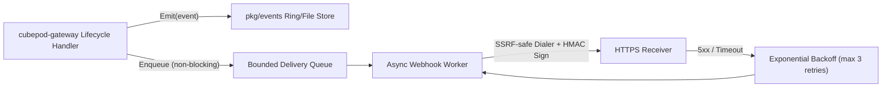

# CEP-0028: Sandbox Lifecycle Events and Signed Webhook Delivery

| Stage | Status | Created | Updated | Owning Area |
| :--- | :--- | :--- | :--- | :--- |
| `alpha` | `implementable` | `2026-11-16` | `2026-11-16` | `gateway` |

## Table of Contents

- [Release Signoff Checklist](#release-signoff-checklist)
- [Summary](#summary)
- [Motivation](#motivation)
  - [Goals](#goals)
  - [Non-Goals](#non-goals)
- [Proposal](#proposal)
  - [User Stories](#user-stories)
  - [Notes / Constraints / Caveats](#notes--constraints--caveats)
  - [Risks and Mitigations](#risks-and-mitigations)
- [Design Details](#design-details)
  - [API / CRD / Wire Changes](#api--crd--wire-changes)
  - [State Machine & Data Flow](#state-machine--data-flow)
  - [Boundary Conditions & Failure Recovery](#boundary-conditions--failure-recovery)
  - [Test Plan](#test-plan)
  - [Graduation Criteria](#graduation-criteria)
  - [Upgrade / Downgrade Strategy](#upgrade--downgrade-strategy)
- [Production Readiness Review Questionnaire (PRR)](#production-readiness-review-questionnaire-prr)
- [Implementation History](#implementation-history)
- [Drawbacks](#drawbacks)
- [Alternatives](#alternatives)

---

## Release Signoff Checklist

- [x] Enhancement is scoped clearly with explicit Goals and Non-Goals.
- [x] API / OpenAPI changes are additive and backward-compatible.
- [x] Security boundary (SSRF protection, HMAC-SHA256 webhook signing, encrypted secret storage, tenant isolation) is reviewed.
- [x] Dual-runtime behavior (Production Kubernetes `Kata + CSI Block` and Local Development `Docker + Loopback ext4`) is specified.
- [x] Test plan covers unit tests (`go test -race`) and end-to-end delivery/retry/SSRF verification.
- [x] Graduation criteria for Alpha, Beta, and Stable are defined.

---

## Summary

CEP-0028 introduces a tenant-isolated **Sandbox Lifecycle Events** store and **Signed Webhook Delivery** subsystem (`pkg/events`) in `cubepod-gateway`. It enables users and external orchestrators to query sandbox lifecycle audit history (`GET /events`, `GET /sandboxes/{sandboxID}/events`) and subscribe to real-time HTTP webhook notifications (`POST/GET/PATCH/DELETE /webhooks`) for `created`, `paused`, `resumed`, `updated`, `forked`, and `killed` transitions.

---

## Motivation

Currently, clients that need to track sandbox lifecycle transitions (for billing, idle-reaper notifications, audit trails, or UI updates) must poll `GET /sandboxes` or `GET /sandboxes/{id}`. Polling adds unnecessary API load and misses transient transitions such as transparent auto-resume or idle-timeout pauses.

### Goals

1. **Tenant-Scoped Lifecycle Event Log**: Record structured lifecycle events (`sandbox.lifecycle.created`, `paused`, `resumed`, `updated`, `forked`, `killed`) with cursor-paginated query APIs (`GET /events`, `GET /sandboxes/{sandboxID}/events`).
2. **Webhook Registration & Management API**: Provide `/webhooks` CRUD (`POST /webhooks`, `GET /webhooks`, `GET /webhooks/{webhookID}`, `PATCH /webhooks/{webhookID}`, `DELETE /webhooks/{webhookID}`) scoped by `sha256(APIKey)` tenant hash.
3. **Cryptographically Signed Delivery**: Sign every webhook payload with HMAC-SHA256 (`t=<unix>,v1=<hex>`) using a per-webhook secret encrypted at rest.
4. **SSRF-Safe Bounded Async Dispatcher**: Deliver events asynchronously with bounded queues, exponential backoff retries, and dial-time IP validation blocking private/loopback/metadata ranges in production.
5. **Dual-Runtime Parity**: Emit identical events across both Local Docker and Production Kubernetes (`Kata + CSI Block`) runtimes.

### Non-Goals

- Streaming in-guest stdout/stderr or filesystem watch events over webhooks (handled by Connect-RPC streaming).
- Guaranteeing unbounded persistent replay across multi-month retention (Alpha uses a bounded ring/retention window; long-term archival belongs to external SIEM/observability sinks).
- Modifying `PodBox` CRD schema in Alpha (events are emitted by `cubepod-gateway` lifecycle handlers and idle-reaper sync).

---

## Proposal

### User Stories

- **Story 1 (Billing & Usage Metering)**: As a platform integrator, I register a webhook subscribed to `sandbox.lifecycle.created`, `paused`, `resumed`, and `killed` so my billing service receives signed notifications without polling `GET /sandboxes`.
- **Story 2 (Audit & Debugging)**: As a tenant developer, I call `GET /sandboxes/{id}/events` to inspect when a sandbox was paused by the idle reaper and when it auto-resumed on incoming traffic.

### Notes / Constraints / Caveats

- **Idle Reaper Visibility**: In Kubernetes mode, `cubepod-controller` may transition `PodBox.Status.Phase` to `Paused` or delete expired sandboxes asynchronously. Gateway's `resolveSandbox` / `sync` loop should emit corresponding `paused` / `killed` events when observing a state transition not already recorded.
- **Dual-Runtime Behavior**:
  - **Production Kubernetes (`Kata + CSI Block`)**: Webhook registrations and event logs are persisted in `<state-dir>/events/` (Alpha) or shared cluster storage (Beta); SSRF dialer blocks RFC1918, loopback, and cloud metadata IPs (`169.254.169.254`).
  - **Local Development (`Docker + Loopback ext4`)**: Identical `/events` and `/webhooks` APIs; operators may set `CUBEPOD_WEBHOOK_ALLOW_PRIVATE=1` in local test harnesses to deliver to `127.0.0.1` mock receivers.

### Risks and Mitigations

| Risk | Likelihood | Impact | Mitigation |
| :--- | :--- | :--- | :--- |
| SSRF against internal cluster services or cloud metadata (`169.254.169.254`) | High | Critical | Custom `net.Dialer.Control` verifies resolved IP is global unicast and not loopback/private/link-local before TCP connect (redirect following disabled). |
| Slow or unreachable webhook receiver blocking sandbox creation/pause | Medium | High | Strictly non-blocking bounded worker queue (`chan` with drop-oldest/drop-new metric) + `5s` per-attempt HTTP timeout; lifecycle handlers never await delivery. |
| Webhook signing secret leakage | Low | High | Encrypt `signatureKey` at rest (AES-256-GCM) and return it only on `POST /webhooks` creation or explicit rotation (`POST /webhooks/{id}` / `PATCH`). |
| Multi-replica duplicate event emission on K8s watch | Medium | Low | Include deterministic `eventID` (`evt_...`) and `idempotencyKey` in payload so receivers deduplicate cleanly. |

---

## Design Details

### API / CRD / Wire Changes

#### 1. Webhooks Endpoints (`pkg/gateway/webhooks.go` & `api/openapi/cubepod-v1.yaml`)

All routes require `X-API-Key` (`requireManagementKey`).

- **`POST /webhooks`**:
  - Request: `{ "name": "billing-hook", "url": "https://example.com/hook", "events": ["sandbox.lifecycle.created", "sandbox.lifecycle.killed"], "enabled": true }`
  - Response (`201 Created`): `{ "id": "whk_...", "name": "...", "url": "...", "events": [...], "enabled": true, "signatureKey": "whsec_...", "createdAt": "..." }` (`signatureKey` returned only at creation).
- **`GET /webhooks`**: List tenant webhooks (omitting `signatureKey`).
- **`GET /webhooks/{webhookID}`**: Get single webhook metadata (omitting `signatureKey`).
- **`PATCH /webhooks/{webhookID}`**: Update `url`, `events`, `enabled`, or `"rotateSecret": true`.
- **`DELETE /webhooks/{webhookID}`**: Remove webhook (`204 No Content`).

#### 2. Events Endpoints

- **`GET /events?sandboxID=...&eventType=...&limit=50&nextToken=...`**: Paginated tenant lifecycle events (`X-Next-Token` header).
- **`GET /sandboxes/{sandboxID}/events`**: Convenience route scoped to one sandbox.

Event payload schema:

```json
{
  "id": "evt_01j9x...",
  "type": "sandbox.lifecycle.created",
  "sandboxID": "cpod-123",
  "templateID": "base",
  "timestamp": "2026-11-16T01:15:00Z",
  "data": {
    "state": "running",
    "reason": "Created"
  }
}
```

#### 3. Signature Verification Header

Every delivery sends:
- `X-CubePod-Event-ID: evt_...`
- `X-CubePod-Signature: t=1794816900,v1=<hmac-sha256-hex(signatureKey, "1794816900." + rawBody)>`

### State Machine & Data Flow



### Boundary Conditions & Failure Recovery

- **Queue Saturation**: If the delivery queue is full, new deliveries are dropped and `cubepod_webhook_deliveries_total{result="dropped"}` increments; `/sandboxes` latency is never impacted.
- **HTTP Redirects**: Webhook client disables automatic `3xx` redirects (`CheckRedirect: func(...) error { return http.ErrUseLastResponse }`) to prevent redirect-based SSRF bypasses.
- **Gateway Restart**: Registered webhooks persist encrypted on disk; in-flight retries are best-effort in Alpha.

### Test Plan

- **Unit Tests (`go test -race`)**:
  - `pkg/events`: Event emission, per-tenant & per-sandbox filtering, cursor pagination, webhook CRUD, HMAC-SHA256 signature verification, SSRF dialer rejecting `127.0.0.1`, `10.0.0.1`, `169.254.169.254`, and `http://` when TLS-only is enforced, redirect blocking, and retry backoff.
  - `pkg/gateway`: `/webhooks` and `/events` HTTP handlers, tenant isolation (`404`), and end-to-end `POST /sandboxes` -> `POST /pause` -> `POST /connect` -> `DELETE /sandboxes/{id}` delivering signed events to a test receiver.

### Graduation Criteria

- **Alpha (`v0.6`)**: `pkg/events` + `/webhooks` + `/events` routes + SSRF-safe HMAC dispatcher passing `make test`.
- **Beta (`v0.7`)**: Shared Kubernetes `ConfigMap`/`Secret` or PostgreSQL-backed event/webhook store for multi-replica HA gateways.
- **Stable (`v1.0`)**: Production soak in CubePlex with dead-letter inspection and alerting.

### Upgrade / Downgrade Strategy

- **Upgrade**: Purely additive gateway routes and local state directory; zero CRD or storage PVC impact.
- **Downgrade**: Disabling `SandboxEventsAndWebhooks` stops event recording and returns `501 Not Implemented` on `/events` and `/webhooks`.

---

## Production Readiness Review Questionnaire (PRR)

- **Feature Enablement and Rollback**: Controlled via `CUBEPOD_EVENTS_DIR` / `CUBEPOD_WEBHOOK_ALLOW_PRIVATE`.
- **Rollout, Upgrade and Rollback Planning**: Existing sandboxes and PVCs are unaffected.
- **Monitoring Requirements**: `cubepod_events_recorded_total`, `cubepod_webhook_deliveries_total{result}`, `cubepod_webhook_queue_depth`.
- **Dependencies**: Go stdlib `crypto/hmac`, `crypto/sha256`, `net`.
- **Scalability**: Bounded event retention per tenant and bounded delivery queue protect gateway memory.
- **Troubleshooting**: Inspect `cubepod_webhook_deliveries_total` and structured logs (`webhookID`, `eventID`, `statusCode`).

---

## Implementation History

- `2026-11-16`: CEP-0028 drafted and marked `implementable`.

---

## Drawbacks

- In Alpha, single-instance file storage means webhook deliveries and `/events` history are node-local until Beta shared storage is added.

---

## Alternatives

1. **Synchronous webhook calls inside `POST /sandboxes` / `DELETE /sandboxes/{id}`**: Rejected; slow receivers would stall sandbox lifecycle APIs.
2. **Kubernetes Events (`corev1.Event`) only**: Rejected; K8s Events have short TTLs (`1h`), lack tenant isolation, and do not provide signed HTTP webhook delivery.
