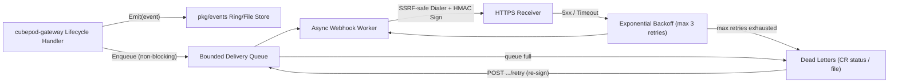

# CEP-0028: Sandbox Lifecycle Events and Signed Webhook Delivery

| Stage | Status | Created | Updated | Owning Area |
| :--- | :--- | :--- | :--- | :--- |
| `stable` | `implemented` | `2026-11-16` | `2026-11-18` | `gateway` |

## Table of Contents

- [Release Signoff Checklist](#release-signoff-checklist)
- [Summary](#summary)
- [Motivation](#motivation)
  - [Goals](#goals)
  - [Non-Goals](#non-goals)
- [Proposal](#proposal)
  - [User Stories](#user-stories)
  - [Notes / Constraints / Caveats](#notes--constraints--caveats)
  - [Risks and Mitigations](#risks-and-mitigations)
- [Design Details](#design-details)
  - [API / CRD / Wire Changes](#api--crd--wire-changes)
  - [State Machine & Data Flow](#state-machine--data-flow)
  - [Boundary Conditions & Failure Recovery](#boundary-conditions--failure-recovery)
  - [Test Plan](#test-plan)
  - [Graduation Criteria](#graduation-criteria)
  - [Upgrade / Downgrade Strategy](#upgrade--downgrade-strategy)
- [Production Readiness Review Questionnaire (PRR)](#production-readiness-review-questionnaire-prr)
- [Implementation History](#implementation-history)
- [Drawbacks](#drawbacks)
- [Alternatives](#alternatives)

---

## Release Signoff Checklist

- [x] Enhancement is scoped clearly with explicit Goals and Non-Goals.
- [x] API / OpenAPI changes are additive and backward-compatible.
- [x] Security boundary (SSRF protection, HMAC-SHA256 webhook signing, encrypted secret storage, tenant isolation) is reviewed.
- [x] Dual-runtime behavior (Production Kubernetes `Kata + CSI Block` and Local Development `Docker + Loopback ext4`) is specified.
- [x] Test plan covers unit tests (`go test -race`) and end-to-end delivery/retry/SSRF verification.
- [x] Graduation criteria for Alpha, Beta, and Stable are defined.
- [x] Beta (`SandboxWebhook` CRD + `Secret` backend, PodBox Kubernetes `Event`s) and Stable (dead-letter inspection/retry API, PrometheusRule alerts) delivered in `v0.7.0`.

---

## Summary

CEP-0028 introduces a tenant-isolated **Sandbox Lifecycle Events** store and **Signed Webhook Delivery** subsystem (`pkg/events`) in `cubepod-gateway`. It enables users and external orchestrators to query sandbox lifecycle audit history (`GET /events`, `GET /sandboxes/{sandboxID}/events`) and subscribe to real-time HTTP webhook notifications (`POST/GET/PATCH/DELETE /webhooks`) for `created`, `paused`, `resumed`, `updated`, `forked`, and `killed` transitions.

As of `v0.7.0` (Stable), Kubernetes deployments persist webhooks as `SandboxWebhook` CRs (HMAC key isolated in a companion `Secret`) and lifecycle events as labeled core/v1 `Event`s on `PodBox`, so multi-replica HA gateways share webhook and event state with zero external database. Failed or dropped deliveries are captured as tenant-scoped **dead letters** that can be listed, retried, or discarded via `/webhooks/dead-letters` APIs, and a reference `PrometheusRule` (`deploy/monitoring/webhook-alerts.yaml`) alerts on failed/dropped deliveries.

---

## Motivation

Currently, clients that need to track sandbox lifecycle transitions (for billing, idle-reaper notifications, audit trails, or UI updates) must poll `GET /sandboxes` or `GET /sandboxes/{id}`. Polling adds unnecessary API load and misses transient transitions such as transparent auto-resume or idle-timeout pauses.

### Goals

1. **Tenant-Scoped Lifecycle Event Log**: Record structured lifecycle events (`sandbox.lifecycle.created`, `paused`, `resumed`, `updated`, `forked`, `killed`) with cursor-paginated query APIs (`GET /events`, `GET /sandboxes/{sandboxID}/events`).
2. **Webhook Registration & Management API**: Provide `/webhooks` CRUD (`POST /webhooks`, `GET /webhooks`, `GET /webhooks/{webhookID}`, `PATCH /webhooks/{webhookID}`, `DELETE /webhooks/{webhookID}`) scoped by `sha256(APIKey)` tenant hash.
3. **Cryptographically Signed Delivery**: Sign every webhook payload with HMAC-SHA256 (`t=<unix>,v1=<hex>`) using a per-webhook secret encrypted at rest.
4. **SSRF-Safe Bounded Async Dispatcher**: Deliver events asynchronously with bounded queues, exponential backoff retries, and dial-time IP validation blocking private/loopback/metadata ranges in production.
5. **Dual-Runtime Parity**: Emit identical events across both Local Docker and Production Kubernetes (`Kata + CSI Block`) runtimes.

### Non-Goals

- Streaming in-guest stdout/stderr or filesystem watch events over webhooks (handled by Connect-RPC streaming).
- Guaranteeing unbounded persistent replay across multi-month retention (Alpha uses a bounded ring/retention window; long-term archival belongs to external SIEM/observability sinks).
- Modifying `PodBox` CRD schema in Alpha (events are emitted by `cubepod-gateway` lifecycle handlers and idle-reaper sync).

---

## Proposal

### User Stories

- **Story 1 (Billing & Usage Metering)**: As a platform integrator, I register a webhook subscribed to `sandbox.lifecycle.created`, `paused`, `resumed`, and `killed` so my billing service receives signed notifications without polling `GET /sandboxes`.
- **Story 2 (Audit & Debugging)**: As a tenant developer, I call `GET /sandboxes/{id}/events` to inspect when a sandbox was paused by the idle reaper and when it auto-resumed on incoming traffic.

### Notes / Constraints / Caveats

- **Idle Reaper Visibility**: In Kubernetes mode, `cubepod-controller` may transition `PodBox.Status.Phase` to `Paused` or delete expired sandboxes asynchronously. Gateway's `resolveSandbox` / `sync` loop should emit corresponding `paused` / `killed` events when observing a state transition not already recorded.
- **Dual-Runtime Behavior**:
  - **Production Kubernetes (`Kata + CSI Block`)**: Webhook subscriptions are persisted as `SandboxWebhook` CRDs (`cubepod.io/v1alpha1`) with a companion Kubernetes `Secret` (`secretRef`) holding only the HMAC `signatureKey`, and lifecycle events are emitted as labeled Kubernetes `Event`s on `PodBox` (zero external database dependency, consistent with CEP-0022). SSRF dialer blocks RFC1918, loopback, and cloud metadata IPs (`169.254.169.254`).
  - **Local Development (`Docker + Loopback ext4`)**: Identical `/events` and `/webhooks` APIs backed by `<state-dir>/events/` (AES-256-GCM encrypted webhook store + bounded event ring); operators may set `CUBEPOD_WEBHOOK_ALLOW_PRIVATE=1` in local test harnesses to deliver to `127.0.0.1` mock receivers.

### Risks and Mitigations

| Risk | Likelihood | Impact | Mitigation |
| :--- | :--- | :--- | :--- |
| SSRF against internal cluster services or cloud metadata (`169.254.169.254`) | High | Critical | Custom `net.Dialer.Control` verifies resolved IP is global unicast and not loopback/private/link-local before TCP connect (redirect following disabled). |
| Slow or unreachable webhook receiver blocking sandbox creation/pause | Medium | High | Strictly non-blocking bounded worker queue (`chan` with drop-oldest/drop-new metric) + `5s` per-attempt HTTP timeout; lifecycle handlers never await delivery. |
| Webhook signing secret leakage | Low | High | Encrypt `signatureKey` at rest (AES-256-GCM) and return it only on `POST /webhooks` creation or explicit rotation (`POST /webhooks/{id}` / `PATCH`). |
| Multi-replica duplicate event emission on K8s watch | Medium | Low | Include deterministic `eventID` (`evt_...`) and `idempotencyKey` in payload so receivers deduplicate cleanly. |

---

## Design Details

### API / CRD / Wire Changes

#### 0. `SandboxWebhook` CRD (`api/v1alpha1/types.go` & `deploy/helm/cubepod/crds/cubepod.io_sandboxwebhooks.yaml`)

In Kubernetes mode, each registered webhook is stored as a `SandboxWebhook` custom resource (`cubepod.io/v1alpha1`, `sandboxwebhooks.cubepod.io`) labeled with `cubepod.io/tenant=<tenantPrefix>`, keeping configuration & delivery status in CRD `etcd` and isolating only the HMAC `signatureKey` in a referenced Kubernetes `Secret` (`secretRef`):

```go
type SandboxWebhookSpec struct {
	TenantHash string   `json:"tenantHash"`
	Name       string   `json:"name"`
	URL        string   `json:"url"`
	Events     []string `json:"events"`
	Enabled    bool     `json:"enabled"`
	SecretName string   `json:"secretName"` // K8s Secret holding key "signatureKey"
}

type SandboxWebhookStatus struct {
	LastDeliveryTime    *time.Time `json:"lastDeliveryTime,omitempty"`
	ConsecutiveFailures int        `json:"consecutiveFailures,omitempty"`
	// Bounded (max 50 per webhook); never contains the signatureKey. Added in v0.7.0.
	DeadLetters []SandboxWebhookDeadLetter `json:"deadLetters,omitempty"`
}

type SandboxWebhookDeadLetter struct {
	ID             string          `json:"id"` // dlq_...
	EventID        string          `json:"eventId"`
	EventType      string          `json:"eventType"`
	SandboxID      string          `json:"sandboxId,omitempty"`
	Reason         string          `json:"reason"` // delivery_failed | queue_full
	Attempts       int             `json:"attempts,omitempty"`
	LastStatusCode int             `json:"lastStatusCode,omitempty"`
	LastError      string          `json:"lastError,omitempty"` // sanitized class
	RetryCount     int             `json:"retryCount,omitempty"`
	CreatedAt      time.Time       `json:"createdAt"`
	UpdatedAt      time.Time       `json:"updatedAt"`
	Event          json.RawMessage `json:"event,omitempty"`
}
```

Concrete Kubernetes object layout (v0.7.0):

| Object | Name | Labels / Annotations | Contents |
| :--- | :--- | :--- | :--- |
| `SandboxWebhook` CR | `cubepod-whk-<hex>` | `cubepod.io/resource=sandbox-webhook`, `cubepod.io/tenant=<16-char tenant prefix>`, annotation `cubepod.io/webhook-id` | `spec` (name, URL, events, enabled, `secretName`) and gateway-maintained `status.lastDeliveryTime`, `status.consecutiveFailures`, `status.deadLetters` |
| `Secret` | `cubepod-whk-sec-<hex>` | `cubepod.io/resource=sandbox-webhook-secret` | data key `signatureKey` only (referenced via `spec.secretName`) |
| core/v1 `Event` | deterministic per transition | `cubepod.io/resource=sandbox-event`, `cubepod.io/tenant`, `cubepod.io/sandbox`, `cubepod.io/source=gateway`, annotation `cubepod.io/lifecycle-event` (JSON payload) | `involvedObject` = `PodBox <sandboxID>` |

Gateways resync `SandboxWebhook` CRs every `5s` and reload on cache miss, so a webhook created on one replica is visible on all replicas.

In Kubernetes mode, `cubepod-controller` / `cubepod-gateway` also emits labeled Kubernetes `Event`s (`core/v1`) attached to `PodBox` (`involvedObject.name = <sandboxID>`, label `cubepod.io/tenant=<tenantPrefix>`), allowing `GET /events` and `GET /sandboxes/{id}/events` to query recent lifecycle events directly from Kubernetes without an external database.

#### 1. Webhooks Endpoints (`pkg/gateway/webhooks.go` & `api/openapi/cubepod-v1.yaml`)

All routes require `X-API-Key` (`requireManagementKey`).

- **`POST /webhooks`**:
  - Request: `{ "name": "billing-hook", "url": "https://example.com/hook", "events": ["sandbox.lifecycle.created", "sandbox.lifecycle.killed"], "enabled": true }`
  - Response (`201 Created`): `{ "id": "whk_...", "name": "...", "url": "...", "events": [...], "enabled": true, "signatureKey": "whsec_...", "createdAt": "..." }` (`signatureKey` returned only at creation).
- **`GET /webhooks`**: List tenant webhooks (omitting `signatureKey`).
- **`GET /webhooks/{webhookID}`**: Get single webhook metadata (omitting `signatureKey`).
- **`PATCH /webhooks/{webhookID}`**: Update `url`, `events`, `enabled`, or `"rotateSecret": true`.
- **`DELETE /webhooks/{webhookID}`**: Remove webhook and its dead letters (`204 No Content`).
- `WebhookInfo` additionally exposes optional `lastDeliveryTime` and `consecutiveFailures` (v0.7.0).

#### 1a. Dead-Letter Endpoints (v0.7.0)

All routes require `X-API-Key` and return `501` when events are not configured or the feature gate is off.

- **`GET /webhooks/dead-letters?webhookID=...&sandboxID=...&reason=...&limit=<=100&nextToken=...`**: Paginated tenant dead letters (`X-Next-Token` header).
- **`GET /webhooks/{webhookID}/dead-letters`**: Same filters minus `webhookID`; `404` if the webhook is not owned by the tenant.
- **`POST /webhooks/{webhookID}/dead-letters/{deadLetterID}/retry`**: Re-sign with the current `signatureKey` and re-enqueue (`202` + `DeadLetter`); `404` not found, `409` webhook disabled, `503` delivery queue full. A failed retry re-records the same id with `retryCount+1`.
- **`DELETE /webhooks/{webhookID}/dead-letters/{deadLetterID}`**: Discard (`204`); `404` not found.

`DeadLetter` schema: `id` (`dlq_...`), `webhookId`, `eventId`, `eventType`, `sandboxId`, `reason` (`delivery_failed` | `queue_full`), `attempts`, optional `lastStatusCode`, optional sanitized `lastError` class (`timeout`, `connection_error`, `http_status`, `ssrf_blocked`), optional `retryCount`, `createdAt`, `updatedAt`, and the original lifecycle `event`. It never contains the `signatureKey` or webhook URL.

#### 2. Events Endpoints & E2B-Compatible Event Payload Schema

- **`GET /events?sandboxID=...&eventType=...&limit=50&nextToken=...`**: Paginated tenant lifecycle events (`X-Next-Token` header).
- **`GET /sandboxes/{sandboxID}/events`**: Convenience route scoped to one sandbox.

Event payload schema (compatible with E2B `v1` Sandbox Lifecycle Webhooks):

```json
{
  "version": "v1",
  "id": "f5911677-cb60-498f-afed-f68143b3cc59",
  "type": "sandbox.lifecycle.paused",
  "timestamp": "2026-11-16T01:15:00Z",
  "eventCategory": "lifecycle",
  "eventLabel": "pause",
  "sandboxId": "cpod-123",
  "sandboxTeamId": "team_abc...",
  "sandboxTemplateId": "base",
  "sandboxBuildId": "a979a14b-bdcc-49e6-bc04-1189fc9fe7c2",
  "sandboxExecutionId": "1dae9e1c-9957-4ce7-a236-a99d5779aadf",
  "eventData": {
    "pause_mode": "filesystem",
    "execution": {
      "started_at": "2026-11-16T01:10:00Z",
      "vcpu_count": 2,
      "memory_mb": 512,
      "execution_time": 300000
    }
  }
}
```

Notes on E2B compatibility:
- CubePod emits `pause_mode: "filesystem"` on `paused` and `resume_mode: "reboot"` on `resumed` (reflecting CubePod's scale-to-zero PVC retention rather than RAM snapshot restore).
- `eventData` may be `null` on `created` / `updated` / `forked`, or carry `execution` usage metadata on `paused` / `killed`.

#### 3. Signature Verification Header

Every delivery sends:
- `e2b-signature: <hmac-sha256-hex-or-v1>` (official E2B webhook signature header)
- `X-CubePod-Event-ID: <event-uuid>`
- `X-CubePod-Signature: t=1794816900,v1=<hmac-sha256-hex(signatureKey, "1794816900." + rawBody)>`

### State Machine & Data Flow



### Boundary Conditions & Failure Recovery

- **Queue Saturation**: If the delivery queue is full, new deliveries are dropped and `cubepod_webhook_deliveries_total{result="dropped"}` increments; `/sandboxes` latency is never impacted. Since v0.7.0 the dropped delivery is recorded as a dead letter with reason `queue_full`.
- **Retry Exhaustion**: After max retries the delivery is recorded as a dead letter with reason `delivery_failed` and `cubepod_webhook_dead_letters_total` increments. Dead letters are bounded to 500 per tenant (file/memory backend) and 50 per webhook (`SandboxWebhook` `status.deadLetters`); oldest entries are evicted first.
- **Multi-Replica Deduplication**: Lifecycle `Event` names are deterministic, so concurrent replicas observing the same sync transition collide on create and only the replica that wins delivers webhooks.
- **Event Retention**: Kubernetes `Event`s are subject to the apiserver event TTL (default `1h`); the gateway additionally keeps a bounded in-memory ring. Long-term archival remains a non-goal.
- **HTTP Redirects**: Webhook client disables automatic `3xx` redirects (`CheckRedirect: func(...) error { return http.ErrUseLastResponse }`) to prevent redirect-based SSRF bypasses.
- **Gateway Restart**: Registered webhooks persist in `SandboxWebhook` CRs + `Secret`s (K8s) or encrypted on disk (file backend); in-flight retries are best-effort, but exhausted or dropped deliveries survive as dead letters.

### Test Plan

- **Unit Tests (`go test -race`)**:
  - `pkg/events`: Event emission, per-tenant & per-sandbox filtering, cursor pagination, webhook CRUD, HMAC-SHA256 signature verification, SSRF dialer rejecting `127.0.0.1`, `10.0.0.1`, `169.254.169.254`, and `http://` when TLS-only is enforced, redirect blocking, and retry backoff.
  - `pkg/gateway`: `/webhooks` and `/events` HTTP handlers, tenant isolation (`404`), and end-to-end `POST /sandboxes` -> `POST /pause` -> `POST /connect` -> `DELETE /sandboxes/{id}` delivering signed events to a test receiver.
  - Beta/Stable (v0.7.0): Kubernetes backend against a fake client (CR + Secret create/sync/delete, `signatureKey` never in CR, cross-replica visibility, deterministic `Event` dedupe), dead-letter recording on retry exhaustion and queue saturation, list/filter/pagination, retry (`202`/`404`/`409`/`503`), delete, bounds, and tenant isolation.

### Graduation Criteria

- **Alpha (`v0.6.0`) — delivered**: `pkg/events` + `/webhooks` + `/events` routes + SSRF-safe HMAC dispatcher passing `make test` (local file store).
- **Beta (`v0.7.0`) — delivered**: `SandboxWebhook` CRD + companion `Secret` backend (`CUBEPOD_EVENTS_BACKEND=k8s`, Helm `events.backend: k8s`) and labeled core/v1 `Event`s on `PodBox` for multi-replica HA gateways (zero external DB); `cubepod-controller` also emits PodBox `Event`s (`PodBoxRunning`, `PodBoxPaused`, `IdlePaused`, `PausedTTLExpired`, `PodBoxDeleted`).
- **Stable (`v0.7.0`) — delivered**: Dead-letter recording (`delivery_failed`, `queue_full`) with list/retry/delete APIs, `lastDeliveryTime` / `consecutiveFailures` on webhook info, `cubepod_webhook_dead_letters_total` / `cubepod_webhook_dead_letters_pending` metrics, and the reference `PrometheusRule` in `deploy/monitoring/webhook-alerts.yaml`.

### Upgrade / Downgrade Strategy

- **Upgrade**: Additive gateway routes; no storage PVC impact. In v0.7.0 Kubernetes gateways default to the `k8s` backend and need the `SandboxWebhook` CRD with the `status.deadLetters` schema. Helm does **not** upgrade CRDs shipped in `crds/`, so on upgrade run:

  ```bash
  kubectl apply -f deploy/helm/cubepod/crds/cubepod.io_sandboxwebhooks.yaml
  ```

  Webhooks previously stored in the Alpha file backend (`<state-dir>/events/webhooks.enc.json`) are not migrated automatically; re-register them, or pin `events.backend: file` to keep using the file store.
- **Downgrade**: Disabling `SandboxEventsAndWebhooks` (or `events.enabled=false`) stops event recording and returns `501 Not Implemented` on `/events`, `/webhooks`, and dead-letter routes. Downgrading to v0.6.x leaves `SandboxWebhook` CRs and Secrets in place (unused); v0.6.x gateways ignore `status.deadLetters`.

---

## Production Readiness Review Questionnaire (PRR)

- **Feature Enablement and Rollback**: Feature gate `SandboxEventsAndWebhooks` plus `CUBEPOD_EVENTS_BACKEND` (`k8s` | `file` | `disabled`). Default is `k8s` when the gateway has a Kubernetes client and `CUBEPOD_EVENTS_DIR` is unset; otherwise `file` under `<state-dir>/events` (`webhooks.enc.json`, `events.json`, `dead_letters.json`). `CUBEPOD_EVENTS_DIR=disabled` still disables. Helm: `events.enabled`, `events.backend`, `events.dir`. `CUBEPOD_WEBHOOK_ALLOW_PRIVATE=1` is for local test harnesses only.
- **Rollout, Upgrade and Rollback Planning**: Existing sandboxes and PVCs are unaffected.
- **Monitoring Requirements**: `cubepod_events_recorded_total`, `cubepod_webhook_deliveries_total{result="ok|failed|dropped"}`, `cubepod_webhook_queue_depth`, `cubepod_webhook_dead_letters_total`, `cubepod_webhook_dead_letters_pending`. `deploy/monitoring/webhook-alerts.yaml` ships a `PrometheusRule` with `CubePodWebhookDeliveriesFailed`, `CubePodWebhookDeliveriesDropped`, and `CubePodWebhookDeadLettersPending`.
- **Dependencies**: Go stdlib `crypto/hmac`, `crypto/sha256`, `net`; in `k8s` mode, the Kubernetes API server (gateway RBAC on `sandboxwebhooks`, `secrets`, and `events`).
- **Scalability**: Bounded event retention per tenant, bounded delivery queue, and bounded dead letters (500 per tenant file/memory, 50 per webhook CR) protect gateway memory and etcd object size.
- **Troubleshooting**: Inspect `cubepod_webhook_deliveries_total`, `GET /webhooks/dead-letters` (sanitized `lastError` / `lastStatusCode`), `kubectl get sandboxwebhooks -o yaml` (`status.consecutiveFailures`), `kubectl get events -l cubepod.io/resource=sandbox-event`, and structured logs (`webhookID`, `eventID`, `statusCode`).

---

## Implementation History

- `2026-11-16`: CEP-0028 drafted and marked `implementable`.
- `2026-11-16`: Alpha implemented in `v0.6.0` (file backend, `/webhooks`, `/events`, SSRF-safe HMAC dispatcher).
- `2026-11-18`: Beta and Stable implemented for `v0.7.0` (GitHub Issue #97): `SandboxWebhook` CR + `Secret` backend, PodBox Kubernetes `Event`s with multi-replica dedupe, controller PodBox `Event`s, dead-letter API, new metrics, Helm `events.*` values, and `PrometheusRule` alerts. Stage promoted to `stable`.

---

## Drawbacks

- The `file` backend remains single-instance and node-local; multi-replica gateways must use the `k8s` backend.
- Kubernetes `Event`s expire with the apiserver event TTL (default `1h`), so `/events` history in `k8s` mode is short-lived; the in-memory ring is per replica.
- Dead letters are bounded (50 per webhook in CR status, 500 per tenant otherwise); sustained receiver outages evict the oldest entries, so alerting on `cubepod_webhook_dead_letters_pending` matters.
- Webhook status writes add API-server traffic proportional to delivery volume.

---

## Alternatives

1. **Synchronous webhook calls inside `POST /sandboxes` / `DELETE /sandboxes/{id}`**: Rejected; slow receivers would stall sandbox lifecycle APIs.
2. **External PostgreSQL / Redis database**: Rejected per CEP-0022; CubePod avoids extra stateful database dependencies by using `SandboxWebhook` CRDs (`secretRef` for HMAC keys) and Kubernetes `Event`s on `PodBox`.
3. **Storing entire webhook configs inside Kubernetes `Secret`s**: Rejected; `Secret`s are meant for credentials (`signatureKey`), whereas a `SandboxWebhook` CRD gives clean schema validation, `kubectl` visibility, and `Status` tracking.
