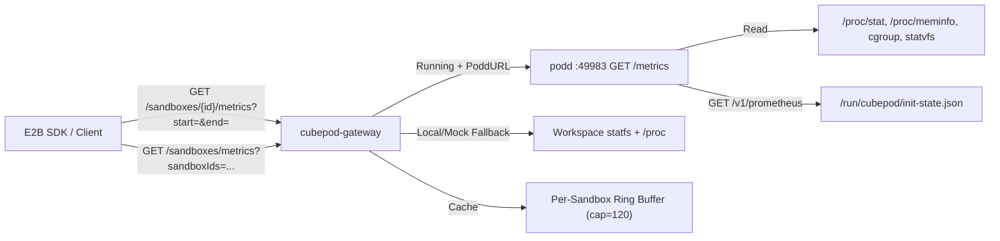

# CEP-0029: E2B Sandbox Metrics Alignment and Gateway/Podd Observability

| Stage | Status | Created | Updated | Owning Area |
| :--- | :--- | :--- | :--- | :--- |
| `alpha` | `implemented` | `2026-11-16` | `2026-11-16` | `gateway` |

## Table of Contents

- [Release Signoff Checklist](#release-signoff-checklist)
- [Summary](#summary)
- [Motivation](#motivation)
  - [Goals](#goals)
  - [Non-Goals](#non-goals)
- [Proposal](#proposal)
  - [User Stories](#user-stories)
  - [Notes / Constraints / Caveats](#notes--constraints--caveats)
  - [Risks and Mitigations](#risks-and-mitigations)
- [Design Details](#design-details)
  - [API / CRD / Wire Changes](#api--crd--wire-changes)
  - [State Machine & Data Flow](#state-machine--data-flow)
  - [Boundary Conditions & Failure Recovery](#boundary-conditions--failure-recovery)
  - [Test Plan](#test-plan)
  - [Graduation Criteria](#graduation-criteria)
  - [Upgrade / Downgrade Strategy](#upgrade--downgrade-strategy)
- [Production Readiness Review Questionnaire (PRR)](#production-readiness-review-questionnaire-prr)
- [Implementation History](#implementation-history)
- [Drawbacks](#drawbacks)
- [Alternatives](#alternatives)

---

## Release Signoff Checklist

- [x] Enhancement is scoped clearly with explicit Goals and Non-Goals.
- [x] API / OpenAPI changes are additive and backward-compatible.
- [x] Security invariants (zero-dependency Rust `podd`, single-threaded `podd-init`, zero-trust secret isolation) are preserved.
- [x] Dual-runtime behavior (Production Kubernetes `Kata + CSI Block` and Local Development `Docker + Loopback ext4`) is specified.
- [x] Test plan covers Rust unit tests (`cargo test`) and Go race-checked tests (`go test -race`).
- [x] Graduation criteria for Alpha, Beta, and Stable are defined.

---

## Summary

CEP-0029 aligns CubePod with the upstream E2B Sandbox Metrics API (`GET /sandboxes/{sandboxID}/metrics` and `GET /sandboxes/metrics`) and closes observability gaps across `podd-init`, `podd`, and `cubepod-gateway`. It introduces in-guest resource sampling in `podd` (`GET /metrics` JSON `SandboxMetric` plus `GET /v1/prometheus` Prometheus text exposition), records E2B volume bind-mount duration (`e2b_bind_duration_ms`) in `podd-init`'s `/run/cubepod/init-state.json`, adds Gateway time-range filtering and per-sandbox bounded ring-buffer caching, and implements the Prometheus counters, gauges, and histograms specified across prior CEPs (`CEP-0001`, `CEP-0002`, `CEP-0004`, `CEP-0018`, `CEP-0021`, `CEP-0022`, `CEP-0026`, `CEP-0027`).

---

## Motivation

1. **E2B SDK Compatibility Gap**: Upstream E2B SDKs expose `sbx.get_metrics(start, end)` (`GET /sandboxes/{sandboxID}/metrics`) and batch metrics (`GET /sandboxes/metrics?sandboxIds=...`) returning `SandboxMetric` snapshots (`timestamp`, `timestampUnix`, `cpuCount`, `cpuUsedPct`, `memUsed`, `memTotal`, `memCache`, `diskUsed`, `diskTotal`). CubePod currently lacks both Gateway routes and in-guest `/metrics` sampling in `podd`.
2. **Prometheus Metric Drift**: Several earlier CEPs declared Prometheus metric names (such as `cubepod_e2b_requests_total`, `cubepod_e2b_request_duration_seconds`, `cubepod_panel_active_sessions`, `cubepod_secrets_operations_total`, `cubepod_secrets_store_count`, `cubepod_e2b_volume_mounts_total`, `cubepod_sandbox_forks_total`, `cubepod_gateway_crd_resyncs_total`, `cubepod_podd_active_processes`, `cubepod_podd_init_duration_milliseconds`, and `cubepod_podd_init_e2b_bind_duration_ms`) that were either not yet exported or differed slightly from `metrics.go` names (`cubepod_gateway_http_requests_total` vs `cubepod_gateway_requests_total`).

### Goals

1. **E2B Single & Batch Sandbox Metrics**: Implement `GET /sandboxes/{sandboxID}/metrics` (`?start=`, `?end=`, optional `?autoResume=false`) returning `[]SandboxMetric`, and `GET /sandboxes/metrics` (`?sandboxIds=a,b`) returning `{"sandboxes": {id: SandboxMetric}}`.
2. **Zero-Dependency Guest Resource Sampling (`podd`)**: Implement `GET /metrics` in `crates/podd` using only `std` and `libc` to sample `/proc/stat`, `/proc/meminfo`, cgroup v2/v1 limits, and `libc::statvfs`, plus Prometheus exposition on `GET /v1/prometheus` (and `/metrics?format=prometheus` or `Accept: text/plain`).
3. **`podd-init` Bind Timing**: Measure E2B volume bind-mount duration in `crates/podd-init` and persist `e2b_bind_duration_ms` in `/run/cubepod/init-state.json`.
4. **Complete Gateway Prometheus Exposition**: Export all missing CEP metrics on `cubepod-gateway` `GET /metrics` while keeping existing `cubepod_gateway_http_requests_total` and `cubepod_gateway_autoresume_total` intact for backward compatibility.

### Non-Goals

- Long-term time-series database retention inside `cubepod-gateway` (Alpha uses a bounded in-memory ring buffer per sandbox; long-term retention belongs to Prometheus/ClickHouse scraping).
- Adding external HTTP or Prometheus client crates to `crates/podd` (must remain `std` + `libc` only).
- Modifying `PodBox` CRD schemas.

---

## Proposal

### User Stories

- **Story 1 (Agent / SDK Consumer)**: As an E2B SDK user, I call `sbx.get_metrics(start=..., end=...)` and receive accurate CPU, memory, cache, and disk utilization sampled from inside the sandbox MicroVM.
- **Story 2 (Platform Operator)**: As a Kubernetes operator, I scrape `cubepod-gateway` `/metrics` and `podd` `/v1/prometheus` to alert on E2B request latency, panel proxy concurrency, secret store operations, E2B volume bind latency, and fork duration.

### Notes / Constraints / Caveats

- **Dual-Runtime Behavior**:
  - **Production Kubernetes (`Kata + CSI Block`)**: `cubepod-gateway` queries `http://<PodIP>:49983/metrics` directly on the Kata pod; `podd` reads guest `/proc/stat`, `/proc/meminfo`, cgroup limits, `statvfs("/workspace")`, and `/run/cubepod/init-state.json`.
  - **Local Development (`Docker + Loopback ext4`)**: When a local `podd` URL is registered, `cubepod-gateway` queries `podd` `/metrics`. When running in unit/mock mode without a live `podd` upstream (`PoddURL == ""`), `cubepod-gateway` falls back cleanly using host/workspace `statfs` and configured `CPUCount`/`MemoryMB`/`DiskSizeMB` bounds without failing requests.
- **Single-Threaded `podd-init`**: Timing uses `std::time::Instant` on the main thread before `pivot_root(2)` and `execvp(3)`, introducing zero threads.

### Risks and Mitigations

| Risk | Likelihood | Impact | Mitigation |
| :--- | :--- | :--- | :--- |
| Unbounded Prometheus label cardinality from sandbox IDs in `endpoint` | Medium | High | Normalize route paths (e.g., `/sandboxes/{sandboxID}/metrics`) before recording `cubepod_e2b_requests_total{endpoint,status}`. |
| Batch metrics query waking up all `Paused` sandboxes | Medium | Medium | `GET /sandboxes/metrics` never calls `ensureRunning`; it queries live `Running` sandboxes and returns cached ring-buffer samples for `Paused` sandboxes. |
| Unbounded memory growth in per-sandbox metric cache | Low | Medium | Cap each sandbox's in-memory ring buffer to a fixed capacity (`120` samples) and evict on sandbox deletion. |
| `podd` `/proc/stat` first-call delta returning `0%` | Medium | Low | Maintain previous CPU sample in `podd` process state; if none exists, perform a brief 20ms delta read before computing `cpuUsedPct`. |

---

## Design Details

### API / CRD / Wire Changes

#### 1. `SandboxMetric` Schema (`api/openapi/cubepod-v1.yaml`)

```json
{
  "timestamp": "2026-11-16T12:00:00Z",
  "timestampUnix": 1794830400,
  "cpuCount": 2,
  "cpuUsedPct": 14.25,
  "memUsed": 536870912,
  "memTotal": 2147483648,
  "memCache": 134217728,
  "diskUsed": 1073741824,
  "diskTotal": 10737418240
}
```

- **`GET /sandboxes/{sandboxID}/metrics`**:
  - Optional query params: `start` (Unix seconds or RFC3339), `end` (Unix seconds or RFC3339), `autoResume` (`true` default; `false` reads cached samples without waking a `Paused` sandbox).
  - Returns `200 OK` with `[]SandboxMetric` filtered to `[start, end]`.
- **`GET /sandboxes/metrics`**:
  - Optional query params: `sandboxIds` (comma-separated or repeated query params). If omitted, returns metrics for all known active sandboxes.
  - Returns `200 OK` with `{"sandboxes": { "<sandboxID>": SandboxMetric }}`.

#### 2. `podd` Endpoints (`crates/podd`)

- `GET /metrics`: Returns JSON `SandboxMetric` (or Prometheus text format if `?format=prometheus` or `Accept: text/plain` without `application/json`).
- `GET /v1/prometheus`: Returns Prometheus text exposition (`text/plain; version=0.0.4; charset=utf-8`) containing:
  - `cubepod_podd_active_processes` (gauge)
  - `cubepod_podd_init_duration_milliseconds` (gauge, from `/run/cubepod/init-state.json` `duration_ms`)
  - `cubepod_podd_init_e2b_bind_duration_ms` (gauge, from `/run/cubepod/init-state.json` `e2b_bind_duration_ms`)

#### 3. `podd-init` State File (`crates/podd-init`)

Adds `"e2b_bind_duration_ms": <u64>` to `/run/cubepod/init-state.json`:

```json
{
  "pivoted": true,
  "rootfs_device": "/dev/cubepod-rootfs",
  "rootfs_action": "mounted",
  "workspace_device": "/dev/cubepod-workspace",
  "workspace_action": "mounted",
  "duration_ms": 42,
  "e2b_bind_duration_ms": 3
}
```

#### 4. Gateway Prometheus Metrics (`pkg/gateway/metrics.go`, `pkg/gateway/panel.go`)

- `cubepod_e2b_requests_total{endpoint,status}` (counter)
- `cubepod_e2b_request_duration_seconds` (histogram)
- `cubepod_gateway_requests_total` (counter, alongside `cubepod_gateway_http_requests_total`)
- `cubepod_gateway_auto_resumes_total` (counter, alongside `cubepod_gateway_autoresume_total`)
- `cubepod_panel_active_sessions` (gauge, tracked in `panel.go` around `proxy.ServeHTTP`)
- `cubepod_secrets_operations_total{op,status}` (counter)
- `cubepod_secrets_store_count` (gauge)
- `cubepod_e2b_volume_mounts_total` (counter)
- `cubepod_e2b_volume_mount_errors_total` (counter)
- `cubepod_sandbox_forks_total{mode,result}` (counter)
- `cubepod_sandbox_fork_duration_seconds` (histogram)
- `cubepod_gateway_crd_resyncs_total` (counter)
- `cubepod_sandbox_metrics_samples_total{result="ok|error"}` (counter, Beta v0.7: background sampler health)
- `cubepod_sandbox_{cpu_count,cpu_used_pct,memory_used_bytes,memory_total_bytes,disk_used_bytes,disk_total_bytes}{sandbox_id}` (gauges, latest sample per sandbox, Beta v0.7)

#### 5. Background Sampler (Beta, `v0.7`)

`Server.StartMetricsSampler(ctx, interval)` / `StopMetricsSampler()` (`pkg/gateway/sandbox_metrics.go`) tick every `--metrics-sample-interval` (env `CUBEPOD_METRICS_SAMPLE_INTERVAL`, Helm `gateway.metricsSampleInterval`, default `10s`, `0` disables). Each tick snapshots `Running` sandboxes under `s.mu.RLock()`, releases the lock, then polls `podd /metrics` (or the local fallback when no `PoddURL`) with at most 8 concurrent workers and records into the ring buffers. Paused/terminated sandboxes are skipped; errors increment `result="error"` and never block the loop.

#### 6. Prometheus Rules & Grafana Dashboard (GA, `v1.0`)

`deploy/monitoring/sandbox-metrics-rules.yaml` (`PrometheusRule`: `cubepod:sandbox_cpu_used_pct:avg5m`, `cubepod:sandbox_memory_utilization_ratio`, `cubepod:sandbox_disk_utilization_ratio`; alerts `CubePodSandboxHighMemoryPressure`, `CubePodSandboxDiskNearFull`, `CubePodMetricsSamplerFailing`) and `deploy/monitoring/sandbox-metrics-dashboard.json`.

### State Machine & Data Flow



### Boundary Conditions & Failure Recovery

- **Invalid `start`/`end` or `start > end`**: Gateway returns `400 Bad Request`.
- **Unknown sandbox**: `GET /sandboxes/{sandboxID}/metrics` returns `404 Not Found`; `GET /sandboxes/metrics` omits unknown IDs from `"sandboxes"`.
- **Transient `podd` `/metrics` timeout/error**: Gateway falls back to the latest cached sample or local workspace/sandbox spec estimation so monitoring polls degrade gracefully.
- **Missing `/run/cubepod/init-state.json`**: `podd` reports `0` for init duration gauges rather than failing Prometheus scrapes.

### Test Plan

- **Unit Tests (Rust)**:
  - `podd-init`: Verify `e2b_bind_duration_ms` serialization in `InitState::to_json` and `setup_and_pivot`.
  - `podd`: Verify RFC3339 formatting, `/proc/stat` delta CPU calculation, `/proc/meminfo` & cgroup memory parsing, `statvfs` disk reporting, `GET /metrics` JSON schema, and `GET /v1/prometheus` exposition including `init-state.json` gauges.
- **Unit Tests (Go, `-race`)**:
  - `sandbox_metrics_test.go`: Verify `GET /sandboxes/{id}/metrics` against a mock `podd` server, local fallback mode, `?start=` / `?end=` filtering (unix seconds & RFC3339), invalid range `400`, paused `autoResume=false` vs auto-resume, and `GET /sandboxes/metrics` batch filtering.
  - `sandbox_metrics_test.go` (sampler): background ticks populate history with no HTTP polling, paused sandboxes skipped, podd errors counted without blocking, clean stop without goroutine leaks.
  - `metrics_test.go`: Verify all newly added Prometheus counters, gauges, histograms, and `cubepod_panel_active_sessions` tracking under concurrent requests with `-race`.

### Graduation Criteria

- **Alpha (`v0.6`)**: `GET /sandboxes/{sandboxID}/metrics`, `GET /sandboxes/metrics`, `podd` `/metrics` & `/v1/prometheus`, `podd-init` `e2b_bind_duration_ms`, and all Gateway Prometheus metrics implemented and verified via `cargo test` and `go test -race`.
- **Beta (`v0.7`)** *(implemented)*: Background periodic sampler in Gateway/Controller populating ring buffers continuously for running sandboxes; live `make test-k8s-e2e` metrics assertions enabled.
- **GA (`v1.0`)**: Production soak in CubePlex with Prometheus recording rules and alerting dashboards (manifests shipped in `deploy/monitoring/`; soak pending).

### Upgrade / Downgrade Strategy

- All API additions (`GET /sandboxes/{sandboxID}/metrics`, `GET /sandboxes/metrics`, `podd` `/metrics`, `podd` `/v1/prometheus`) and `init-state.json` field (`e2b_bind_duration_ms`) are strictly additive.
- Existing Prometheus series (`cubepod_gateway_http_requests_total`, `cubepod_gateway_autoresume_total`) remain emitted alongside the new CEP-aligned names so existing Grafana dashboards continue working without modification.

---

## Production Readiness Review Questionnaire (PRR)

- **Feature Enablement and Rollback**: Always enabled in `v0.6`; additive HTTP routes and additive JSON/Prometheus fields require no data migration and can be rolled back safely by downgrading binaries.
- **Rollout, Upgrade and Rollback Planning**: In-memory ring buffers are ephemeral per gateway replica; rolling upgrades immediately resume sampling live `podd` instances without disrupting `Running` or `Paused` sandboxes or `/workspace` PVCs.
- **Monitoring Requirements**: `cubepod_e2b_requests_total`, `cubepod_e2b_request_duration_seconds`, `cubepod_panel_active_sessions`, `cubepod_podd_active_processes`, `cubepod_podd_init_duration_milliseconds`, `cubepod_podd_init_e2b_bind_duration_ms`.
- **Dependencies**: Linux `/proc` (`stat`, `meminfo`), `statvfs(2)`, optional cgroup v2/v1 files; zero new third-party dependencies in Rust or Go.
- **Scalability**: Bounded `120`-entry ring buffer per sandbox keeps memory overhead negligible (`< 15 KiB` per sandbox); `endpoint` label normalization prevents Prometheus cardinality explosion.
- **Troubleshooting**: Scrape `GET /v1/prometheus` on `podd` (`:49983`) or `GET /metrics` on `cubepod-gateway` (`:8080`); inspect `/run/cubepod/init-state.json` inside the guest for `duration_ms` and `e2b_bind_duration_ms`.

---

## Implementation History

- **2026-11-16**: CEP-0029 drafted and marked `implementable` for `v0.6`.
- **2026-11-16**: Alpha implementation completed across `podd-init`, `podd`, `cubepod-gateway`, and `api/openapi/cubepod-v1.yaml`; marked `implemented`.
- **2026-11-17**: Beta: background sampler, live K8s E2E assertions (`TestK8sLiveE2ESandboxMetrics`), and Prometheus rules/Grafana dashboard added (#98).

---

## Drawbacks

- Exposing both `cubepod_gateway_http_requests_total` / `cubepod_gateway_autoresume_total` and `cubepod_gateway_requests_total` / `cubepod_gateway_auto_resumes_total` temporarily duplicates two counter series until legacy names are deprecated in `v1.0`.

---

## Alternatives

- **Sidecar Metrics Exporter (cAdvisor / node_exporter)**: Rejected because adding another daemon inside each Kata MicroVM increases boot latency and memory footprint; sampling directly inside `podd` adds zero extra processes and negligible overhead.
- **Replacing Legacy Metric Names Immediately**: Rejected because existing tests and dashboards scrape `cubepod_gateway_http_requests_total` and `cubepod_gateway_autoresume_total`.
