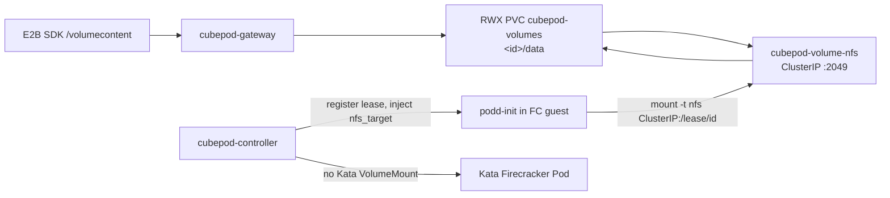

# CEP-0030: Firecracker NFS Transport for Official E2B Volumes

| Stage | Status | Created | Updated | Owning Area |
| :--- | :--- | :--- | :--- | :--- |
| `alpha` | `implementable` | `2026-11-22` | `2026-11-22` | `storage` (`controller`, `runtime`, `egress`, `gateway`) |

## Table of Contents

- [Release Signoff Checklist](#release-signoff-checklist)
- [Summary](#summary)
- [Motivation](#motivation)
  - [Goals](#goals)
  - [Non-Goals](#non-goals)
- [Proposal](#proposal)
  - [User Stories](#user-stories)
  - [Notes / Constraints / Caveats](#notes--constraints--caveats)
  - [Risks and Mitigations](#risks-and-mitigations)
- [Design Details](#design-details)
  - [Runtime Selection](#runtime-selection)
  - [API / CRD / Wire Changes](#api--crd--wire-changes)
  - [Architecture & Data Flow](#architecture--data-flow)
  - [In-Guest `podd-init` NFS Mount](#in-guest-podd-init-nfs-mount)
  - [Network Reachability and Egress](#network-reachability-and-egress)
  - [Lease Admission and Isolation](#lease-admission-and-isolation)
  - [Fork & Lifecycle Semantics](#fork--lifecycle-semantics)
  - [Boundary Conditions & Failure Recovery](#boundary-conditions--failure-recovery)
  - [Dual-Runtime Behavior](#dual-runtime-behavior)
  - [Test Plan](#test-plan)
  - [Graduation Criteria](#graduation-criteria)
  - [Upgrade / Downgrade Strategy](#upgrade--downgrade-strategy)
- [Production Readiness Review Questionnaire (PRR)](#production-readiness-review-questionnaire-prr)
- [Implementation History](#implementation-history)
- [Drawbacks](#drawbacks)
- [Alternatives](#alternatives)

---

## Release Signoff Checklist

- [x] Enhancement design documented in `docs/enhancements/0030-firecracker-volume-nfs/`
- [x] Enhancement scope, Goals, and Non-Goals are agreed upon (`provisional` -> `implementable`)
- [x] API / CRD (`pod.cubeplex.ai/v1alpha1`) and E2B-superset OpenAPI changes are specified (no public volume API change; internal `CUBEPOD_VOLUME_MOUNTS` transport fields only)
- [x] Dual-runtime behavior (Kubernetes Kata Firecracker NFS, Kubernetes `kata-qemu` / `kata-clh` virtio-fs, and Local Docker loopback) is defined
- [x] Security boundary (MicroVM isolation, lease-scoped exports, egress exemption, `MS_NOSUID | MS_NODEV`) is reviewed
- [x] Test plan includes unit tests (`cargo test` / `go test`) and real invariant E2E tests (unskip official SDK volume tests on the Firecracker lane)
- [x] Production Readiness Review (PRR) section is complete

---

## Summary

[CEP-0026](../0026-k8s-kata-e2b-volumes/README.md) made official E2B `volumeMounts` work on Kubernetes by backing `/volumecontent` and sandbox mounts with one shared `ReadWriteMany` PVC (`cubepod-volumes`) and staging each volume into the guest via a container `VolumeMount` (`subPath: <volumeID>/data` at `/run/cubepod/volumes/<volumeID>`). That path depends on the runtime sharing the host directory into the guest as a live filesystem: `kata-qemu` and `kata-clh` do this with virtio-fs; runc and Docker do it with a bind mount.

Kata Firecracker does not implement virtio-fs. Its `FilesystemShare.ShareFile` copies the host directory into the guest once at container creation and never writes changes back. Official SDK volume tests therefore look green inside a running Firecracker sandbox and lose every write when the VM is destroyed ([issue #122](https://github.com/cubeplexai/cubepod/issues/122)).

This CEP keeps CEP-0026's RWX PVC as the single source of truth and adds a **Firecracker-only** transport: a userspace NFSv3 proxy running *outside* the MicroVM exports the volume `data/` directory, and `podd-init` mounts it in the guest with `mount -t nfs`. Gateway `/volumecontent`, concurrent sandboxes, and fork inheritance do not change. The design follows official E2B's `nfsproxy` approach, adapted to CubePod's cluster-wide RWX PVC and zero-trust egress. It does not add a virtio-blk device, so it does not depend on [issue #120](https://github.com/cubeplexai/cubepod/issues/120).

---

## Motivation

On Kata Firecracker, `applyVolumeMounts` in `pkg/controller/manifests.go` still attaches the shared RWX PVC as a container `VolumeMount`. The host kubelet sees a normal mount, but Kata's Firecracker filesystem share is a one-way copy ([`fs_share_linux.go` in Kata 4.4.0](https://github.com/kata-containers/kata-containers/blob/4.4.0/src/runtime/virtcontainers/fs_share_linux.go#L317-L430)). `podd-init` then bind-mounts that copy onto the target path. Guest writes never reach the PVC, so `Volume.write_file` from a later sandbox or `GET /volumecontent` after destroy does not observe them. The same official volume tests pass on runc, Compose, and Kata Cloud Hypervisor.

A raw `volumeMode: Block` attachment would conflict with CEP-0026 Non-Goal 3 (gateway and multiple sandboxes need concurrent file access) and would add another virtio-blk hotplug, which is the class of bug tracked by issue #120 (`/dev/vdb` EIO). A destroy-time copy-back is racy, loses data on crash, and cannot serve two sandboxes at once.

Official E2B solved the same Firecracker gap by *not* using virtio-fs or virtio-blk for volumes. Volume bytes live in a host directory; a userspace NFS proxy (`packages/orchestrator/pkg/nfsproxy`, `github.com/willscott/go-nfs`) listens on a single TCP port; the guest mounts `<orchestrator-ip>:/<lifecycleID>/<volumeName>` with NFSv3 `hard,sync` options. CubePod should do the equivalent, with the RWX PVC in place of E2B's per-host directory tree.

### Goals

1. **Persistent official volumes on Firecracker**: After `Volume.create` -> `Volume.write_file` -> `Sandbox.create(volume_mounts=...)` -> in-guest write -> sandbox destroy -> new sandbox with the same volume, both the new guest and `/volumecontent` observe the bytes.
2. **Preserve CEP-0026 concurrency**: The volume store remains the shared RWX PVC. Multiple Firecracker sandboxes, qemu/CLH sandboxes, gateway replicas, and `/volumecontent` may read and write the same volume at the same time.
3. **No additional virtio-blk hotplug**: Official volumes must not be attached as Kata `volumeDevices` or extra block disks on Firecracker.
4. **Fail closed**: If the NFS transport is unavailable or the mount fails, sandbox create fails with a structured error. CubePod must never again boot a Firecracker sandbox against a one-way copy and silently drop writes.
5. **No API divergence**: Official E2B volume routes and SDK `volumeMounts` stay unchanged. qemu, Cloud Hypervisor, runc, and Compose keep the CEP-0026 / CEP-0025 transports.
6. **Re-enable Firecracker volume E2E**: Python `test_volume_mount_persistence` and TypeScript `volume mounts survive destruction and recreation` pass with zero `#122` skips on the Kata Firecracker lane.

### Non-Goals

1. **Fixing issue #120**: The Firecracker virtio-mmio block hotplug race for `/dev/vdb` (workspace / rootfs) is out of scope. This transport must not wait on that fix.
2. **Changing the official volume API or on-disk store layout**: `meta.json`, `attrs.json`, and `<volumeID>/data/` stay as in CEP-0025 / CEP-0026.
3. **Raw Block CSI for official E2B volumes**: Still rejected, for the same concurrent-access reason as CEP-0026 Non-Goal 3.
4. **Using NFS on qemu, Cloud Hypervisor, runc, or Docker**: Those runtimes already have a live filesystem share.
5. **Destroy-time or pause-time copy-back** of guest trees onto the PVC.
6. **Per-file POSIX ACL translation** inside the guest (same as CEP-0026 Non-Goal 1). Ownership remains `1000:1000`.
7. **Implementing NFSv4 or a kernel NFS server**: The first implementation is a userspace NFSv3 proxy on one TCP port, matching official E2B.

---

## Proposal

Leave official volume bytes on the existing cluster-wide RWX PVC `cubepod-volumes`. Introduce a new component, `cubepod-volume-nfs`, that mounts that PVC and serves a userspace NFSv3 proxy (same protocol family as E2B's `nfsproxy`: `github.com/willscott/go-nfs`, MOUNT and NFS on a single TCP port, default `2049`).

On Firecracker only, `cubepod-controller` must **not** add a Kata container `VolumeMount` for the official volume (that path is still the dead copy). It registers a lease with the proxy and passes an NFS target to `podd-init` through `CUBEPOD_VOLUME_MOUNTS` / `/etc/cubepod/volume-mounts.json`. `podd-init` creates the target directory and runs `mount -t nfs` into the pre-`pivot_root` merged root (or onto the target path when `CUBEPOD_SKIP_PIVOT=1` is not used for Firecracker).

Because CubePod already stores volumes on a cluster-wide RWX PVC, the proxy does not have to run on the same node as the sandbox (unlike E2B's host-local directories). A Deployment that mounts `cubepod-volumes`, plus a `ClusterIP` Service (`cubepod-volume-nfs`), is the default. Export paths are lease-scoped (`/<leaseID>/<volumeID>` maps only to `<volumesDir>/<volumeID>/data`) so a reused Pod IP cannot inherit a stale mount, and so the guest never sees sibling tenants, `meta.json`, or `attrs.json`.

The NFS server cannot be a sidecar in the same Kata Pod: every container in a Kata Pod shares one VM, so a sidecar would still be inside the guest and could not export the host PVC.

### User Stories

1. **As an E2B SDK user on a Kata Firecracker cluster**, I can attach a volume with `Sandbox.create(volume_mounts=...)`, write files in the guest, destroy the sandbox, start a new one with the same volume, and read those files again, just as I do on Cloud Hypervisor or Docker.
2. **As a CubePlex operator**, I keep one RWX volume store and one `/volumecontent` path across qemu, Cloud Hypervisor, and Firecracker. Enabling Firecracker does not require a second volume provisioner.
3. **As a security reviewer**, a Firecracker guest can mount only the lease it was issued, cannot traverse into other tenants' `data/` directories, and cannot use the volume as a `setuid` or device backdoor (`nosuid,nodev`). NFS to the proxy is an explicit egress exemption, not a general hole in zero-trust policy.

### Notes / Constraints / Caveats

- **No filesystem share on Firecracker**: Kata Firecracker's `Capabilities()` expose block hotplug only. Any official volume still listed in the Pod's `spec.containers[].volumeMounts` will be copied once and then diverge from the PVC. The controller must omit those `VolumeMounts` on Firecracker.
- **NFS server placement**: `cubepod-volume-nfs` runs as a cluster Deployment (or, optionally, a DaemonSet) in the CubePod namespace, not in the sandbox Pod. It mounts the same RWX PVC the gateway uses (`CUBEPOD_VOLUMES_DIR`).
- **Guest kernel NFS client**: The Firecracker guest kernel must provide NFSv3 (`CONFIG_NFS_FS`, `CONFIG_NFS_V3`, and the SunRPC client). Kata Firecracker E2E must preflight this (for example, `grep nfs /proc/filesystems` in the smoke guest) and fail clearly if it is missing. This CEP does not invent a custom in-guest NFS client.
- **Zero-trust egress**: CEP-0020's sidecar intercepts TCP `:80`/`:443` and DNS, and may drop other traffic when `DefaultAction == Deny`. Guest NFS (TCP to the proxy port, default `2049`, including the MOUNT protocol on the same port) MUST be exempted to the `cubepod-volume-nfs` Service ClusterIP only. The exemption is not a general "allow port 2049" rule.
- **NFS on top of NFS**: Some RWX StorageClasses (Longhorn RWX, NFS CSI) already use NFS under the PVC mount. The proxy re-exports that local mount. `sync` / `noac` on the guest mount reduce double-cache surprises. This is accepted; it is still a live share, not a copy.
- **Single-threaded `podd-init`**: All NFS mounts run synchronously on the main thread before `pivot_root(2)` (AGENTS.md Invariant 2).
- **Reserved paths and ownership**: Existing lexical reserved-path checks, `1000:1000` ownership, and `nosuid,nodev` still apply.

### Risks and Mitigations

| Risk | Impact | Mitigation |
| :--- | :--- | :--- |
| Controller still attaches a Kata `VolumeMount` on Firecracker | Silent data loss (issue #122 again) | Firecracker pod build omits official-volume `VolumeMounts`; unit tests assert the omission; E2E destroy/recreate must observe guest writes on the PVC, not only inside one VM. |
| Guest reaches the NFS proxy as a general egress hole | Sandbox can speak NFS to unintended addresses | nftables exemption is destination-prefixed to the `cubepod-volume-nfs` ClusterIP and port; the Service is `ClusterIP` only (no NodePort / LoadBalancer); NetworkPolicy allows sandbox Pods to that Service on TCP `2049` only. |
| Stale lease after Pod IP reuse | Sandbox A mounts Sandbox B's volume | Export path includes a per-start `leaseID`; MOUNT is admitted only when the client source IP matches the registered Pod IP for that lease; the lease is revoked on Pod delete / pause. |
| Guest escapes the export into `<volumesDir>` | Cross-tenant read/write | Proxy chroots each export to `<volumesDir>/<volumeID>/data` (E2B `chrooted.Builder` pattern). `/`, `meta.json`, `attrs.json`, and sibling IDs are not exported. |
| NFS mount fails but sandbox still starts | Empty target dir looks like a successful mount | `podd-init` fails fast with a non-zero exit if `mount -t nfs` fails or the target is not an NFS mount before `pivot_root`. |
| `DefaultAction == Deny` drops NFS or kube-DNS needed to find the Service | Sandbox CrashLoop | Controller injects the Service **ClusterIP** (not a DNS name) into `nfs_target`, so `podd-init` does not need DNS at mount time. Egress exemption is installed with the sidecar. |
| Pause/resume or proxy restart drops in-flight writes | Data loss | Guest mount uses `hard,sync,noac,lookupcache=none` (same rationale as E2B). CubePod pause recreates the Pod, so `podd-init` remounts on resume. Proxy fail-over may stall `hard` mounts until a replica is back. |
| Guest kernel has no NFS client | Feature cannot work | E2E preflight fails the lane with an explicit message; this is a kernel/config bug, not a skip of the volume tests. |

---

## Design Details

### Runtime Selection

Treat a sandbox as Firecracker when any of the following is true:

- `PodTemplateSpec.RuntimeClassName` or the resolved RuntimeClass is `kata-fc` or `kata-fc-e2e`
- The RuntimeClass has label `cubepod.io/hypervisor: firecracker` or handler `kata-fc` / `kata-fc-e2e`

Production should gain a first-class `kata-fc` RuntimeClass next to `kata-qemu` and `kata-clh` in `deploy/k8s/kata/runtimeclasses.yaml`. The E2E name `kata-fc-e2e` must be recognized as well.

All other Kata and runc classes keep the CEP-0026 bind / virtio-fs path.

### API / CRD / Wire Changes

The public E2B volume API and `PodBoxSpec.VolumeMounts` (`volumeID`, `path`, `subPath`, `pvcName`) do not change.

`CUBEPOD_VOLUME_MOUNTS` / `/etc/cubepod/volume-mounts.json` entries gain an optional transport. Existing bind/virtio-fs entries stay valid.

```json
[
  {
    "volume_id": "0123456789abcdef0123456789abcdef",
    "target_path": "/data",
    "transport": "nfs",
    "nfs_target": "10.96.10.20:/<leaseID>/0123456789abcdef0123456789abcdef"
  }
]
```

Rules:

- `transport` omitted or `"bind"`: current CEP-0026 behavior; `staging_path` must be `/run/cubepod/volumes/<volumeID>`.
- `transport: "nfs"`: `nfs_target` is required (`<clusterIP>:/<leaseID>/<volumeID>`); `staging_path` must be omitted; `podd-init` must not expect a host staging directory.
- Unknown `transport` is a hard error.
- On Firecracker, the controller MUST emit `transport: "nfs"` for every official volume and MUST NOT attach the corresponding PVC as a container `VolumeMount`.
- On qemu / CLH / runc, the controller MUST NOT emit `transport: "nfs"`.

Feature gate: `FirecrackerVolumeNFS` (Helm `volumes.nfs.enabled`). When official `volumeMounts` are requested on Firecracker and the gate is off or the NFS Service is not ready, the gateway returns a structured JSON error (CEP-0021 / AGENTS.md E2B JSON error convention) rather than creating a Pod that would copy the volume.

Helm adds a `cubepod-volume-nfs` Deployment + `ClusterIP` Service in the CubePod namespace, mounting `volumes.pvcName` at `CUBEPOD_VOLUMES_DIR`. Default listen port is `2049`.

Internal lease API (not published on the official E2B surface; reachable only from the controller in-cluster):

- `PUT /leases/{leaseID}` `{volumeID, podIP, podBoxName}` — create or refresh the export `/<leaseID>/<volumeID>`
- `DELETE /leases/{leaseID}` — revoke the export

The controller registers the lease once the Pod IP is known (or updates it when the IP is assigned) and always deletes it when the PodBox is paused or removed. `podd-init` may start racing the first registration; the guest mount retries (see below) until the lease exists or a deadline is reached.

### Architecture & Data Flow



### In-Guest `podd-init` NFS Mount

For each `transport: "nfs"` entry, after reserved-path validation and before `pivot_root(2)`:

1. `mkdir` the target under the merged root and `chown 1000:1000`.
2. Run `mount -t nfs -o <options> <nfs_target> <merged>/<target_path>`.
3. Confirm the mount is type `nfs` (or `nfs3`) in `/proc/mounts`; otherwise fail.
4. Continue with existing `pivot_root` propagation so the NFS mount survives into the sandbox root.

Mount options (aligned with official E2B `envd` `nfsOptions`, plus CubePod hardening):

```text
fg,hard,sync,nosuid,nodev,rsize=1048576,wsize=1048576,mountproto=tcp,mountport=2049,proto=tcp,port=2049,nfsvers=3,noacl,nolock,noac,lookupcache=none,retry=0
```

`sync` and `hard` exist so a sudden VM teardown does not leave unwritten pages only in the guest. `noac` / `lookupcache=none` keep concurrent gateway and multi-sandbox views coherent. `retry=0` keeps a single `mount(8)` from blocking for minutes; `podd-init` retries the whole mount up to twice with a short per-attempt timeout (10s class, same order as E2B) and then exits non-zero.

`nolock` avoids a separate NLM/portmapper dependency on the userspace proxy.

### Network Reachability and Egress

- `nfs_target` uses the Service **ClusterIP**, so the mount does not depend on CoreDNS during `podd-init`.
- The Firecracker guest already owns the Pod's network (Kata assigns the Pod interface to the VM), so the ClusterIP is reachable if cluster routing works for other in-guest traffic.
- `cubepod-egress` must install a narrow exemption: TCP to `<ClusterIP>:<nfs-port>` from the sandbox UIDs is not redirected and is not dropped when `DefaultAction == Deny`. DNS and HTTP/HTTPS policy are otherwise unchanged.
- The Service must not be exposed outside the cluster. NetworkPolicy: ingress to `cubepod-volume-nfs` on TCP `2049` only from sandbox Pods (and the controller to the lease API on a **different** port, never `2049`).

### Lease Admission and Isolation

`leaseID` is a new unguessable identifier per sandbox *start* (create or resume), not the stable volume ID and not a recycled Pod name alone.

On `MOUNT /<leaseID>/<volumeID>` the proxy admits the request only if:

1. A live lease with that `leaseID` and `volumeID` exists.
2. The client source IP equals the lease's Pod IP.
3. The export path has exactly two components and the volume ID is a valid 32-hex official volume ID.

Otherwise it returns a MOUNT denial and increments `cubepod_volume_nfs_export_denials_total`. The handler then chroots to `<CUBEPOD_VOLUMES_DIR>/<volumeID>/data`. AUTH_UNIX credentials are accepted but files on disk remain `1000:1000` as in CEP-0026.

### Fork & Lifecycle Semantics

- **Shared mutable volume** (unchanged): `ForkFrom` inherits `VolumeMounts` by reference; the child gets its own `leaseID` and its own NFS mount of the same `<volumeID>/data`. There is no CoW clone of official volumes.
- **Pause**: CubePod pause tears down the Pod and keeps store data on the RWX PVC. The lease is revoked. Resume creates a new Pod, a new lease, and a new `podd-init` NFS mount.
- **Kill / delete**: Lease revocation is part of PodBox cleanup. Volume data remains until `Volume.delete`.
- **Concurrent mounts**: Two Firecracker sandboxes, or one Firecracker and one qemu sandbox, may write the same volume. POSIX coherence is whatever the RWX StorageClass already provides for CEP-0026, plus `noac` on the NFS client.

### Boundary Conditions & Failure Recovery

- **NFS mount failure**: `podd-init` exits non-zero; the Pod does not become Ready. The gateway surfaces the create failure as JSON (`code` + `message`).
- **Proxy down at create time**: Retries exhaust, then the same fail-closed path. Running `hard` mounts stall until the proxy returns.
- **Gateway restart**: Unaffected; `/volumecontent` still talks to the PVC, not to NFS.
- **Unclean VM kill**: Writes that reached the proxy with `sync` are on the PVC; unsynced unwritten pages are lost, same as a hard host crash. No copy-back is attempted.
- **Missing staging directory**: Does not apply to `transport: "nfs"`. A leftover bind `staging_path` on Firecracker is a controller bug and must fail tests.

### Dual-Runtime Behavior

| Runtime | Official volume transport | Notes |
| :--- | :--- | :--- |
| Local Docker / Compose (CEP-0025) | Bind mount of `<stateDir>/volumes/<id>/data` | Unchanged |
| Kubernetes runc (`RuntimeClass` empty / `none`) | PVC `subPath` at the target (and/or staging + `podd-init` bind) | Unchanged CEP-0026 `mountDirect` |
| `kata-qemu`, `kata-clh` | PVC `subPath` staging + virtio-fs + `podd-init` bind | Unchanged CEP-0026 |
| `kata-fc` / `kata-fc-e2e` | No Kata `VolumeMount`; `podd-init` `mount -t nfs` | This CEP |

### Test Plan

- **Unit tests**:
  - `pkg/controller`: Firecracker pod manifests omit official-volume `VolumeMounts`, include `transport: "nfs"` and a ClusterIP `nfs_target`, and still attach rootfs/workspace block devices as today. qemu/CLH manifests are unchanged.
  - `crates/podd-init`: parse `transport: "nfs"`; reject missing `nfs_target`; reject NFS entries that also set a bind `staging_path`; reserved-path overlap still fails; bind entries without `transport` still work.
  - `pkg/volumenfs` (or equivalent): MOUNT admitted only for a matching lease + source IP + two-component path; chroot cannot `LOOKUP` `../`; stale lease after revoke is denied; metrics increment on denial.
  - `pkg/egress`: `DefaultAction == Deny` still allows the ClusterIP:2049 exemption and still denies other destinations on 2049.
- **Integration / E2E**:
  - Kata Firecracker lane: remove the `#122` documented skips for Python `test_volume_mount_persistence` and TypeScript `volume mounts survive destruction and recreation`. Both must pass with zero skips, including a write that is visible to `/volumecontent` and to a second sandbox after destroy. Assert `/proc/mounts` shows `nfs` and `nosuid,nodev` on the target. Strict cleanup still applies.
  - The same tests remain mandatory (and unskipped) on runc, Compose, and Cloud Hypervisor.
  - Guest preflight fails the Firecracker lane if the kernel cannot mount NFS, rather than skipping the volume tests.
  - Issue #120 may still skip unrelated workspace-block cases; volume tests must not be tied to those skips.

### Graduation Criteria

- **Alpha (`v0.8.0`)**: Behind `FirecrackerVolumeNFS` (default `false` until the NFS Service and guest kernel preflight are in place). Unit tests passing. A Firecracker sandbox with the gate enabled mounts NFS and persists writes on a dev cluster.
- **Beta (`v0.8.0`)**: Gate auto-enabled when `volumes.rwxStorageClassName` is set and the `cubepod-volume-nfs` Service is deployed. Official Python and TypeScript volume persistence tests pass on the Kata Firecracker CI lane with zero `#122` skips. qemu / CLH / runc / Compose volume tests remain green. Egress exemption verified under `DefaultAction == Deny`.
- **GA (`v1.0.0`)**: Production bake time in CubePlex, capacity metrics and alerts in use, and no silent-copy regressions.

### Upgrade / Downgrade Strategy

- Existing `PodBox` objects without Firecracker `volumeMounts` are unchanged.
- Setting `FirecrackerVolumeNFS=false` (or removing the NFS Service) rejects *new* Firecracker creates that request `volumeMounts`. Running Firecracker Pods keep their NFS mounts until they pause or stop. qemu / CLH / Docker mounts are unaffected.
- Downgrade to a controller that does not understand `transport: "nfs"` must not be rolled out while Firecracker volume Pods are still starting; older `podd-init` would ignore the field and look for a staging directory that the new controller no longer attaches. Roll `podd-init` first, or disable the gate, before a downgrade.
- `/workspace` and `rootfs-upper` PVCs are not modified by this CEP.

---

## Production Readiness Review Questionnaire (PRR)

- **Feature Enablement and Rollback**: Feature gate `FirecrackerVolumeNFS` and Helm `volumes.nfs.enabled`. Disabling the gate does not unmount the RWX PVC from the gateway and does not touch `/workspace`.
- **Rollout, Upgrade and Rollback Planning**: Ship `cubepod-volume-nfs` and a `podd-init` that understands `transport: "nfs"` before flipping the gate on. During a proxy rollout, `hard` mounts may stall briefly; they must not fall back to a local empty directory.
- **Monitoring Requirements**:
  - Metrics: `cubepod_volume_nfs_mounts_total`, `cubepod_volume_nfs_mount_errors_total`, `cubepod_volume_nfs_export_denials_total`, `cubepod_volume_nfs_rpc_duration_seconds`, `cubepod_volume_nfs_leases_active`, plus existing CEP-0026 volume metrics.
  - Logs: lease register/revoke, MOUNT denial reason (path vs IP vs unknown lease), `podd-init` mount failure (stderr before exit).
- **Dependencies**: CEP-0026 RWX PVC; userspace NFSv3 proxy; Firecracker guest kernel NFS client; cluster routing from the guest to the Service ClusterIP; CEP-0020 egress exemption hook.
- **Scalability**: One Service and a small proxy Deployment serve all Firecracker volume mounts (O(1) CSI attachments, same as CEP-0026). Cost is per-RPC CPU and network on the proxy, not per-volume PVCs. Horizontal proxy replicas are allowed because any replica that mounts the RWX PVC can serve any lease; lease state must be shared (in-process only is Alpha-safe for a single replica; Beta should store leases so replicas agree).
- **Troubleshooting**: If a sandbox CrashLoops on volume start, check (1) guest kernel NFS client, (2) lease exists for the Pod IP, (3) ClusterIP reachability from the guest (`connect` to `:2049`), (4) egress nftables exemption, (5) `/proc/mounts` inside a debug guest. Never "fix" a failed mount by attaching the PVC as a Kata `VolumeMount`.

---

## Implementation History

- **2026-11-22**: Proposal drafted after issue #122 analysis and a read of official E2B `nfsproxy` / `envd` NFS mount behavior. Target milestone `v0.8.0`. Status `implementable`.

---

## Drawbacks

- Adds a new cluster component and a network hop, so Firecracker official volumes will typically be slower than virtio-fs on qemu/CLH, especially for small-file metadata.
- Re-exporting an RWX StorageClass that is itself NFS stacks two NFS clients.
- Depends on the Firecracker guest kernel shipping an NFS client, which is an extra image/kernel requirement beyond today's block-only path.
- Lease state and egress exemptions add operational surface that bind mounts do not have.

These are acceptable because the alternative on Firecracker is not a slower live share — it is data loss.

---

## Alternatives

1. **Per-volume virtio-blk (RWO or RWX block) mounted by `podd-init`**: Rejected. Conflicts with CEP-0026 Non-Goal 3 (gateway `/volumecontent` and multiple sandboxes need concurrent file access) and would hotplug another virtio-blk device on Firecracker, overlapping issue #120.
2. **Destroy-time or pause-time copy-back** of the guest tree onto the PVC: Rejected. Racy, loses data on crash or kill `-9`, and cannot express concurrent mounts.
3. **Reject `volumeMounts` on Firecracker** with a structured 4xx/5xx: Acceptable as a fail-closed stopgap if this CEP's gate is off, but not a substitute for v0.8.0 persistence.
4. **NFS server sidecar in the sandbox Pod**: Rejected. Kata Pods share one VM; a sidecar cannot see the host PVC as a server for the guest.
5. **9P, virtio-fs port to Firecracker, or NFS-over-vsock**: Rejected for the first implementation. virtio-fs on Firecracker is not provided by Kata 4.4.0; 9P and vsock transports would need a custom guest client and would not match official E2B. They may be revisited if the NFS path proves inadequate.
6. **Node-local host-network proxy only (verbatim E2B placement)**: Not required as the default, because CubePod's source of truth is already a cluster-wide RWX PVC. A later DaemonSet + `internalTrafficPolicy: Local` optimization is compatible with this CEP but is not needed for correctness.

Official E2B's host-directory + userspace NFSv3 proxy is the model this CEP adapts; the CubePod-specific changes are the RWX PVC, the `ClusterIP` Service, lease-scoped exports, the `podd-init` mount (instead of `envd` `/init`), and the zero-trust egress exemption.
