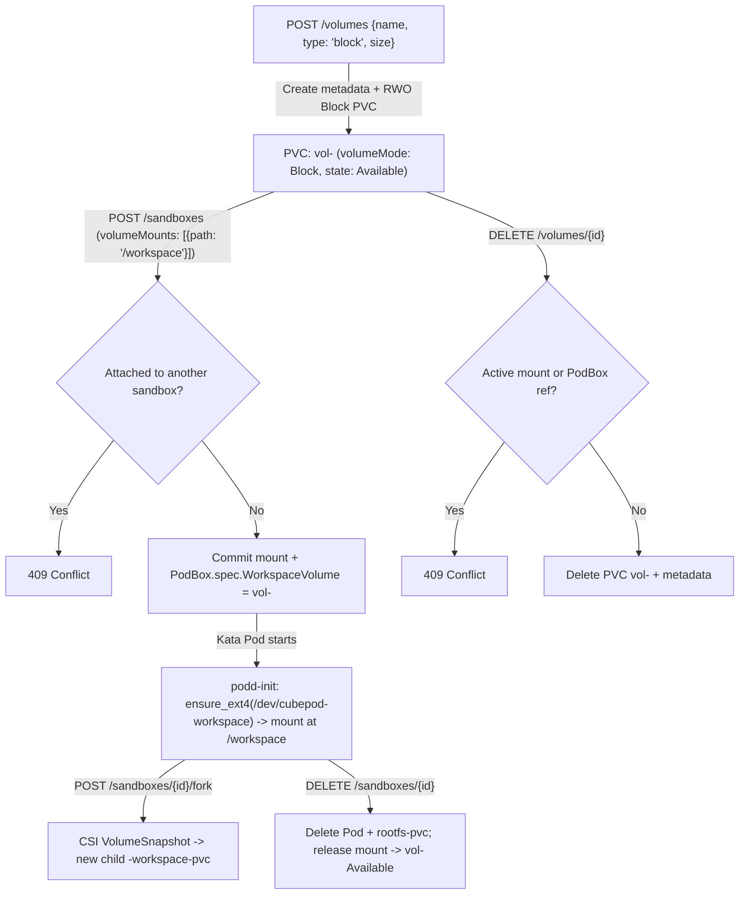

# CEP-0030: Unified Workspace Block Volume Lifecycle Management via `/volumes` API

| Stage | Status | Created | Updated | Owning Area |
| :--- | :--- | :--- | :--- | :--- |
| `alpha` | `provisional` | `2026-11-21` | `2026-11-21` | `storage` (`gateway`, `controller`, `runtime`, `sdk`) |

Tracking Issue: [#146](https://github.com/cubeplexai/cubepod/issues/146) (Milestone `0.8.0`)

## Table of Contents

- [Release Signoff Checklist](#release-signoff-checklist)
- [Summary](#summary)
- [Motivation](#motivation)
  - [Goals](#goals)
  - [Non-Goals](#non-goals)
- [Proposal](#proposal)
  - [User Stories](#user-stories)
  - [Notes / Constraints / Caveats](#notes--constraints--caveats)
  - [Risks and Mitigations](#risks-and-mitigations)
- [Design Details](#design-details)
  - [API / CRD / Wire Changes](#api--crd--wire-changes)
  - [State Machine & Data Flow](#state-machine--data-flow)
  - [Legacy `/workspace` Data Migration Strategy](#legacy-workspace-data-migration-strategy)
  - [Boundary Conditions & Failure Recovery](#boundary-conditions--failure-recovery)
  - [Test Plan](#test-plan)
  - [Graduation Criteria](#graduation-criteria)
  - [Upgrade / Downgrade Strategy](#upgrade--downgrade-strategy)
- [Production Readiness Review Questionnaire (PRR)](#production-readiness-review-questionnaire-prr)
- [Implementation History](#implementation-history)
- [Drawbacks](#drawbacks)
- [Alternatives](#alternatives)

---

## Release Signoff Checklist

- [x] Enhancement design documented in `docs/enhancements/0030-unified-workspace-block-volumes/`
- [ ] `POST /volumes` (`type: "shared" | "block"`) and volume metadata extension (`sizeBytes`, `legacyVolumeKey`, PVC binding) specified in OpenAPI (`api/openapi/cubepod-v1.yaml`) and implemented in `pkg/volume` + `pkg/gateway`
- [ ] `PodBoxSpec.WorkspaceVolume` (and `KubeClient.GetPVC` / `KubeClient.ListPVCs`) implemented in `api/v1alpha1` & `pkg/controller` without coupling `/workspace` to `/rootfs-upper` (AGENTS.md Invariant 1)
- [ ] Single-writer exclusivity (`409 Conflict` when attached to a non-Terminated PodBox) & CSI `VolumeSnapshot` CoW Fork behavior verified
- [ ] Legacy `/workspace` data migration implemented & verified: zero-copy in-place adoption (active `PodBox` auto-adoption + `cubepod volume migrate-legacy` CLI/Job + optional CSI `VolumeSnapshot` clone) with pre/post-upgrade data integrity checks
- [ ] Anonymous `/workspace` WarmPool claim (`< 50ms`) preserved unchanged
- [ ] Dual-runtime behavior implemented and tested across **Production Kubernetes (`Kata + CSI Block`)** and **Local Development (`Docker + Loopback ext4`)**
- [ ] Statechart / TLC check run for `PodBox` / block volume attach-detach lifecycle transitions (`AGENTS.md`)
- [ ] Deployed & soak-verified in test/staging environment (`v0.8.0`) before graduating to `v1.0.0` GA

---

## Summary

CEP-0030 extends CubePod's control-plane `/volumes` API (`POST / GET / DELETE /volumes`) to support **exclusive persistent `/workspace` block volumes** (`type: "block"`) alongside existing **shared RWX filesystem volumes** (`type: "shared"`, the default).

Today, users who want a sandbox `/workspace` to persist across `DELETE /sandboxes` -> `POST /sandboxes` cycles must pass an implicit `extension.volumeKey` string when creating a sandbox, which creates a `<sanitized>-workspace-pvc` without any list, inspect, quota, tenant-ownership, or delete REST API. CEP-0030 brings persistent `/workspace` block storage under the `/volumes` lifecycle while **keeping the underlying storage engines separate**: `/workspace` block volumes continue using `volumeMode: Block` (`VolumeDevices` -> `/dev/cubepod-workspace`), `podd-init` `ensure_ext4`, and CSI `VolumeSnapshot` CoW Forks, while shared volumes keep their RWX `subPath` + `/volumecontent` semantics.

---

## Motivation

CubePod currently manages two independent persistent storage paths with an awkward user-facing gap:

1. **Shared Volumes (`/volumes`, [CEP-0025](../0025-e2b-volumes/README.md) & [CEP-0026](../0026-k8s-kata-e2b-volumes/README.md))**: Full CRUD (`POST/GET/DELETE /volumes`), tenant isolation via `X-API-KEY` and `tenants.json`, quota enforcement, and `/volumecontent/{id}/...` HTTP file APIs, backed by a cluster-wide shared `ReadWriteMany` PVC (`cubepod-volumes`) mounted into guests via `virtiofsd` + `VolumeMounts`.
2. **Workspace Block Volumes (`extension.volumeKey`, [CEP-0003](../0003-controller-warmpool-and-fork/README.md) & [CEP-0022](../0022-cow-fork-and-stateless-ha-gateway/README.md))**: Passing `volumeKey` on `POST /sandboxes` creates an exclusive `ReadWriteOnce` `volumeMode: Block` PVC (`<sanitized>-workspace-pvc`) and keeps it alive when the sandbox is deleted (`spec.VolumeKey != ""` in `pkg/controller/reconciler.go`). However:
   - Operators and SDK users have **no REST API** to pre-provision, list (`GET /volumes`), inspect, quota-limit, rotate ownership, or explicitly delete (`DELETE /volumes/{id}`) a `volumeKey` PVC.
   - `volumeKey` has no `X-API-KEY` tenant isolation boundary equivalent to `pkg/volume.Store` (`SanitizeVolumeKey` hashes raw keys globally).

At the same time, `/workspace` **cannot** simply be collapsed into the RWX `/volumes` data-plane implementation:
- Raw `Block` CSI (`volumeMode: Block` with Kata QEMU direct block attach) avoids `virtiofsd` overhead and enables **CSI `VolumeSnapshot` CoW Fork**, where parent and child sandboxes diverge on independent writable `/workspace` clones.
- Anonymous sandboxes (without persistent volumes) rely on pre-created, pre-attached `workspace-pvc`s in **PodWarmPool** for `< 50ms` claims.
- `cubepod-gateway` cannot safely mount user `ext4` block devices directly onto the gateway Pod to serve `/volumecontent`.

### Goals

1. **Unified Control-Plane API**: Allow users to create, list, inspect, rotate keys for, and delete persistent block `/workspace` volumes through `/volumes` (`type: "block"`).
2. **Preserve Raw Block Semantics**: Mount `type: "block"` volumes exclusively at `/workspace` using `VolumeDevices` (`/dev/cubepod-workspace`) + `podd-init` `ensure_ext4` on Kubernetes Kata, and loopback `ext4` image / bind mount on local Docker.
3. **Preserve CSI `VolumeSnapshot` CoW Fork**: Forking a sandbox with a `type: "block"` `/workspace` volume MUST clone a new writable block PVC (never multi-attaching an RWO PVC or mutating the parent volume).
4. **Preserve WarmPool Fast Path**: Sandboxes created without `volumeMounts` / `/workspace` block mount continue claiming pre-warmed `PodWarmPool` replicas sub-50ms.
5. **Enforce Single-Writer Exclusivity & Tenant Isolation**: Bind block volumes to `pkg/volume.Store` tenant ownership (`X-API-KEY` / `tenants.json`) and reject attaching a `type: "block"` volume that is already attached to an active (non-`Terminated`) sandbox, or deleting an attached volume, with `409 Conflict`.

### Non-Goals

1. **Gateway `/volumecontent/{id}/...` for `type: "block"` volumes**: Offline HTTP file read/write via `cubepod-gateway` remains exclusive to `type: "shared"` RWX volumes. Gateway MUST return `400 Bad Request` / `422 Unprocessable Entity` (or `501 Not Implemented`) when `/volumecontent` is called on a `type: "block"` volume; file I/O on a block workspace uses the running sandbox's `/files` API.
2. **Mounting `type: "block"` volumes at arbitrary paths (e.g. `/mnt/data`) in Alpha**: Alpha restricts `type: "block"` mounts strictly to `path: "/workspace"` (replacing the anonymous sandbox `workspace-pvc` on that `PodBox`). Arbitrary multi-block device mounting is deferred.
3. **Converting anonymous `PodWarmPool` sandboxes to RWX**: Ephemeral sandboxes keep per-sandbox block `workspace-pvc`s.

---

## Proposal

### User Stories

1. **As an agent developer**, I want to create a persistent workspace via `POST /volumes` (`{"name": "repo-ws", "type": "block", "size": "20Gi"}`), attach it to a sandbox via `POST /sandboxes` (`"volumeMounts": [{"name": "repo-ws", "path": "/workspace"}]`), delete the sandbox when idle, re-attach `"repo-ws"` to a newer template/image sandbox later, and eventually delete it via `DELETE /volumes/{volumeID}` when the project is archived.
2. **As a platform operator**, I want tenant storage quotas, `GET /volumes` inventory, `POST /volumes/rotate-key`, and `409 Conflict` delete/attach guards to cover both shared RWX datasets and persistent block workspaces under one `/volumes` control surface.
3. **As an SDK consumer forking a workspace**, when I call `POST /sandboxes/{id}/fork` on a sandbox whose `/workspace` is backed by `"repo-ws"`, I expect the child sandbox to get an independent CoW CSI snapshot clone of `/workspace` without mutating `"repo-ws"` or stalling in `Multi-Attach`.

### Notes / Constraints / Caveats

- **Dual-Runtime Behavior**:
  - **Production Kubernetes (`Kata + CSI Block`)**:
    - Creating a `type: "block"` volume via `POST /volumes` records metadata in `pkg/volume.Store` (`type: "block"`, deterministic `pvcName: "vol-<volumeID>"`) and provisions a `ReadWriteOnce` `volumeMode: Block` `PersistentVolumeClaim` (`vol-<volumeID>`) via `controller.KubeClient().EnsurePVC` using the configured block `StorageClass`.
    - When `POST /sandboxes` requests `volumeMounts: [{name, path: "/workspace"}]` backed by a `type: "block"` volume, Gateway validates single-writer exclusivity, attaches the existing `vol-<volumeID>` claim as the Pod's `workspace-volume` (`VolumeDevices -> /dev/cubepod-workspace`) instead of allocating a fresh `<boxName>-workspace-pvc`, and skips `PodWarmPool` claiming.
    - `podd-init` requires **zero changes** for the block path: it already formats/fscks `/dev/cubepod-workspace` (`ensure_ext4`) and mounts it at `<merged>/workspace` while keeping `rootfs-upper` strictly isolated (AGENTS.md Invariant 1).
    - On `DELETE /sandboxes/{id}`: `cubepod-controller` deletes the Pod and ephemeral `rootfs-pvc`, and **preserves** `vol-<volumeID>` (just like `VolumeKey` today, except lifecycle deletion is explicitly controlled by `DELETE /volumes/{id}`).
  - **Local Development (`Docker + Loopback ext4`)**:
    - Creating a `type: "block"` volume allocates a sparse `ext4` image file `<volumesDir>/<volumeID>/workspace.img` (or loopback device / isolated host workspace dir when running host-loopback Docker), formatted on first sandbox attach.
    - Mounting at `/workspace` attaches `<volumeID>` exclusively to at most one running sandbox (enforcing single-writer `409 Conflict` parity with K8s RWO).
- **Pause / Resume with Attached Block Volume**:
  - When a sandbox with an attached `type: "block"` volume at `/workspace` is `Paused` (`DesiredState: "Paused"`), its compute Pod is deleted (releasing the CSI RWO node attachment while keeping the sandbox-to-volume lease in `mounts.json` / `PodBox.Spec`). Resuming (`DesiredState: "Running"`) re-attaches `vol-<volumeID>` to the new Pod.
  - Because a `Paused` sandbox still owns that `/workspace` state, another sandbox CANNOT mount the same `type: "block"` volume concurrently (`409 Conflict`); the owner sandbox must be deleted (`DELETE /sandboxes/{id}`) to release the block volume for reuse.

### Risks and Mitigations

| Risk | Impact | Mitigation |
| :--- | :--- | :--- |
| Concurrent attachment of a `type: "block"` RWO PVC to two sandboxes | K8s `Multi-Attach error` stalling Pod startup or ext4 corruption | `pkg/volume.Store` checks active mounts under tenant/global lock AND Gateway checks active `PodBox` CRs referencing `vol-<volumeID>` before `Reconcile`; any active attachment returns `409 Conflict` immediately. |
| Controller mistakenly deletes `vol-<volumeID>` on `DELETE /sandboxes/{id}` | Permanent loss of user `/workspace` data | `reconciler.deletePodBoxLocked` checks whether `WorkspacePVCName` is a managed persistent volume (`vol-*` / `WorkspaceVolume` set) and skips PVC deletion unless invoked by `DELETE /volumes/{id}`. |
| `ForkFrom` reuses parent's RWO `vol-<volumeID>` instead of cloning | CSI multi-attach deadlock + shared corruption | For `ForkFrom`, `BuildBlockPVCsWithOptions` still uses `WorkspaceSnapshotName` / `DataSourcePVC` pointing to `vol-<volumeID>` to create an **ephemeral per-fork** `<childID>-workspace-pvc` (or detached snapshot clone); the child does NOT inherit `vol-<volumeID>` ownership in `mounts.json`. |
| Unclean Pod kill leaves dirty ext4 journal on `vol-<volumeID>` | Mount failure on next sandbox attach | `podd-init` already runs `e2fsck -p` via `ensure_ext4` prior to mounting `/dev/cubepod-workspace` cleanly before `pivot_root(2)`. |
| User attempts `/volumecontent/{id}/...` against `type: "block"` volume | Confusion or unintended host mount exposure | Volume metadata explicitly stores `type`; `/volumecontent/*` handlers reject `type == "block"` upfront with `400 Bad Request` (`"content API is only supported for shared volumes"`). |

---

## Design Details

### API / CRD / Wire Changes

#### 1. OpenAPI / REST Wire (`api/openapi/cubepod-v1.yaml`, `pkg/gateway/volumes.go`)

- **`POST /volumes`** (`CreateVolumeRequest`):
  ```json
  {
    "name": "repo-workspace",
    "type": "block",
    "size": "20Gi"
  }
  ```
  - `type` (optional, enum `["shared", "block"]`, default `"shared"`):
    - `"shared"`: RWX shared filesystem volume (existing E2B 2.64.0 behavior, `/volumecontent` supported).
    - `"block"`: Exclusive RWO block volume (`size` defaults to template/cluster default `20Gi`, capped by tenant quota). `token` may be omitted or issued only for schema compatibility while `/volumecontent` rejects `type == "block"`.
- **`GET /volumes` & `GET /volumes/{volumeID}`**:
  Include `"type": "shared" | "block"` and optional `"size": "20Gi"` in responses (backwards-compatible additive JSON fields).
- **`POST /sandboxes`** (`volumeMounts` semantics):
  - Existing validation in `api/v1alpha1.ValidVolumeContainerPath` reserves `/workspace` for `type: "shared"` volumes.
  - When a requested mount references a `type: "block"` volume:
    - `path` MUST equal `"/workspace"` (`400 Bad Request` otherwise).
    - At most one `type: "block"` volume may be mounted per sandbox (`400 Bad Request` otherwise).
    - If already attached to any sandbox in `mounts.json` or an active `PodBox` CR, return `409 Conflict`.
    - Coexists seamlessly with `type: "shared"` mounts on other paths (e.g. `/mnt/datasets`).
  - `extension.volumeKey` remains supported as legacy/implicit shorthand during `v0.8.x` (with deprecation notice in `v0.8.0` docs if `BlockWorkspaceVolumes` is promoted).

#### 2. CRD (`api/v1alpha1/types.go`, `deploy/helm/cubepod/crds/cubepod.io_podboxes.yaml`)

Add optional `WorkspaceVolume` field to `PodBoxSpec`:

```go
type WorkspaceVolumeSpec struct {
	// VolumeID is the 32-char hex ID from /volumes when backed by a managed block volume.
	VolumeID string `json:"volumeID"`
	// PVCName is the pre-provisioned RWO Block PVC name (vol-<volumeID>).
	PVCName string `json:"pvcName"`
}

type PodBoxSpec struct {
	// ... existing fields ...
	WorkspaceVolume *WorkspaceVolumeSpec `json:"workspaceVolume,omitempty"`
}
```

- When `spec.WorkspaceVolume != nil`:
  - `WorkspacePVCName` returns `spec.WorkspaceVolume.PVCName` (`vol-<volumeID>`).
  - `reconciler.ensurePodBoxPVCs` ensures/verifies `vol-<volumeID>` exists (`EnsurePVC` is idempotent) and NEVER deletes `vol-<volumeID>` on `DeletePodBox` or failed cold-create rollback.
  - `spec.VolumeMounts` continues to hold only `type: "shared"` RWX mounts (non-`/workspace`), preserving the clean separation between `VolumeDevices` and `VolumeMounts`.

### State Machine & Data Flow



### Legacy `/workspace` Data Migration Strategy

Production and staging clusters currently running `v0.7.x` (and earlier `0.x` releases) already hold user data inside existing `/workspace` PVCs and local loopback directories. Upgrading to `v0.8.0` and graduating to `v1.0.0` MUST NOT lose, overwrite, or orphan this data.

#### Inventory of Legacy `/workspace` Assets in Deployed Clusters

1. **Active Anonymous Sandboxes (`spec.VolumeKey == ""`)**:
   - Ephemeral `/workspace` PVCs named `<boxName>-workspace-pvc` (labels `pod.cubeplex.ai/box=<boxName>`, `pod.cubeplex.ai/vol-type=workspace`).
   - Kept intact as-is; `PodBoxSpec.WorkspaceVolume` is `nil`, so `WorkspacePVCName` resolves `<boxName>-workspace-pvc` identically across upgrade and rolling restarts.
2. **Active Sandboxes with `spec.VolumeKey != ""` (`Running` or `Paused`)**:
   - Persistent `/workspace` PVCs named `<SanitizeVolumeKey(volumeKey)>-workspace-pvc`.
   - The `PodBox` CR carries `annotations["cubepod.io/volume-key"]` and `annotations["cubepod.io/owner-tenant"]` (`pkg/gateway/sandboxes.go`).
3. **Retained Orphaned Legacy `VolumeKey` PVCs (Sandbox Already Deleted in `<= v0.7.x`)**:
   - When a sandbox created with `volumeKey` was deleted prior to `v0.8.0`, `reconciler.deletePodBoxLocked` intentionally retained `<sanitized>-workspace-pvc` even though the `PodBox` CR was deleted.
   - Only the Kubernetes `PersistentVolumeClaim` (`pod.cubeplex.ai/vol-type=workspace`) remains; `owner-tenant` is absent on the PVC itself because pre-`v0.8.0` `BuildBlockPVCsWithOptions` did not copy tenant annotations onto the PVC.
4. **Local Development (`Docker + Loopback ext4`)**:
   - Existing directories or sparse images under `<workspaceBaseDir>` associated with prior sandboxes / `volumeKey` workloads.

#### Two Migration Modes (Lossless by Design)

Because `pkg/volume.Store` (`meta.json`) and `PodBoxSpec.WorkspaceVolume.PVCName` store an explicit `pvcName` string rather than requiring `pvcName == "vol-" + volumeID`, migration supports **Zero-Copy In-Place Adoption** as the primary path and optional **CSI Snapshot Clone**:

1. **Mode 1 — Zero-Copy In-Place Adoption (Default, Zero Downtime)**:
   - **Why zero-copy**: Kubernetes does not allow renaming an existing `PersistentVolumeClaim` (`metadata.name` is immutable). Instead, `volume.Store` records `pvcName: "<legacy-pvc-name>"` (e.g. `<sanitized>-workspace-pvc`), `type: "block"`, `size` (read from PVC `spec.resources.requests.storage`), and optional `legacyVolumeKey` in `meta.json`.
   - **Data safety invariant**: Existing ext4 blocks on the CSI volume are untouched. When a new sandbox attaches the adopted volume, `podd-init` `ensure_ext4` detects the existing valid `ext4` superblock (`blkid` / `dumpe2fs` check) and skips formatting, running only `e2fsck -p` before mounting at `/workspace`.
   - **Automatic Adoption for Active `PodBox`es (`syncFromKube`)**:
     - On `cubepod-gateway` boot and periodic resync, for any `PodBox` whose `spec.VolumeKey != ""` and `spec.WorkspaceVolume == nil` and whose `annotations["cubepod.io/owner-tenant"]` is present, Gateway automatically registers a deterministic `type: "block"` entry in `volume.Store` under that `owner-tenant` hash referencing `status.WorkspacePVCName` (idempotent; skips if already registered).
     - Subsequent `GET /volumes` calls immediately show the volume; `POST /sandboxes` with either `volumeMounts: [{name, path: "/workspace"}]` OR legacy `extension.volumeKey` resolves to the exact same `volume.Store` lock, preventing concurrent multi-attach (`409 Conflict`).
   - **Idempotent Migration CLI / Upgrade Job (`cubepod volume migrate-legacy`)**:
     - Covers **already-deleted sandboxes' retained PVCs** (Scenario 3 above) and **local workspace directories** (Scenario 4), as well as pre-populating entries cleanly during the `v0.8.0` test/production rollout:
       - Lists PVCs in `controller.workloadNamespace` with label `pod.cubeplex.ai/vol-type=workspace` via `KubeClient.ListPVCs` (skipping WarmPool standby PVCs `*-warm-*`, active ephemeral `<podBox>-workspace-pvc` without `VolumeKey`, and already-managed `vol-*` PVCs).
       - Resolves tenant ownership in strict precedence order:
         1. Active `PodBox` annotation (`cubepod.io/owner-tenant` + `cubepod.io/volume-key`);
         2. Operator-supplied `--owner-map <file.json>` (mapping `pvcName` or `volumeKey` -> `tenantID` or `apiKey`);
         3. Explicit `--default-api-key` (only when operator explicitly passes it for single-tenant staging/legacy clusters; never auto-assigned to arbitrary callers without authorization).
       - Writes `meta.json` (`type: "block"`, `pvcName: pvc.Name`, `pvcNamespace`) atomically under `.store.lock` `flock` and patches non-breaking tracking labels/annotations onto the migrated PVC (`cubepod.io/volume-id`, `app.kubernetes.io/managed-by=cubepod-volumes`).
   - **Lazy Claim Compatibility for Legacy `extension.volumeKey` Callers**:
     - During `v0.8.0`, if a client calls `POST /sandboxes` with `extension.volumeKey = K` and that volume was not yet pre-migrated:
       - Gateway checks whether PVC `<SanitizeVolumeKey(K)>-workspace-pvc` already exists via `KubeClient.GetPVC`.
       - Because knowledge of the exact raw string `K` (which maps deterministically via `SanitizeVolumeKey`) served as the caller credential in `<= v0.7.x`, if the PVC exists and has no active owner `PodBox` belonging to a *different* `owner-tenant`, Gateway adopts it under the caller's tenant on attach and populates `PodBoxSpec.WorkspaceVolume`! If an active `PodBox` with a *different* `cubepod.io/owner-tenant` owns that PVC, Gateway rejects the request with `409 Conflict` / `403 Forbidden`.

2. **Mode 2 — Optional CSI Snapshot Clone Migration (`--clone-to-canonical`)**:
   - Available in `cubepod volume migrate-legacy --clone-to-canonical` when an operator wants canonical `vol-<volumeID>` PVC names and independent backup before retiring legacy PVCs.
   - Creates a CSI `VolumeSnapshot` of the legacy PVC (`WaitVolumeSnapshotReady`), creates a new `vol-<volumeID>` PVC with `DataSourceSnapshot`, verifies `Bound` status, and retains the original `<sanitized>-workspace-pvc` untouched until the operator manually removes it after validation.

### Boundary Conditions & Failure Recovery

- **Gateway Crash Between `CommitMounts` and `UpsertPodBox`**:
  On startup, `pkg/gateway` reconciles `mounts.json` against active `PodBox` CRs (`ReconcileMounts`), releasing orphaned block volume leases so the volume does not stay stuck in `409 Conflict`.
- **Two Concurrent `POST /sandboxes` Requests Claiming the Same `block` Volume**:
  `Store.LookupAndCommitBlockMount` (or `CommitMounts` checking `type == "block"` uniqueness atomically under lock + `tenants.json` / `.store.lock` `flock` in multi-replica HA mode) guarantees at most one caller succeeds; the loser receives `409 Conflict`.
- **`VolumeMode: Filesystem` Fallback Clusters**:
  When template/cluster `volumeMode` is `Filesystem` (e.g. Kind E2E without raw block CSI), `vol-<volumeID>` is created with `volumeMode: Filesystem` (`AccessModes: ["ReadWriteOnce"]`) and mounted at `/workspace` instead of `VolumeDevices`, preserving identical single-writer API semantics.

### Test Plan

- **Unit Tests (Go, `-race`)**:
  - `pkg/volume/store_test.go`: Creating `type: "block"` volumes, tenant byte/size quota checks, rejection of concurrent block mounts (`ErrInUse` -> `409`), and cleanup after unmount.
  - `pkg/controller/manifests_test.go`: `BuildBlockPVCsWithOptions` and `BuildPodManifest` with `spec.WorkspaceVolume` (`vol-<id>` mapped to `/dev/cubepod-workspace`, no `<boxName>-workspace-pvc` leak, CSI snapshot fork pointing to `vol-<id>`).
  - `pkg/controller/reconciler_test.go`: State-machine verification ensuring `DeletePodBox` and rollback do NOT delete `vol-<id>`, and `ForkFrom` creates a separate cloned PVC for the child without inheriting `WorkspaceVolume`.
  - `pkg/gateway/volumes_test.go`: Full API tests for `POST /volumes` (`type: "block"`), `/volumecontent` rejection (`400`), `POST /sandboxes` mounting at `/workspace`, non-`/workspace` path rejection for block volumes, `409` concurrent mount rejection, `DELETE /volumes/{id}` `409` while mounted -> `204` after sandbox delete, `POST /sandboxes/{id}/fork` independence, and legacy `/workspace` PVC auto-adoption / lazy `volumeKey` bridging / cross-tenant guard.
  - `cmd/cubepod/` migration CLI tests: Idempotent `cubepod volume migrate-legacy` execution against Memory/fake K8s PVCs and local workspace directories, `--owner-map` resolution, and `--clone-to-canonical` snapshot flow.
- **State Machine Verification (`AGENTS.md`)**:
  - Run `/statechart` (TLA+/TLC model check) covering `Available -> Attached -> Paused (Pod deleted, volume leased) -> Running -> Detached -> Deleted` and `ForkFrom` snapshot clone invariants before implementation PRs merge.
- **Integration / E2E Tests**:
  - `make test-e2e`: Local Docker / loopback `ext4` persistence across sandbox delete -> recreate via `/volumes` (`type: "block"`).
  - `make test-k8s-e2e`: Live Kata + Longhorn V2 Block CSI test: create block volume -> attach at `/workspace` -> write data -> delete sandbox -> create new sandbox with same block volume -> verify data intact -> fork sandbox -> mutate child `/workspace` and verify parent block volume untouched -> delete both sandboxes -> delete block volume.

- **Release & Staging Verification Plan (`v0.8.0` -> Test Cluster -> `v1.0.0` GA)**:
  - Before `v1.0.0` GA, deploy `v0.8.0` into the staging/test Kubernetes cluster that contains representative `v0.7.x` legacy `/workspace` PVCs (active `Running`, `Paused`, and deleted-sandbox retained `<sanitized>-workspace-pvc` claims):
    1. Record SHA-256 checksums of sentinel files inside legacy `/workspace` PVCs;
    2. Upgrade control plane (`cubepod-controller`, `cubepod-gateway`, CRD) in place to `v0.8.0` and confirm existing `PodBox`es remain healthy without unintended Pod restarts;
    3. Run `cubepod volume migrate-legacy` (and test lazy `volumeKey` adoption + `type: "block"` mounts);
    4. Verify `GET /volumes` lists the migrated block volumes, re-attaching at `/workspace` preserves exact sentinel file checksums (`ensure_ext4` skips formatting), concurrent attach returns `409 Conflict`, CSI `VolumeSnapshot` fork isolates writes from the parent block volume, and `DELETE /volumes/{id}` cleanly reclaims the PVC once unmounted.

### Graduation Criteria

- **Release Scope (`v0.8.0` — Complete Production-Launchable Feature Set + Test Environment Rollout)**:
  - [ ] All runtime, API, CRD, Helm, SDK (Python/TS/Go), monitoring, statechart (`/statechart`), and legacy `/workspace` migration capabilities implemented and passing automated unit/E2E suites (`make test`, `make test-e2e`, `make test-k8s-e2e`).
  - [ ] Deployed to staging/test Kubernetes environment and verified end-to-end, including in-place `v0.7.x -> v0.8.0` upgrade and legacy `/workspace` data migration without data loss.
- **GA / Formal Production Release (`v1.0.0`)**:
  - [ ] Staging/test deployment soak complete with zero data-loss or multi-attach incidents; `BlockWorkspaceVolumes` enabled by default (`true`); `extension.volumeKey` documented as legacy compatibility alias (or switched to auto-adopt bridge) with zero breaking data migration gaps for existing users.

### Upgrade / Downgrade Strategy

- `CreateVolumeRequest.Type` defaults to `"shared"` when omitted; all existing `/volumes` clients behave identically without changes.
- `PodBoxSpec.WorkspaceVolume` is optional (`omitempty`); existing `PodBox` CRs (`spec.VolumeKey` and anonymous/WarmPool sandboxes) continue operating seamlessly without Pod recreation.
- In-place adopted legacy PVCs keep their original `<sanitized>-workspace-pvc` claim names; if an operator rolls back from `v0.8.0` to `v0.7.x`, legacy `extension.volumeKey` callers continue resolving those exact PVCs without data loss. (`--clone-to-canonical` also preserves the original PVC until manually deleted.)
- Disabling `BlockWorkspaceVolumes` rejects new `POST /volumes` (`type: "block"`) requests with `501 Not Implemented` while existing sandboxes continue running.

---

## Production Readiness Review Questionnaire (PRR)

- **Feature Enablement and Rollback**: Gated by `--feature-gate=BlockWorkspaceVolumes=true|false` (`featureGates.blockWorkspaceVolumes` in Helm). Disabling prevents creating new `block` volumes without deleting existing `vol-*` PVCs or interrupting running pods.
- **Rollout, Upgrade and Rollback Planning**: Gateway restarts reconcile active `mounts.json` leases against `PodBox` CRs in Kubernetes; rolling upgrades do not detach running Pod `VolumeDevices`.
- **Monitoring Requirements**:
  - `cubepod_block_volumes_total` (gauge): active managed `type: "block"` volumes across tenants.
  - `cubepod_block_volume_attach_conflicts_total` (counter): rejected concurrent attach/delete `409 Conflict` events.
- **Dependencies**: Kubernetes CSI driver supporting `volumeMode: Block` and `VolumeSnapshot` (e.g., Longhorn V2 or OpenEBS LVM-LocalPV) for Kata Block + CoW Fork; `Filesystem` RWO fallback when cluster `volumeMode` is `Filesystem`.
- **Scalability**: Each `type: "block"` volume corresponds 1:1 to a Kubernetes PVC (`vol-<volumeID>`) bounded by tenant volume count & byte quotas (`MaxVolumesPerTenant`, `MaxBytesPerTenant`).
- **Troubleshooting**: Check `PodBox.spec.workspaceVolume`, `kubectl get pvc vol-<volumeID>`, `mounts.json` active owner sandbox ID, and `cubepod_block_volume_attach_conflicts_total` for `409` contention.

---

## Implementation History

- **2026-11-21**: Drafted CEP-0030 (`provisional`, `alpha`) targeting `v0.8.0` alongside GitHub Issue [#146](https://github.com/cubeplexai/cubepod/issues/146).

---

## Drawbacks

- Exposing two volume types (`shared` vs `block`) on `/volumes` introduces capability asymmetry: callers must understand that `block` volumes are single-writer, `/workspace`-only, and do not support `/volumecontent` offline file uploads.
- Multi-replica Gateway HA requires atomic single-writer lease arbitration across replicas (either via shared `flock` state or Kubernetes `PodBox` / PVC lease annotations) before Pod creation starts.

---

## Alternatives

1. **Migrate `/workspace` to Shared RWX Filesystem (`/volumes`)**: Rejected because RWX POSIX (`virtiofsd`) sacrifices raw block VM I/O performance, breaks CSI `VolumeSnapshot` CoW Fork isolation (forks would share and overwrite the parent's `/workspace`), and requires an RWX StorageClass even on single-tenant block clusters.
2. **Proxy `/volumecontent` to `type: "block"` via Ephemeral Helper Pods**: Deferred (not needed for Alpha). Mounting an RWO block device into an on-demand helper Pod when no sandbox is running adds seconds of CSI attach/format latency and Pod GC complexity; `/files` inside the running sandbox suffices for block workspace I/O.
3. **Keep `extension.volumeKey` Separate Forever**: Rejected because users lack `/volumes` CRUD (`GET`, `DELETE`), tenant API-key isolation, and unified quota accounting for persistent `/workspace` PVCs.
