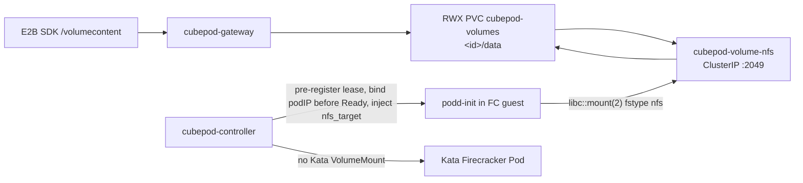

# CEP-0031: Firecracker NFS Transport for Official E2B Volumes

| Stage | Status | Created | Updated | Owning Area |
| :--- | :--- | :--- | :--- | :--- |
| `beta` | `implemented` | `2026-11-22` | `2026-11-23` | `storage` (`controller`, `runtime`, `egress`, `gateway`) |

## Table of Contents

- [Release Signoff Checklist](#release-signoff-checklist)
- [Summary](#summary)
- [Motivation](#motivation)
  - [Goals](#goals)
  - [Non-Goals](#non-goals)
- [Proposal](#proposal)
  - [User Stories](#user-stories)
  - [Notes / Constraints / Caveats](#notes--constraints--caveats)
  - [Risks and Mitigations](#risks-and-mitigations)
- [Design Details](#design-details)
  - [Runtime Selection](#runtime-selection)
  - [API / CRD / Wire Changes](#api--crd--wire-changes)
  - [Architecture & Data Flow](#architecture--data-flow)
  - [Lease Bootstrapping and Pod IP Binding](#lease-bootstrapping-and-pod-ip-binding)
  - [In-Guest `podd-init` NFS Mount](#in-guest-podd-init-nfs-mount)
  - [Network Reachability and Egress](#network-reachability-and-egress)
  - [Lease Admission and Isolation](#lease-admission-and-isolation)
  - [Filehandle Stability and Alpha HA Limits](#filehandle-stability-and-alpha-ha-limits)
  - [Fork & Lifecycle Semantics](#fork--lifecycle-semantics)
  - [Boundary Conditions & Failure Recovery](#boundary-conditions--failure-recovery)
  - [Fail-Closed Responsibility](#fail-closed-responsibility)
  - [Dual-Runtime Behavior](#dual-runtime-behavior)
  - [Test Plan](#test-plan)
  - [Graduation Criteria](#graduation-criteria)
  - [Upgrade / Downgrade Strategy](#upgrade--downgrade-strategy)
- [Production Readiness Review Questionnaire (PRR)](#production-readiness-review-questionnaire-prr)
- [Implementation History](#implementation-history)
- [Drawbacks](#drawbacks)
- [Alternatives](#alternatives)

---

## Release Signoff Checklist

- [x] Enhancement design documented in `docs/enhancements/0031-firecracker-volume-nfs/`
- [x] Enhancement scope, Goals, and Non-Goals agreed upon and implemented (`PR #158`)
- [x] API / CRD (`pod.cubeplex.ai/v1alpha1`) and E2B-superset OpenAPI changes are specified (no public volume API change; internal `CUBEPOD_VOLUME_MOUNTS` transport fields only)
- [x] Dual-runtime behavior (Kubernetes Kata Firecracker NFS, Kubernetes `kata-qemu` / `kata-clh` virtio-fs, and Local Docker loopback) is defined
- [x] Security boundary (MicroVM isolation, lease-scoped exports, egress exemption, `MS_NOSUID | MS_NODEV`) is reviewed
- [x] Test plan includes unit tests (`cargo test` / `go test`) and real invariant E2E tests (unskip official SDK volume tests on the Firecracker lane)
- [x] Production Readiness Review (PRR) section is complete

---

## Summary

[CEP-0026](../0026-k8s-kata-e2b-volumes/README.md) made official E2B `volumeMounts` work on Kubernetes by backing `/volumecontent` and sandbox mounts with one shared `ReadWriteMany` PVC (`cubepod-volumes`) and staging each volume into the guest via a container `VolumeMount` (`subPath: <volumeID>/data` at `/run/cubepod/volumes/<volumeID>`). That path depends on the runtime sharing the host directory into the guest as a live filesystem: `kata-qemu` and `kata-clh` do this with virtio-fs; runc and Docker do it with a bind mount.

Kata Firecracker does not implement virtio-fs. Its `FilesystemShare.ShareFile` copies the host directory into the guest once at container creation and never writes changes back. Official SDK volume tests therefore look green inside a running Firecracker sandbox and lose every write when the VM is destroyed ([issue #122](https://github.com/cubeplexai/cubepod/issues/122)).

This CEP keeps CEP-0026's RWX PVC as the single source of truth and adds a **Firecracker-only** transport: a userspace NFSv3 proxy running *outside* the MicroVM exports the volume `data/` directory, and the injected `podd-init` binary mounts it in the guest with `libc::mount(2)` (fstype `nfs`). It must not exec `mount.nfs` or any other helper from the user image. Gateway `/volumecontent`, concurrent sandboxes, and fork inheritance do not change. The design follows official E2B's `nfsproxy` approach, adapted to CubePod's cluster-wide RWX PVC and zero-trust egress. It does not add a virtio-blk device, so it does not depend on [issue #120](https://github.com/cubeplexai/cubepod/issues/120).

---

## Motivation

On Kata Firecracker, `applyVolumeMounts` in `pkg/controller/manifests.go` still attaches the shared RWX PVC as a container `VolumeMount`. The host kubelet sees a normal mount, but Kata's Firecracker filesystem share is a one-way copy ([`fs_share_linux.go` in Kata 4.4.0](https://github.com/kata-containers/kata-containers/blob/4.4.0/src/runtime/virtcontainers/fs_share_linux.go#L317-L430)). `podd-init` then bind-mounts that copy onto the target path. Guest writes never reach the PVC, so `Volume.write_file` from a later sandbox or `GET /volumecontent` after destroy does not observe them. The same official volume tests pass on runc, Compose, and Kata Cloud Hypervisor.

A raw `volumeMode: Block` attachment would conflict with CEP-0026 Non-Goal 3 (gateway and multiple sandboxes need concurrent file access) and would add another virtio-blk hotplug, which is the class of bug tracked by issue #120 (`/dev/vdb` EIO). A destroy-time copy-back is racy, loses data on crash, and cannot serve two sandboxes at once.

Official E2B solved the same Firecracker gap by *not* using virtio-fs or virtio-blk for volumes. Volume bytes live in a host directory; a userspace NFS proxy (`packages/orchestrator/pkg/nfsproxy`, `github.com/willscott/go-nfs`) listens on a single TCP port; the guest mounts `<orchestrator-ip>:/<lifecycleID>/<volumeName>` with NFSv3 `hard,sync` options. CubePod should do the equivalent, with the RWX PVC in place of E2B's per-host directory tree.

### Goals

1. **Persistent official volumes on Firecracker**: After `Volume.create` -> `Volume.write_file` -> `Sandbox.create(volume_mounts=...)` -> in-guest write -> sandbox destroy -> new sandbox with the same volume, both the new guest and `/volumecontent` observe the bytes.
2. **Preserve CEP-0026 concurrency**: The volume store remains the shared RWX PVC. Multiple Firecracker sandboxes, qemu/CLH sandboxes, gateway replicas, and `/volumecontent` may read and write the same volume at the same time.
3. **No additional virtio-blk hotplug**: Official volumes must not be attached as Kata `volumeDevices` or extra block disks on Firecracker.
4. **Fail closed**: If the NFS transport is unavailable or the mount fails, sandbox create fails with a structured error. CubePod must never again boot a Firecracker sandbox against a one-way copy and silently drop writes.
5. **No API divergence**: Official E2B volume routes and SDK `volumeMounts` stay unchanged. qemu, Cloud Hypervisor, runc, and Compose keep the CEP-0026 / CEP-0025 transports.
6. **Re-enable Firecracker volume E2E**: Python `test_volume_mount_persistence` and TypeScript `volume mounts survive destruction and recreation` pass with zero `#122` skips on the Kata Firecracker lane.

### Non-Goals

1. **Fixing issue #120**: The Firecracker virtio-mmio block hotplug race for `/dev/vdb` (workspace / rootfs) is out of scope. This transport must not wait on that fix.
2. **Changing the official volume API or on-disk store layout**: `meta.json`, `attrs.json`, and `<volumeID>/data/` stay as in CEP-0025 / CEP-0026.
3. **Raw Block CSI for official E2B volumes**: Still rejected, for the same concurrent-access reason as CEP-0026 Non-Goal 3.
4. **Using NFS on qemu, Cloud Hypervisor, runc, or Docker**: Those runtimes already have a live filesystem share.
5. **Destroy-time or pause-time copy-back** of guest trees onto the PVC.
6. **Per-file POSIX ACL translation** inside the guest (same as CEP-0026 Non-Goal 1). Ownership remains `1000:1000`.
7. **Implementing NFSv4 or a kernel NFS server**: The first implementation is a userspace NFSv3 proxy on one TCP port, matching official E2B.
8. **A second identity protocol for SNAT clusters in Alpha**: Source-IP admission requires the cluster to preserve Pod-to-ClusterIP source addresses. Alpha does not add a substitute client-authentication scheme.

---

## Proposal

Leave official volume bytes on the existing cluster-wide RWX PVC `cubepod-volumes`. Introduce a new component, `cubepod-volume-nfs`, that mounts that PVC and serves a userspace NFSv3 proxy (same protocol family as E2B's `nfsproxy`: `github.com/willscott/go-nfs`, MOUNT and NFS on a single TCP port, default `2049`).

On Firecracker only, `cubepod-controller` must **not** add a Kata container `VolumeMount` for the official volume (that path is still the dead copy). Before `EnsurePod`, it pre-registers a lease with the proxy and writes an NFS target into `CUBEPOD_VOLUME_MOUNTS` / `/etc/cubepod/volume-mounts.json`. The injected `podd-init` creates the target directory and issues `libc::mount(2)` with fstype `"nfs"` into the pre-`pivot_root` merged root (or onto the target path when `CUBEPOD_SKIP_PIVOT=1` is not used for Firecracker). It must not invoke `mount(8)` / `mount.nfs` from the user image.

Because CubePod already stores volumes on a cluster-wide RWX PVC, the proxy does not have to run on the same node as the sandbox (unlike E2B's host-local directories). A Deployment that mounts `cubepod-volumes`, plus a `ClusterIP` Service (`cubepod-volume-nfs`), is the default. Export paths are lease-scoped (`/<leaseID>/<volumeID>` maps only to `<volumesDir>/<volumeID>/data`) so a reused Pod IP cannot inherit a stale mount, and so the guest never sees sibling tenants, `meta.json`, or `attrs.json`.

The NFS server cannot be a sidecar in the same Kata Pod: every container in a Kata Pod shares one VM, so a sidecar would still be inside the guest and could not export the host PVC.

### User Stories

1. **As an E2B SDK user on a Kata Firecracker cluster**, I can attach a volume with `Sandbox.create(volume_mounts=...)`, write files in the guest, destroy the sandbox, start a new one with the same volume, and read those files again, just as I do on Cloud Hypervisor or Docker.
2. **As a CubePlex operator**, I keep one RWX volume store and one `/volumecontent` path across qemu, Cloud Hypervisor, and Firecracker. Enabling Firecracker does not require a second volume provisioner.
3. **As a security reviewer**, a Firecracker guest can mount only the lease it was issued, cannot traverse into other tenants' `data/` directories, and cannot use the volume as a `setuid` or device backdoor (`nosuid,nodev`). NFS to the proxy is an explicit egress exemption, not a general hole in zero-trust policy.

### Notes / Constraints / Caveats

- **No filesystem share on Firecracker**: Kata Firecracker's `Capabilities()` expose block hotplug only. Any official volume still listed in the Pod's `spec.containers[].volumeMounts` will be copied once and then diverge from the PVC. The controller must omit those `VolumeMounts` on Firecracker.
- **NFS server placement**: `cubepod-volume-nfs` runs as a cluster Deployment (or, optionally, a DaemonSet) in the CubePod namespace, not in the sandbox Pod. It mounts the same RWX PVC the gateway uses (`CUBEPOD_VOLUMES_DIR`).
- **Guest kernel NFS client and in-kernel MOUNT RPC**: The Firecracker guest kernel must provide NFSv3 (`CONFIG_NFS_FS`, `CONFIG_NFS_V3`, SunRPC, and the in-kernel mount client in `fs/nfs/mount_clnt.c`). A text `mount(2)` with fstype `"nfs"` and an `addr=` option leaves `need_mount=true`; the kernel then issues `MOUNTPROC3_MNT` to obtain the export filehandle (`nfs_request_mount` / `nfs_try_get_tree` in `fs/nfs/super.c`). This is the intended path. It is an [implementation gate](#in-guest-podd-init-nfs-mount): it must be proven on the actual Kata Firecracker guest kernel. Kata Firecracker E2E must preflight the NFS client (for example, `grep nfs /proc/filesystems`) and fail clearly if it is missing.
- **No user-image NFS helpers**: `images/sandbox-base` and `images/desktop` do not install `nfs-common`. Arbitrary user OCI images must keep working. `podd-init` is injected at `/opt/cubepod/bin` (AGENTS.md Invariant 2) and must not exec `/sbin/mount.nfs` or `mount -t nfs` from the user image.
- **Zero-trust egress (current vs. intended)**: Today `images/egress/egress-init.sh` only redirects TCP/UDP `53` and TCP `80`/`443` in `output_nat`, and `output_filter` is `policy accept` (it only rejects UDP `443`). `DefaultAction == Deny` is enforced in the HTTP/HTTPS/DNS proxy (`pkg/egress`), not by dropping TCP `2049` in nftables. The NFS exemption is still required so a later default-drop filter, or any redirect of port `2049`, cannot break mounts. The exemption is destination-prefixed to the `cubepod-volume-nfs` ClusterIP and NFS port, not scoped to sandbox UIDs. Linux kernel NFSv3 client sockets (`rpciod`) originate with `skuid 0`, not the sandbox user (`1000`).
- **Pod-to-ClusterIP source IP preservation**: Lease admission compares the NFS client source IP with the bound `podIP`. Some CNI / `kube-proxy` setups (`masquerade-all`, same-node hairpin) SNAT Pod-to-ClusterIP traffic to the node IP and would fail that check. This is a cluster networking prerequisite. See [Lease Admission and Isolation](#lease-admission-and-isolation).
- **NFS on top of NFS**: Some RWX StorageClasses (Longhorn RWX, NFS CSI) already use NFS under the PVC mount. The proxy re-exports that local mount. `sync` / `noac` on the guest mount reduce double-cache surprises. This is accepted; it is still a live share, not a copy.
- **Single-threaded `podd-init`**: All NFS mounts run synchronously on the main thread before `pivot_root(2)` (AGENTS.md Invariant 2). Retry/timeout policy lives in `podd-init`, not in a user-image `mount.nfs`.
- **Reserved paths and ownership**: Existing lexical reserved-path checks, `1000:1000` ownership, and `nosuid,nodev` still apply.
- **Alpha filehandle / HA limits**: A process restart of `cubepod-volume-nfs` can `ESTALE` active mounts. Alpha is single-replica and does not promise transparent failover. See [Filehandle Stability and Alpha HA Limits](#filehandle-stability-and-alpha-ha-limits).

### Risks and Mitigations

| Risk | Impact | Mitigation |
| :--- | :--- | :--- |
| Controller still attaches a Kata `VolumeMount` on Firecracker | Silent data loss (issue #122 again) | Firecracker pod build omits official-volume `VolumeMounts`; unit tests assert the omission; E2E destroy/recreate must observe guest writes on the PVC, not only inside one VM. |
| Lease registered only after `EnsurePod` returns | Start deadlock or first-start CrashLoop: `EnsurePod` waits for Ready, Ready needs the NFS mount, the mount needs a bound lease | Pre-register the lease before `EnsurePod`. Bind `podIP` on the first observation of `status.podIP`, still inside the existing `waitForPodRunning` poll and **before** Ready. Fail closed while `podIP` is empty. Revoke on failure. |
| Guest `mount(2)` cannot complete MOUNT RPC / filehandle negotiation | Feature cannot work; easy to mis-specify as “just swap `mount -t nfs` for a syscall” | Implementation gate on the real Firecracker guest kernel, without `nfs-common`. In-kernel `MOUNTPROC3_MNT` is the primary path; an embedded MOUNT client inside injected `podd-init` is the only fallback. Never exec user-image `mount.nfs`. |
| Guest reaches the NFS proxy as a general egress hole | Sandbox can speak NFS to unintended addresses | nftables exemption is destination-prefixed to the `cubepod-volume-nfs` ClusterIP and port, matching `skuid 0` kernel sockets; the Service is `ClusterIP` only (no NodePort / LoadBalancer); NetworkPolicy allows sandbox Pods to that Service on TCP `2049` only. |
| Stale lease after Pod IP reuse | Sandbox A mounts Sandbox B's volume | Export path includes a per-start unguessable `leaseID`; MOUNT is admitted only for a live lease, an allow-listed `volumeID`, and a bound `podIP`. Source IP is an additional check, not a complete identity guarantee. The lease is revoked on Pod delete / pause. |
| Guest escapes the export into `<volumesDir>` | Cross-tenant read/write | Proxy chroots each export to `<volumesDir>/<volumeID>/data` (E2B `chrooted.Builder` pattern). `/`, `meta.json`, `attrs.json`, and sibling IDs are not exported. |
| NFS mount fails but sandbox still starts | Empty target dir looks like a successful mount | `podd-init` fails fast with a non-zero exit if `libc::mount(2)` fails or the target is not an NFS mount before `pivot_root`. |
| `DefaultAction == Deny` or a hardened `output_filter` drops NFS | Sandbox CrashLoop | Controller injects the Service **ClusterIP** (not a DNS name) into `nfs_target`. Egress exemption is by destination address and port, installed with the sidecar. |
| CNI SNATs Pod-to-ClusterIP traffic | Every MOUNT is denied | Document source-IP preservation as a prerequisite. Alpha fails closed on SNAT clusters rather than weakening admission. |
| Proxy process restart or multi-replica failover | `ESTALE` on existing filehandles; `hard` does not recover | Alpha: single replica; document restart as a breaking event for active mounts. Beta: deterministic, stateless filehandles plus shared lease state. |
| Guest kernel has no NFS client | Feature cannot work | E2E preflight fails the lane with an explicit message; this is a kernel/config bug, not a skip of the volume tests. |

---

## Design Details

### Runtime Selection

Treat a sandbox as Firecracker when any of the following is true:

- `PodTemplateSpec.RuntimeClassName` or the resolved RuntimeClass is `kata-fc` or `kata-fc-e2e`
- The RuntimeClass has label `cubepod.io/hypervisor: firecracker` or handler `kata-fc` / `kata-fc-e2e`

Production should gain a first-class `kata-fc` RuntimeClass next to `kata-qemu` and `kata-clh` in `deploy/k8s/kata/runtimeclasses.yaml`. The E2E name `kata-fc-e2e` must be recognized as well.

All other Kata and runc classes keep the CEP-0026 bind / virtio-fs path.

### API / CRD / Wire Changes

The public E2B volume API and `PodBoxSpec.VolumeMounts` (`volumeID`, `path`, `subPath`, `pvcName`) do not change.

`CUBEPOD_VOLUME_MOUNTS` / `/etc/cubepod/volume-mounts.json` entries gain an optional transport. Existing bind/virtio-fs entries stay valid. One sandbox start may carry multiple official volumes; each entry has its own `nfs_target` under the same `leaseID`.

```json
[
  {
    "volume_id": "0123456789abcdef0123456789abcdef",
    "target_path": "/data",
    "transport": "nfs",
    "nfs_target": "10.96.10.20:/<leaseID>/0123456789abcdef0123456789abcdef"
  },
  {
    "volume_id": "aaaaaaaaaaaaaaaaaaaaaaaaaaaaaaaa",
    "target_path": "/models",
    "transport": "nfs",
    "nfs_target": "10.96.10.20:/<leaseID>/aaaaaaaaaaaaaaaaaaaaaaaaaaaaaaaa"
  }
]
```

Rules:

- `transport` omitted or `"bind"`: current CEP-0026 behavior; `staging_path` must be `/run/cubepod/volumes/<volumeID>`.
- `transport: "nfs"`: `nfs_target` is required (`<clusterIP>:/<leaseID>/<volumeID>`); `staging_path` must be omitted; `podd-init` must not expect a host staging directory.
- Unknown `transport` is a hard error.
- On Firecracker, the controller MUST emit `transport: "nfs"` for every official volume and MUST NOT attach the corresponding PVC as a container `VolumeMount`.
- On qemu / CLH / runc, the controller MUST NOT emit `transport: "nfs"`.

Feature gate: `FirecrackerVolumeNFS` (Helm `volumes.nfs.enabled`). When official `volumeMounts` are requested on Firecracker and the gate is off or the NFS Service is not ready, create **fails closed**. [Fail-Closed Responsibility](#fail-closed-responsibility) defines which component decides and how the SDK sees the error.

Helm adds a `cubepod-volume-nfs` Deployment + `ClusterIP` Service in the CubePod namespace, mounting `volumes.pvcName` at `CUBEPOD_VOLUMES_DIR`. Default listen port is `2049`. Alpha defaults to a single replica.

Internal lease API (not published on the official E2B surface; reachable only from the controller in-cluster):

- `PUT /leases/{leaseID}` `{volumeIDs, podName, podBoxName, podIP?}` — create or refresh the lease. `volumeIDs` is an array: one `leaseID` is issued per sandbox start (create or resume) and covers every official volume on that start. `podIP` may be omitted or empty at pre-registration.
- `PUT /leases/{leaseID}` (same schema, with `podIP` set) — bind or refresh the Pod IP once it is known, still before Ready.
- `DELETE /leases/{leaseID}` — revoke every export under that lease

A singular `{volumeID, ...}` body is invalid. The proxy must not overwrite one volume with another under the same `leaseID`.

### Architecture & Data Flow



### Lease Bootstrapping and Pod IP Binding

This sequence exists to break a deadlock against the current controller. `cmd/cubepod-controller` and `cmd/cubepod-gateway` construct `RESTKubeClient` with `WithWaitForRunning(true)`. `EnsurePod` then calls `waitForPodRunning`, which polls until `phase == "Running" && ip != "" && ready == true` (default 60s) before returning. `podd-init` must finish the NFS mount and exec `podd` before the Pod becomes Ready. The lease therefore cannot be registered only after `EnsurePod` returns a `podIP`.

Required order:

1. **Pre-register**, before `EnsurePod`. The controller generates an unguessable `leaseID` and `PUT`s `{volumeIDs, podName, podBoxName}` with `podIP` empty. The Service ClusterIP is already known, so the Pod manifest can carry a complete `nfs_target` at create time.
2. **Call `EnsurePod`** with the existing synchronous `waitForRunning=true` contract.
3. **Bind `podIP` before Ready.** Extend the existing `waitForPodRunning` poll (or a thin wrapper used for Firecracker volume creates) with a synchronous `onPodIP` hook: the first time `getPodStatus` observes `ip != ""`, update the lease with that `podIP`, then continue polling until Ready. This is implementable without a second informer and without changing the external blocking semantics of `EnsurePod`. A concurrent Pod watch started before `EnsurePod` is an acceptable equivalent only if it is guaranteed to publish `podIP` to the lease before Ready, and is cancelled and cleaned up when `EnsurePod` fails.
4. **`podd-init` may race the bind.** It retries `libc::mount(2)` with a short interval until a deadline (about 30s, long enough for IP assignment plus the hook, not the multi-minute `mount.nfs` retry loop). It then exits non-zero. It must not assume the lease is already bound on the first attempt.
5. **Fail closed on an empty `podIP`.** The proxy must deny `MOUNT` while the lease exists but `podIP` is unbound. It must not admit on `leaseID` alone.
6. **Failure cleanup and TTL.** If `EnsurePod` fails, the Pod never gets an IP before the wait deadline, or the create is rolled back, the controller `DELETE`s the lease immediately. Unbound leases also expire after a TTL aligned with the `EnsurePod` poll timeout (60s class) so a crashed controller cannot leave a permanent half-open export. Bound leases live until pause or delete; a container CrashLoop after a successful bind may remount with the same `leaseID` and `podIP`.

Do not depend on `waitForPodRunning`'s timeout path (it currently returns `ip, nil` when an IP was seen but Ready was not) or on a CrashLoop restart after `EnsurePod` returns. Those are accidental and are not the bootstrapping design.

### In-Guest `podd-init` NFS Mount

NFSv3 needs a root filehandle for the export path before the NFS protocol can be used. Userspace `mount.nfs` (from `nfs-common` / `nfs-utils`) ordinarily does host resolution, retry/fg policy, and often the MOUNT RPC, then calls `mount(2)`. CubePod cannot rely on that binary being present in an arbitrary user image, and `fg` / `retry=` are userspace policy (on current Linux they are accepted as NFS parameter names but have no kernel semantics; on some kernels they are `EINVAL`). Swapping `Command::new("mount")` for `libc::mount(2)` is therefore not automatically implementable unless the chosen path still performs MOUNT / filehandle negotiation.

**Primary path (intended):** `podd-init` calls `libc::mount(2)` directly:

- source: `<clusterIP>:/<leaseID>/<volumeID>` (the `nfs_target`)
- fstype: `"nfs"`
- flags: `MS_NOSUID | MS_NODEV` (VFS flags; do not depend on `nosuid,nodev` being parsed as NFS data)
- data (kernel NFSv3 text options only):

```text
addr=<clusterIP>,vers=3,proto=tcp,port=2049,mountproto=tcp,mountport=2049,hard,sync,rsize=1048576,wsize=1048576,nolock,noacl,noac,lookupcache=none
```

`addr=` is required: the kernel does not do DNS. `mountport=2049` / `mountproto=tcp` / `port=2049` / `proto=tcp` avoid rpcbind/portmapper. `nolock` avoids NLM. `sync`, `hard`, `noac`, and `lookupcache=none` keep the same durability and coherence rationale as official E2B.

On modern Linux, a text NFS mount leaves `need_mount=true` unless a filehandle was pre-supplied in legacy binary `nfs_mount_data`. `nfs_try_get_tree` then calls `nfs_request_mount` → `nfs_mount()` (`fs/nfs/super.c`, `fs/nfs/mount_clnt.c`) and the kernel issues `MOUNTPROC3_MNT` to obtain the filehandle. `podd-init` does not implement MOUNT RPC itself on this path. This matches the Linux NFS text-mount design: userspace supplies `addr=` and policy; the kernel makes the mountd request.

Retry, foreground vs background, and protocol fallback stay in `podd-init` (single-threaded, short deadline). Do not pass `fg`, `bg`, or `retry=` as mount data.

**Implementation gate:** Before `FirecrackerVolumeNFS` may be enabled on a Firecracker lane, implementation must demonstrate one of the following on the *actual* Kata Firecracker guest kernel, using a user image that does not contain `nfs-common`, `nfs-utils`, or `/sbin/mount.nfs`:

1. **Preferred:** the primary `libc::mount(2)` text path succeeds, `/proc/mounts` shows `nfs` or `nfs3` with `nosuid,nodev` on the target, and a write is visible on the PVC.
2. **Fallback only if (1) fails** on that kernel (stripped config, missing in-kernel mount client, or `EINVAL` / `EOPNOTSUPP` / `EPROTONOSUPPORT`): `podd-init` (or a helper shipped next to it under `/opt/cubepod/bin` and injected with `podd-init`) embeds a minimal MOUNT v3 client, issues `MOUNTPROC3_MNT` on TCP port 2049, and passes the returned filehandle into `mount(2)`. This is still CubePod-injected code. It is not a license to exec a helper from the user image.

Until one of those two paths is proven, the gate stays off and Alpha graduation is not met. Existing volume bind mounts in `crates/podd-init` already use `libc::mount(2)`; this transport must do the same for the VFS call, plus the NFSv3 negotiation above.

For each `transport: "nfs"` entry, after reserved-path validation and before `pivot_root(2)`:

1. `mkdir` the target under the merged root and `chown 1000:1000`.
2. Retry `libc::mount(2)` as specified until success or the deadline.
3. Confirm the mount is type `nfs` (or `nfs3`) in `/proc/mounts`; otherwise fail.
4. Continue with existing `pivot_root` propagation so the NFS mount survives into the sandbox root.

### Network Reachability and Egress

- `nfs_target` uses the Service **ClusterIP**, so the mount does not depend on CoreDNS during `podd-init`.
- The Firecracker guest already owns the Pod's network (Kata assigns the Pod interface to the VM), so the ClusterIP is reachable if cluster routing works for other in-guest traffic.
- `cubepod-egress` must install a narrow exemption: TCP to `<ClusterIP>:<nfs-port>` is not redirected and is not dropped, including when `output_filter` is later hardened to a default-drop and when `DefaultAction == Deny`. The match is the destination address and port. It must not be scoped to the sandbox user UID, because kernel NFS sockets use `skuid 0`. DNS and HTTP/HTTPS policy are otherwise unchanged.
- Today's `egress-init.sh` would already allow TCP `2049` because `output_filter` is `policy accept` and `2049` is not redirected. The exemption is still specified so a future hardening cannot silently break mounts, and so tests can lock the intended rule.
- The Service must not be exposed outside the cluster. NetworkPolicy: ingress to `cubepod-volume-nfs` on TCP `2049` only from sandbox Pods (and the controller to the lease API on a **different** port, never `2049`).

### Lease Admission and Isolation

`leaseID` is a new unguessable identifier per sandbox *start* (create or resume), not the stable volume ID and not a recycled Pod name alone. One lease lists every official `volumeID` mounted on that start.

On `MOUNT /<leaseID>/<volumeID>` the proxy admits the request only if all of the following hold:

1. A live lease with that `leaseID` exists.
2. The requested `volumeID` is in the lease's `volumeIDs` allow-list.
3. The lease's `podIP` is bound (non-empty). An unbound lease is a hard denial.
4. The client source IP equals the bound `podIP`. This check is applied when the cluster preserves Pod-to-ClusterIP source IPs; it is a complementary control, not a complete identity guarantee.
5. The export path has exactly two components and the volume ID is a valid 32-hex official volume ID.

Otherwise it returns a MOUNT denial and increments `cubepod_volume_nfs_export_denials_total`. The handler then chroots to `<CUBEPOD_VOLUMES_DIR>/<volumeID>/data`. AUTH_UNIX credentials are accepted but files on disk remain `1000:1000` as in CEP-0026.

Identity is the unguessable `leaseID` plus the `volumeIDs` allow-list, with source-IP binding once the controller has published the Pod IP from the API server. Knowing or guessing a lease path is not enough: the lease must exist, the volume must be allow-listed, and `podIP` must already be bound.

**Source IP and SNAT.** Some CNI / `kube-proxy` setups SNAT Pod-to-ClusterIP traffic to the node IP, which breaks check (4). Operators must keep source IP preservation for this traffic (a cluster networking prerequisite, recorded in the PRR). Alpha on clusters that cannot preserve source IPs must fail closed (mounts denied, sandbox create fails) rather than skip the source-IP check or treat `leaseID` as sufficient alone. A substitute client-authentication scheme is a Non-Goal for v0.8.0 Alpha.

### Filehandle Stability and Alpha HA Limits

`github.com/willscott/go-nfs` default `nfshelper.NewCachingHandler` stores filehandle mappings in an in-memory map. A process restart, a rollout that replaces the process, or load-balancing a client to another replica returns `NFS3ERR_STALE` (`ESTALE`) for existing filehandles. A `hard` mount does not recover from `ESTALE`. Shared lease state is not enough: the filehandle map must also be deterministic or shared.

Alpha (`v0.8.0`) therefore:

- Runs a **single** `cubepod-volume-nfs` replica.
- Does **not** claim that `hard` mounts only stall briefly across a proxy restart. If the same process pauses and resumes in memory, in-flight RPCs may stall and continue. If the process is replaced, active mounts go `ESTALE` and the sandbox must be remounted (CrashLoop restart of `podd-init` is not sufficient once the filehandle is stale; a new sandbox start or an explicit remount after a new lease bind is required). Pause/resume already creates a new Pod, a new lease, and a new mount, which is the supported recovery path.
- Does not run multiple Service backends for this component.

Beta must specify deterministic, stateless filehandle encoding (or equivalently durable shared filehandle state) *and* shared lease state before horizontal replicas are allowed. Until that is designed and tested, “any replica can serve any lease” is not a supported claim.

### Fork & Lifecycle Semantics

- **Shared mutable volume** (unchanged): `ForkFrom` inherits `VolumeMounts` by reference; the child gets its own `leaseID` and its own NFS mounts of the same `<volumeID>/data` directories. There is no CoW clone of official volumes.
- **Pause**: CubePod pause tears down the Pod and keeps store data on the RWX PVC. The lease is revoked. Resume creates a new Pod, a new lease, and a new `podd-init` NFS mount.
- **Kill / delete**: Lease revocation is part of PodBox cleanup. Volume data remains until `Volume.delete`.
- **Concurrent mounts**: Two Firecracker sandboxes, or one Firecracker and one qemu sandbox, may write the same volume. POSIX coherence is whatever the RWX StorageClass already provides for CEP-0026, plus `noac` on the NFS client.

### Boundary Conditions & Failure Recovery

- **NFS mount failure**: `podd-init` exits non-zero; the Pod does not become Ready. The create path fails closed and the gateway surfaces a JSON error (`code` + `message`). The pre-registered lease is revoked.
- **Proxy down at create time**: Retries exhaust, then the same fail-closed path.
- **Proxy process restart while a sandbox is running (Alpha)**: Existing filehandles may go `ESTALE`. This is a documented Alpha degradation, not a silent stall-and-resume. Recovery is a new start or pause/resume (new lease, new mount).
- **Gateway restart**: Unaffected; `/volumecontent` still talks to the PVC, not to NFS.
- **Unclean VM kill**: Writes that reached the proxy with `sync` are on the PVC; unsynced unwritten pages are lost, same as a hard host crash. No copy-back is attempted.
- **Missing staging directory**: Does not apply to `transport: "nfs"`. A leftover bind `staging_path` on Firecracker is a controller bug and must fail tests.

### Fail-Closed Responsibility

The **controller** decides fail-closed for Firecracker official volumes. It already resolves the effective RuntimeClass (`PodTemplate` / `defaultRuntimeClass`) and can inspect whether `FirecrackerVolumeNFS` is on and whether the `cubepod-volume-nfs` Service has ready endpoints. It must refuse to create the Pod (and must not attach a Kata `VolumeMount` fallback) when the gate is off or the Service is not ready.

The **gateway** does not need to watch NFS Service endpoints or resolve RuntimeClass itself. When the controller (or the synchronous create path the gateway already calls) fails closed, the gateway returns the structured E2B JSON error (`{"code": <status int>, "message": "..."}`, AGENTS.md / CEP-0021). That is the SDK-visible surface, not a second policy engine in `pkg/gateway`.

### Dual-Runtime Behavior

| Runtime | Official volume transport | Notes |
| :--- | :--- | :--- |
| Local Docker / Compose (CEP-0025) | Bind mount of `<stateDir>/volumes/<id>/data` | Unchanged |
| Kubernetes runc (`RuntimeClass` empty / `none`) | PVC `subPath` at the target (and/or staging + `podd-init` bind) | Unchanged CEP-0026 `mountDirect` |
| `kata-qemu`, `kata-clh` | PVC `subPath` staging + virtio-fs + `podd-init` bind | Unchanged CEP-0026 |
| `kata-fc` / `kata-fc-e2e` | No Kata `VolumeMount`; `podd-init` `libc::mount(2)` fstype `nfs` | This CEP |

### Test Plan

- **Unit tests**:
  - `pkg/controller`: Firecracker pod manifests omit official-volume `VolumeMounts`, include `transport: "nfs"` and a ClusterIP `nfs_target` for every official volume, and still attach rootfs/workspace block devices as today. qemu/CLH manifests are unchanged. Multi-volume starts emit one `leaseID` and a `volumeIDs` array, not a singular `volumeID` body.
  - `pkg/controller` bootstrapping: the `onPodIP` hook (or equivalent watch) runs when `ip != ""` and **before** Ready; a lease is pre-registered with empty `podIP` before `EnsurePod`; `EnsurePod` failure / IP timeout / rollback deletes the lease; unbound leases expire by TTL. Tests must not treat “wait for `EnsurePod` to return, then register” as correct.
  - `crates/podd-init`: parse `transport: "nfs"`; reject missing `nfs_target`; reject NFS entries that also set a bind `staging_path`; reserved-path overlap still fails; bind entries without `transport` still work. The NFS mount path calls `libc::mount(2)` with fstype `"nfs"` and the kernel option set above; it does not exec `mount` / `mount.nfs`. Retries are implemented in `podd-init` and then fail closed.
  - `pkg/volumenfs` (or equivalent; planned package, not yet in-tree): MOUNT admitted only for a matching live lease, allow-listed `volumeID`, bound `podIP`, matching source IP, and two-component path; unbound (`podIP` empty) and unknown `volumeID` are denied; chroot cannot `LOOKUP` `../`; stale lease after revoke is denied; metrics increment on denial.
  - `pkg/egress`: exemption matches destination `<ClusterIP>:<nfs-port>` and allows `skuid 0`; `DefaultAction == Deny` still denies other destinations on 2049; the rule is not UID-scoped to `1000`.
- **Integration / E2E** (implementation follow-up, not this documentation PR):
  - **Implementation gate:** on the Kata Firecracker guest kernel, with a user image that has no `nfs-common` / `mount.nfs`, a sandbox with the gate enabled mounts NFSv3 via `podd-init` and persists writes. This must be observed before the gate is turned on in CI.
  - Kata Firecracker lane: remove the `#122` documented skips for Python `test_volume_mount_persistence` and TypeScript `volume mounts survive destruction and recreation`. Both must pass with zero skips, including a write that is visible to `/volumecontent` and to a second sandbox after destroy. Assert `/proc/mounts` shows `nfs` and `nosuid,nodev` on the target. Strict cleanup still applies. Also cover two official volumes on one sandbox.
  - The same tests remain mandatory (and unskipped) on runc, Compose, and Cloud Hypervisor.
  - Guest preflight fails the Firecracker lane if the kernel cannot mount NFS, rather than skipping the volume tests.
  - Issue #120 may still skip unrelated workspace-block cases; volume tests must not be tied to those skips.

This documentation PR does not run those runtime tests.

### Graduation Criteria

- **Alpha (`v0.8.0`)**: Behind `FirecrackerVolumeNFS` (default `false` until the implementation gate, NFS Service, and guest kernel preflight are in place). Unit tests passing. A Firecracker sandbox with the gate enabled mounts NFS and persists writes on a dev cluster. Honest Alpha limits: single proxy replica; proxy process restart may `ESTALE` active mounts; source-IP preservation is required; unbound leases fail closed. The feature is not “implementable” until this CEP is approved.
- **Beta (`v0.8.0`)**: Gate auto-enabled when `volumes.rwxStorageClassName` is set and the `cubepod-volume-nfs` Service is deployed. Official Python and TypeScript volume persistence tests pass on the Kata Firecracker CI lane with zero `#122` skips, including an image without `nfs-common`. qemu / CLH / runc / Compose volume tests remain green. Egress exemption verified under `DefaultAction == Deny` and with kernel NFS `skuid 0`. Deterministic/stateless filehandles (or equivalent) are specified and tested before any multi-replica deployment.
- **GA (`v1.0.0`)**: Production bake time in CubePlex, capacity metrics and alerts in use, and no silent-copy regressions.

### Upgrade / Downgrade Strategy

- Existing `PodBox` objects without Firecracker `volumeMounts` are unchanged.
- Setting `FirecrackerVolumeNFS=false` (or removing the NFS Service) rejects *new* Firecracker creates that request `volumeMounts`. Running Firecracker Pods keep their NFS mounts until they pause or stop. qemu / CLH / Docker mounts are unaffected.
- Downgrade to a controller that does not understand `transport: "nfs"` must not be rolled out while Firecracker volume Pods are still starting; older `podd-init` would ignore the field and look for a staging directory that the new controller no longer attaches. Roll `podd-init` first, or disable the gate, before a downgrade.
- `/workspace` and `rootfs-upper` PVCs are not modified by this CEP.

---

## Production Readiness Review Questionnaire (PRR)

- **Feature Enablement and Rollback**: Feature gate `FirecrackerVolumeNFS` and Helm `volumes.nfs.enabled`. Disabling the gate does not unmount the RWX PVC from the gateway and does not touch `/workspace`.
- **Rollout, Upgrade and Rollback Planning**: Ship `cubepod-volume-nfs` and a `podd-init` that understands `transport: "nfs"` and performs the gated NFS mount path before flipping the gate on. Alpha rollouts of the proxy may `ESTALE` active Firecracker volume mounts; operators should drain or pause those sandboxes first. Mounts must not fall back to a local empty directory.
- **Monitoring Requirements**:
  - Metrics named in `cep.yaml` (`cubepod_volume_nfs_mounts_total`, `cubepod_volume_nfs_mount_errors_total`, `cubepod_volume_nfs_export_denials_total`, `cubepod_volume_nfs_rpc_duration_seconds`, `cubepod_volume_nfs_leases_active`).
  - Structured logs for lease bind, unbound denials, mount failures, and lease TTL expiry.
- **Dependencies**: CEP-0026 RWX PVC; userspace NFSv3 proxy; Firecracker guest kernel NFS client **and** either in-kernel `MOUNTPROC3_MNT` or an embedded MOUNT client in injected `podd-init`; cluster routing from the guest to the Service ClusterIP; Pod-to-ClusterIP **source IP preservation**; CEP-0020 egress exemption hook (destination ClusterIP:port, `skuid 0`).
- **Scalability**: One Service and, in Alpha, a single proxy replica serve all Firecracker volume mounts (O(1) CSI attachments, same as CEP-0026). Cost is per-RPC CPU and network on the proxy, not per-volume PVCs. Horizontal replicas are **not** Alpha-supported, even if lease state is later shared, until filehandles are deterministic or otherwise failover-safe.
- **Troubleshooting**: If a sandbox CrashLoops on volume start, check (1) guest kernel NFS client and the implementation-gate mount path, (2) lease exists and `podIP` is bound, (3) ClusterIP reachability from the guest (`connect` to `:2049`) and source-IP preservation, (4) egress destination exemption, (5) `/proc/mounts` inside a debug guest, (6) proxy logs for `ESTALE` after a rollout. Never "fix" a failed mount by attaching the PVC as a Kata `VolumeMount`.

---

## Implementation History

- **2026-11-22**: Proposal drafted after issue #122 analysis and a read of official E2B `nfsproxy` / `envd` NFS mount behavior. Target milestone `v0.8.0`. Status initially marked `implementable`.
- **2026-11-23**: Returned status to `provisional` and addressed PR #149 review: lease pre-registration and `podIP` bind before Ready under synchronous `EnsurePod`; `volumeIDs` lease API; `libc::mount(2)` plus an explicit NFSv3 MOUNT/filehandle implementation gate (no user-image `mount.nfs`); destination-based egress exemption and `skuid 0`; source-IP / SNAT prerequisite; controller fail-closed with gateway JSON errors; honest Alpha `ESTALE` / single-replica limits.
- **2026-11-24**: Implemented `pkg/volumenfs`, `cmd/cubepod-volume-nfs`, `images/volume-nfs/Dockerfile`, controller/egress/podd-init wiring, Helm `volume-nfs.yaml`, and verified the fail-closed CEP-0031 gate (`test/kata-e2e/verify_cep0031_gate.py`) against pinned guest kernel `6.18.62-cubepod-nfs1` on Kata Firecracker in draft PR #157; enabled `FirecrackerVolumeNFS=true` by default for `v0.8.0` in PR #158.

---

## Drawbacks

- Adds a new cluster component and a network hop, so Firecracker official volumes will typically be slower than virtio-fs on qemu/CLH, especially for small-file metadata.
- Re-exporting an RWX StorageClass that is itself NFS stacks two NFS clients.
- Depends on the Firecracker guest kernel shipping an NFS client and a working MOUNT/filehandle path, which is an extra image/kernel requirement beyond today's block-only path.
- Lease state, source-IP preservation, and egress exemptions add operational surface that bind mounts do not have.
- Alpha proxy restarts can `ESTALE` active mounts.

These are acceptable because the alternative on Firecracker is not a slower live share — it is data loss.

---

## Alternatives

1. **Per-volume virtio-blk (RWO or RWX block) mounted by `podd-init`**: Rejected. Conflicts with CEP-0026 Non-Goal 3 (gateway `/volumecontent` and multiple sandboxes need concurrent file access) and would hotplug another virtio-blk device on Firecracker, overlapping issue #120.
2. **Destroy-time or pause-time copy-back** of the guest tree onto the PVC: Rejected. Racy, loses data on crash or kill `-9`, and cannot express concurrent mounts.
3. **Reject `volumeMounts` on Firecracker** with a structured 4xx/5xx: Acceptable as a fail-closed stopgap if this CEP's gate is off, but not a substitute for v0.8.0 persistence.
4. **NFS server sidecar in the sandbox Pod**: Rejected. Kata Pods share one VM; a sidecar cannot see the host PVC as a server for the guest.
5. **9P, virtio-fs port to Firecracker, or NFS-over-vsock**: Rejected for the first implementation. virtio-fs on Firecracker is not provided by Kata 4.4.0; 9P and vsock transports would need a custom guest client and would not match official E2B. They may be revisited if the NFS path proves inadequate.
6. **Node-local host-network proxy only (verbatim E2B placement)**: Not required as the default, because CubePod's source of truth is already a cluster-wide RWX PVC. A later DaemonSet + `internalTrafficPolicy: Local` optimization is compatible with this CEP but is not needed for correctness.
7. **Exec `mount.nfs` from the user image, or bake `nfs-common` into every sandbox image**: Rejected. Breaks arbitrary OCI images and AGENTS.md Invariant 2.

Official E2B's host-directory + userspace NFSv3 proxy is the model this CEP adapts; the CubePod-specific changes are the RWX PVC, the `ClusterIP` Service, lease-scoped exports, the injected `podd-init` `libc::mount(2)` path (instead of `envd` `/init` or user-image `mount.nfs`), and the zero-trust egress exemption.
