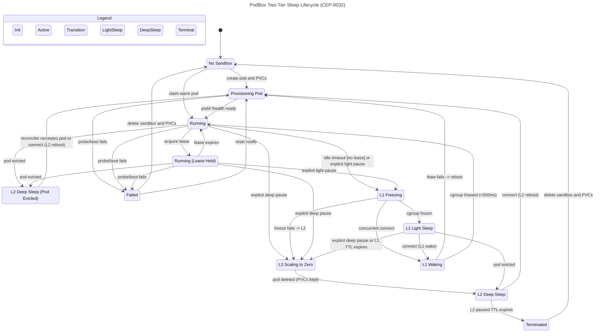

# CEP-0032: Two-Tier Sandbox Sleep (L1 Light Freeze + L2 Scale-to-Zero) and InitContainer-Free `podd` Runtime Injection

| Field | Value |
| :--- | :--- |
| **CEP Number** | `0032` |
| **Status** | `provisional` (`alpha`) |
| **Owning Area** | `controller` (`runtime`, `gateway`, `storage`) |
| **Authors** | @xfgong |
| **Created** | 2026-11-25 |
| **Last Updated** | 2026-11-25 |
| **Tracking Issue** | [cubeplexai/cubepod#162](https://github.com/cubeplexai/cubepod/issues/162) |

<!-- toc -->
- [Release Signoff Checklist](#release-signoff-checklist)
- [Summary](#summary)
- [Motivation](#motivation)
  - [Goals](#goals)
  - [Non-Goals](#non-goals)
- [Proposal](#proposal)
  - [User Stories](#user-stories)
  - [Notes / Constraints / Caveats](#notes--constraints--caveats)
  - [Risks and Mitigations](#risks-and-mitigations)
- [Design Details](#design-details)
  - [Part 1: Two-Tier Sandbox Sleep (`L1 LightPaused` + `L2 DeepPaused`)](#part-1-two-tier-sandbox-sleep-l1-lightpaused--l2-deeppaused)
  - [Part 2: InitContainer-Free `podd` Runtime Injection](#part-2-initcontainer-free-podd-runtime-injection)
  - [API / CRD / Wire Changes](#api--crd--wire-changes)
  - [State Machine & Formal Verification (`/statechart`)](#state-machine--formal-verification-statechart)
  - [Boundary Conditions, Concurrency Races, and Failure Recovery](#boundary-conditions-concurrency-races-and-failure-recovery)
  - [Billing, Metrics, and Lifecycle Events Semantics](#billing-metrics-and-lifecycle-events-semantics)
  - [Dual-Runtime Behavior (K8s Kata vs. Local Docker)](#dual-runtime-behavior-k8s-kata-vs-local-docker)
  - [Test Plan](#test-plan)
  - [Graduation Criteria](#graduation-criteria)
  - [Upgrade / Downgrade Strategy](#upgrade--downgrade-strategy)
- [Production Readiness Review Questionnaire (PRR)](#production-readiness-review-questionnaire-prr)
- [Implementation History](#implementation-history)
- [Drawbacks](#drawbacks)
- [Alternatives](#alternatives)
<!-- /toc -->

---

## Release Signoff Checklist

- [ ] Enhancement scope, Goals, and Non-Goals are agreed upon (`provisional` -> `implementable`)
- [ ] API / CRD (`cubepod.io/v1alpha1`) and E2B-superset OpenAPI changes are specified
- [ ] Dual-runtime behavior (Kubernetes Kata + CSI Block AND Local Docker Loopback) is defined
- [ ] Security boundary (MicroVM isolation, UID/GID privilege separation, read-only runtime binary injection, Egress secret safety) is reviewed
- [ ] Formal state machine verification (`/statechart` TLA+/TLC) completed with zero invariant violations
- [ ] Test plan includes unit tests (`cargo test` / `go test`) and real invariant E2E tests
- [ ] Production Readiness Review (PRR) section is complete

---

## Summary

Today, CubePod implements a single-tier `Paused` state that immediately deletes the sandbox's Kubernetes `Pod` (Scale-to-Zero) while retaining its `RootFS Upper` and `Workspace` PVCs. Even with local NVMe LVM (`cubepod-lvm-block`, zero remote CSI attach), waking a paused sandbox takes **9.2–9.6 seconds** because the cluster must re-create a Pod, run the `podd-installer` `initContainer`, cold-boot the Kata MicroVM (`kata-clh` / `kata-qemu`), run `podd-init` (`e2fsck -p` + `OverlayFS` + `pivot_root`), and pass `podd`'s `/health` probe. On `longhorn-v2-block-thin`, wake latency reaches **11.37 seconds** due to CSI re-attach.

This CEP introduces two complementary optimizations that achieve **sub-500ms wake** for interactive agent idle gaps while retaining full Scale-to-Zero compute reclamation for longer sleeps:

1. **Two-Tier Sleep (`L1 LightPaused` + `L2 DeepPaused`)**:
   - **L1 Light Sleep (`LightPaused`)**: Freezes guest workload compute in-place via Linux **cgroup v2 freezer (`cgroup.freeze = 1`)** inside the `workload` sub-cgroup managed by `podd` (with `SIGSTOP`/`SIGCONT` fallback when cgroupfs is read-only), flushing filesystems (`sync`) while keeping the Pod, MicroVM, RAM state, `PodIP`, and PVC mounts intact. Wake (`POST /v1/lifecycle/unfreeze`) thaws the cgroup in **< 500ms** (typically 20–100ms) with all in-memory processes, servers, and browser tabs preserved.
   - **L2 Deep Sleep (`DeepPaused`)**: After a configurable L1 idle threshold (`lifecycle.lightSleepTTLSeconds`) or explicit `?tier=deep` pause, `cubepod-controller` calls `prepare-stop` and deletes the Pod (reclaiming 100% of node CPU and RAM while retaining RootFS and Workspace PVCs).
2. **InitContainer-Free `podd` Runtime Injection**:
   - Eliminates the per-pod `podd-installer` `initContainer` overhead (~0.8–2.0s per cold create/wake) while strictly preserving Architecture Invariant #2 (never baking `podd-init` or `podd` into user images).
   - Evaluates a node-level `cubepod-podd-agent` DaemonSet with read-only `hostPath` (`/var/lib/cubepod/bin/active` -> `/opt/cubepod/bin:ro`) as the immediate cross-cluster default, alongside Kubernetes OCI `ImageVolume` (`KEP-4639`) as an opt-in mode for K8s `>= 1.33` / `Restricted` PSS clusters, retaining `initContainer` fallback for custom `PodTemplateSpec.poddImage` overrides.

---

## Motivation

Interactive AI coding agents and browser-use workflows (CubePlex workspaces) pause frequently for short intervals—between LLM reasoning turns, waiting on human approvals, or between short user sessions. Paying a **9.2–11.4s** cold VM reboot + CSI re-attach penalty on every short pause degrades agent responsiveness and discards useful in-memory state (dev servers, Jupyter kernels, LSP caches, open browser tabs). Conversely, keeping every idle sandbox running at 100% CPU or holding RAM indefinitely wastes cluster capacity.

Staging benchmark baseline ([issue #162](https://github.com/cubeplexai/cubepod/issues/162)):

| Storage / Runtime Path | Wake Time (Current Scale-to-Zero) | Breakdown |
| :--- | :--- | :--- |
| `cubepod-lvm-block` + `kata-clh` | `9.2 – 9.6s` | ~6–7s Kata CLH MicroVM reboot + `podd-installer` initContainer + `podd-init` + readiness probe |
| `longhorn-v2-block-thin` + `kata-clh` | `11.37s` | ~6–9s CSI volume re-attach + Kata MicroVM reboot + `podd-installer` + readiness |

Meanwhile, every cold Pod boot and L2 resume currently schedules a sequential `podd-installer` `initContainer` (`busybox:1.37-musl`) whose sole purpose is copying two `< 5MB` statically linked Rust binaries (`podd-init`, `podd`) into an `emptyDir` volume. Inside a Kata MicroVM, spawning an extra container adds container lifecycle setup/teardown latency on the critical path of every Pod start.

### Goals

1. **Sub-500ms L1 Wake Latency**: Waking a `LightPaused` sandbox via `POST /sandboxes/{id}/connect` (or implicit `ensureRunning`) completes in **< 500ms** E2E on Kubernetes (`kata-clh` / `kata-qemu`) and Local Docker.
2. **Bounded Node Resource Retention**: L1 Light Sleep drops guest workload CPU to **0%** and automatically demotes to L2 Deep Sleep (`DeepPaused`, Pod deleted, 0 CPU / 0 RAM) once `lightSleepTTLSeconds` expires.
3. **E2B Wire Compatibility**: Official E2B Python and TypeScript SDKs continue seeing `"running"` and `"paused"` in `SandboxInfo.state`, while CubePod-aware callers can inspect `sleepTier` (`"light"` / `"deep"`) and request `?tier=light|deep` on `POST /sandboxes/{id}/pause`.
4. **Eliminate Per-Pod `podd-installer` InitContainer**: Standard sandbox Pods start with `initContainers: []` using node-staged read-only `hostPath` (or opt-in OCI `ImageVolume`), without baking `podd-init`/`podd` into user images.
5. **Formal Lifecycle Correctness**: Verify the full `PodBox` state machine (`Provisioning`, `Running`, `PausingL1`, `LightPaused`, `ResumingL1`, `PausingL2`, `DeepPaused`, `Failed`, `Terminated`, lease locks, eviction, concurrent connect/pause) using TLA+/TLC (`/statechart`).

### Non-Goals

1. **Hypervisor-level VM memory snapshot/restore to object storage (CRIU / Firecracker snapshot-to-S3)**: Out of scope for L1/L2; L1 keeps the live Pod/VM in RAM, and L2 uses PVC persistence + VM reboot.
2. **Dynamic Kubernetes Pod RAM shrink/ballooning during L1**: Kata MicroVMs keep their allocated Pod memory during L1; reclaiming RAM is the explicit job of L1 -> L2 demotion.
3. **Modifying user/template image build contracts**: `images/sandbox-base`, `images/desktop`, and user Dockerfiles remain completely free of `podd` and `podd-init` (Architecture Invariant #2).
4. **Live-migrating L1 Pods across worker nodes**: An L1 Pod remains bound to its scheduled node until demoted to L2.

---

## Proposal

### User Stories

1. **Story 1 (Interactive Agent Session)**: As a CubePlex agent user, when my sandbox goes idle for 2 minutes while I review a PR, it enters L1 Light Sleep. When I send my next prompt, `connect()` wakes the sandbox in **< 500ms** with my Next.js dev server, Python REPL, and Chromium tabs still running in memory.
2. **Story 2 (Cluster Cost & Density Operator)**: As a cluster operator, after a sandbox remains untouched in L1 Light Sleep for `lightSleepTTLSeconds` (e.g., 15 minutes), `cubepod-controller` automatically transitions it to L2 Deep Sleep (deleting the Pod and releasing node RAM/CPU while preserving `/workspace` and RootFS PVCs) so long-idle sandboxes do not pin cluster memory.
3. **Story 3 (Fast Cold Starts & Security Compliance)**: As a platform engineer, I deploy the `cubepod-podd-agent` DaemonSet once per node (or enable OCI `ImageVolume` on K8s >= 1.33), removing `podd-installer` from every sandbox Pod while keeping `/opt/cubepod/bin` read-only and decoupled from user container images.

### Notes / Constraints / Caveats

- **Why In-Guest Workload Cgroup v2 Freezer Instead of Hypervisor Pause (`containerd` CRI `Pause` / QMP `stop`)**:
  - `cubepod-controller` attaches a Kubelet `readinessProbe` (`HTTPGet /health :49983`, `periodSeconds: 1`, `failureThreshold: 60`) to the main `sandbox` container. Freezing the entire Kata VM or the container's root cgroup freezes `podd` itself, causing Kubelet readiness to fail after 60s, flipping Pod `Ready=False`, and breaking EndpointSlices/health monitors.
  - Keeping `podd` unfrozen in `/sys/fs/cgroup/podd` while freezing `/sys/fs/cgroup/workload` (`cgroup.freeze = 1`) puts 100% of user processes, `startCmd`, PTYs, and desktop processes to sleep (0% guest CPU) while `podd` continues answering `/health` (`200 OK`, `"sleep_tier": "L1"`) and accepting instant `/v1/lifecycle/unfreeze` commands over the existing `PodIP`.
- **Guest Wall-Clock Time During L1**: Because the guest Linux kernel remains scheduled (only the `workload` cgroup is frozen), `CLOCK_REALTIME` and `CLOCK_MONOTONIC` advance while processes are frozen. Upon thaw, processes with elapsed sleep/timer deadlines wake immediately.
- **L1 Memory & Quota Footprint**: An L1 `LightPaused` Pod continues to occupy its Kubernetes `Pod` slot, `PodIP`, node memory reservation, Kata `overhead.podFixed` (`128Mi–160Mi`), and CSI block attachments. Clusters MUST size `lightSleepTTLSeconds` (default proposed: `900s`) and per-tenant L1 quotas appropriately.
- **Pod Security Standards (PSS) for `hostPath`**: Sandbox Pods in `volumeMode: Block` already run `privileged: true` inside Kata MicroVMs, requiring `Privileged` namespace PSS. Clusters running unprivileged `runc` `Filesystem` mode under `Restricted` PSS should select `PoddInjectionMode = "image-volume"` (requires K8s `>= 1.33` / `containerd >= 2.0`).
- **Kata Firecracker (`kata-fc`) Read-Only `hostPath`**: As documented in [CEP-0031](../0031-firecracker-volume-nfs/README.md), `kata-fc` lacks `virtio-fs` and copies `VolumeMount` inputs into the guest once at container creation (`FilesystemShare.ShareFile`). Since `/opt/cubepod/bin` is strictly read-only (`podd-init` and `podd` never write to it), a read-only `hostPath` (`type: Directory`) satisfies the same one-time injection semantics without write-back, subject to live `kata-fc` E2E verification before Beta.

### Risks and Mitigations

| Risk | Impact | Likelihood | Mitigation |
| :--- | :--- | :--- | :--- |
| **Out-of-order `freeze`/`unfreeze` RPC race**: Background `ReapIdle` `freeze` arrives at `podd` *after* a concurrent `connect` already thawed the sandbox, leaving a `Running` sandbox silently frozen. | High | Med | **Monotonic `SleepEpoch` fencing** (verified via TLC counterexample): every `Running <-> LightPaused` step increments `PodBoxStatus.SleepEpoch`; `podd` rejects any `freeze(epoch)` where `epoch < current_epoch` with `409 Conflict`. |
| **Stale Gateway cache race across HA replicas**: Gateway A caches `LightPaused` + old `PodIP`, while Controller demoted `LightPaused -> DeepPaused` and deleted the Pod. | High | Med | Gateway acquires per-sandbox lock (`acquireSandboxLock`) and calls `Reconciler.Reconcile(DesiredStateRunning)` first; `Reconcile` reads authoritative `PodBox` state and seamlessly falls back to L2 Pod creation (`DeepPaused -> Provisioning`) if the Pod was deleted. |
| **Pod evicted / OOM-killed while in `LightPaused`** | Med | Med | `Reconcile` / background sync detects missing/Failed Pod for a `LightPaused` box and gracefully demotes `PodBox` to `DeepPaused` (clearing `PodName`/`PodIP`, keeping PVCs intact) instead of leaving it wedged or failing. |
| **L1 `PausedTTLSeconds` premature termination**: Using `PausedAt` (set at L1 entry) for L2 expiration terminates a box immediately upon L1->L2 demotion if `PausedTTLSeconds <= LightSleepTTLSeconds`. | Med | High | Track `LightPausedAt` and `DeepPausedAt` separately. `LightSleepTTLSeconds` measures from `LightPausedAt`; `PausedTTLSeconds` measures from `DeepPausedAt`. |
| **DaemonSet binary upgrade `ETXTBSY` or broken symlinks across `virtiofsd`** | High | Low | `cubepod-podd-agent` stages binaries into `/var/lib/cubepod/bin/active` via temp-file + same-filesystem `rename(2)` (`mv -T`), never host-absolute symlinks. Running Pods hold open inodes cleanly; new Pods open the new inodes. |
| **Unfrozen dirty page cache lost if L1 Pod is forcibly killed** | Med | Low | `podd` executes `libc::sync()` / `syncfs()` on `/workspace` and `/` upperdir *before* freezing `workload/cgroup.freeze = 1`, and `podd-init` retains `e2fsck -p` self-healing on next boot. |
| **Node missing `cubepod-podd-agent` binaries** | Med | Low | `hostPath` uses `type: Directory` (not `DirectoryOrCreate`), failing Pod scheduling/creation clearly with `FailedMount` instead of cryptic `exec` errors; Helm DaemonSet sets `PriorityClassName: system-node-critical` (optional) and readiness probe. |

---

## Design Details

### Part 1: Two-Tier Sandbox Sleep (`L1 LightPaused` + `L2 DeepPaused`)

#### 1.1 In-Guest Cgroup v2 Freezer (`podd-init` & `podd`)

1. **Cgroup Isolation at Boot**:
   - In `podd-init` (or `podd` startup prior to launching `CUBEPOD_START_CMD` and HTTP listener):
     - Detect cgroup v2 unified hierarchy by checking `/sys/fs/cgroup/cgroup.controllers`.
     - Create `/sys/fs/cgroup/podd` and `/sys/fs/cgroup/workload`.
     - Move PID 1 (`podd` itself) into `/sys/fs/cgroup/podd/cgroup.procs`.
     - Every user-facing child process spawned by `podd` (`CUBEPOD_START_CMD`, `POST /v1/commands/run`, `Process/Start` PTY & non-PTY, and `cubepod-desktop-ctl` / `supervisord`) is placed into `/sys/fs/cgroup/workload/cgroup.procs` inside `pre_exec` (async-signal-safe `libc::write` to a pre-opened fd) so even double-forked daemon descendants remain inside `/sys/fs/cgroup/workload`.
   - **Unprivileged / Read-Only Cgroup Fallback**: If `/sys/fs/cgroup` is read-only or cgroup v2 creation returns `EPERM`/`EROFS` (e.g., rootless Docker or unprivileged `runc` without cgroup delegation), `podd` records `freezer_mode = "signal"` and tracks all child PGIDs/PIDs (walking `/proc/<pid>/stat` PPID tree) for `SIGSTOP`/`SIGCONT`.

2. **New `podd` Lifecycle Endpoints (`:49983`)**:
   - `POST /v1/lifecycle/freeze`:
     - Request JSON: `{"epoch": 3, "sync": true, "timeoutMs": 2000}`
     - Behavior:
       1. Acquire `podd` lifecycle mutex. Compare `req.epoch` against `state.current_epoch`. If `req.epoch <= state.current_epoch` and `state.current_epoch > 0` (unless exact idempotent retry of the *same* `epoch` already in `frozen=true`), return `409 Conflict` (`{"error":"stale_sleep_epoch","current_epoch":...}`).
       2. Update `state.current_epoch = req.epoch`.
       3. Stop active filesystem poll watchers temporarily (or mark paused so idle watchers don't spin).
       4. If `req.sync` (default `true`), call `libc::sync()` to flush dirty buffers on `/workspace` and OverlayFS `upperdir`.
       5. Write `"1"` to `/sys/fs/cgroup/workload/cgroup.freeze` and poll `/sys/fs/cgroup/workload/cgroup.events` until `frozen 1` (bounded by `timeoutMs`, default `2000ms`). On failure/timeout, write `"0"` back and return `500 Internal Server Error`.
       6. Return `200 OK`: `{"status":"frozen","mode":"cgroup_v2","epoch":3,"duration_ms":4}`.
   - `POST /v1/lifecycle/unfreeze`:
     - Request JSON: `{"epoch": 4, "timeoutMs": 2000}`
     - Behavior:
       1. Acquire `podd` lifecycle mutex. If `req.epoch < state.current_epoch`, return `409 Conflict` (`stale_sleep_epoch`).
       2. Advance `state.current_epoch = req.epoch`.
       3. Write `"0"` to `/sys/fs/cgroup/workload/cgroup.freeze` and verify `/sys/fs/cgroup/workload/cgroup.events` reports `frozen 0`.
       4. Resume filesystem watchers.
       5. Return `200 OK`: `{"status":"thawed","mode":"cgroup_v2","epoch":4,"duration_ms":2}`.
   - `POST /v1/lifecycle/prepare-stop` (existing, updated for L1 -> L2):
     - If `workload` is currently frozen (`L1`), unfreeze `workload`, send `SIGTERM` to tracked process groups (short 500ms grace) so databases/files flush cleanly, stop watchers, and call `libc::sync()`.
   - `GET /health` (existing, extended):
     - Always returns `200 OK` even during L1 Light Sleep, with additive fields:
       ```json
       {"status":"ok","daemon":"podd-rs","workdir":"/workspace","active_processes":3,"sleep_tier":"L1","sleep_epoch":3,"workload_frozen":true}
       ```
   - **Defense-in-depth Guard**: While `workload_frozen == true`, workload RPCs (`/v1/commands/run`, `/process.Process/Start`, `/filesystem.Filesystem/*`) return `409 Conflict` (`"sandbox is in L1 light sleep"`) so callers must wake via Gateway/Controller first rather than spawning into a frozen cgroup.

#### 1.2 Controller & Gateway Lifecycle Orchestration

1. **`Running -> LightPaused` (L1 Entry)**:
   - **Trigger**: Explicit `POST /sandboxes/{id}/pause` (with `tier=light` or default when `TieredSleep` enabled), OR `ReapIdle` when `LastActivityAt + IdleTimeoutSeconds <= now` and `LeaseExpiresAt` is nil/expired.
   - **Sequence**:
     1. Under `Reconciler.mu` + `PodBox` CAS: verify `phase == Running` (or `Provisioning`? No—`Provisioning` cannot L1-freeze; explicit light pause while `Provisioning` returns `409 Conflict` or falls back to L2 `DeepPaused`).
     2. Increment `status.SleepEpoch++` (say `N`), set `status.Phase = PausingL1`, `spec.DesiredState = LightPaused`, clear `spec.Lifecycle.LeaseExpiresAt = nil`, persist `PodBox`.
     3. Call `POST http://<PodIP>:49983/v1/lifecycle/freeze` with `{"epoch": N}`.
     4. On `200 OK`: set `status.Phase = LightPaused`, `status.SleepTier = "L1"`, `status.LightPausedAt = &now`, `status.PausedAt = &now` (keeping `PodName`, `PodIP`, `NodeName` intact!), persist `PodBox`.
     5. On error/timeout:
        - If triggered by `ReapIdle`: fall back to **L2 Deep Pause** (`PausingL2 -> DeepPaused`, delete Pod) so idle compute is never stranded.
        - If triggered by explicit `POST /pause?tier=light`: either fall back to L2 if `allowFallback` or revert to `Running` and return `502/500`. (Default: revert to `Running` on explicit `tier=light` error unless `tier` was omitted, in which case fall back to `DeepPaused` and report `sleepTier: "deep"`.)

2. **`LightPaused -> Running` (L1 Wake, `< 500ms`)**:
   - **Trigger**: `POST /sandboxes/{id}/connect` or Gateway `ensureRunning` (on command/file/PTY/desktop request).
   - **Sequence**:
     1. Gateway acquires `s.acquireSandboxLock(id)` and calls `Reconciler.Reconcile(ctx, id, spec{DesiredState: Running})`.
     2. Under `Reconciler.mu`: if `status.Phase == LightPaused` (or `PausingL1` preempted by connect), increment `status.SleepEpoch++` (`N+1`), set `status.Phase = ResumingL1`, persist `PodBox`.
     3. Call `POST http://<PodIP>:49983/v1/lifecycle/unfreeze` with `{"epoch": N+1}` (2s timeout).
     4. On `200 OK`: set `status.Phase = Running`, `status.SleepTier = ""`, `status.LightPausedAt = nil`, `status.PausedAt = nil`, `status.LastActivityAt = &now`, persist `PodBox`. Total overhead: **~10–50ms**!
     5. On error (e.g., Pod died or `podd` unresponsive): do NOT fail the sandbox! Automatically fall back to **L2 Wake**: `DeletePod`, set `PodName=""`, `PodIP=""`, create replacement Pod (`Provisioning -> Running`) against the intact RootFS & Workspace PVCs.

3. **`LightPaused -> DeepPaused` (L1 -> L2 Demotion / Scale-to-Zero)**:
   - **Trigger**: `ReapIdle` when `LightPausedAt + LightSleepTTLSeconds <= now`, OR explicit `POST /sandboxes/{id}/pause?tier=deep`, OR Pod eviction detected by `SyncFromKube` / `ReconcileProvisioning`.
   - **Sequence**:
     1. Under `Reconciler.mu`: verify `status.Phase == LightPaused` and `spec.DesiredState == LightPaused` (blocks race with concurrent `ResumingL1`).
     2. Set `status.Phase = PausingL2`, `spec.DesiredState = DeepPaused`, persist `PodBox`.
     3. Call `POST http://<PodIP>:49983/v1/lifecycle/prepare-stop` (best-effort 5s timeout).
     4. Revoke VolumeNFS lease (`CEP-0031`), `DeletePod`, delete per-pod egress secrets.
     5. Set `status.Phase = DeepPaused`, `status.SleepTier = "L2"`, `status.DeepPausedAt = &now`, clear `PodName = ""`, `PodIP = ""`, `NodeName = ""`, `LightPausedAt = nil` (keep `PausedAt` or preserve initial pause timestamp), persist `PodBox`.

4. **`DeepPaused -> Running` (L2 Wake)** & **`DeepPaused -> Terminated` (TTL Expiry)**:
   - Identical to existing `Paused -> Running` (re-create Pod, attach retained PVCs, `e2fsck -p` + `OverlayFS` + `pivot_root`) and `Paused -> Terminated` (`DeepPausedAt + PausedTTLSeconds <= now` -> `Terminated`, release block volume attach leases).

---

### Part 2: InitContainer-Free `podd` Runtime Injection

#### 2.1 Evaluation: DaemonSet Read-Only `hostPath` vs. Kubernetes OCI `ImageVolume`

| Dimension | Option A: Node DaemonSet + Read-Only `hostPath` | Option B: K8s OCI `ImageVolume` (`KEP-4639`) | Legacy: `podd-installer` `initContainer` + `emptyDir` |
| :--- | :--- | :--- | :--- |
| **Kubernetes Version** | Any K8s (`>= 1.24`) | Requires K8s `>= 1.33` (Beta default) or `1.31+` with `ImageVolume` feature gate | Any K8s |
| **CRI / containerd Version** | Any `containerd` (`1.6+`, `1.7+`, `2.0+`) | Requires `containerd >= 2.0` or `CRI-O >= 1.31` | Any CRI |
| **Kata Compatibility** | `kata-qemu`, `kata-clh` (`virtiofsd`), `kata-fc` (`FilesystemShare` copy) | `kata-qemu`, `kata-clh` (`virtiofsd`); `kata-fc` unverified on `ImageVolume` | All |
| **Per-Pod Startup Overhead** | **~0–5ms** (direct bind-mount / virtio-fs share; zero extra container) | **~5–20ms** (host overlayfs mount of cached layers; zero extra container) | **~800–2000ms** (initContainer spawn + `cp` + exit + teardown) |
| **Pod Security Standards (PSS)** | Requires `Privileged` PSS (already required by Kata `volumeMode: Block` `privileged: true`) | Compatible with `Restricted` PSS | Compatible with `Baseline`/`Restricted` (if main container unprivileged) |
| **Architecture Invariant #2** | Preserved (`podd-init`/`podd` never baked into user image) | Preserved | Preserved |
| **Custom `PodTemplate.poddImage`** | Falls back to `initContainer` when `tpl.PoddImage != clusterDefault` | Supported natively per-Pod (`volume.image.reference`) | Supported natively |

**Architectural Decision**:
- Introduce `controller.PoddInjectionMode` (and Helm `runtime.poddInjectionMode`), supporting three modes:
  1. **`"host-path"` (Default when `InitFreePoddInjection` is enabled)**:
     - Helm deploys a lightweight `cubepod-podd-agent` **DaemonSet** scheduled on sandbox/Kata nodes (matching `runtime.nodeSelector` / tolerations).
     - The DaemonSet runs an init/sync loop from `runtime.poddInjectorImage` (`ghcr.io/cubeplexai/cubepod-podd:v0.9.0`) that copies `podd-init` and `podd` into `/var/lib/cubepod/bin/active` on the node via **same-filesystem atomic rename**:
       ```sh
       cp -f /opt/cubepod/dist/podd-init /host-bin/.podd-init.tmp && chmod 0755 /host-bin/.podd-init.tmp && mv -Tf /host-bin/.podd-init.tmp /host-bin/podd-init
       cp -f /opt/cubepod/dist/podd /host-bin/.podd.tmp && chmod 0755 /host-bin/.podd.tmp && mv -Tf /host-bin/.podd.tmp /host-bin/podd
       ```
       Using `mv -Tf` (instead of overwriting in-place or using host-external symlinks) prevents `ETXTBSY` for running Pods and avoids broken symlink resolution inside `virtiofsd` / `pivot_root`.
     - `BuildPodManifest` omits `initContainers` (`InitContainers: nil`) and mounts:
       ```yaml
       volumes:
         - name: cubepod-bin
           hostPath:
             path: /var/lib/cubepod/bin/active
             type: Directory
       containers:
         - name: sandbox
           command: ["/opt/cubepod/bin/podd-init", "/opt/cubepod/bin/podd"]
           volumeMounts:
             - name: cubepod-bin
               mountPath: /opt/cubepod/bin
               readOnly: true
       ```
     - **Custom `PodTemplateSpec.PoddImage` Override**: Whenever `tpl.PoddImage != ""` and `tpl.PoddImage != controller.poddInjectorImage`, `BuildPodManifest` automatically falls back to the `podd-installer` `initContainer` + `emptyDir` for that Pod so per-template custom `podd` images (including E2E overrides) continue working without modifying node state.
  2. **`"image-volume"` (Opt-in for K8s `>= 1.33` + `containerd >= 2.0` / `Restricted` PSS)**:
     - `BuildPodManifest` omits `initContainers` and emits a `VolumeSource.Image` volume (`reference: poddImg`, `pullPolicy: IfNotPresent`) mounted `readOnly: true` at `/opt/cubepod/bin`, requiring no DaemonSet and supporting per-template `tpl.PoddImage` natively without `initContainers`.
  3. **`"init-container"` (Legacy / Rollback Mode)**:
     - Restores exact pre-CEP-0032 `podd-installer` + `emptyDir` behavior via feature gate disable (`InitFreePoddInjection=false`).

---

### API / CRD / Wire Changes

#### 1. Go CRD Types (`api/v1alpha1/types.go` & `deploy/helm/cubepod/crds/cubepod.io_podboxes.yaml`)

```go
// DesiredState represents the target lifecycle state of a PodBox.
type DesiredState string

const (
	DesiredStateRunning     DesiredState = "Running"
	DesiredStateLightPaused DesiredState = "LightPaused"
	DesiredStateDeepPaused  DesiredState = "DeepPaused"
	// DesiredStatePaused is retained for backward compatibility and aliases DeepPaused
	// (or LightPaused when Lifecycle.DefaultPauseTier == "light").
	DesiredStatePaused DesiredState = "Paused"
)

// PodBoxPhase represents the observed phase of a PodBox instance.
type PodBoxPhase string

const (
	PodBoxPhasePending      PodBoxPhase = "Pending"
	PodBoxPhaseProvisioning PodBoxPhase = "Provisioning"
	PodBoxPhaseRunning      PodBoxPhase = "Running"
	PodBoxPhasePausingL1    PodBoxPhase = "PausingL1"
	PodBoxPhaseLightPaused  PodBoxPhase = "LightPaused"
	PodBoxPhaseResumingL1   PodBoxPhase = "ResumingL1"
	PodBoxPhasePausingL2    PodBoxPhase = "PausingL2"
	PodBoxPhaseDeepPaused   PodBoxPhase = "DeepPaused"
	PodBoxPhasePausing      PodBoxPhase = "Pausing"         // legacy alias
	PodBoxPhasePaused       PodBoxPhase = "Paused"          // legacy alias (normalized as DeepPaused)
	PodBoxPhaseResuming     PodBoxPhase = "Resuming"        // legacy alias
	PodBoxPhaseResetting    PodBoxPhase = "ResettingRootFS"
	PodBoxPhaseFailed       PodBoxPhase = "Failed"
	PodBoxPhaseTerminated   PodBoxPhase = "Terminated"
)

type LifecyclePolicy struct {
	IdleTimeoutSeconds   int64      `json:"idleTimeoutSeconds,omitempty"`
	LightSleepTTLSeconds int64      `json:"lightSleepTTLSeconds,omitempty"`
	PausedTTLSeconds     int64      `json:"pausedTTLSeconds,omitempty"`
	DefaultPauseTier     string     `json:"defaultPauseTier,omitempty"` // "", "light", "deep"
	LeaseExpiresAt       *time.Time `json:"leaseExpiresAt,omitempty"`
}

type PodBoxStatus struct {
	Phase             PodBoxPhase `json:"phase"`
	SleepTier         string      `json:"sleepTier,omitempty"`         // "", "L1", "L2"
	SleepEpoch        int64       `json:"sleepEpoch,omitempty"`        // monotonic fencing token
	PodName           string      `json:"podName,omitempty"`
	PodIP             string      `json:"podIP,omitempty"`
	NodeName          string      `json:"nodeName,omitempty"`
	RootfsPVCName     string      `json:"rootfsPVCName,omitempty"`
	WorkspacePVCName  string      `json:"workspacePVCName,omitempty"`
	ObservedRootfsGen int64       `json:"observedRootfsGeneration,omitempty"`
	LastActivityAt    *time.Time  `json:"lastActivityAt,omitempty"`
	PausedAt          *time.Time  `json:"pausedAt,omitempty"`
	LightPausedAt     *time.Time  `json:"lightPausedAt,omitempty"`
	DeepPausedAt      *time.Time  `json:"deepPausedAt,omitempty"`
	Reason            string      `json:"reason,omitempty"`
	Message           string      `json:"message,omitempty"`
}
```

#### 2. Controller Pod Manifest Types (`pkg/controller/manifests.go` & `pkg/controller/kubetypes.go`)

Add `HostPath` and `Image` sources to `VolumeManifest` / `coreV1Volume`:

```go
type HostPathVolumeSource struct {
	Path string `json:"path"`
	Type string `json:"type,omitempty"` // e.g., "Directory"
}

type ImageVolumeSource struct {
	Reference  string `json:"reference"`
	PullPolicy string `json:"pullPolicy,omitempty"` // "IfNotPresent"
}

type VolumeManifest struct {
	Name                  string                `json:"name"`
	EmptyDir              bool                  `json:"emptyDir,omitempty"`
	HostPath              *HostPathVolumeSource `json:"hostPath,omitempty"`
	Image                 *ImageVolumeSource    `json:"image,omitempty"`
	PersistentVolumeClaim string                `json:"persistentVolumeClaim,omitempty"`
	SecretName            string                `json:"secretName,omitempty"`
}
```

#### 3. Gateway E2B OpenAPI Changes (`api/openapi/cubepod-v1.yaml` & `pkg/gateway/server.go`)

- `POST /sandboxes/{sandboxID}/pause`:
  - Accepts optional query parameter `?tier=light|deep` or JSON body `{"tier": "light" | "deep"}` (defaults to `"light"` when `TieredSleep` is enabled and `lightSleepTTLSeconds > 0`, otherwise `"deep"`).
- `GET /sandboxes/{sandboxID}` and `GET /v2/sandboxes`:
  - `SandboxInfo.state` remains strictly E2B-compatible (`"running"` or `"paused"`, mapping both `LightPaused` and `DeepPaused` to `"paused"` on wire responses).
  - `SandboxInfo` adds optional additive metadata fields:
    - `sleepTier` (`"light"` | `"deep"`, omitted when `running`)
    - `lightPausedAt` (RFC3339 timestamp, optional)
    - `deepPausedAt` (RFC3339 timestamp, optional)
- `GET /sandboxes?state=...`:
  - `state=Paused` / `state=paused` matches both `LightPaused` and `DeepPaused`; `state=LightPaused` and `state=DeepPaused` filter specifically.

---

### State Machine & Formal Verification (`/statechart`)

The `PodBox` Two-Tier Sleep lifecycle state machine was formally modeled in TLA+ ([`PodBoxTieredSleep.tla`](./statechart/PodBoxTieredSleep.tla)) and exhaustively verified with TLC via the `/statechart` workflow (full verification log and counterexample traces in [`statechart/verification-report.md`](./statechart/verification-report.md)).

#### Verified Invariants

| Invariant | Formal Meaning |
| :--- | :--- |
| `TypeOK` | All variables remain within valid enum/boolean domains. |
| `TerminatedStaysTerminated` | `wasTerminated => (phase \in {"Terminated", "none"})` — No `connect`, `pause`, or `Reconcile` can resurrect a `Terminated` sandbox. |
| `PodPresenceConsistent` | `DeepPaused`/`Failed`/`Terminated`/`none` have `podState="absent"`; `Provisioning` has `"starting"`; `Running`/`PausingL1`/`LightPaused`/`ResumingL1` have `"ready"`; `PausingL2` has `"starting"` or `"ready"`. |
| `FreezeConsistent` | `LightPaused => workloadFrozen`; `Running => ~workloadFrozen`; `podState="absent" => ~workloadFrozen`. |
| `LeaseOnlyWhenRunning` | `hasLease => (phase = "Running")` — Leases are strictly disallowed in `LightPaused`/`DeepPaused`/`Failed`/`Terminated`, and cleared on any pause/eviction. |
| `PVCsRetainedDuringLifecycle` | RootFS and Workspace PVCs remain intact across `Provisioning`, `Running`, `PausingL1`, `LightPaused`, `ResumingL1`, `PausingL2`, `DeepPaused`, `Failed`, and `Terminated` until explicit `DeleteBox`. |
| `NoDeadlock` | Every reachable state (including `Terminated` via explicit terminal stutter/delete) has a valid outgoing step. |

#### TLC Verification Results

- **Model (`PodBoxTieredSleep.tla`)**: Exhaustive BFS reached **20 distinct states** and **83 transitions**; **all 7 invariants (`TypeOK`, `TerminatedStaysTerminated`, `PodPresenceConsistent`, `FreezeConsistent`, `LeaseOnlyWhenRunning`, `PVCsRetainedDuringLifecycle`, `NoDeadlock`) hold with 0 violations**.
- **Design Hazards Caught by TLC During Modeling**:
  1. **Cancelling `Provisioning` via Deep Pause**: Modeling `Provisioning -> PausingL2` initially broke `PodPresenceConsistent` in 2 steps (`CreateCold -> BeginPauseDeep`) because the Pod being deleted is in `"starting"` rather than `"ready"` state. Fixed `PausingL2` Pod presence invariant and confirmed `ReconcileProvisioning` must check `desiredState == Running` before promoting.
  2. **Out-of-Order Freeze/Unfreeze Race (`PodBoxTieredSleepNoEpoch.tla`)**: Removing `SleepEpoch` fencing produced a **5-step counterexample** breaking `FreezeConsistent`: `CreateWarm -> BeginIdleLight -> PreemptPauseLightWithConnect -> CompleteWakeLight -> LateFreezeWithoutEpoch`, leaving `phase = "Running"` while `workloadFrozen = TRUE`. Adding monotonic `SleepEpoch` rejection in `podd` eliminates this bug.



*(Note: For visual clarity, the projection hides `DeleteBox` from intermediate non-terminal states, `ResetRootFS` from healthy states, `BeginPauseDeep` from `Provisioning`, and `PodEvictedDuringCompute` from `PausingL1`/`ResumingL1`; all hidden transitions remain enabled and invariant-checked in the underlying 20-state TLC model.)*

---

### Boundary Conditions, Concurrency Races, and Failure Recovery

1. **Concurrent `connect` vs. `ReapIdle` (`Running -> LightPaused` or `LightPaused -> DeepPaused`)**:
   - All `PodBox` mutations flow through `Reconciler.mu` (single-leader controller) and `UpsertPodBox` optimistic concurrency (`ResourceVersion` CAS).
   - If `connect` arrives while `PausingL1` is in-flight, `Reconcile(Running)` preempts `DesiredState = Running`, increments `SleepEpoch`, transitions `PausingL1 -> ResumingL1`, and issues `unfreeze(epoch)`. Any late `freeze(epoch-1)` arriving at `podd` is rejected with `409 Conflict`.
   - If `ReapIdle` already completed `LightPaused -> DeepPaused` (Pod deleted) before Gateway's `connect` lock acquired `Reconcile`, Gateway sees `phase == DeepPaused` and executes L2 Pod creation instead of L1 thaw.
2. **Pod Eviction / Crash During `LightPaused`**:
   - During `SyncFromKube` / `ReconcileProvisioning` / `Reconcile`, if a `LightPaused` `PodBox`'s backing Pod is missing (`ErrPodNotFound`) or in K8s `Failed`/`Succeeded` phase:
     - Controller deletes any leftover Pod shell, clears `PodName`/`PodIP`/`NodeName`, revokes VolumeNFS lease & egress secrets, and sets `Phase = DeepPaused`, `SleepTier = "L2"`, `DeepPausedAt = &now`, `Reason = "LightPausedPodLost"`.
     - The sandbox's RootFS and Workspace PVCs remain intact and cleanly boot on the next `connect()`.
3. **Controller Crash Mid-Transition (`PausingL1`, `ResumingL1`, `PausingL2`)**:
   - On controller restart (`SyncFromKube`), any box found in a transient phase (`PausingL1`, `ResumingL1`, `PausingL2`) is reconciled to its `Spec.DesiredState`:
     - `PausingL1` with `DesiredState == LightPaused`: probe `podd` `/health`; if reachable, re-issue `freeze(SleepEpoch)`; if unreachable, demote to `DeepPaused`.
     - `ResumingL1` with `DesiredState == Running`: probe `podd` `/health`; if reachable, re-issue `unfreeze(SleepEpoch)`; if unreachable, delete Pod and re-provision.
     - `PausingL2` with `DesiredState == DeepPaused`: ensure Pod is deleted and finalize `DeepPaused`.
4. **Lease Lock Interaction**:
   - `POST /sandboxes/{id}/lease` returns `409 Conflict` for `LightPaused`, `DeepPaused`, `PausingL1`, `PausingL2`, `ResumingL1`, `Failed`, and `Terminated`.
   - Active leases block `ReapIdle` `Running -> LightPaused`, but explicit `POST /sandboxes/{id}/pause` overrides and clears `LeaseExpiresAt`.
5. **CoW Fork & RootFS Reset Interaction**:
   - `POST /sandboxes/{id}/fork` on a `LightPaused` parent works cleanly: `sync()` already ran at L1 freeze, and `quiesce` (`FIFREEZE`) can still operate on the live mounted filesystem (or proceed against flushed block state) without waking user processes!
   - `POST /sandboxes/{id}/reset-rootfs` on a `LightPaused` or `DeepPaused` sandbox deletes the Pod (if `LightPaused`), swaps `RootfsPVCName` (`gen+1`), keeps `WorkspacePVCName` intact, and boots `Provisioning -> Running`.

---

### Billing, Metrics, and Lifecycle Events Semantics

1. **Prometheus Metrics (`cubepod-controller` & `cubepod-gateway`)**:
   - `cubepod_light_paused_sandboxes` (gauge): Sandboxes in `LightPaused` (0% vCPU workload, RAM + PVC storage retained).
   - `cubepod_deep_paused_sandboxes` (gauge): Sandboxes in `DeepPaused` (0% CPU, 0% RAM, PVC storage only).
   - `cubepod_paused_sandboxes` (gauge, legacy compat): Equals `light_paused + deep_paused`.
   - `cubepod_gateway_sandboxes_active{state="Running|LightPaused|DeepPaused"}` (gauge).
   - `cubepod_sandbox_sleep_transitions_total{from,to,trigger,result}` (counter, e.g., `from="Running",to="LightPaused",trigger="idle",result="ok"`).
   - `cubepod_sandbox_wake_duration_seconds{tier="L1|L2"}` (histogram, buckets `0.01, 0.05, 0.1, 0.25, 0.5, 1, 2.5, 5, 10, 20`).
   - `cubepod_podd_injection_mode_total{mode="host_path|image_volume|init_container"}` (counter).
2. **Webhook Lifecycle Events (`pkg/events`)**:
   - `Running -> LightPaused`: emits `sandbox.lifecycle.paused` with `eventData.pause_mode = "memory"`.
   - `Running -> DeepPaused` (direct): emits `sandbox.lifecycle.paused` with `eventData.pause_mode = "filesystem"`.
   - `LightPaused -> DeepPaused` (demotion): emits `sandbox.lifecycle.updated` with `eventData.pause_mode = "filesystem"` and `eventData.reason = "DeepPaused"` (preserving 1:1 `paused`/`resumed` pairing for standard E2B webhook consumers while exposing tier demotion to billing).
   - `LightPaused -> Running`: emits `sandbox.lifecycle.resumed` with `eventData.resume_mode = "thaw"`.
   - `DeepPaused -> Running`: emits `sandbox.lifecycle.resumed` with `eventData.resume_mode = "reboot"`.
   - `observedTransitionKey` includes `SleepTier` + `SleepEpoch` + `LightPausedAt` + `DeepPausedAt` for deterministic multi-replica gateway event deduplication.
3. **Billing & Sandbox Metrics Semantics**:
   - `ExecutionData.ExecutionTime` counts cumulative `Running` seconds only (pauses in both L1 and L2).
   - `GET /sandboxes/{id}/metrics`:
     - In `LightPaused`: `podd` `/metrics` reports `cpuUsedPct: 0.0` (or near-0 infra polling) and accurate non-zero `memUsed` / `diskUsed` without waking user processes.
     - In `DeepPaused`: Gateway returns the cached ring sample (`cpuUsedPct: 0.0`, `memUsed: 0`) without triggering wake (existing `?autoResume=false` semantics).

---

### Dual-Runtime Behavior (K8s Kata vs. Local Docker)

- **Kubernetes Production (`Kata + CSI Raw Block`)**:
  - **L1 Sleep**: `podd` freezes `/sys/fs/cgroup/workload/cgroup.freeze = 1` inside the Kata Guest kernel; Pod, Kata MicroVM, `PodIP`, and virtio-blk/virtiofsd mounts stay intact; Kubelet `/health` stays `200 OK`.
  - **L2 Sleep**: `cubepod-controller` calls `prepare-stop` and deletes the Pod; CSI block volumes detach cleanly while PVCs remain bound.
  - **`podd` Injection**: `cubepod-podd-agent` DaemonSet stages `/var/lib/cubepod/bin/active/{podd-init,podd}` and mounts it `readOnly: true` at `/opt/cubepod/bin` (`initContainers: []`), or uses K8s OCI `ImageVolume` when configured.
- **Local Development (`Docker + Loopback ext4`)**:
  - **L1 Sleep**: `DockerBackend` calls the exact same `podd` `POST /v1/lifecycle/freeze` & `POST /v1/lifecycle/unfreeze` endpoints (with `podd` automatically falling back from cgroup v2 `cgroup.freeze` to tracked process-tree `SIGSTOP`/`SIGCONT` if Docker runs rootless or without writable cgroupfs delegation). Container stays running on the local network; wake takes `< 50ms`.
  - **L2 Sleep**: `DockerBackend.Pause` calls `prepare-stop` + `docker stop` (retaining sparse `rootfs.ext4` and `workspace.ext4` loopback files).
  - **`podd` Injection**: `pkg/runtime/docker.go` already uses `-v <BinDir>:/opt/cubepod/bin:ro` with no init container; K8s `host-path` brings production Kubernetes into full parity.

---

### Test Plan

- **Unit Tests (`cargo test` & `go test -race`)**:
  - `crates/podd`: cgroup v2 `workload` sub-cgroup placement, `freeze`/`unfreeze` epoch fencing (`409` on stale epoch), `SIGSTOP`/`SIGCONT` fallback on read-only cgroupfs, `prepare-stop` thawing before `SIGTERM` + `sync`, `409` rejection on workload RPCs while frozen, `/health` reporting `sleep_tier: "L1"`.
  - `pkg/controller`: `BuildPodManifest` generating `initContainers: []` + `hostPath` (`readOnly: true`) in `host-path` mode, `image` volume in `image-volume` mode, and `podd-installer` fallback on custom `tpl.PoddImage`; `Reconciler` `Running <-> LightPaused -> DeepPaused -> Running` transitions, `ReapIdle` dual-timer (`IdleTimeoutSeconds` -> L1, `LightSleepTTLSeconds` -> L2, `PausedTTLSeconds` -> `Terminated`), concurrent `Reconcile(Running)` vs `ReapIdle`, `PodEvicted` during `LightPaused` -> `DeepPaused`, and `AcquireLease` `409` rejection during `LightPaused`/`DeepPaused`.
  - `pkg/gateway`: `POST /pause?tier=light|deep`, E2B `state == "paused"` wire compatibility, `sleepTier` field, webhook `pause_mode: "memory"` vs `"filesystem"` and `resume_mode: "thaw"` vs `"reboot"`.
- **Integration / E2E Tests**:
  - **Docker Loopback E2E**: Start sandbox with background HTTP server -> `Pause(tier=light)` -> verify background process stays alive (frozen, 0% CPU) and `connect()` wakes in `< 500ms` preserving in-memory state -> `Pause(tier=deep)` -> verify container stops and `connect()` reboots preserving `/workspace` and RootFS upperdir.
  - **Live Kubernetes (`Kata CLH` + `cubepod-lvm-block` / `longhorn-v2-block-thin`)**:
    - Verify sandbox Pod starts with `len(pod.Spec.InitContainers) == 0` using `cubepod-podd-agent` `hostPath` `:ro`.
    - Benchmark L1 wake p95 latency (`< 500ms` SLO), verify Pod stays `Ready=True` throughout L1, verify L1 -> L2 auto-demotion after `lightSleepTTLSeconds` reclaims Pod & memory, and verify L2 -> Running wake preserves `/workspace` and RootFS.

---

### Graduation Criteria

- **Alpha (`v0.9.0`)**:
  - Behind `TieredSleep=false` and `InitFreePoddInjection=false` feature gates (opt-in via Helm values).
  - Unit tests, Docker loopback E2E, and TLA+/TLC statechart model pass.
- **Beta (`v0.9.0`+)**:
  - Both feature gates enabled by default (`host-path` injection default; `lightSleepTTLSeconds` configurable, default `900s`).
  - Live K8s `kata-clh` & `kata-qemu` E2E benchmarks verify `< 500ms` L1 wake p95 and zero `initContainer` boot regressions; `kata-fc` read-only `hostPath` preflight verified.
- **Stable (`v1.0.0`)**:
  - Production CubePlex bake with Prometheus alerting on L1->L2 fallback rate, zero leaked Pods in `DeepPaused`, and documented billing integration.

---

### Upgrade / Downgrade Strategy

- **CRD Schema**: All new fields (`LightSleepTTLSeconds`, `DefaultPauseTier`, `SleepTier`, `SleepEpoch`, `LightPausedAt`, `DeepPausedAt`) are optional (`omitempty`) and additive on `cubepod.io/v1alpha1`. Existing `PodBox` objects with `phase: Paused` are treated identically to `DeepPaused`.
- **Upgrade**: Deploy `cubepod-podd-agent` DaemonSet first and wait for DaemonSet readiness before enabling `InitFreePoddInjection=true` on `cubepod-controller`. Existing running Pods continue uninterrupted with their `emptyDir` binaries until rotated.
- **Downgrade / Rollback**: Setting `TieredSleep=false` triggers `ReapIdle` / `Reconcile` to demote any existing `LightPaused` Pods cleanly to `DeepPaused` (Scale-to-Zero) on next idle tick or pause, with zero `/workspace` or RootFS data loss. Setting `InitFreePoddInjection=false` reverts new Pods to `podd-installer` `initContainer` immediately.

---

## Production Readiness Review Questionnaire (PRR)

### Feature Enablement and Rollback
- **How can this feature be enabled / disabled in a live cluster?**
  - Controller & Gateway flags / Helm values: `--feature-gates=TieredSleep=true,InitFreePoddInjection=true` and `--podd-injection-mode=host-path|image-volume|init-container`.
- **Does disabling or rolling back corrupt `/workspace` or `RootFS` block volumes?**
  - No. L1 freeze executes `sync()` before cgroup freeze and never alters PVC bindings or OverlayFS layout. L2 deletion uses the existing `prepare-stop` + Pod deletion path.

### Monitoring Requirements
- **How can an operator determine if this feature is working or failing?**
  - Inspect `cubepod_light_paused_sandboxes`, `cubepod_deep_paused_sandboxes`, `cubepod_sandbox_wake_duration_seconds_bucket{tier="L1"}`, and `cubepod_sandbox_sleep_transitions_total{result="fallback_l2"}` (rising fallback rate indicates `podd` freeze timeouts or cgroup permission issues).
  - Verify DaemonSet rollout `kubectl -n cubepod-system rollout status ds/cubepod-podd-agent`.

### Dependencies
- **Does this feature depend on specific Linux kernel features, Kata versions, or CSI capabilities?**
  - L1 cgroup freezer uses standard Linux cgroup v2 `cgroup.freeze` (built into Linux `>= 5.2` with `CONFIG_CGROUPS=y`; automatic `SIGSTOP`/`SIGCONT` fallback on older/read-only cgroups).
  - `InitFreePoddInjection=host-path` has no K8s version dependency beyond standard `hostPath` (`type: Directory`). `image-volume` mode requires K8s `>= 1.33` (or `1.31+` with `ImageVolume` gate) and `containerd >= 2.0`.

### Scalability & Troubleshooting
- **Scalability**: L1 reduces kube-apiserver Pod churn and CSI attach/detach QPS dramatically for bursty agent workloads, at the cost of retaining Pod/VM RAM until `lightSleepTTLSeconds`.
- **Troubleshooting stuck states**:
  - *Stuck in `PausingL1` or `ResumingL1`*: Inspect `kubectl exec` / `curl http://<podIP>:49983/health` and `pod.status.reason`; controller auto-recovers or falls back to `DeepPaused` on next sync/reap cycle.
  - *Pod stuck `ContainerCreating` with `FailedMount` on `/var/lib/cubepod/bin/active`*: Check `ds/cubepod-podd-agent` on that node (`kubectl get pods -l app.kubernetes.io/component=podd-agent -o wide`).

---

## Implementation History

- `2026-11-25`: Initial CEP drafted (`provisional`) with `/statechart` (TLA+/TLC) formal state machine verification for [issue #162](https://github.com/cubeplexai/cubepod/issues/162).

---

## Drawbacks

1. **RAM Retention During L1**: Keeping the Kata MicroVM alive in `LightPaused` trades node RAM capacity for `< 500ms` wake latency until `lightSleepTTLSeconds` expires.
2. **DaemonSet Operational Surface (`host-path` mode)**: Introduces a per-node DaemonSet (`cubepod-podd-agent`) and requires `Privileged` PSS (already required by Kata `volumeMode: Block`) unless the cluster uses K8s `>= 1.33` OCI `ImageVolume`.
3. **Additional State Complexity**: Adds `LightPaused`, `DeepPaused`, `SleepEpoch`, and dual TTL timers (`lightSleepTTLSeconds`, `pausedTTLSeconds`) to controller reconciliation.

---

## Alternatives

### Alternative 1: Hypervisor-Level VM Pause (`containerd` CRI `Pause` / QMP `stop` / Cloud Hypervisor `vm.pause`)
- **Description**: Run a privileged node agent talking to `/run/containerd/containerd.sock` or VMM sockets to pause the entire MicroVM vCPUs.
- **Reason for Rejection**: Freezing the entire VM also freezes `podd` inside the guest, causing Kubelet's `readinessProbe` (`HTTPGet /health :49983`) to fail after 60s (`NotReady`), triggering EndpointSlice churn and requiring out-of-band node-agent RPC plumbing. In-guest `workload` cgroup v2 freeze gives identical 0% guest workload CPU with zero node-agent dependency and keeps `/health` responsive.

### Alternative 2: CRIU Memory Checkpointing to Object Storage (S3/PVC)
- **Description**: Checkpoint all guest process memory with CRIU on pause, delete the Pod, and restore memory pages on wake.
- **Reason for Rejection**: CRIU fails on many GPU/namespace/FUSE/epoll workloads, requires `CAP_CHECKPOINT_RESTORE` + complex kernel/VMM coordination, and still incurs Pod + Kata MicroVM reboot + CSI attach latency (`6–9s`) before CRIU restore can even begin—failing the `< 500ms` wake goal.

### Alternative 3: Bake `podd` & `podd-init` into Base/Template Images
- **Description**: Copy `podd` binaries during template image builds instead of runtime injection.
- **Reason for Rejection**: Directly violates Architecture Invariant #2 (`AGENTS.md`): arbitrary stock OCI images (`ubuntu:24.04`, user Dockerfiles) must run unmodified, and decoupling `podd` upgrades from user images avoids rebuilding every tenant template on daemon bug fixes.

### Alternative 4: Kubernetes OCI `ImageVolume` as the Only Injection Mode
- **Description**: Replace `podd-installer` solely with `spec.volumes[].image` (`KEP-4639`).
- **Reason for Rejection**: `ImageVolume` is Beta only in K8s `>= 1.33` (`containerd >= 2.0`); clusters running K8s `<= 1.32` or `containerd 1.7.x` reject `volumeSource.image` at Pod admission, and `kata-fc` support is unverified. Supporting `host-path` as default and `image-volume` as opt-in solves both immediate production clusters and future PSS-`Restricted` K8s `>= 1.33` clusters.
