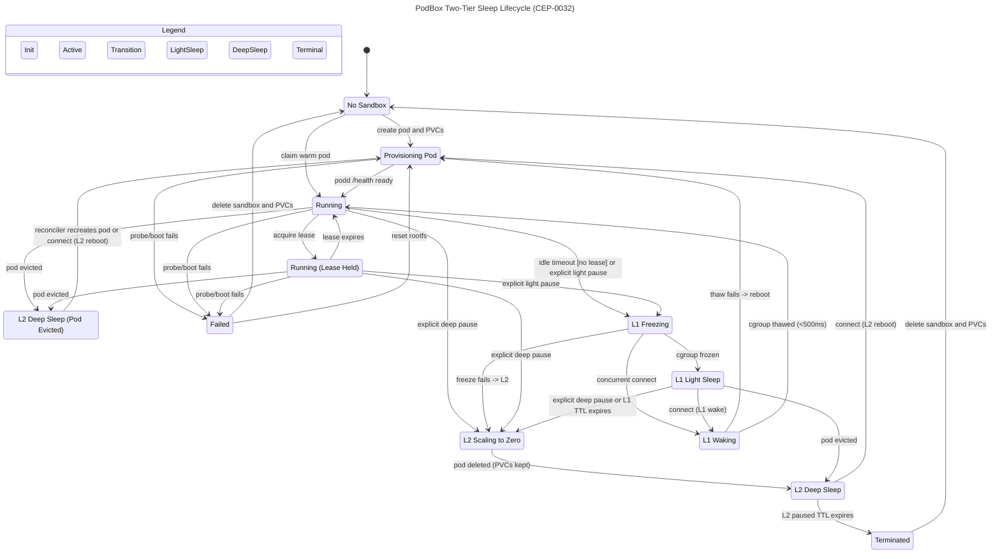

# CEP-0032 Statechart Verification Report (`PodBoxTieredSleep`)

## 1. Summary

- **Spec**: [`PodBoxTieredSleep.tla`](./PodBoxTieredSleep.tla) ([`PodBoxTieredSleep.cfg`](./PodBoxTieredSleep.cfg))
- **View**: [`PodBoxTieredSleep.view.ts`](./PodBoxTieredSleep.view.ts)
- **Counterexample Variant**: [`PodBoxTieredSleepNoEpoch.tla`](./PodBoxTieredSleepNoEpoch.tla) ([`PodBoxTieredSleepNoEpoch.cfg`](./PodBoxTieredSleepNoEpoch.cfg))
- **TLC Result**: Exhaustive BFS reached **20 distinct states** and **83 steps** (`12` projected chart states, `29` arrows).
- **Rules That Hold**: `TypeOK`, `TerminatedStaysTerminated`, `PodPresenceConsistent`, `FreezeConsistent`, `LeaseOnlyWhenRunning`, `PVCsRetainedDuringLifecycle`, `NoDeadlock` (**0 violations**).

## 2. Statechart Diagram



## 3. What the Model Includes & What the View Hides

- **Modeled in TLA+**:
  - Cold creation (`Provisioning -> Running`) and WarmPool claim (`Running`).
  - L1 Light Sleep (`Running -> PausingL1 -> LightPaused -> ResumingL1 -> Running`), including `ReapIdle` idle timeout vs. active `Lease` lock, freeze failure fallback to L2, thaw failure fallback to Pod reboot, and concurrent `connect` preempting `PausingL1`.
  - Async out-of-order `freeze` RPC fencing (`freezeInFlight` + epoch check).
  - L2 Deep Sleep (`PausingL2 -> DeepPaused`), triggered explicitly, via `LightSleepTTLSeconds` expiration (`ReapLightToDeep`), or via unexpected Pod eviction (`PodEvictedDuringCompute`).
  - Stale Gateway replica cache (`gwStaleLight`) across background L1->L2 demotion and `DeepPaused -> Terminated` TTL expiry (`StaleConnectRejectedOnTerminated`).
  - RootFS reset (`ResetRootFS`), `Failed`, `Terminated`, and `DeleteBox`.
- **Omitted from Model**: Wall-clock timestamp arithmetic (`IdleTimeoutSeconds`, `LightSleepTTLSeconds`, `PausedTTLSeconds` are abstracted as non-deterministic guard-checked timer events), exact integer `SleepEpoch` counter (abstracted as `freezeInFlight` epoch-fencing boolean), and `podd-agent` DaemonSet binary injection (orthogonal to PodBox lifecycle).
- **Hidden in View (`PodBoxTieredSleep.view.ts`)**: `DeleteBox` from non-terminal states (kept on `Failed` and `Terminated`), `ResetRootFS` from healthy states (kept on `Failed`), `BeginPauseDeep` from `Provisioning`, and `PodEvictedDuringCompute` from `PausingL1`/`ResumingL1` (`29` hidden steps total, `5` self-loop steps).

## 4. Counterexample Hazards Found During Verification

1. **`Provisioning -> PausingL2` Pod State Mismatch** (caught in initial run `out2`):
   - Path: `0. init` -> `1. CreateCold (Provisioning, podState="starting")` -> `2. BeginPauseDeep (PausingL2, podState="starting")`.
   - Fix: `PausingL2` may delete either a `"starting"` or `"ready"` Pod, and `ReconcileProvisioning` must verify `desiredState == Running` before promoting to `Running`.
2. **Out-of-Order Freeze/Unfreeze Race Without Epoch Fencing** (`PodBoxTieredSleepNoEpoch.tla`, `out-bug2`):
   - Rule broken: `FreezeConsistent` (`(phase = "Running") => ~workloadFrozen`).
   - Reader's rule: A `Running` sandbox must never have its guest workload cgroup frozen.
   - Shortest 5-step path:
     - `0`: `phase="none", workloadFrozen=FALSE`
     - `1. CreateWarm`: `phase="Running", workloadFrozen=FALSE`
     - `2. BeginIdleLight`: `phase="PausingL1", freezeInFlight=TRUE`
     - `3. PreemptPauseLightWithConnect`: `phase="ResumingL1", desiredState="Running", freezeInFlight=TRUE`
     - `4. CompleteWakeLight`: `phase="Running", workloadFrozen=FALSE, freezeInFlight=TRUE`
     - `5. LateFreezeWithoutEpoch`: `phase="Running", workloadFrozen=TRUE` (**VIOLATION**)
   - Fix applied to CEP-0032: Monotonic `PodBoxStatus.SleepEpoch` fencing on `POST /v1/lifecycle/freeze` and `POST /v1/lifecycle/unfreeze`.

## 5. Reproduce

```sh
TLA2TOOLS=/home/chris/.cache/statechart/tla2tools.jar JAVA=/usr/bin/java \
  statechart docs/enhancements/0032-tiered-sleep-and-init-free-podd/statechart/PodBoxTieredSleep.tla \
  --view docs/enhancements/0032-tiered-sleep-and-init-free-podd/statechart/PodBoxTieredSleep.view.ts \
  --out /tmp/cep0032-statechart-out
```
