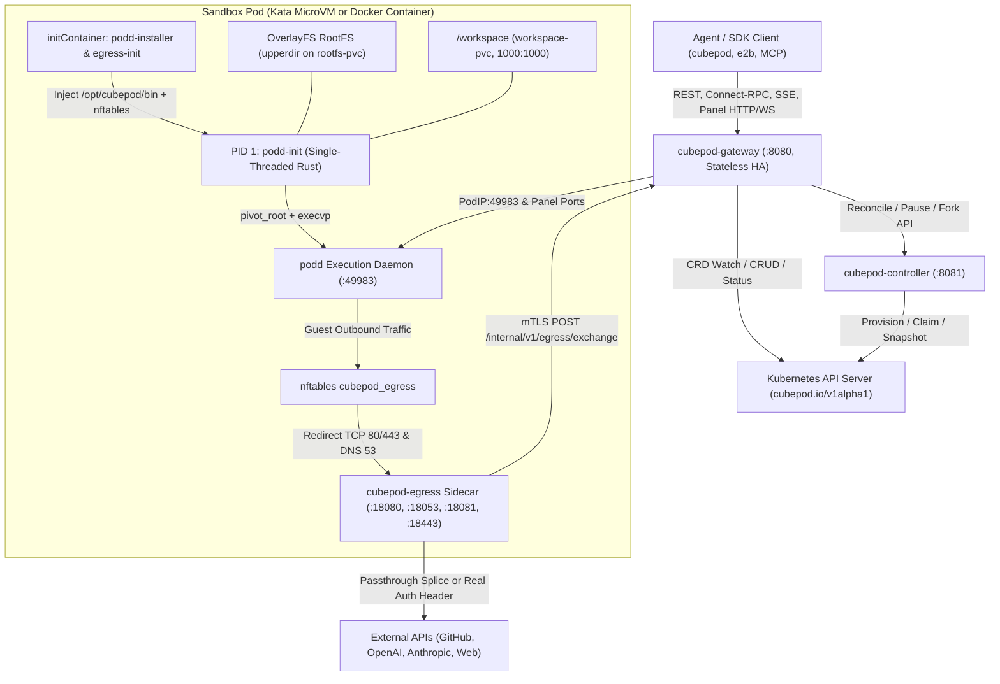

CubePod separates **agent orchestration**, **persistent storage**, **hardware compute isolation**, **in-guest execution**, and **outbound credential security** into focused, loosely coupled components. Every component maintains behavioral parity between **Production Kubernetes (`Kata + CSI Block`)** and **Local Development (`Docker + Loopback ext4`)**.

## End-to-End Topology

## Control Plane & Operator Components

### 1. Stateless HA Control Plane Gateway (`cubepod-gateway`)

Implemented in `cmd/cubepod-gateway/` and `pkg/gateway/`, `cubepod-gateway` listens on `:8080` and terminates all client traffic:

- **E2B-Compatible & Superset API**: Serves sandbox lifecycle (`POST /sandboxes`, `/v2/sandboxes`), command/filesystem data plane, Connect-RPC (`/process.Process/*`, `/filesystem.Filesystem/*`), wildcard subdomain routing (`<port>-<sandboxID>.<domain>`), and optional template builds (`--e2b-template-api`).
- **Auto-Resume & Readiness Polling**: When a request arrives for a `Paused` sandbox, the gateway drives `desiredState: Running` and polls `podd` `/health` via `waitForPoddReady` before forwarding traffic.
- **Stateless Multi-Replica HA**: All authoritative sandbox metadata is persisted on Kubernetes `PodBox` annotations (`cubepod.io/template-id`, `cubepod.io/timeout-seconds`, `cubepod.io/volume-key`, `cubepod.io/metadata-*`, `cubepod.io/resolved-image`, `cubepod.io/forked-from`) and `status.podIP`. Any replica suffering an in-memory cache miss reconstructs state via `resolveSandbox` directly from the cluster.
- **Signed Panel Proxy & Secret Vault**: Mints and validates HMAC-SHA256 `/panel/{token}/` URLs for interactive desktops and dev previews, and serves `POST /internal/v1/egress/exchange` over mTLS for `cpodref_` placeholder swapping.

### 2. Kubernetes Operator (`cubepod-controller`)

Implemented in `cmd/cubepod-controller/` and `pkg/controller/`, `cubepod-controller` reconciles three custom resources defined in `deploy/helm/cubepod/crds/` under **`cubepod.io/v1alpha1`** (`api/v1alpha1/types.go` defines both `CRDGroup = "cubepod.io"` and `GroupName = "pod.cubeplex.ai"`):

- **`PodBox` (`pb`, `pbox`)**: Represents a single persistent sandbox with independent RootFS and `/workspace` PVCs, lifecycle timeouts, `forkFrom` lineage, and `networkPolicy`.
- **`PodTemplate` (`pt`, `ptemplate`)**: Defines base OCI image, `runtimeClassName` (`kata-qemu`, `kata-clh`, or empty for local dev), CPU/memory limits, storage class, and default egress posture.
- **`PodWarmPool` (`pwp`, `warmpool`)**: Maintains pre-booted, pre-attached standby MicroVMs claimed via atomic Kubernetes CAS label updates in `< 50 ms`.

The controller manages dual PVC provisioning, `rootfsGeneration` resets, CoW `ForkFrom` resolution across rootfs generations, idle/TTL reaping (`ReapIdle`), and per-pod ECDSA P-256 mTLS & MITM CA secrets (`ensureEgressSecretsLocked`).

## Data Plane & In-Guest Components

### 3. Clean Image Injection & In-Guest Rust Runtime (`podd-init` & `podd`)

CubePod never requires baking proprietary agents or init scripts into user Dockerfiles:

- `images/podd/Dockerfile` packages static Rust binaries into a minimal `busybox:1.37-musl` injector image.
- An `initContainer` (`podd-installer`) copies `/opt/cubepod/bin/{podd-init,podd}` into a shared `emptyDir` volume (or Docker bind-mounts the binary directory read-only).
- **`podd-init`** (`crates/podd-init/`) runs as a **single-threaded PID 1**: formats or heals `ext4` (`blkid` / `mkfs.ext4` / `e2fsck -p`), mounts the RootFS `OverlayFS` (`lowerdir=/`), attaches `/workspace` as UID/GID `1000:1000`, bind-mounts `/opt/cubepod` across the mount namespace, executes `pivot_root`, and `execvp`s into `podd`.
- **`podd`** (`crates/podd/`) listens on `:49983` for command execution (cursor-tailed stdout/stderr, PGID kill, Connect-RPC), file transfer & streaming `tar.gz` `archive-sync`, crash-consistent `FIFREEZE`/`FITHAW` quiescing, and 6 persistent code-interpreter kernels.

### 4. Zero-Trust Egress Sidecar (`cubepod-egress`)

Co-located inside the sandbox Pod as a dedicated UID `65532` sidecar container (`cmd/cubepod-egress/`, `pkg/egress/`), `cubepod-egress` enforces domain policies (`DenyHosts` > `AllowHosts` > `DefaultAction`), refuses unauthorized DNS (`RCODE=5` on `:18053`), receives `nftables`-redirected HTTP/TLS traffic (`:18081` / `:18443`), performs zero-copy splicing for normal sites, and selectively MITMs only secret-bound hosts to swap `cpodref_` placeholders over mTLS.

### 5. Lazy Interactive Desktop (`images/desktop/`)

Optional desktop images launch cleanly with `sleep infinity` (~0 MiB idle RAM) and expose `/opt/cubepod/desktop/cubepod-desktop-ctl` to bring up `Xvfb`, `openbox`, Chromium CDP (`127.0.0.1:9222`), `x11vnc`/`websockify`/`noVNC` (`:8080`), and `ttyd` (`:7681`) on demand.

## Dual-Runtime Architecture Parity

| Layer | Production Kubernetes (`Kata + CSI Block`) | Local Development (`Docker + Loopback`) |
| :--- | :--- | :--- |
| **Compute Isolation** | `Kata Containers` (`runtimeClassName: kata-qemu` / `kata-clh`) | Docker container (`CUBEPOD_RUNTIME_MODE=docker-loopback`) |
| **Storage Backing** | Two `volumeMode: Block` PVCs (`/dev/cubepod-rootfs`, `/dev/cubepod-workspace`) or `volumeMode: Filesystem` fallback | Sparse `.ext4` loopback files per sandbox (`cubepod-volumes`) |
| **In-Guest Mounts** | `podd-init` mounts `OverlayFS` (`lowerdir=/`) + `/workspace` inside VM kernel | Identical `podd-init` `e2fsck` + `OverlayFS` + `pivot_root` path |
| **CoW Fork Mechanism** | `podd` `FIFREEZE` -> CSI `DataSourcePVC` / snapshot clone -> `FITHAW` | `podd` `FIFREEZE` -> `cp --reflink=auto --sparse=always -a` -> `FITHAW` |
| **Runtime Binary Injection** | `podd-installer` `initContainer` -> `emptyDir` `/opt/cubepod/bin` | Read-only host bind-mount `-v <binDir>:/opt/cubepod/bin:ro` |

> **Note on Defaults:** Production Helm defaults (`deploy/helm/cubepod/values.yaml`) and `controller.NewReconciler()` target `volumeMode: Block`, `runtimeClassName: kata-qemu`, and `storageClassName: longhorn-v2-block-thin`. When running standalone `cmd/cubepod-controller` or `cmd/cubepod-gateway` binaries outside Helm, CLI flags default to `-volume-mode=Filesystem`, `-storage-class=nfs-storage`, and `-runtime-class=""` unless explicitly overridden.

## Next Steps

- Understand volume separation in **[Dual-Volume Persistence](/concepts/dual-volume-persistence/)**.
- Inspect the Rust PID 1 boot sequence in **[In-Guest Runtime (podd-init & podd)](/concepts/in-guest-init-and-podd/)**.
- Explore `< 50ms` scheduling and cloning in **[Lifecycle, WarmPool, CoW Fork & HA](/concepts/lifecycle-warmpool-fork/)**.
