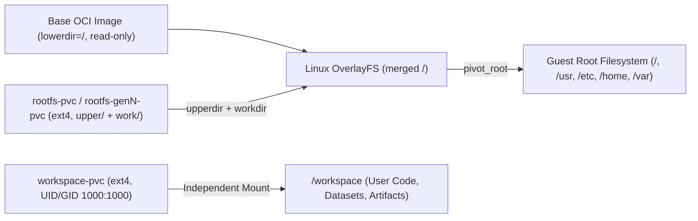

A foundational invariant of CubePod is **Dual-Volume Independence**: the lifecycle of user project files in `/workspace` (`workspace-pvc`) is strictly decoupled from the container's persistent OS `OverlayFS` layer (`rootfs-pvc`).

## Why Two Independent Volumes?

If an agent sandbox keeps everything on one volume or leaves the OS RootFS ephemeral:

- **With an ephemeral RootFS**, any `apt-get install`, `npm install -g`, Python toolchain, Playwright browser binary, or `/etc` configuration disappears whenever compute scales to zero (`Paused`) or moves across Kubernetes nodes.
- **With a single merged volume**, resetting a corrupted OS installation or upgrading the underlying base OCI template image forces a destructive wipe of the agent's source code, checkpoints, and datasets.

CubePod avoids both failure modes by attaching **two independent persistent volumes** to every `PodBox`.

## Volume Layout Inside the Sandbox

| Volume | Default Size (`manifests.go`) | PVC Naming Convention | Mount Path in Guest | Ownership & Purpose |
| :--- | :--- | :--- | :--- | :--- |
| **RootFS Upper** | `10Gi` | `<box>-rootfs-pvc` (gen `1`) or `<box>-rootfs-gen<N>-pvc` (gen `> 1`) | Block device `/dev/cubepod-rootfs` -> mounted at `/mnt/cubepod-upper` -> `OverlayFS` `upperdir` + `workdir` | Persists every OS-level mutation (`/usr`, `/etc`, `/var`, installed packages, system libs) on top of the read-only OCI `lowerdir`. |
| **Workspace** | `20Gi` | `<box>-workspace-pvc` | Block device `/dev/cubepod-workspace` -> mounted directly at `/workspace` | Dedicated workspace storage initialized to `UID:GID 1000:1000` (`cubeplex`). Survives base image upgrades and `RootFS` resets untouched. |

In Kubernetes, both PVCs carry deterministic labels (`pod.cubeplex.ai/box: <boxName>` and `pod.cubeplex.ai/vol-type: rootfs | workspace`) so garbage collection, snapshot cloning, and multi-generation tracking remain unambiguous.

## Non-Destructive OS Reset (`rootfsGeneration`)

When an AI agent breaks system libraries, pollutes `/etc`, or needs a newer base OCI image, CubePod does not discard `/workspace`:

1. A client calls `POST /sandboxes/{id}/reset-rootfs` (or `client.reset_rootfs(id)` / `sandbox.resetRootfs()`), or updates `PodBox.spec.rootfsGeneration`.
2. `cubepod-controller` transitions the `PodBox` phase to `ResettingRootFS` (`Reconcile` compares `spec.rootfsGeneration` against `status.observedRootfsGeneration`).
3. The controller tears down the running Pod, allocates a **fresh RootFS PVC** named `<box>-rootfs-gen<N>-pvc`, and leaves the original `<box>-workspace-pvc` (`status.workspacePVCName`) completely intact.
4. A new Pod boots against the new `upperdir` while re-attaching the exact same `/workspace` volume, updating `status.observedRootfsGeneration` and `status.rootfsPVCName`.

> **Important for CoW Fork:** When a forked sandbox (`spec.forkFrom`) is later created from a parent that has reset its RootFS one or more times, the controller's `resolveParentPVCNames` reads `status.RootfsPVCName` (e.g., `<parent>-rootfs-gen3-pvc`) instead of assuming `-rootfs-pvc`, ensuring forks always clone the parent's active RootFS generation.

## Three Storage Backends Across Production and Local Dev

CubePod executes the same dual-volume abstraction across three storage modes implemented in `pkg/controller/manifests.go` and `pkg/runtime/docker.go`:

### 1. CSI Raw Block (`volumeMode: Block` + Kata MicroVM)

In production (`kata-qemu` / `kata-clh` with Longhorn V2 SPDK, OpenEBS LVM-LocalPV, Ceph RBD, or cloud EBS):

- `BuildBlockPVCs` requests two `volumeMode: Block` PVCs and injects them into the Pod's `volumeDevices` at `/dev/cubepod-rootfs` and `/dev/cubepod-workspace`.
- Inside the Kata guest VM kernel, `podd-init` checks `blkid`, formats fresh volumes with `mkfs.ext4 -F -L ... -m 0 -E lazy_itable_init=0,lazy_journal_init=0`, or heals existing volumes with `e2fsck -p`, then mounts `ext4` (`-o noatime`) and builds the `OverlayFS` inside the MicroVM's own Linux kernel.
- **Why Raw Block Inside Kata Matters**: Mounting `OverlayFS` directly on a containerd overlayfs root inside a standard host container fails in Linux kernels that forbid nested `OverlayFS`-on-`OverlayFS` (`overlay` `lowerdir` cannot be another `overlay`). Inside a Kata MicroVM (`virtio-blk` + guest kernel), `podd-init` runs cleanly without polluting host `containerd` image layers.

### 2. CSI Filesystem Fallback (`volumeMode: Filesystem`)

When deploying into standard Kubernetes clusters without raw block CSI support (`runtimeClassName: ""`, `-volume-mode=Filesystem`):

- `BuildBlockPVCs` provisions normal `volumeMode: Filesystem` PVCs mounted into `/mnt/cubepod/rootfs` and `/workspace`.
- `podd-init` detects the absence of raw block devices (or `CUBEPOD_SKIP_PIVOT=1`), records `pivoted: false` in `/run/cubepod/init-state.json`, and hands off cleanly to `podd` so `/workspace` still persists across Pod restarts.

### 3. Local Docker Loopback (`CUBEPOD_RUNTIME_MODE=docker-loopback`)

For laptop development without Kubernetes:

- `pkg/runtime/docker.go` creates sparse `.ext4` loopback files per sandbox inside the volumes directory and attaches them alongside `--entrypoint /opt/cubepod/bin/podd-init`.
- `podd-init` runs the exact same `blkid` / `e2fsck -p` / `OverlayFS` / `pivot_root` sequence used inside Kata MicroVMs, giving developers high fidelity locally.

## Next Steps

- Follow the exact PID 1 boot steps inside the guest in **[In-Guest Runtime (podd-init & podd)](/concepts/in-guest-init-and-podd/)**.
- Learn how `PodWarmPool` and `ForkFrom` snapshot dual volumes in **[Lifecycle, WarmPool, CoW Fork & HA](/concepts/lifecycle-warmpool-fork/)**.
- Configure CSI storage classes in **[Kata & Block Storage](/deployment/kata-and-block-storage/)**.
