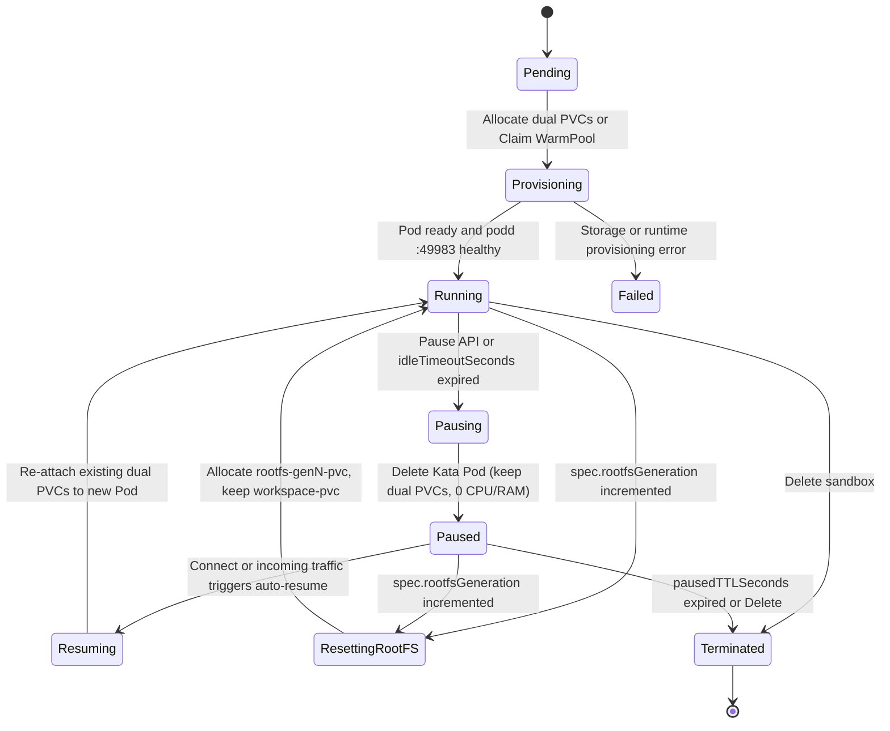
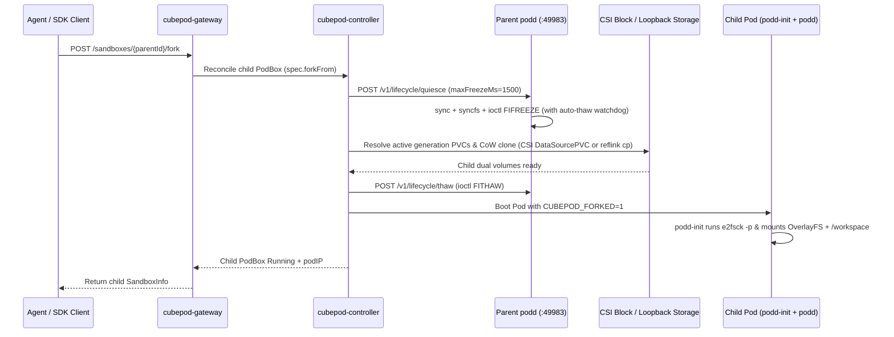

CubePod combines Kubernetes-native reconciliation (`pkg/controller/reconciler.go`) with stateless gateway routing (`pkg/gateway/sandboxes.go`) to give persistent MicroVMs `< 50 ms` startup, `0 CPU / 0 RAM` idle pause, crash-consistent cloning, and multi-replica gateway High Availability ([CEP-0022](/ceps/0022-cow-fork-and-stateless-ha-gateway/)).

## `PodBox` State Machine

A `PodBox` (`cubepod.io/v1alpha1`) separates **desired compute state** (`spec.desiredState`: `Running` or `Paused`) from **observed controller phase** (`status.phase`), while preserving both persistent volumes (`status.rootfsPVCName` and `status.workspacePVCName`) across compute pauses and OS resets.

### Idle Auto-Pause, Leases & Auto-Resume

- **Idle Reaping (`ReapIdle`)**: `cubepod-controller` monitors `status.lastActivityAt` against `spec.lifecycle.idleTimeoutSeconds`. If an agent holds an active lease (`spec.lifecycle.leaseExpiresAt` in the future), idle auto-pause is suppressed until the lease expires.
- **Compute Pause-to-Zero**: Transitioning `desiredState` to `Paused` deletes the Kubernetes Pod (`status.podName` and `status.podIP` clear) while keeping `<box>-rootfs-pvc` and `<box>-workspace-pvc` bound and untouched.
- **Paused TTL Reclamation**: Once `status.pausedAt` exceeds `spec.lifecycle.pausedTTLSeconds`, expired PVCs are reclaimed cleanly.
- **Transparent Auto-Resume**: Any request hitting `cubepod-gateway` for a `Paused` sandbox — explicit `POST /sandboxes/{id}/connect`, data-plane `/commands` or `/files`, wildcard subdomain routing, desktop start, or `/panel/{token}/` proxy — automatically patches `desiredState: Running` and polls `podd` `/health` via `waitForPoddReady` before serving the request.

## Sub-50ms Startup via `PodWarmPool`

Waiting seconds for PVC creation, CSI attachment, Kata VM boot, and `e2fsck` breaks interactive agent responsiveness. `PodWarmPool` shifts provisioning latency off the critical path:

1. **Pre-Warming**: For each pool, `cubepod-controller` maintains `spec.replicas` standby Kata Pods named `<pool>-warm-<N>-kata-pod`, each with pre-provisioned & pre-mounted dual PVCs (`podd-init` has already mounted `OverlayFS`, initialized `/workspace`, and started `podd` on `:49983`).
2. **Atomic CAS Claim (`ClaimPod`)**: When `handleCreateSandbox` receives `warmPoolRef` (or auto-discovers an available pool via `FindAvailableWarmPool`), `ClaimPod` performs a **Kubernetes Compare-And-Swap (CAS) label/metadata update** (`cubepod.io/claimed=true`, `cubepod.io/claimed-by=<boxName>`). Concurrent gateway requests cannot double-claim the same warm pod.
3. **Instant Ownership Transfer & Replenishment**: The claimed pod and its attached PVCs immediately bind to the new `PodBox` (delivering ready sandboxes in `< 50 ms`), while the controller asynchronously replenishes a replacement standby pod back up to `spec.replicas`.

## Crash-Consistent Multi-Generation CoW Fork (`spec.forkFrom`)

Forking an active sandbox lets AI agents branch filesystem and environment state speculatively (for example, trying competing fixes in parallel) without interrupting the parent session.

### Key CoW Fork Invariants

- **Bounded Freeze Safety**: `ParentPodd` flushes kernel dirty pages (`sync` + `syncfs`) and calls `FIFREEZE` (`0xC0045877`) backed by a monotonic watchdog timer (`maxFreezeMs` clamped to `[100, 5000]`, default `1500` ms). Even if `cubepod-controller` restarts mid-fork, the parent MicroVM automatically unfreezes rather than deadlocking.
- **Dual-Backend Cloning**:
  - **Kubernetes CSI Mode**: `cubepod-controller` creates child PVCs with `dataSource` (`DataSourcePVC` / snapshot clone) targeting the parent's RootFS and Workspace PVCs.
  - **Local Docker Loopback Mode**: `pkg/runtime/docker.go` calls `quiesceSandbox`, clones both `.ext4` loopback files via `cp --reflink=auto --sparse=always -a`, calls `thaw`, and boots the child with `CUBEPOD_FORKED=1`.
- **Multi-Generation PVC Resolution (`resolveParentPVCNames`)**: If the parent sandbox previously ran `reset-rootfs` (`rootfsGeneration > 1`), its live RootFS PVC is `<parent>-rootfs-gen<N>-pvc` rather than `<parent>-rootfs-pvc`. `resolveParentPVCNames` inspects the parent's `status.RootfsPVCName` and `status.WorkspacePVCName` so forks always capture the parent's true active generation.

## Stateless Multi-Replica Gateway HA

In production, `cubepod-gateway` scales horizontally behind a Kubernetes Service or LoadBalancer without sticky sessions or shared Redis state:

- **Kubernetes CRD as Single Source of Truth**: Every gateway mutation writes canonical state into `PodBox` annotations (`cubepod.io/template-id`, `cubepod.io/timeout-seconds`, `cubepod.io/volume-key`, `cubepod.io/metadata-*`, `cubepod.io/resolved-image`, `cubepod.io/forked-from`) alongside `spec.networkPolicy` and `status.podIP`.
- **Cache-Miss Reconstruction (`resolveSandbox`)**: When any replica receives a request for a `sandboxID` missing from its local in-memory cache (for instance after a pod rollout or round-robin load balancing), `resolveSandbox` fetches the `PodBox` resource from Kubernetes, reconstructs the full `SandboxRecord`, transparently resumes it if `Paused`, and proxies directly to `http://<status.podIP>:49983`.

## Next Steps

- Inspect all `PodBox`, `PodTemplate`, and `PodWarmPool` fields in the **[CRD Reference](/reference/crds/)**.
- Understand how credentials and outbound traffic stay isolated across forks and resumes in **[Zero-Trust Egress & Secret Vault](/concepts/zero-trust-egress/)**.
- Read the architectural design spec in **[CEP-0022](/ceps/0022-cow-fork-and-stateless-ha-gateway/)**.
