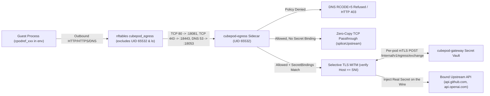

AI agents routinely call external APIs (OpenAI, Anthropic, GitHub, Slack, internal SaaS gateways) using privileged credentials. Giving an agent real API keys inside environment variables exposes those keys to prompt injection, untrusted code execution, `env` dumps, and `/proc/self/environ` reads.

CubePod enforces a strict **Zero-Trust Egress Secret Safety** invariant ([CEP-0005](/ceps/0005-zero-trust-egress-and-sdk/), [CEP-0020](/ceps/0020-transparent-zero-trust-egress/)):

> **Real external credentials must never enter the sandbox environment, filesystem, or guest process memory.** Inside the MicroVM, agents receive only opaque `cpodref_` placeholders swapped at the Pod egress boundary over per-sandbox mTLS.

## Architecture Overview

## 1. `cpodref_` Placeholders & Secret Binding

When creating a sandbox with `secretBindings`, you bind an environment variable (e.g., `GITHUB_TOKEN`) to a real secret, `allowedHosts` (e.g., `["api.github.com"]`), and optional `allowedHeaders` (e.g., `["Authorization"]`):

- `Vault.BindSecret` (`pkg/egress/vault.go`) stores the raw credential inside the control-plane vault and returns a deterministic opaque placeholder formatted as **`cpodref_` followed by 32 lowercase Base32 characters**.
- Only `GITHUB_TOKEN=cpodref_<32chars>` is injected into the sandbox environment. If untrusted code prints `os.environ` or attempts to send the placeholder to an attacker-controlled server (`evil.example.com`), `evil.example.com` receives only the useless `cpodref_` string — never the real credential.

## 2. Per-Pod Cryptographic Identity (`mTLS` + `MITM CA`)

In `pkg/controller/reconciler.go` (`ensureEgressSecretsLocked`), `cubepod-controller` provisions two distinct Kubernetes `Secret` objects for each sandbox using **ECDSA P-256** cryptography:

| Kubernetes Secret | Contents | Mounted Where | Purpose |
| :--- | :--- | :--- | :--- |
| **`<box>-egress-mtls`** | Per-pod client leaf cert/key (`CN = <sandboxID>`), CA cert, plus per-pod MITM CA private key & cert | **Only** inside the `cubepod-egress` sidecar at `/etc/cubepod/certs` | Authenticates the sidecar to `cubepod-gateway` over mTLS and signs short-lived leaf certificates during selective MITM. |
| **`<box>-egress-ca`** | **Public `mitm-ca.crt` only** (zero private keys) | Sandbox user container at `/etc/cubepod/ca` | Exported via `NODE_EXTRA_CA_CERTS` and `CUBEPOD_EXTRA_CA_CERT` (plus proxy envs `HTTP_PROXY`/`HTTPS_PROXY=http://127.0.0.1:18080`) so guest TLS clients trust the sidecar's selective MITM certs without touching private key material. |

## 3. Dual Interception: Explicit Proxy & Transparent `nftables`

`cubepod-egress` (`cmd/cubepod-egress/`, `pkg/egress/`) supports both explicit HTTP proxy clients and proxy-unaware binaries (such as static Go/Rust tools, `curl --noproxy`, or raw sockets):

- **Explicit Proxy Listener (`:18080`)**: Serves HTTP proxy and `HTTPS CONNECT` tunnels via `HTTP_PROXY` / `HTTPS_PROXY`.
- **Transparent Interception (`CUBEPOD_TRANSPARENT=1`)**: An init hook (`images/egress/egress-init.sh`) installs the `nftables` table `cubepod_egress` in the Pod network namespace before guest workload start:
  - Redirects outbound **TCP port `80`** -> **`:18081`** (`cubepod-egress` transparent HTTP)
  - Redirects outbound **TCP port `443`** -> **`:18443`** (`cubepod-egress` transparent TLS SNI router)
  - Redirects outbound **UDP/TCP port `53`** -> **`:18053`** (`cubepod-egress` policy-enforcing DNS proxy)
  - Drops/rejects outbound **UDP port `443`** to prevent HTTP/3 QUIC bypasses, transparently falling back to TLS over TCP
  - Excludes loopback traffic and **`skuid 65532`** (the `cubepod-egress` sidecar user ID) so the sidecar's own upstream connections exit normally without redirect loops

## 4. Policy Evaluation & DNS Tunneling Defense

Every destination host is evaluated against `spec.networkPolicy` (`pkg/egress/policy.go`) using deterministic precedence:

1. **`DenyHosts`** is evaluated first and always wins.
2. **`AllowHosts`** is checked next.
3. **`DefaultAction`** (`Allow` or `Deny`) acts as fallback.

Wildcard rules follow strict **dot-boundary matching**: `*.github.com` matches `api.github.com` and `uploads.github.com`, while rejecting lookalikes such as `evilgithub.com`.

On port **`:18053`**, `cubepod-egress` inspects DNS queries in flight (`pkg/egress/dns.go`) and immediately replies with **`RCODE=5` (`Refused`)** for policy-denied domains — blocking DNS exfiltration even when TCP/HTTP is never opened.

## 5. Selective HTTPS MITM vs. Zero-Copy Passthrough

For allowed TLS connections (`CONNECT :18080` or transparent `:18443`), `pkg/egress/sni.go` peeks the raw TLS `ClientHello` **SNI** via `prefixConn` before deciding how to handle the stream (`pkg/egress/proxy.go`):

- **Non-Secret Destinations -> Zero-Copy Passthrough (`spliceUpstream`)**: If the SNI host does not match any `SecretBindings[].AllowedHosts`, `cubepod-egress` **never decrypts TLS**. It replays the peeked bytes into a zero-copy TCP splice (optionally chaining through `spec.networkPolicy.upstreamProxy`), preserving native end-to-end TLS certificates and WebSocket/HTTP2 fidelity.
- **Secret-Bound Destinations -> Selective MITM (`serveMITMTLS`)**: Only hosts listed in `SecretBindings[].AllowedHosts` undergo TLS termination using the per-pod MITM CA:
  1. Enforces **`HTTP Host == TLS SNI`**, immediately returning **`HTTP 421 Misdirected Request`** if a compromised client attempts domain fronting across a mismatched Host header.
  2. Scans headers (respecting `AllowedHeaders` restrictions when set) for `cpodref_` tokens.
  3. Calls `cubepod-gateway` (`POST /internal/v1/egress/exchange`) over **per-sandbox mTLS**, where the gateway verifies that the sidecar's client certificate **`CN` matches `sandboxID`**, along with `sniHost` and `headerName`.
  4. Replaces `cpodref_...` with the real secret solely in transit buffers and forwards upstream; real credentials are never logged or sent back to the guest.

Prometheus metrics and liveness probes are exposed by `cubepod-egress` on **`:19090`** (`/metrics` and `/healthz`).

## Next Steps

- Review `networkPolicy` and `secretBindings` schemas in **[CRD Reference](/reference/crds/)**.
- Inspect the underlying architecture specs in **[CEP-0005](/ceps/0005-zero-trust-egress-and-sdk/)** and **[CEP-0020](/ceps/0020-transparent-zero-trust-egress/)**.
