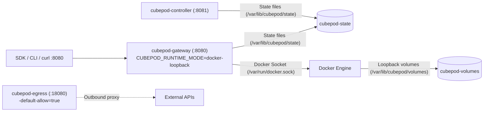

CubePod includes a self-contained `docker-compose` topology under `deploy/docker-compose/docker-compose.yaml` for developing and testing the control plane, SDKs, CLI, and MCP server on a single Docker host—without needing Kubernetes, KVM, or Kata Containers.

## Topology & Shared Volumes



Both `cubepod-gateway` and `cubepod-controller` share the `cubepod-state` Docker named volume at `/var/lib/cubepod/state`, while `cubepod-gateway` mounts the host Docker socket (`/var/run/docker.sock`) and the `cubepod-volumes` named volume at `/var/lib/cubepod/volumes`.

## Quick Start

Start the three services from the repository root:

```bash
docker compose -f deploy/docker-compose/docker-compose.yaml up --build
```

Once the containers are healthy, verify the Gateway and Controller health endpoints:

```bash
curl -fsS http://localhost:8080/health
curl -fsS http://localhost:8081/healthz
```

You can now point any CubePod client at `http://localhost:8080`:

```bash
export CUBEPOD_GATEWAY_URL=http://localhost:8080
cubepod sandbox create --template cubeplex-ubuntu24-desktop
```

To tear down the stack and remove the local state and volume storage:

```bash
docker compose -f deploy/docker-compose/docker-compose.yaml down -v
```

## Service Configuration Reference

The table below reflects the exact service definitions in `deploy/docker-compose/docker-compose.yaml`:

| Service | Dockerfile Context | Published Port | Default Flags & Environment | Mounted Volumes |
| :--- | :--- | :--- | :--- | :--- |
| `cubepod-gateway` | `images/gateway/Dockerfile` (root `../..`) | `8080:8080` | `-addr=:8080`, `--e2b-template-api=false`, `--template-build=false`, `--state-dir=/var/lib/cubepod/state`, `--template-probe-timeout=120s`, `CUBEPOD_RUNTIME_MODE=docker-loopback`, `CUBEPOD_STATE=/var/lib/cubepod/state` | `/var/run/docker.sock:/var/run/docker.sock`, `cubepod-volumes:/var/lib/cubepod/volumes`, `cubepod-state:/var/lib/cubepod/state` |
| `cubepod-controller` | `images/controller/Dockerfile` (root `../..`) | `8081:8081` | `-addr=:8081`, `--e2b-template-api=false`, `--template-build=false`, `--state-dir=/var/lib/cubepod/state`, `--template-probe-timeout=120s`, `CUBEPOD_STATE=/var/lib/cubepod/state` | `cubepod-state:/var/lib/cubepod/state` |
| `cubepod-egress` | `images/egress/Dockerfile` (root `../..`) | `18080:18080` | `-addr=:18080`, `-default-allow=true` | — |

## How `docker-loopback` Simulates Dual-Volume Persistence

In Kubernetes production clusters, CubePod pairs two raw block PVCs per sandbox (`rootfs-pvc` and `workspace-pvc`) and lets `podd-init` mount and `pivot_root` an OverlayFS inside a Kata microVM. Locally, `pkg/runtime/docker.go` mirrors that split using Docker and loopback storage:

- **`BinDir` injection (`/opt/cubepod/bin`)**: Rather than baking `podd` into user images, the Docker driver exposes the runtime binaries from `BinDir` (`/opt/cubepod/bin` by default) into sandbox containers.
- **Sparse `ext4` loopback volumes**: When `EnableSparseExt4` is active on `DockerConfig`, the driver creates sparse `ext4` backing files (default `SparseExt4Size`: `100MiB` under `BaseDir`, defaulting to `<os.TempDir>/cubepod-docker`) so sandbox pause, resume, RootFS resets, and workspace persistence behave consistently with production semantics.
- **Health polling timeout**: Container readiness checks default to a `5s` `HealthTimeout`.

See [Dual-Volume Persistence](/concepts/dual-volume-persistence/) and [In-Guest Init & podd](/concepts/in-guest-init-and-podd/) for how this maps directly onto the production Kata runtime.

## Enabling E2B Template Builds Locally

By default, `deploy/docker-compose/docker-compose.yaml` starts with both `--e2b-template-api=false` and `--template-build=false` (so only the pre-seeded default templates are active).

To test template builds or the `/v2/templates` and `/v3/templates` HTTP endpoints locally:

1. Ensure `/var/run/docker.sock:/var/run/docker.sock` is mounted into `cubepod-controller` and flip `--e2b-template-api=true` and `--template-build=true` on the Gateway and Controller flags so the controller routes builds through `LocalDockerBuilder`.
2. Restart the Compose services or run native Go/Rust binaries directly with `make build` and `make test-e2e`.

## Building & Testing Outside Compose

For rapid edit-compile loops directly on the host machine, the repository `Makefile` exposes:

```bash
# Format Rust & Go code
make fmt

# Run Rust clippy & Go vet
make vet

# Build all binaries (bin/podd-init, bin/podd, bin/cubepod-controller, bin/cubepod-gateway, bin/cubepod-egress, bin/cubepod)
make build

# Run all Rust and Go unit tests
make test

# Run the multi-process local E2E test suite
make test-e2e
```

## Next Steps

- Deploy to Kubernetes with Helm in [Kubernetes & Helm Deployment](/deployment/kubernetes-helm/).
- Configure Kata Containers and block storage drivers in [Kata & Block Storage](/deployment/kata-and-block-storage/).
- Explore the SDKs in [Python SDK](/sdks/python/), [TypeScript SDK](/sdks/typescript/), and [Go SDK & CLI](/sdks/go-and-cli/).
