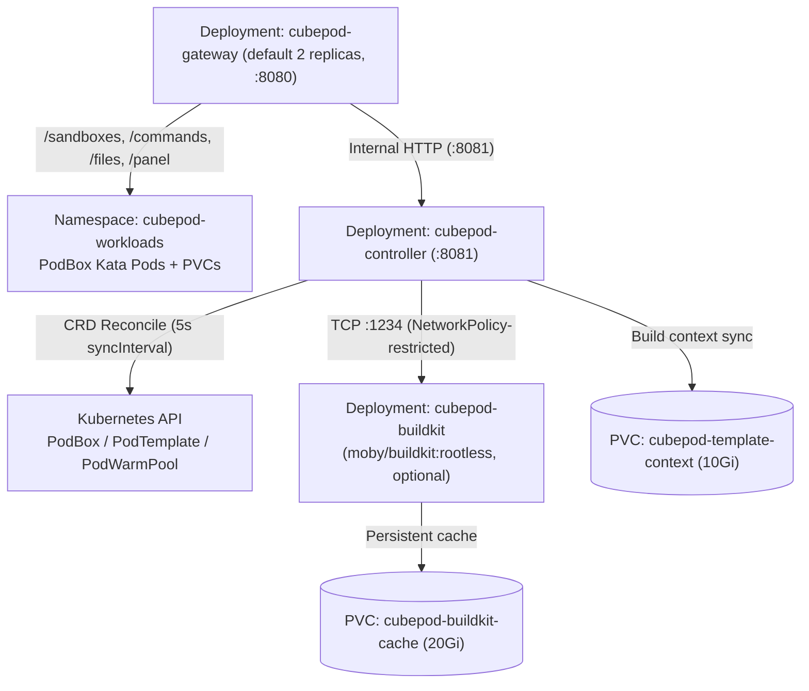

For Kubernetes deployments, CubePod is packaged as Helm chart `cubepod` (`version: 0.4.1`, `appVersion: "0.4.1"`) under `deploy/helm/cubepod/`. It installs the Custom Resource Definitions (`PodBox`, `PodTemplate`, `PodWarmPool`), RBAC rules, workload namespace, Control Plane Gateway, Kubernetes Controller, and—when enabled—an isolated rootless BuildKit builder deployment.

For the exhaustive key-by-key schema generated directly from `deploy/helm/cubepod/values.yaml`, see the [Helm Values Reference](/reference/helm-values/) and [CRD Reference](/reference/crds/).

## Prerequisites

- Kubernetes cluster with `kubectl` and `helm` (`v3+`) configured.
- A [Kata Containers runtime and CSI block storage](/deployment/kata-and-block-storage/) provisioner (such as Longhorn V2 SPDK `longhorn-v2-block-thin` or OpenEBS LVM-LocalPV `cubepod-lvm-block`) if running in production microVM mode.

## Quick Install

Install the chart from your local checkout into a control-plane namespace such as `cubepod-system`:

```bash
helm install cubepod ./deploy/helm/cubepod \
  --namespace cubepod-system \
  --create-namespace
```

Helm automatically installs the three CRDs in `deploy/helm/cubepod/crds/` on a fresh `helm install`:

- `cubepod.io_podboxes.yaml`
- `cubepod.io_podtemplates.yaml`
- `cubepod.io_podwarmpools.yaml`

:::note
Helm skips upgrading files inside `crds/` on subsequent `helm upgrade` runs. When upgrading CubePod, apply updated CRD manifests explicitly before running `helm upgrade`:
```bash
kubectl apply -f deploy/helm/cubepod/crds/
```
:::

## Deployed Resources Architecture



| Template File | Resources Created | Notes |
| :--- | :--- | :--- |
| `namespace.yaml` | `Namespace` (`controller.workloadNamespace`, default `cubepod-workloads`) | Labeled `cubepod.io/role: workloads` |
| `rbac.yaml` | `ServiceAccount`, `ClusterRole` (`<fullname>-controller`), `ClusterRoleBinding` | Grants CRUD on `pods`, `pods/exec`, `pods/log`, `persistentvolumeclaims`, `events`, `configmaps`, `secrets` and `cubepod.io`/`pod.cubeplex.ai` resources + statuses; read access to `apps` `deployments`/`statefulsets` |
| `gateway-deployment.yaml` | `Deployment` (`gateway.replicaCount`, default `2`) | Serves `/health` liveness (`initialDelaySeconds: 5, periodSeconds: 10`) & readiness (`initialDelaySeconds: 2, periodSeconds: 5`); sets `CUBEPOD_PANEL_SECRET` if configured |
| `controller-deployment.yaml` | `Deployment` (`controller.replicaCount`, forced to `1` when `templateBuild.enabled` is true) | Serves `/livez` and `/healthz`; reconciles on `--sync-interval` (`5s`); mounts `cubepod-template-context` PVC when `templateBuild.enabled` is true |
| `service.yaml` | `<fullname>-gateway` (`:8080`), `<fullname>-controller` (`:8081`) | Both default to `ClusterIP`; `gateway.service.nodePort` supported when switching to `NodePort` |
| `buildkit.yaml` | `Deployment`, `Service` (`:1234`), 2 `PVC`s, `NetworkPolicy` | Rendered only when `templateBuild.enabled: true` |

## Core Production Values

Override defaults in a custom `my-values.yaml` file rather than editing the chart directly:

```yaml
gateway:
  replicaCount: 2
  port: 8080
  panelSecret: "replace-with-random-hmac-secret"
  service:
    type: ClusterIP

runtime:
  runtimeClassName: kata-qemu
  defaultTemplate: cubeplex-ubuntu24-desktop
  poddInjectorImage: ghcr.io/cubeplexai/cubepod-podd:v0.4.1
  defaultSandboxImage: ghcr.io/cubeplexai/cubeplex-sandbox:v0.4.0

storage:
  storageClassName: longhorn-v2-block-thin
  volumeMode: Block
  rootfsSize: "10Gi"
  workspaceSize: "20Gi"

warmPool:
  enabled: true
  replicas: 3

egress:
  enabled: true
  image:
    registry: "ghcr.io"
    repository: "cubeplexai/cubepod-egress"
    tag: "v0.4.1"
  port: 18080
  exchangeUrl: "https://cubeplex-backend.cubeplex.svc:8443/api/v1/internal/egress/exchange"
```

Install or upgrade with your overrides:

```bash
helm upgrade --install cubepod ./deploy/helm/cubepod \
  --namespace cubepod-system \
  --create-namespace \
  -f my-values.yaml
```

### Key Runtime & Storage Defaults

- **Runtime injection (`runtime.poddInjectorImage`)**: Defaults to `ghcr.io/cubeplexai/cubepod-podd:v0.4.1`. Every sandbox pod uses an `initContainer` to copy `podd-init` and `podd` into an `emptyDir` mounted at `/opt/cubepod/bin` so user images remain clean.
- **Dual block PVCs (`storage.*`)**: Defaults to `storageClassName: longhorn-v2-block-thin`, `volumeMode: Block`, `rootfsSize: "10Gi"`, and `workspaceSize: "20Gi"`.
- **WarmPool (`warmPool.*`)**: Enabled by default with `3` pre-warmed replicas so `POST /sandboxes` can claim an already-running microVM sub-second.
- **Zero-Trust Egress (`egress.*`)**: Enabled by default, injecting the `cubepod-egress` sidecar on port `18080` and swapping `cpodref_` placeholders against `egress.exchangeUrl`. See [Zero-Trust Egress](/concepts/zero-trust-egress/).

## Enabling In-Cluster Template Builds (`BuildKit`)

By default, both `featureGates.e2bTemplateAPI` and `templateBuild.enabled` are `false`. Enabling template builds deploys a locked-down `moby/buildkit:rootless` builder pod alongside the controller:

```yaml
featureGates:
  e2bTemplateAPI: true

templateBuild:
  enabled: true
  cacheSize: "20Gi"
  probeTimeout: "120s"
  buildkit:
    image: "moby/buildkit:rootless"
    address: "tcp://cubepod-buildkit.cubepod-system.svc:1234"
    nodeSelector: {}
    # Optional nodeSelector: { role: builder }
  registry:
    url: "ghcr.io/your-org"
    repositoryPrefix: "cubepod-templates"
    pushSecret: "cubepod-buildkit-push"
    pullSecret: "cubepod-buildkit-pull"
```

Operational constraints when `templateBuild.enabled: true`:

1. **Controller replica pinning**: `controller-deployment.yaml` forces controller replicas to `1` because `cubepod-template-context` (`10Gi`) is mounted `ReadWriteOnce` at `/var/lib/cubepod/context`.
2. **Rootless BuildKit security context**: `cubepod-buildkit` runs as `1000:1000` with `--oci-worker-no-process-sandbox`, `seccompProfile: Unconfined`, and `appArmorProfile: Unconfined` so nested `RUN` builds work without root inside the builder container.
3. **Ingress NetworkPolicy**: `cubepod-buildkit-netpol` restricts TCP port `1234` strictly to pods carrying `app.kubernetes.io/component: controller`.
4. **Image push/pull secrets**: Create the Kubernetes Docker registry secrets referenced by `templateBuild.registry.pushSecret` and `pullSecret` in your control-plane and workload namespaces before triggering builds.

See [Templates & Image Builds](/sdks/templates/) for the SDK and CLI workflow.

## Verifying the Deployment

Confirm pods, CRDs, and health probes are green:

```bash
kubectl -n cubepod-system get pods
kubectl get crds | grep cubepod.io
kubectl -n cubepod-system port-forward svc/cubepod-gateway 8080:8080
curl -fsS http://localhost:8080/health
```

## Next Steps

- Prepare worker nodes for Kata Containers and raw block storage in [Kata Containers & Block Storage](/deployment/kata-and-block-storage/).
- Inspect every Helm value in [Helm Values Reference](/reference/helm-values/) and CRD field in [CRD Reference](/reference/crds/).
