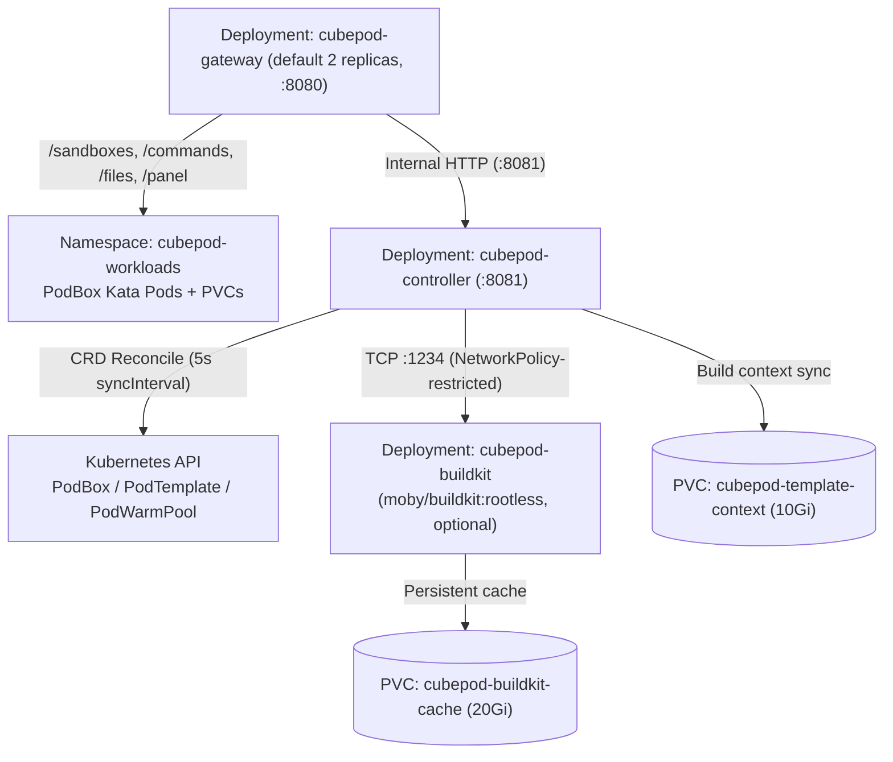

For Kubernetes deployments, CubePod is packaged as Helm chart `cubepod` (`version: 0.7.1`, `appVersion: "0.7.1"`) under `deploy/helm/cubepod/`. It installs the Custom Resource Definitions (`PodBox`, `PodTemplate`, `PodWarmPool`, `SandboxWebhook`), RBAC rules, workload namespace, Control Plane Gateway, Kubernetes Controller, and—when enabled—an isolated rootless BuildKit builder deployment.

For the exhaustive key-by-key schema generated directly from `deploy/helm/cubepod/values.yaml`, see the [Helm Values Reference](/reference/helm-values/) and [CRD Reference](/reference/crds/).

## Prerequisites

- Kubernetes cluster with `kubectl` and `helm` (`v3+`) configured.
- A [Kata Containers runtime and CSI block storage](/deployment/kata-and-block-storage/) provisioner (such as Longhorn V2 SPDK `longhorn-v2-block-thin` or OpenEBS LVM-LocalPV `cubepod-lvm-block`) if running in production microVM mode.

## Quick Install

Install directly from the published GHCR OCI registry into a control-plane namespace such as `cubepod-system` (no repository clone required):

```bash
helm install cubepod oci://ghcr.io/cubeplexai/charts/cubepod \
  --version 0.7.1 \
  --namespace cubepod-system \
  --create-namespace
```

Or install from a local repository checkout:

```bash
helm install cubepod ./deploy/helm/cubepod \
  --namespace cubepod-system \
  --create-namespace
```

Helm automatically installs the four CRDs in `deploy/helm/cubepod/crds/` on a fresh `helm install`:

- `cubepod.io_podboxes.yaml`
- `cubepod.io_podtemplates.yaml`
- `cubepod.io_podwarmpools.yaml`
- `cubepod.io_sandboxwebhooks.yaml`

:::note
Helm skips upgrading files inside `crds/` on subsequent `helm upgrade` runs. When upgrading CubePod, apply updated CRD manifests explicitly before running `helm upgrade`:
```bash
kubectl apply -f deploy/helm/cubepod/crds/
```
When upgrading to v0.7.0, re-apply at least `kubectl apply -f deploy/helm/cubepod/crds/cubepod.io_sandboxwebhooks.yaml` so the `SandboxWebhook` CRD gains the `status.deadLetters` schema used by the `k8s` events backend.
:::

## Deployed Resources Architecture



| Template File | Resources Created | Notes |
| :--- | :--- | :--- |
| `namespace.yaml` | `Namespace` (`controller.workloadNamespace`, default `cubepod-workloads`) | Labeled `cubepod.io/role: workloads` |
| `rbac.yaml` | `ServiceAccount`, `ClusterRole` (`<fullname>-controller`), `ClusterRoleBinding` | Grants CRUD on `pods`, `pods/exec`, `pods/log`, `persistentvolumeclaims`, `events`, `configmaps`, `secrets` and `cubepod.io`/`pod.cubeplex.ai` resources (`podboxes`, `podtemplates`, `podwarmpools`, `sandboxwebhooks`) + statuses; read access to `apps` `deployments`/`statefulsets` |
| `gateway-deployment.yaml` | `Deployment` (`gateway.replicaCount`, default `2`) | Serves `/health` liveness (`initialDelaySeconds: 5, periodSeconds: 10`) & readiness (`initialDelaySeconds: 2, periodSeconds: 5`); wires runtime/storage/egress flags, `--feature-gate`, `secrets.*`, `volumes.*`, `global.imagePullSecrets`, `egress.caSecretName`, and optional `gateway.persistence` |
| `pdb.yaml` *(Added in v0.6.0)* | `PodDisruptionBudget` (`<fullname>-gateway`) | Rendered when `gateway.podDisruptionBudget.enabled` is `true`, or `null` with `gateway.replicaCount > 1` (defaults to `minAvailable: 1`) |
| `controller-deployment.yaml` | `Deployment` (`controller.replicaCount`; forced to `1` only when `templateBuild.enabled=true` and `contextStore.backend=local`) | Serves `/livez` and `/healthz`; reconciles on `--sync-interval` (`5s`); wires runtime/storage/egress flags, `--feature-gate`, `global.imagePullSecrets`, `egress.caSecretName`, S3 context store (`--context-store-backend=s3`), BuildKit mTLS (`--buildkit-*-cert`), or mounts `cubepod-template-context` PVC for `local` builds |
| `gateway-state-pvc.yaml` | `PersistentVolumeClaim` (`<fullname>-gateway-state`, optional) | Rendered when `gateway.persistence.enabled: true` and `existingClaim` is empty; persists Gateway `stateDir` (templates, file secrets, events/webhooks) |
| `secrets-key-secret.yaml` *(Added in v0.6.0)* | `Secret` (`<fullname>-secrets-key`, optional) | Rendered when `secrets.encryptionKey` is set inline without `secrets.existingSecret` or `gateway.secretsKeySecret` |
| `panel-secret.yaml` *(Added in v0.7.0)* | `Secret` (`<fullname>-panel-secret`) | Holds the gateway panel HMAC key. Generated randomly on install when `gateway.panelSecret` is empty, then reused on upgrade via `lookup`. Injected as `CUBEPOD_PANEL_SECRET` through `secretKeyRef` |
| `volumes-pvc.yaml` | `PersistentVolumeClaim` (`volumes.pvcName`, `ReadWriteMany`) | Rendered when `volumes.rwxStorageClassName` is non-empty (*Changed in v0.8.0*); kept on uninstall via `helm.sh/resource-policy: keep` |
| `volume-nfs.yaml` *(Added in v0.8.0)* | `Deployment`, `ClusterIP` `Service`, and `NetworkPolicy` (`<fullname>-volume-nfs`) | Rendered when `volumes.nfs.enabled` or `featureGates.firecrackerVolumeNFS` is true **and** the RWX volume store is active. Alpha is a single replica; NFS is on TCP `2049` and the internal lease API is on a different port. |
| `service.yaml` | `<fullname>-gateway` (`:8080`), `<fullname>-controller` (`:8081`) | Both default to `ClusterIP`; `gateway.service.nodePort` supported when switching to `NodePort` |
| `buildkit.yaml` | `Deployment` (or `StatefulSet` + headless `Service` when `buildkit.replicaCount > 1`), `Service` (`:1234`), cache `PVC` / `volumeClaimTemplates`, optional `cubepod-template-context` PVC, `NetworkPolicy` | Rendered only when `templateBuild.enabled: true` *(Changed in v0.7.0)* |

## Core Production Values

Override defaults in a custom `my-values.yaml` file rather than editing the chart directly.

The panel HMAC secret (`gateway.panelSecret`) is required at gateway startup (*Changed in v0.7.0*). Leave it empty to let the chart generate a random Kubernetes Secret on install and reuse that same value on upgrade. Set `gateway.panelSecret` only if you want to supply your own value. Do not rotate an in-use secret: existing `/panel/{token}/` URLs and other replicas will fail verification.

*Changed in v0.7.0*: For GitOps / Argo CD / offline `helm template`, set `gateway.existingPanelSecret` to an operator-managed Secret in the release namespace with key `panel-secret`. It takes precedence over `gateway.panelSecret` and disables chart Secret creation. Offline rendering cannot use `lookup`, so leaving both values empty generates a different key on each render; automatic generation/reuse is intended for online Helm install/upgrade. Explicit `gateway.panelSecret` changes trigger a pod-template checksum rollout; the generated/lookup path adds no random rollout annotation. After rotating an external Secret, run `kubectl rollout restart deployment/<fullname>-gateway` because environment variables are read only at startup. Rotating any key invalidates old panel tokens; coordinate rotations across replicas.

```yaml
gateway:
  replicaCount: 2
  port: 8080
  service:
    type: ClusterIP

runtime:
  runtimeClassName: kata-qemu
  defaultTemplate: cubeplex-ubuntu24-desktop
  poddInjectorImage: ghcr.io/cubeplexai/cubepod-podd:v0.7.1
  defaultSandboxImage: ghcr.io/cubeplexai/cubeplex-sandbox:v0.4.0

storage:
  storageClassName: longhorn-v2-block-thin
  volumeMode: Block
  rootfsSize: "10Gi"
  workspaceSize: "20Gi"

warmPool:
  enabled: true
  replicas: 3

egress:
  enabled: true
  image:
    registry: "ghcr.io"
    repository: "cubeplexai/cubepod-egress"
    tag: "v0.7.1"
  port: 18080
  exchangeUrl: "https://cubeplex-backend.cubeplex.svc:8443/api/v1/internal/egress/exchange"
```

Install or upgrade with your overrides:

```bash
helm upgrade --install cubepod ./deploy/helm/cubepod \
  --namespace cubepod-system \
  --create-namespace \
  -f my-values.yaml
```

### Key Runtime & Storage Defaults

- **Runtime injection (`runtime.poddInjectorImage`)**: Defaults to `ghcr.io/cubeplexai/cubepod-podd:v0.7.1`. Every sandbox pod uses an `initContainer` to copy `podd-init` and `podd` into an `emptyDir` mounted at `/opt/cubepod/bin` so user images remain clean.
- **Registry pull secrets (`global.imagePullSecrets`, `runtime.templatePullSecret`)**: Added in `v0.5.2`. Attaches private registry pull secrets to control-plane pods (`controller`, `gateway`, `buildkit`) and sandbox pods even when `templateBuild.enabled` is `false`.
- **Egress CA & state persistence (`egress.caSecretName`, `gateway.persistence`)**: Added in `v0.5.2`. Mounts a persistent root CA secret into both controller and gateway and optionally persists Gateway `stateDir` (`CUBEPOD_STATE`) for templates, E2B secrets, and webhooks.
- **Dual block PVCs (`storage.*`)**: Defaults to `storageClassName: longhorn-v2-block-thin`, `volumeMode: Block`, `rootfsSize: "10Gi"`, and `workspaceSize: "20Gi"`.
- **WarmPool (`warmPool.*`)**: Enabled by default with `3` pre-warmed replicas so `POST /sandboxes` can claim an already-running microVM sub-second.
- **Gateway PodDisruptionBudget (`gateway.podDisruptionBudget.*`)** *(Added in v0.6.0)*: When `gateway.podDisruptionBudget.enabled` is `null` (default) and `gateway.replicaCount > 1`, `pdb.yaml` automatically provisions a `PodDisruptionBudget` with `minAvailable: 1` (or `maxUnavailable` if set).
- **Zero-Trust Egress (`egress.*`)** *(Changed in v0.6.0)*: Enabled by default (`egress.enabled: true`, `egress.transparent: true`), injecting the `cubepod-egress` sidecar (`egress.image.*`) on port `18080` and swapping `cpodref_` placeholders against `egress.exchangeUrl`. Both `egress.transparent` and `featureGates.transparentEgress` must be `true` for `TransparentEgress` (`CUBEPOD_TRANSPARENT=1` + `NET_ADMIN`) to activate. See [Zero-Trust Egress](/concepts/zero-trust-egress/).
- **E2B Secrets HA Store (`secrets.*`)** *(Added in v0.6.0)*: Configures `CUBEPOD_SECRETS_BACKEND` (`"k8s"` default for multi-replica HA via `KubeSecretBackend`, `"file"` using `secrets.dir`, or `"disabled"`) and encryption key wiring (`secrets.existingSecret`, inline `secrets.encryptionKey`, or legacy fallback `gateway.secretsKeySecret`).
- **Sandbox Events & Webhooks HA Store (`events.*`)** *(Added in v0.7.0)*: `events.enabled` (default `true`), `events.backend` (default `"k8s"`, rendered as `CUBEPOD_EVENTS_BACKEND`), and `events.dir` (default `/var/lib/cubepod/events`, used only when `events.backend` is `"file"`). Events are disabled when `events.enabled` is `false` or `featureGates.sandboxEventsAndWebhooks` is `false`. With the `k8s` backend every gateway replica shares state through the Kubernetes API: each webhook is a `SandboxWebhook` CR (`cubepod-whk-<hex>`) whose HMAC `signatureKey` lives only in a companion `Secret` (`cubepod-whk-sec-<hex>`), lifecycle events are core/v1 `Event`s on the `PodBox` (label `cubepod.io/resource=sandbox-event`, subject to the apiserver event TTL, default `1h`), and failed/dropped deliveries are kept as dead letters in `status.deadLetters` (max 50 per webhook). Replicas resync webhooks every `5s`. See [Sandbox events and webhooks](/reference/api-overview/).
- **Unified Feature Gates (`featureGates.*`)** *(Changed in v0.8.0)*: Chart values under `featureGates` (`e2bTemplateAPI`, `transparentEgress`, `desktopStack`, `statelessGatewayHA`, `e2bFilesystemWatch`, `e2bSecretsAPI`, `sandboxEventsAndWebhooks`, `k8sVolumeMounts`, `firecrackerVolumeNFS`) are rendered into `--feature-gate=...` on both `cubepod-gateway` and `cubepod-controller`. `e2bTemplateAPI` now defaults to `true` (GA in `v0.7.0`; set `false` for legacy rollback). `firecrackerVolumeNFS` defaults to `true` (*Added in v0.8.0*); set it to `false` to opt out.
- **Shared RWX Volumes (`volumes.*`)** *(Changed in v0.8.0; renamed from `e2bVolumes.*` / `K8sE2BVolumeMounts`)*: Setting `volumes.rwxStorageClassName` (for example `"longhorn-rwx"` or `"nfs-storage"`) automatically creates the `ReadWriteMany` PVC (`volumes.pvcName`), mounts it into `cubepod-gateway`, and **automatically enables `K8sVolumeMounts`** even if `volumes.enabled` and `featureGates.k8sVolumeMounts` remain `false`. Official E2B volumes on Kata Firecracker (`kata-fc` / `kata-fc-e2e`) use an in-cluster userspace NFSv3 proxy (`volumes.nfs.*` / `FirecrackerVolumeNFS`) instead of a Kata `VolumeMount`. The controller fails closed if the gate is off or the NFS Service is not ready; it never falls back to the one-way Firecracker copy path. Alpha is single-replica, requires Pod-to-ClusterIP source-IP preservation, and a proxy process restart may `ESTALE` active mounts. `featureGates.firecrackerVolumeNFS` is on by default: the guest kernel `mount(2)` path was proven on real Kata Firecracker with both official SDKs and a user image without `nfs-common`. Kata Firecracker guests need a kernel with built-in NFSv3, such as the digest-pinned `deploy/k8s/kata/guest-kernel/fc-nfs1.pin.json` (`6.18.62-cubepod-nfs1`) selected in a dedicated Kata configuration; without it Firecracker volume mounts fail closed (*Added in v0.8.0*).

## Webhook Delivery Alerts (`PrometheusRule`)

*Added in v0.7.0.* `deploy/monitoring/webhook-alerts.yaml` ships a reference `monitoring.coreos.com/v1` `PrometheusRule` for clusters running the Prometheus Operator. It alerts on the gateway `/metrics` series:

| Alert | Expression | For | Severity |
| :--- | :--- | :--- | :--- |
| `CubePodWebhookDeliveriesFailed` | `increase(cubepod_webhook_deliveries_total{result="failed"}[10m]) > 0` | `5m` | `warning` |
| `CubePodWebhookDeliveriesDropped` | `increase(cubepod_webhook_deliveries_total{result="dropped"}[10m]) > 0` | `5m` | `critical` |
| `CubePodWebhookDeadLettersPending` | `cubepod_webhook_dead_letters_pending > 0` | `30m` | `info` |

```bash
kubectl -n cubepod-system apply -f deploy/monitoring/webhook-alerts.yaml
```

Adjust `metadata.labels` (for example `release: kube-prometheus-stack`) to match your Prometheus `ruleSelector`. Inspect and replay failed deliveries with `GET /webhooks/dead-letters` and `POST /webhooks/{webhookID}/dead-letters/{deadLetterID}/retry`.

## Enabling In-Cluster Template Builds (`BuildKit` & HA S3 Context Store)

`featureGates.e2bTemplateAPI` defaults to `true` *(Changed in v0.7.0)*, while `templateBuild.enabled` remains `false` by default until a target OCI registry is configured. Enabling template builds deploys isolated rootless `moby/buildkit:rootless` builder pods alongside the controller:

```yaml
controller:
  replicaCount: 2

featureGates:
  e2bTemplateAPI: true

templateBuild:
  enabled: true
  contextStore:
    backend: "s3"                  # "local" (1 replica RWO PVC) or "s3" (HA multi-replica)
    s3:
      endpoint: "https://minio.cubepod-system.svc:9000"
      bucket: "cubepod-template-contexts"
      region: "us-east-1"
      prefix: "prod/"
      forcePathStyle: true
      credentialsSecretName: "cubepod-s3-creds" # accessKeyId, secretAccessKey, optional sessionToken
  cacheSize: "20Gi"
  probeTimeout: "120s"
  buildkit:
    replicaCount: 2                # >= 2 renders a StatefulSet + volumeClaimTemplates
    image: "moby/buildkit:rootless"
    address: "tcp://cubepod-buildkit.cubepod-system.svc:1234"
    nodeSelector: {}
    tls:
      enabled: true
      secretName: "cubepod-buildkit-tls" # ca.crt, tls.crt, tls.key
      serverName: "cubepod-buildkit"
  registry:
    url: "ghcr.io/your-org"
    repositoryPrefix: "cubepod-templates"
    pushSecret: "cubepod-buildkit-push"
    pullSecret: "cubepod-buildkit-pull"
```

Operational behavior and constraints when `templateBuild.enabled: true`:

1. **HA Controller & S3 Object Storage *(Added in v0.7.0)***: With `contextStore.backend: "local"`, `controller-deployment.yaml` pins replicas to `1` and mounts the RWO `cubepod-template-context` PVC. Switching to `contextStore.backend: "s3"` omits the RWO PVC, honors `controller.replicaCount > 1`, stores contexts and ordered chunked logs (`<prefix>logs/<buildID>/*.jsonl`) in S3-compatible storage, and coordinates concurrent build claims using `PodTemplate` `ResourceVersion` optimistic concurrency.
2. **BuildKit HA `StatefulSet` & `:1234` mTLS *(Added in v0.7.0)***: Setting `templateBuild.buildkit.replicaCount > 1` switches `buildkit.yaml` to a `StatefulSet` with per-replica cache `volumeClaimTemplates` and a headless Service (`cubepod-buildkit-headless`), with `cubepod-controller` round-robining and failing over across replicas. Setting `templateBuild.buildkit.tls.enabled: true` mounts `ca.crt`, `tls.crt`, and `tls.key` from `tls.secretName` into both `buildkitd` and `cubepod-controller`.
3. **Rootless BuildKit security context & cache storage**: `cubepod-buildkit` runs as `1000:1000` (with pod `fsGroup: 1000`, *Added in v0.8.0*) with `--oci-worker-no-process-sandbox`, `seccompProfile: Unconfined`, and `appArmorProfile: Unconfined` on Kubernetes `>= 1.30` (automatically falling back to the `container.apparmor.security.beta.kubernetes.io/buildkitd: unconfined` Pod annotation on Kubernetes `< 1.30` such as `1.27`–`1.29`, e.g., with `--kube-version` during offline `helm template`) so nested `RUN` builds work without root inside the builder container. Configure `templateBuild.buildkit.cacheStorageClassName` and `templateBuild.contextStore.storageClassName` *(Added in v0.8.0; recommended: a block-backed `ext4` StorageClass such as `longhorn` rather than NFS)* so BuildKit can use `overlayfs` instead of falling back to the `native` snapshotter.
4. **Ingress NetworkPolicy**: `cubepod-buildkit-netpol` restricts TCP port `1234` strictly to pods carrying `app.kubernetes.io/component: controller`.
5. **Image push/pull secrets**: Create the Kubernetes Docker registry secrets referenced by `templateBuild.registry.pushSecret` and `pullSecret` in your control-plane and workload namespaces before triggering builds.

See [Templates & Image Builds](/sdks/templates/) for the SDK and CLI workflow.

## Sandbox Metrics Sampling & Monitoring

*Added in v0.7.0.*

`cubepod-gateway` runs a background sampler that polls `podd /metrics` for every `Running` sandbox and fills the per-sandbox ring buffers behind `GET /sandboxes/{sandboxID}/metrics`, so history exists even when nobody queries it. Paused and terminated sandboxes are skipped.

```yaml
gateway:
  metricsSampleInterval: "10s"   # Go duration; "0" disables (flag --metrics-sample-interval, env CUBEPOD_METRICS_SAMPLE_INTERVAL)
```

The gateway `/metrics` endpoint exposes `cubepod_sandbox_metrics_samples_total{result="ok|error"}` plus per-sandbox gauges (`cubepod_sandbox_cpu_used_pct`, `cubepod_sandbox_memory_used_bytes`, `cubepod_sandbox_memory_total_bytes`, `cubepod_sandbox_disk_used_bytes`, `cubepod_sandbox_disk_total_bytes`, `cubepod_sandbox_cpu_count`, all labeled `sandbox_id`).

Ready-made Prometheus Operator rules and a Grafana dashboard live in `deploy/monitoring/`:

```bash
kubectl apply -f deploy/monitoring/sandbox-metrics-rules.yaml
# Import deploy/monitoring/sandbox-metrics-dashboard.json in Grafana
```

The rules record `cubepod:sandbox_cpu_used_pct:avg5m`, `cubepod:sandbox_memory_utilization_ratio` and `cubepod:sandbox_disk_utilization_ratio`, and alert on `CubePodSandboxHighMemoryPressure`, `CubePodSandboxDiskNearFull` and `CubePodMetricsSamplerFailing`.

## Verifying the Deployment

Confirm pods, CRDs, and health probes are green:

```bash
kubectl -n cubepod-system get pods
kubectl get crds | grep cubepod.io
kubectl -n cubepod-system port-forward svc/cubepod-gateway 8080:8080
curl -fsS http://localhost:8080/health
```

## Next Steps

- Prepare worker nodes for Kata Containers and raw block storage in [Kata Containers & Block Storage](/deployment/kata-and-block-storage/).
- Inspect every Helm value in [Helm Values Reference](/reference/helm-values/) and CRD field in [CRD Reference](/reference/crds/).

*Changed in v0.7.0*: Both environment and in-process secret settings trim surrounding whitespace and reject the old public default and `replace-with-random-hmac-secret` placeholder. Empty/invalid keys cannot mint tokens, including desktop URLs. No new minimum key length is imposed; use a cryptographically random secret.
