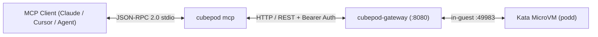

The `cubepod` binary includes a native **Model Context Protocol (MCP)** JSON-RPC 2.0 stdio server (`cubepod mcp`). Any MCP-compatible client—such as Claude Desktop, Cursor, Windsurf, or custom agent orchestrators—can provision persistent MicroVMs, execute shell commands, edit files, pause compute, and reset RootFS layers without custom glue code.

## Architecture & Protocol

- **Transport**: Line-delimited JSON-RPC 2.0 over `stdin` / `stdout`
- **Protocol Version**: `2024-11-05`
- **Server Info**: `{"name": "cubepod-mcp", "version": "<cubepod-version>"}`
- **Capabilities**: `tools` (`initialize`, `notifications/initialized`, `ping`, `tools/list`, `tools/call`)
- **Gateway Target**: Configured via `--gateway-url` / `$CUBEPOD_GATEWAY_URL` (default `http://127.0.0.1:8080`) and `--api-key` / `$CUBEPOD_API_KEY`.



## Available MCP Tools (`tools/list`)

`cubepod mcp` exposes 8 tools mapped directly to `pkg/client`:

### 1. `cubepod_create_sandbox`
Provision a new persistent MicroVM execution sandbox.

| Parameter | Type | Required | Description |
| :--- | :--- | :--- | :--- |
| `templateID` | `string` | No | Template ID for the sandbox base image (default: `cubeplex-ubuntu24-desktop`). |
| `timeout` | `integer` | No | Optional idle timeout in seconds before auto-pause. |

### 2. `cubepod_list_sandboxes`
List active and paused CubePod sandboxes, optionally filtered by template ID.

| Parameter | Type | Required | Description |
| :--- | :--- | :--- | :--- |
| `templateID` | `string` | No | Optional template ID filter. |

### 3. `cubepod_run_command`
Execute a shell command inside a CubePod sandbox.

| Parameter | Type | Required | Description |
| :--- | :--- | :--- | :--- |
| `sandboxID` | `string` | **Yes** | Target sandbox ID. |
| `command` | `string` | **Yes** | Shell command string to execute. |
| `workdir` | `string` | No | Optional working directory inside the sandbox (default: `/workspace`). |
| `background` | `boolean` | No | Whether to run the command in the background. |

### 4. `cubepod_read_file`
Read file contents from inside a CubePod sandbox.

| Parameter | Type | Required | Description |
| :--- | :--- | :--- | :--- |
| `sandboxID` | `string` | **Yes** | Target sandbox ID. |
| `path` | `string` | **Yes** | Absolute path of the file inside the sandbox. |

### 5. `cubepod_write_file`
Write content to a file inside a CubePod sandbox.

| Parameter | Type | Required | Description |
| :--- | :--- | :--- | :--- |
| `sandboxID` | `string` | **Yes** | Target sandbox ID. |
| `path` | `string` | **Yes** | Absolute destination path inside the sandbox. |
| `content` | `string` | **Yes** | Text or binary content to write. |
| `mode` | `string` | No | File permissions mode (default: `0644`). |

### 6. `cubepod_pause_sandbox`
Pause a running sandbox while retaining persistent volumes (`0` CPU/RAM).

| Parameter | Type | Required | Description |
| :--- | :--- | :--- | :--- |
| `sandboxID` | `string` | **Yes** | Target sandbox ID to pause. |

### 7. `cubepod_reset_rootfs`
Reset the persistent RootFS Upper layer of a sandbox while preserving `/workspace`.

| Parameter | Type | Required | Description |
| :--- | :--- | :--- | :--- |
| `sandboxID` | `string` | **Yes** | Target sandbox ID. |

### 8. `cubepod_delete_sandbox`
Permanently terminate and delete a CubePod sandbox.

| Parameter | Type | Required | Description |
| :--- | :--- | :--- | :--- |
| `sandboxID` | `string` | **Yes** | Target sandbox ID to delete. |
| `deleteVolumes` | `boolean` | No | Whether to also delete persistent volumes (default: `false`). |

## Client Configuration Examples

Ensure the `cubepod` binary is built and on your `PATH` (see [Go SDK & CLI](/sdks/go-and-cli/)).

### Claude Desktop

Add `cubepod` to your `claude_desktop_config.json` (`~/Library/Application Support/Claude/claude_desktop_config.json` on macOS or `~/.config/Claude/claude_desktop_config.json` on Linux):

```json
{
  "mcpServers": {
    "cubepod": {
      "command": "/usr/local/bin/cubepod",
      "args": [
        "--gateway-url", "http://127.0.0.1:8080",
        "mcp"
      ],
      "env": {
        "CUBEPOD_API_KEY": "your-api-key-if-configured"
      }
    }
  }
}
```

### Cursor / Windsurf / VS Code

Configure an `stdio` MCP server entry in `.cursor/mcp.json` or your IDE MCP settings:

```json
{
  "mcpServers": {
    "cubepod": {
      "command": "cubepod",
      "args": ["mcp"],
      "env": {
        "CUBEPOD_GATEWAY_URL": "http://127.0.0.1:8080",
        "CUBEPOD_API_KEY": "your-api-key"
      }
    }
  }
}
```

:::tip[Remember Leading Global Flags]
If you pass `--gateway-url` or `--api-key` in `args`, place them **before** `mcp` (for example `["--gateway-url", "http://127.0.0.1:8080", "mcp"]`), or set `CUBEPOD_GATEWAY_URL` and `CUBEPOD_API_KEY` in `env`.
:::

## Smoke Testing via `stdin` / `stdout`

You can verify the MCP server directly from your shell without an external IDE:

```bash
printf '%s\n' \
  '{"jsonrpc":"2.0","id":1,"method":"initialize","params":{}}' \
  '{"jsonrpc":"2.0","method":"notifications/initialized"}' \
  '{"jsonrpc":"2.0","id":2,"method":"tools/list"}' \
  | cubepod --gateway-url http://127.0.0.1:8080 mcp
```

Notifications (such as `notifications/initialized` or messages with no `id`) produce no output per the JSON-RPC 2.0 specification, while `initialize` and `tools/list` return single-line JSON responses.

## Agent Recovery Pattern with `reset_rootfs`

Because `cubepod_reset_rootfs` is exposed directly as an MCP tool, an AI coding agent that breaks system packages (e.g. an incompatible `apt` or global `pip` install) can self-heal without losing any source code or artifacts stored under `/workspace`:

1. Call `cubepod_reset_rootfs` with `sandboxID`.
2. Continue calling `cubepod_run_command` and `cubepod_read_file` against the same `sandboxID` and intact `/workspace`.
