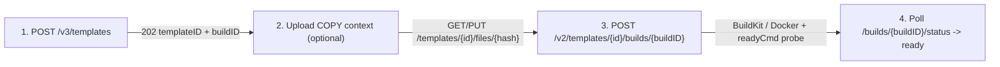

CubePod resolves every `templateID` passed to `POST /sandboxes` through the `PodTemplate` CRD (`cubepod.io/v1alpha1`) and supports two template workflows:

1. **Zero-BuildKit Registration (Alpha)**: Register an existing OCI registry image with CPU, memory, and RootFS size metadata.
2. **Dockerfile-Subset Recipe Builds (Beta)**: Build and push custom OCI images via **rootless BuildKit** in Kubernetes (or the local Docker daemon in `docker-loopback` mode) using the E2B-compatible `v3`/`v2` template build protocol.

## Feature Gates & Helm Settings

Template catalog and build endpoints are controlled by two independent flags on `cubepod-gateway` and `cubepod-controller`:

| Helm Value | CLI Flag | Default | Effect |
| :--- | :--- | :--- | :--- |
| `featureGates.e2bTemplateAPI` | `--e2b-template-api` / `--feature-gate=E2BTemplateAPI=true` | `false` | Switches `GET /templates` from the legacy 3-card `{"templates":[...]}` wrapper to the E2B JSON array (`E2BTemplate[]`), and enables `/v2/templates`, `/v3/templates`, `/templates/aliases/{alias}`, `/templates/tags`, `PATCH`, and `DELETE`. |
| `templateBuild.enabled` | `--template-build` | `false` | Enables `BuildKit` (Kubernetes) or local Docker recipe builds (`POST /v2/templates/{id}/builds/{buildID}` with `steps` and `PUT /templates/{id}/files/{hash}`). When `false`, those endpoints return HTTP `501`, though registering an existing `fromImage` with empty `steps` still works when `e2bTemplateAPI` is enabled. |

## Built-In Seeded Templates & Aliases

On startup, `cubepod-controller` seeds three default `PodTemplate` entries (without overwriting existing objects):

| Template Name | Aliases | Default Image | CPU / RAM / Disk |
| :--- | :--- | :--- | :--- |
| `cubeplex-ubuntu24-desktop` | `cubeplex-ubuntu24-desktop`, `base`, `code-interpreter`, `code-interpreter-v1`, `python` | `cubeplex-ubuntu24-desktop:latest` | `2` vCPU / `2048 MB` / `10Gi` RootFS + `20Gi` Workspace |
| `ubuntu-24-04` | `ubuntu:24.04` | `ubuntu:24.04` | `2` vCPU / `2048 MB` / `10Gi` RootFS + `20Gi` Workspace |
| `debian-12` | `debian:12` | `debian:12` | `2` vCPU / `2048 MB` / `10Gi` RootFS + `20Gi` Workspace |

If `POST /sandboxes` receives an unknown `templateID` containing a registry/tag shape (such as `ghcr.io/org/custom:v1`), CubePod falls back to booting that string as a direct OCI image reference unless it matches an in-progress/unready `PodTemplate`.

## Path 1: Register an Existing OCI Image (No BuildKit)

When you already have an OCI image in a registry your cluster can pull, register it with `fromImage` and empty `steps`:

```python
# Python SDK
from cubepod import CubePod

with CubePod(base_url="http://localhost:8080") as client:
    res = client.create_template_from_image(
        from_image="python:3.13-slim",
        alias="py313-slim",
        cpu_count=2,
        memory_mb=2048,
        min_free_disk_mb=10240,
        wait=True,
    )
    print(res["templateID"], res["aliases"])
```

```bash
# cubepod CLI
cubepod template create \
  --from-image python:3.13-slim \
  --alias py313-slim \
  --cpu 2 \
  --memory-mb 2048 \
  --disk-mb 10240
```

Once ready, launch sandboxes using either `templateID` or the alias `py313-slim`.

## Path 2: Custom Recipe Builds (`POST /v3/templates` + `POST /v2/.../builds`)

When `templateBuild.enabled=true`, CubePod implements the E2B multi-step build flow:



### Example in TypeScript

```ts
import { CubePodClient } from 'cubepod';

const client = new CubePodClient({ baseUrl: 'http://localhost:8080' });

// 1. Register template build slot
const reg = await client.createTemplate({
  name: 'ml-sandbox:v1',
  cpuCount: 4,
  memoryMB: 4096,
  minFreeDiskMb: 12288,
});

// 2. Start BuildKit build
await client.startTemplateBuild(reg.templateID, reg.buildID, {
  fromImage: 'python:3.13',
  steps: [
    { type: 'ENV', args: ['PIP_NO_CACHE_DIR', '1'] },
    { type: 'RUN', args: ['pip install numpy pandas matplotlib'] },
    { type: 'WORKDIR', args: ['/app'] },
    { type: 'USER', args: ['1000:1000'] },
  ],
  startCmd: 'python3 -m http.server 8000',
  readyCmd: 'curl -fsS http://127.0.0.1:8000 >/dev/null',
});

// 3. Poll until status === 'ready' or 'error'
let status = await client.getTemplateBuildStatus(reg.templateID, reg.buildID);
while (status.status === 'waiting' || status.status === 'building') {
  await new Promise((r) => setTimeout(r, 1000));
  status = await client.getTemplateBuildStatus(reg.templateID, reg.buildID);
}
if (status.status === 'error') {
  throw new Error(`${status.reason?.step}: ${status.reason?.message}`);
}
```

### Supported Build Steps & Validation Rules

`RenderDockerfile` in `pkg/controller/template.go` validates every step before invoking BuildKit or Docker:

| Step Type | Arguments | Behavior & Constraints |
| :--- | :--- | :--- |
| `RUN` | `[command, optionalUser]` | Runs shell command. Preceding `ENV` variables are exported inline during `RUN`. |
| `COPY` / `ADD` | `[src, dest, optionalChown, optionalMode]` | Copies from uploaded `filesHash` tar context (`64` lowercase hex chars). Rejects absolute `src`, `..` traversal, copying `podd`/`podd-init`, or `dest` under `/workspace`. |
| `WORKDIR` | `[dir]` | Sets working directory. **Rejects `/workspace` or subdirectories** (HTTP `400`). |
| `USER` | `[uid \| uid:gid \| username]` | Sets image `USER` and populates `PodTemplate` runtime user (`runAsUser` / `runAsGroup` / `runAsUsername`). |
| `ENV` | `[key1, val1, key2, val2, ...]` | **Build-time only** (applied to subsequent `RUN` steps, not persisted in image `Config.Env`). |
| `ARG` | — | **Disallowed** (HTTP `400`). CubePod only emits an internal `ARG CUBEPOD_CACHEBUST` when `force: true`. |

:::caution[Why `/workspace` Is Forbidden During Template Builds]
In CubePod, `/workspace` is dynamically mounted at Pod startup from a per-sandbox `workspace-pvc` (see [Dual-Volume Persistence](/concepts/dual-volume-persistence/)). Any file written to `/workspace` during image build would be masked at runtime and could pollute persistent user workspaces, so `WORKDIR`, `COPY`, and `ADD` targeting `/workspace` fail fast with HTTP `400`. Place baked assets in `/app`, `/opt`, or `/home/user` instead.
:::

### Important Differences from Firecracker Snapshot Builders

1. **No `podd` or `podd-init` in Template Images**: CubePod injects `/opt/cubepod/bin/{podd-init,podd}` via `initContainer` at Pod startup. Attempting to `COPY`/`ADD` binaries named `podd` or `podd-init` is rejected (`400`).
2. **`startCmd` & `readyCmd` Execution Model**: CubePod does not snapshot guest RAM at build time. Instead, `PodTemplate.spec.startCmd` is started by `podd` after `pivot_root` on every sandbox boot, and `readyCmd` is probed up to `templateBuild.probeTimeout` (default `120s`). If `readyCmd` times out on sandbox creation, `POST /sandboxes` returns `503` with `sandboxID` and `logPath: "/var/log/cubepod/start-cmd.log"` so you can inspect logs.
3. **Zero Impact on Existing Sandboxes**: Rebuilding a template updates `PodTemplate` for **new** sandboxes only. Existing `rootfs-pvc` and `workspace-pvc` volumes are never touched, and if a rebuild fails (`error`), the previous `ready` image remains active.
4. **Build Status Machine**: `waiting` → `building` (wire mapping combines internal `uploaded` and `building`) → `ready` or `error`.

## Registry Credentials & Security Separation

CubePod strictly separates **base-image pull credentials** from **target template registry credentials**:

- **`fromImageRegistry`**: Passed per-build by the user (`{type, username, password}`) to pull a private base image. The controller stores it in an ephemeral Secret (`cubepod-template-src-<buildID>`), passes it only to the BuildKit session, scrubs the password (`[REDACTED]`) from build logs, rejects steps containing the password or `cpodref_` references, and deletes the Secret once the build finishes (`ready` or `error`).
- **Cluster Target Registry (`templateBuild.registry`)**: Configured by cluster operators via Helm (`url`, `repositoryPrefix`, `pushSecret`, `pullSecret`). `pushSecret` pushes the built image to `<url>/<repositoryPrefix>/...`, while `pullSecret` is attached as `imagePullSecrets` on probe and sandbox Pods.

See [Helm Chart Values](/reference/helm-values/) and [Kubernetes CRDs](/reference/crds/) for the full `PodTemplate` and `templateBuild` field definitions.
