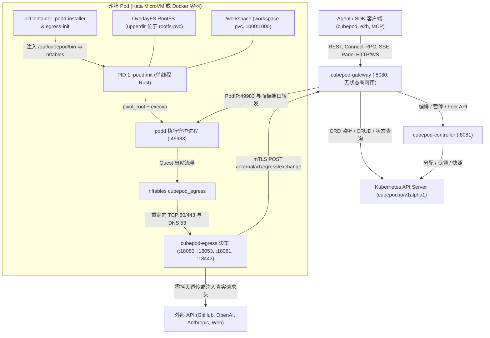

CubePod 将 **Agent 编排控制面**、**持久化存储**、**硬件计算隔离**、**Guest 内执行引擎** 与 **出站凭证安全边界** 清晰解耦为一组职责单一的组件，并在 **生产级 Kubernetes（`Kata + CSI Block`）** 与 **本地开发（`Docker + Loopback ext4`）** 之间保持一致行为语义。

## 端到端拓扑架构

## 控制面与编排组件

### 1. 无状态高可用控制面网关 (`cubepod-gateway`)

实现于 `cmd/cubepod-gateway/` 与 `pkg/gateway/`，`cubepod-gateway` 监听 **`:8080`** 并承接全部外部入口流量：

- **E2B 兼容与超集 API**：统一提供沙箱生命周期接口（`POST /sandboxes`、`/v2/sandboxes`）、命令与文件数据面、Connect-RPC（`/process.Process/*`、`/filesystem.Filesystem/*`）、子域名端口路由（`<port>-<sandboxID>.<domain>`）以及可选 E2B 模板构建（`--e2b-template-api`）。
- **自动唤醒与就绪探针**：收到发往 `Paused` 沙箱的请求时，网关自动将 `desiredState` 置为 `Running`，并通过 `waitForPoddReady` 轮询 `podd` `/health` 直至就绪后再转发请求。
- **无状态多副本高可用**：所有权威沙箱元数据均持久化在 Kubernetes `PodBox` 注解（`cubepod.io/template-id`、`cubepod.io/timeout-seconds`、`cubepod.io/volume-key`、`cubepod.io/metadata-*`、`cubepod.io/resolved-image`、`cubepod.io/forked-from`）与 `status.podIP` 中。任意副本发生本地缓存未命中时，都会通过 `resolveSandbox` 从集群直接重建路由上下文。
- **签名面板代理与凭证交换**：签发并校验 HMAC-SHA256 `/panel/{token}/` 访问地址，并通过 mTLS 暴露内部接口 `POST /internal/v1/egress/exchange` 完成 `cpodref_` 占位符密钥替换。

### 2. Kubernetes Operator (`cubepod-controller`)

实现于 `cmd/cubepod-controller/` 与 `pkg/controller/`，`cubepod-controller` 负责调谐定义在 `deploy/helm/cubepod/crds/` 下的三类 **`cubepod.io/v1alpha1`** 自定义资源（`api/v1alpha1/types.go` 同时声明 `CRDGroup = "cubepod.io"` 与 `GroupName = "pod.cubeplex.ai"`）：

- **`PodBox` (`pb`, `pbox`)**：描述单个持久化沙箱，包含独立 RootFS 与 `/workspace` PVC、生命周期超时策略、`forkFrom` 谱系及 `networkPolicy`。
- **`PodTemplate` (`pt`, `ptemplate`)**：定义基础 OCI 镜像、`runtimeClassName`（`kata-qemu`、`kata-clh` 或本地开发留空）、CPU/内存配额、存储类以及默认出站规则。
- **`PodWarmPool` (`pwp`, `warmpool`)**：维护预启动、预挂载双卷的待命 MicroVM 池，通过 Kubernetes 原子 CAS 标签更新实现 `< 50 ms` 极速认领。

此外，Controller 还负责双 PVC 生命周期管理、`rootfsGeneration` 无损重置、跨代 `ForkFrom` 解析、空闲/过期回收（`ReapIdle`）以及每 Pod ECDSA P-256 mTLS 与 MITM CA 证书签发（`ensureEgressSecretsLocked`）。

## 数据面与 Guest 内组件

### 3. 纯净镜像注入与 Rust 运行时 (`podd-init` 与 `podd`)

CubePod 从不要求在用户 Dockerfile 中植入任何专用二进制或启动脚本：

- `images/podd/Dockerfile` 将静态编译的 Rust 二进制打包在精简的 `busybox:1.37-musl` 注入镜像 `/opt/cubepod/dist/` 中。
- Kubernetes 通过 `initContainer`（`podd-installer`）将 `/opt/cubepod/bin/{podd-init,podd}` 复制到 Pod 共享 `emptyDir`（本地 Docker 模式则直接以只读方式绑定挂载二进制目录）。
- **`podd-init`**（`crates/podd-init/`）作为**单线程 PID 1** 运行：探测并自愈 `ext4`（`blkid` / `mkfs.ext4` / `e2fsck -p`），挂载 RootFS `OverlayFS`（`lowerdir=/`）与 `1000:1000` `/workspace`，跨挂载命名空间绑定 `/opt/cubepod`，完成 `pivot_root` 后 `execvp` 进入 `podd`。
- **`podd`**（`crates/podd/`）在 **`:49983`** 提供命令执行（游标增量日志、PGID 清理、Connect-RPC）、单文件及流式 `.tar.gz` `archive-sync`、崩溃一致性 `FIFREEZE`/`FITHAW` 静默以及 6 种有状态代码解释器内核。

### 4. 零信任出站边车 (`cubepod-egress`)

`cubepod-egress`（`cmd/cubepod-egress/`、`pkg/egress/`）以独立非特权 UID `65532` 边车容器运行在同一沙箱 Pod 内，执行域名策略评估（`DenyHosts` > `AllowHosts` > `DefaultAction`），在 `:18053` 拦截未授权 DNS（`RCODE=5`），接收 `nftables` 重定向的 HTTP/TLS 连接（`:18081` / `:18443`），对普通流量执行零拷贝 TCP 拼接，仅对绑定了密钥的目标主机启动选择性 HTTPS MITM 并通过 mTLS 替换 `cpodref_`。

### 5. 按需交互式桌面栈 (`images/desktop/`)

桌面镜像默认以 `CMD ["sleep", "infinity"]` 启动（几乎 0 MiB 闲置内存开销），并在收到请求后通过 `/opt/cubepod/desktop/cubepod-desktop-ctl` 懒启动 `Xvfb`、`openbox`、Chromium CDP（`127.0.0.1:9222`）、`x11vnc`/`websockify`/`noVNC`（`:8080`）和 `ttyd`（`:7681`）。

## 双运行时对等矩阵

| 架构层次 | 生产级 Kubernetes (`Kata + CSI Block`) | 本地开发 (`Docker + Loopback`) |
| :--- | :--- | :--- |
| **计算隔离** | `Kata Containers`（`runtimeClassName: kata-qemu` / `kata-clh`） | Docker 容器（`CUBEPOD_RUNTIME_MODE=docker-loopback`） |
| **存储后端** | 两块 `volumeMode: Block` PVC（`/dev/cubepod-rootfs`、`/dev/cubepod-workspace`）或回退至 `volumeMode: Filesystem` | 每沙箱独立的稀疏 `.ext4` 回环文件（`cubepod-volumes`） |
| **Guest 挂载路径** | `podd-init` 在 VM 内核中挂载 `OverlayFS`（`lowerdir=/`）与 `/workspace` | 与生产完全一致的 `podd-init` `e2fsck` + `OverlayFS` + `pivot_root` |
| **CoW Fork 实现** | `podd` `FIFREEZE` -> CSI `DataSourcePVC` / 快照克隆 -> `FITHAW` | `podd` `FIFREEZE` -> `cp --reflink=auto --sparse=always -a` -> `FITHAW` |
| **运行时注入方式** | `podd-installer` `initContainer` -> `emptyDir` `/opt/cubepod/bin` | 宿主机只读绑定 `-v <binDir>:/opt/cubepod/bin:ro` |

> **关于默认配置的差异说明：** 生产 Helm Chart（`deploy/helm/cubepod/values.yaml`）与 `controller.NewReconciler()` 默认采用 `volumeMode: Block`、`runtimeClassName: kata-qemu` 和 `storageClassName: longhorn-v2-block-thin`；而直接运行独立二进制 `cubepod-controller` / `cubepod-gateway` 时，命令行默认 flag 为 `-volume-mode=Filesystem`、`-storage-class=nfs-storage` 和 `-runtime-class=""`（可按需通过参数覆盖）。

## 下一步

- 了解 RootFS 与工作区的隔离机制：**[双卷持久化存储](/zh/concepts/dual-volume-persistence/)**。
- 深入 PID 1 与守护进程实现：**[Guest 内核运行时 (podd-init & podd)](/zh/concepts/in-guest-init-and-podd/)**。
- 探索 `< 50ms` 调度与无状态高可用：**[生命周期、WarmPool、CoW Fork 与高可用](/zh/concepts/lifecycle-warmpool-fork/)**。
