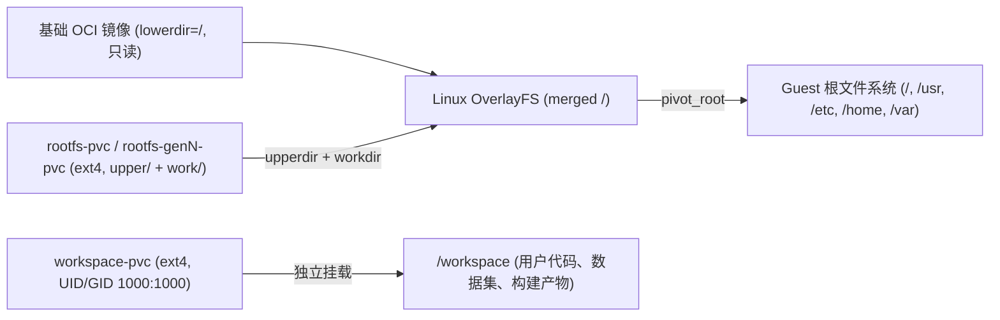

**双卷独立性（Dual-Volume Independence）** 是 CubePod 最核心的架构不变量之一：`/workspace`（`workspace-pvc`）的生命周期与容器持久化操作系统 `OverlayFS` 层（`rootfs-pvc`）严格解耦。

## 为什么必须分离两块持久化卷？

如果将系统状态与用户工作区混为一谈，或任由 RootFS 处于瞬态：

- **当 RootFS 为瞬态层时**：Agent 通过 `apt-get`、`npm -g`、`pip` 安装的依赖、Playwright 浏览器以及 `/etc` 系统配置，会在算力暂停（`Paused`）或 Pod 跨节点调度后全部消失。
- **当 OS 与 `/workspace` 强绑定为单一卷时**：一旦 Agent 破坏了系统库或需要升级基础 OCI 镜像，清理环境就会连同源代码、训练数据与构建产物一起误删。

CubePod 通过为每个 `PodBox` 绑定**两块独立持久卷**彻底解决了上述矛盾：

## 沙箱内的双卷布局

| 卷角色 | 默认大小 (`manifests.go`) | PVC 命名规范 | Guest 内挂载路径 | 属主与职责 |
| :--- | :--- | :--- | :--- | :--- |
| **RootFS Upper** | `10Gi` | `<box>-rootfs-pvc`（第 1 代）或 `<box>-rootfs-gen<N>-pvc`（第 `> 1` 代） | 块设备 `/dev/cubepod-rootfs` -> 挂载于 `/mnt/cubepod-upper` -> `OverlayFS` `upperdir` + `workdir` | 在只读 OCI `lowerdir` 之上持久化所有系统级修改（`/usr`、`/etc`、`/var`、已安装软件与系统库）。 |
| **Workspace** | `20Gi` | `<box>-workspace-pvc` | 块设备 `/dev/cubepod-workspace` -> 直接挂载于 `/workspace` | 专供工作区数据，默认初始化为 `UID:GID 1000:1000`（`cubeplex`）。在基础镜像升级或 RootFS 重置期间保持原样不变。 |

在 Kubernetes 中，这两块 PVC 均附带标准标签（`pod.cubeplex.ai/box: <boxName>` 与 `pod.cubeplex.ai/vol-type: rootfs | workspace`），确保回收清理、CoW 快照克隆及跨代跟踪精确无误。

## 无损系统重置 (`rootfsGeneration`)

当 AI Agent 损坏了系统共享库、污染了 `/etc` 配置或需要切换新版基础镜像时，CubePod 无需破坏 `/workspace`：

1. 客户端调用 `POST /sandboxes/{id}/reset-rootfs`（或 `client.reset_rootfs(id)` / `sandbox.resetRootfs()`），或直接递增 `PodBox.spec.rootfsGeneration`。
2. `cubepod-controller` 检测到 `spec.rootfsGeneration` 与 `status.observedRootfsGeneration` 不一致，将 `PodBox` 推进至 `ResettingRootFS` 阶段。
3. 控制器销毁旧 Pod，创建一块**全新 RootFS PVC**（`<box>-rootfs-gen<N>-pvc`），同时完全保留原 `<box>-workspace-pvc`（`status.workspacePVCName`）。
4. 新 Pod 基于全新的空白 `upperdir` 启动，并重新挂载同一块 `/workspace` 持久卷，同时更新 `status.observedRootfsGeneration` 与 `status.rootfsPVCName`。

> **关于多代 CoW Fork 的重要细节：** 若父沙箱此前执行过一次或多次 `reset-rootfs`（`rootfsGeneration > 1`），其当前活跃 RootFS PVC 名称已变为 `<parent>-rootfs-gen<N>-pvc` 而非 `<parent>-rootfs-pvc`。控制器内的 `resolveParentPVCNames` 会直接读取父沙箱的 `status.RootfsPVCName` 与 `status.WorkspacePVCName`，确保 Fork 始终克隆真实的最新一代数据。

## 跨生产与本地开发的三类存储后端

`pkg/controller/manifests.go` 与 `pkg/runtime/docker.go` 将同一双卷抽象落地在三种后端模式中：

### 1. CSI 原始块设备 (`volumeMode: Block` + Kata MicroVM)

在生产集群中（`kata-qemu` / `kata-clh` 搭配 Longhorn V2 SPDK、OpenEBS LVM-LocalPV、Ceph RBD 或云厂商 EBS）：

- `BuildBlockPVCs` 创建两块 `volumeMode: Block` PVC，并通过 Pod `volumeDevices` 将其直接映射为 `/dev/cubepod-rootfs` 与 `/dev/cubepod-workspace`。
- 在 Kata 客户机内核内部，`podd-init` 通过 `blkid` 识别设备：首次启动执行 `mkfs.ext4 -F -L ... -m 0 -E lazy_itable_init=0,lazy_journal_init=0`，后续启动或 Fork 后自动运行 `e2fsck -p`，并以 `-o noatime` 挂载 `ext4`，最终在 MicroVM 独立内核中完成 `OverlayFS` 组装。
- **为什么 Kata 必须使用原始块设备：** 在普通宿主机容器的 `overlayfs` 根文件系统中直接嵌套挂载 `OverlayFS` 会触发 Linux 内核限制（`overlay` 的 `lowerdir` 不能直接位于另一 `overlay` 上）或污染宿主机 containerd 层。而通过 `virtio-blk` 将块设备透传进 Kata VM 内核，可彻底绕开宿主机约束。

### 2. CSI 文件系统回退模式 (`volumeMode: Filesystem`)

在未部署原始块存储或无 Kata 运行时的标准 Kubernetes 集群中（`runtimeClassName: ""`、`-volume-mode=Filesystem`）：

- `BuildBlockPVCs` 申请常规 `volumeMode: Filesystem` PVC，并作为普通 `volumeMounts` 挂载到 `/mnt/cubepod/rootfs` 与 `/workspace`。
- `podd-init` 检测到缺少块设备（或环境变量 `CUBEPOD_SKIP_PIVOT=1`）时，自动跳过格式化与 `pivot_root`，在 `/run/cubepod/init-state.json` 中记录 `pivoted: false` 并启动 `podd`，从而保证 `/workspace` 在 Pod 重启后依旧持久化保留。

### 3. 本地 Docker 回环模式 (`CUBEPOD_RUNTIME_MODE=docker-loopback`)

面向无 Kubernetes 环境的单机开发与调试：

- `pkg/runtime/docker.go` 为每个沙箱生成稀疏 `.ext4` 回环文件，并以 `--entrypoint /opt/cubepod/bin/podd-init` 挂载注入容器。
- `podd-init` 执行与 Kata MicroVM 完全一致的 `blkid` / `e2fsck -p` / `OverlayFS` / `pivot_root` 流程，让开发者在笔记本电脑上即可复现生产行为。

## 下一步

- 查看 Guest 内部精确的 PID 1 启动步骤：**[Guest 内核运行时 (podd-init & podd)](/zh/concepts/in-guest-init-and-podd/)**。
- 了解 `PodWarmPool` 与 `ForkFrom` 如何高效管理双卷快照：**[生命周期、WarmPool、CoW Fork 与高可用](/zh/concepts/lifecycle-warmpool-fork/)**。
- 配置集群块存储驱动：**[Kata 与块存储配置](/zh/deployment/kata-and-block-storage/)**。
