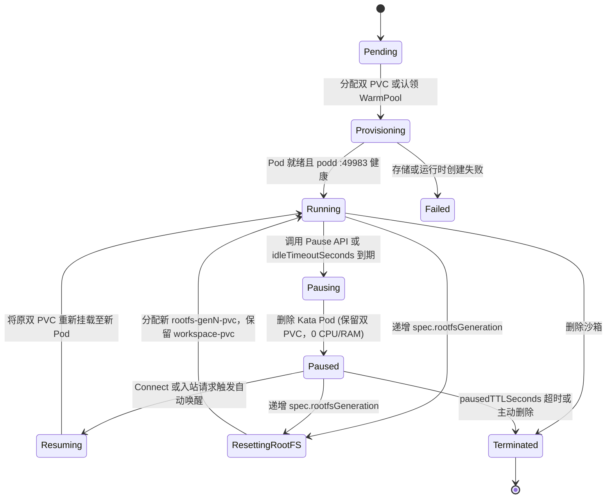
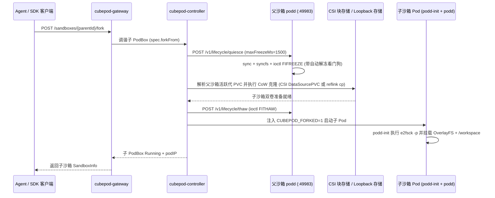

CubePod 将 Kubernetes 原生调谐（`pkg/controller/reconciler.go`）与无状态网关路由（`pkg/gateway/sandboxes.go`）结合在一起，为持久化 MicroVM 提供 **`< 50 ms` 启动**、**闲置时 `0 CPU / 0 RAM` 休眠**、**崩溃一致性秒级克隆**以及**无状态多副本高可用**（[CEP-0022](/zh/ceps/)）。

## `PodBox` 生命周期状态机

`PodBox`（`cubepod.io/v1alpha1`）将**期望计算状态**（`spec.desiredState`：`Running` 或 `Paused`）与**控制器观测阶段**（`status.phase`）解耦，在算力暂停或操作系统重置期间始终保留双持久卷（`status.rootfsPVCName` 与 `status.workspacePVCName`）。

### 空闲自动暂停、租约保护与透明唤醒

- **空闲回收 (`ReapIdle`)**：`cubepod-controller` 持续对照 `status.lastActivityAt` 与 `spec.lifecycle.idleTimeoutSeconds`。若 Agent 持有尚未过期的租约（`spec.lifecycle.leaseExpiresAt` 在未来），控制器会延后自动暂停，防止长任务中途休眠。
- **算力暂停归零**：将 `desiredState` 设为 `Paused` 会销毁计算 Pod（清空 `status.podName` 与 `status.podIP`），而 `<box>-rootfs-pvc` 与 `<box>-workspace-pvc` 保持完整保留。
- **暂停 TTL 清理**：当 `status.pausedAt` 超过 `spec.lifecycle.pausedTTLSeconds` 后，控制器自动清理过期持久卷。
- **透明自动唤醒**：向处于 `Paused` 状态的沙箱发起任意请求——无论是显式 `POST /sandboxes/{id}/connect`、数据面 `/commands` 或 `/files`、通配符子域名访问、桌面启动还是 `/panel/{token}/` 代理——`cubepod-gateway` 都会自动将 `desiredState` 切回 `Running`，并通过 `waitForPoddReady` 等待 `podd` `/health` 就绪后无缝完成转发。

## 基于 `PodWarmPool` 的 `< 50 ms` 极速创建

冷创建 PVC、挂载 CSI 块设备、启动 Kata VM 与执行 `e2fsck` 通常耗时数秒。`PodWarmPool` 将上述重操作全部前移至后台预热：

1. **后台预热**：`cubepod-controller` 针对每个池维护 `spec.replicas` 个待命 Kata Pod（命名为 `<pool>-warm-<N>-kata-pod`），内部已完成双 PVC 预绑定、`podd-init` `OverlayFS` 组装及 `/workspace` 初始化，`podd`（`:49983`）随时待命。
2. **原子 CAS 认领 (`ClaimPod`)**：当 `handleCreateSandbox` 指定 `warmPoolRef`（或通过 `FindAvailableWarmPool` 自动匹配可用池）时，`ClaimPod` 使用 Kubernetes 乐观锁执行 **CAS 标签原子更新**（`cubepod.io/claimed=true`、`cubepod.io/claimed-by=<boxName>`），彻底消除高并发下多个请求重复认领同一个预热 Pod 的竞态条件。
3. **瞬时归属切换与自动补齐**：认领成功后 Pod 与其双 PVC 立即绑定给新 `PodBox`（`< 50 ms` 可用），控制器随即异步补充新的待命 Pod 至目标 `spec.replicas`。

## 崩溃一致性跨代 CoW Fork (`spec.forkFrom`)

对活跃沙箱执行 Fork，使 AI Agent 能够并行尝试多种修复分支或构建实验，且丝毫不中断或污染父沙箱。

### CoW Fork 关键不变量

- **有界冻结防死锁**：父沙箱 `podd` 在刷新脏页（`sync` + `syncfs`）后调用 `FIFREEZE`（`0xC0045877`），由单调时钟看门狗约束最长冻结窗口（`maxFreezeMs` 限制在 `[100, 5000]` ms，默认 `1500` ms）。即使 `cubepod-controller` 在克隆中途崩溃重启，父 MicroVM 也会按时自动解冻。
- **双后端无缝实现**：
  - **Kubernetes CSI 模式**：`cubepod-controller` 通过 `dataSource`（`DataSourcePVC` / 快照克隆）创建指向父沙箱 RootFS 与 Workspace 卷的子 PVC。
  - **本地 Docker Loopback 模式**：`pkg/runtime/docker.go` 调用 `quiesceSandbox`，利用 `cp --reflink=auto --sparse=always -a` 克隆两个稀疏 `.ext4` 文件，随后触发 `thaw` 并以 `CUBEPOD_FORKED=1` 启动子容器。
- **跨代 PVC 解析 (`resolveParentPVCNames`)**：若父沙箱此前执行过 `reset-rootfs`（`rootfsGeneration > 1`），其实际在用的 RootFS PVC 名为 `<parent>-rootfs-gen<N>-pvc`。`resolveParentPVCNames` 会直接读取父沙箱的 `status.RootfsPVCName` 与 `status.WorkspacePVCName`，避免错克隆第 1 代旧卷。

## 无状态多副本网关高可用

在生产集群中，多个 `cubepod-gateway` 副本部署在 Service / LoadBalancer 后方，无需粘性会话或 Redis 共享状态：

- **Kubernetes CRD 即单一事实来源**：网关在每次变更时将权威元数据写入 `PodBox` 注解（`cubepod.io/template-id`、`cubepod.io/timeout-seconds`、`cubepod.io/volume-key`、`cubepod.io/metadata-*`、`cubepod.io/resolved-image`、`cubepod.io/forked-from`）以及 `spec.networkPolicy` 与 `status.podIP`。
- **缓存未命中自动重建 (`resolveSandbox`)**：当任意副本因滚动升级或轮询负载均衡收到本地缓存中不存在的 `sandboxID` 请求时，`resolveSandbox` 直接向 Kubernetes 读取 `PodBox`，重构完整 `SandboxRecord`，并在沙箱处于 `Paused` 时自动唤醒后直接代理至 `http://<status.podIP>:49983`。

## 下一步

- 查阅 `PodBox`、`PodTemplate` 与 `PodWarmPool` 全部字段定义：**[CRD 参考](/zh/reference/crds/)**。
- 了解凭证如何在跨唤醒、跨 Fork 边界下保持零泄露：**[零信任出站代理与凭证保险库](/zh/concepts/zero-trust-egress/)**。
- 阅读英文原版详细提案：**[CEP 提案总览](/zh/ceps/)**。
