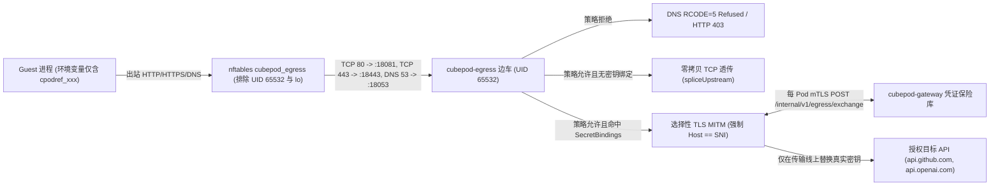

AI Agent 经常需要使用高权限凭据调用外部 API（OpenAI、Anthropic、GitHub、Slack 或企业内网接口）。一旦将真实密钥写入环境变量，提示词注入（Prompt Injection）、恶意第三方包或一次简单的 `env` / `/proc/self/environ` 读取就会直接导致凭证外泄。

CubePod 在设计上严格坚守 **零信任出站密钥安全（Zero-Trust Egress Secret Safety）** 不变量（参见 **[CEP 提案总览](/zh/ceps/)** 中的 CEP-0005 与 CEP-0020）：

> **真实外部 API 密钥绝不允许进入沙箱环境变量、文件系统或 Guest 进程内存。** MicroVM 内仅注入不透明的 `cpodref_` 占位符，由沙箱外围边车在出站边界通过每沙箱 mTLS 实时替换。

## 架构与流量链路

## 1. `cpodref_` 占位符与凭证绑定

创建沙箱并传入 `secretBindings` 时，用户将环境变量名（如 `GITHUB_TOKEN`）与真实密钥、`allowedHosts`（如 `["api.github.com"]`）及可选 `allowedHeaders`（如 `["Authorization"]`）关联：

- `Vault.BindSecret`（`pkg/egress/vault.go`）将原始明文密钥保存在控制面 Vault 中，并生成形如 **`cpodref_` + 32 位小写 Base32 字符**的确定性占位符。
- 沙箱内部只看得到 `GITHUB_TOKEN=cpodref_<32chars>`。即便恶意脚本遍历环境变量并将其发送至攻击者服务器（`evil.example.com`），目标服务器收到的也只是毫无价值的占位符字符串。

## 2. 每 Pod 独立密码学身份 (`mTLS` + `MITM CA`)

`cubepod-controller`（`pkg/controller/reconciler.go` 中的 `ensureEgressSecretsLocked`）会为每个沙箱自动签发两组 **ECDSA P-256** Kubernetes `Secret`：

| Secret 名称 | 包含内容 | 挂载位置 | 安全作用 |
| :--- | :--- | :--- | :--- |
| **`<box>-egress-mtls`** | 每 Pod 客户端叶证书/私钥（`CN = <sandboxID>`）、集群 CA 证书，以及该 Pod 专属的 MITM CA 私钥与公钥证书 | **仅挂载**到 `cubepod-egress` 边车容器 `/etc/cubepod/certs` | 用于边车向 `cubepod-gateway` 发起 mTLS 身份校验，并在选择性 MITM 时签发临时目标域名叶证书。 |
| **`<box>-egress-ca`** | **仅含公开 `mitm-ca.crt` 公钥证书**（无任何私钥） | 挂载到用户沙箱 `/etc/cubepod/ca` | 通过 `NODE_EXTRA_CA_CERTS`、`CUBEPOD_EXTRA_CA_CERT`（以及代理变量 `HTTP_PROXY`/`HTTPS_PROXY=http://127.0.0.1:18080`）注入，让沙箱内客户端信任选择性 MITM 证书，同时完全接触不到私钥。 |

## 3. 双模式流量劫持：显式代理 + `nftables` 透明拦截

`cubepod-egress`（`cmd/cubepod-egress/`、`pkg/egress/`）同时覆盖标准代理感知客户端与忽略代理环境变量的静态二进制或原生 Socket：

- **显式代理监听 (`:18080`)**：为遵守 `HTTP_PROXY` / `HTTPS_PROXY` 的程序提供 HTTP 代理与 `HTTPS CONNECT` 隧道。
- **透明劫持模式 (`CUBEPOD_TRANSPARENT=1`)**：由 `images/egress/egress-init.sh` 在 Pod 网络命名空间预先写入 `nftables` 表 `cubepod_egress`：
  - 将出站 **TCP `80`** 重定向至 **`:18081`**（透明 HTTP）
  - 将出站 **TCP `443`** 重定向至 **`:18443`**（透明 TLS SNI 路由器）
  - 将出站 **UDP/TCP `53`** 重定向至 **`:18053`**（策略强管控 DNS 代理）
  - 拒绝出站 **UDP `443`**（阻断 HTTP/3 QUIC 绕过，促使客户端透明回落至 TCP/TLS）
  - 放行回环地址与 **`skuid 65532`**（`cubepod-egress` 边车运行身份 UID），确保边车自身的对外建连不会产生死循环

## 4. 出站策略与 DNS 隧道防护

所有目标主机均依据 `spec.networkPolicy`（`pkg/egress/policy.go`）按确定顺序匹配：

1. **`DenyHosts`** 优先级最高，命中即拒绝。
2. **`AllowHosts`** 次之。
3. **`DefaultAction`**（`Allow` 或 `Deny`）作为最终兜底。

通配符严格遵循**点号边界匹配**：`*.github.com` 仅匹配 `api.github.com` 或 `uploads.github.com`，绝不会误匹配 `evilgithub.com`。

在 **`:18053`** 端口上，`cubepod-egress`（`pkg/egress/dns.go`）实时审查 DNS 查询域名，对被策略禁止的域名直接返回 **`RCODE=5`（`Refused`）**，从源头封堵 DNS 隧道外传数据。

## 5. 选择性 HTTPS MITM 与零拷贝透传

针对策略放行的 TLS 流量（`CONNECT :18080` 或透明 `:18443`），`pkg/egress/sni.go` 先利用 `prefixConn` 窥探原始 TLS `ClientHello` 中的 **SNI**（`pkg/egress/proxy.go`）：

- **非密钥目标站点 -> 零拷贝 TCP 透传 (`spliceUpstream`)**：只要 SNI 域名未出现在任何 `SecretBindings[].AllowedHosts` 中，`cubepod-egress` **绝不解密 TLS 报文**，直接将预读字节与连接通过零拷贝转发给上游（或串接 `spec.networkPolicy.upstreamProxy`），完整保留端到端 TLS 证书与 WebSocket/HTTP2 行为。
- **密钥绑定站点 -> 选择性 MITM (`serveMITMTLS`)**：仅当目标主机属于某条密钥绑定的 `AllowedHosts` 时，边车才使用每 Pod MITM CA 终止 TLS：
  1. 严格校验 **`HTTP Host == TLS SNI`**；若发现不一致的域前置（Domain Fronting）尝试，直接返回 **`HTTP 421 Misdirected Request`**。
  2. 扫描请求头中的 `cpodref_` 令牌（若配置了 `AllowedHeaders`，仅检查白名单 Header）。
  3. 通过 **每沙箱 mTLS** 向 `cubepod-gateway` 发起 `POST /internal/v1/egress/exchange`，网关严格校验边车客户端证书 **`CN == sandboxID`**、目标 `sniHost` 与 `headerName`。
  4. 仅在内存传输缓冲区中将 `cpodref_...` 替换为真实凭证发出请求，绝不写入磁盘日志或回流进 Guest 容器。

边车还在 **`:19090`** 暴露 `/metrics`（Prometheus）与 `/healthz` 探针端口。

## 下一步

- 在 **[CRD 参考](/zh/reference/crds/)** 中查看 `networkPolicy` 与 `secretBindings` 完整字段。
- 在 **[CEP 提案总览](/zh/ceps/)** 查阅 CEP-0005 与 CEP-0020 完整设计规范。
