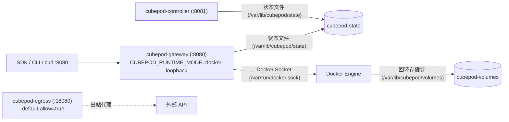

CubePod 在 `deploy/docker-compose/docker-compose.yaml` 中提供了自包含的 `docker-compose` 本地拓扑，无需依赖 Kubernetes、KVM 或 Kata Containers，即可在单台 Docker 宿主机上完成控制面、SDK、CLI 与 MCP 服务端的开发和测试。

## 服务拓扑与共享存储卷



`cubepod-gateway` 与 `cubepod-controller` 共同挂载 `cubepod-state` 命名卷（`/var/lib/cubepod/state`），同时 `cubepod-gateway` 额外挂载宿主机 Docker Socket（`/var/run/docker.sock`）和 `cubepod-volumes` 命名卷（`/var/lib/cubepod/volumes`）。

## 快速启动

在仓库根目录启动全部三个服务：

```bash
docker compose -f deploy/docker-compose/docker-compose.yaml up --build
```

容器就绪后，检查 Gateway 与 Controller 的健康探针：

```bash
curl -fsS http://localhost:8080/health
curl -fsS http://localhost:8081/healthz
```

随后即可将任意 CubePod 客户端指向 `http://localhost:8080`：

```bash
export CUBEPOD_GATEWAY_URL=http://localhost:8080
cubepod sandbox create --template cubeplex-ubuntu24-desktop
```

如需停止服务并清空本地状态卷与数据卷：

```bash
docker compose -f deploy/docker-compose/docker-compose.yaml down -v
```

## 服务配置参数对照

下表对应 `deploy/docker-compose/docker-compose.yaml` 中的实际服务定义：

| 服务名 | Dockerfile 构建配置 | 暴露端口 | 默认启动参数与环境变量 | 挂载卷 |
| :--- | :--- | :--- | :--- | :--- |
| `cubepod-gateway` | `images/gateway/Dockerfile`（构建上下文 `../..`） | `8080:8080` | `-addr=:8080`、`--e2b-template-api=false`、`--template-build=false`、`--state-dir=/var/lib/cubepod/state`、`--template-probe-timeout=120s`；环境变量 `CUBEPOD_RUNTIME_MODE=docker-loopback`、`CUBEPOD_STATE=/var/lib/cubepod/state` | `/var/run/docker.sock:/var/run/docker.sock`、`cubepod-volumes:/var/lib/cubepod/volumes`、`cubepod-state:/var/lib/cubepod/state` |
| `cubepod-controller` | `images/controller/Dockerfile`（构建上下文 `../..`） | `8081:8081` | `-addr=:8081`、`--e2b-template-api=false`、`--template-build=false`、`--state-dir=/var/lib/cubepod/state`、`--template-probe-timeout=120s`；环境变量 `CUBEPOD_STATE=/var/lib/cubepod/state` | `cubepod-state:/var/lib/cubepod/state` |
| `cubepod-egress` | `images/egress/Dockerfile`（构建上下文 `../..`） | `18080:18080` | `-addr=:18080`、`-default-allow=true` | — |

## `docker-loopback` 如何模拟双卷持久化

在 Kubernetes 生产环境中，CubePod 为每个沙箱分配两块裸块设备 PVC（`rootfs-pvc` 与 `workspace-pvc`），并由 `podd-init` 在 Kata MicroVM 内部挂载 OverlayFS 后执行 `pivot_root`。在本地模式下，`pkg/runtime/docker.go` 通过 Docker 与回环镜像文件复刻相同的存储边界：

- **`BinDir` 二进制注入（`/opt/cubepod/bin`）**：Docker 驱动同样不要求用户镜像预装 `podd`，而是默认从 `BinDir`（`/opt/cubepod/bin`）将运行时二进制注入沙箱容器。
- **稀疏 `ext4` 回环卷**：当 `DockerConfig` 开启 `EnableSparseExt4` 时，驱动会在 `BaseDir`（默认为 `<os.TempDir>/cubepod-docker`）下创建稀疏 `ext4` 镜像文件（默认 `SparseExt4Size` 为 `100MiB`），从而在本地完整验证沙箱暂停、恢复、RootFS 重置与工作区持久化语义。
- **健康检查超时**：容器就绪探活默认 `HealthTimeout` 为 `5s`。

生产级虚拟化实现原理请参阅[双卷持久化架构](/zh/concepts/dual-volume-persistence/)与[容器内 PID 1 与 podd 守护进程](/zh/concepts/in-guest-init-and-podd/)。

## 在本地开启 E2B 模板构建

默认情况下，`deploy/docker-compose/docker-compose.yaml` 以 `--e2b-template-api=false` 和 `--template-build=false` 启动（仅启用内置默认模板）。

若需在本地验证模板构建或 `/v2/templates`、`/v3/templates` 接口：

1. 请确保已将 `/var/run/docker.sock:/var/run/docker.sock` 挂载至 `cubepod-controller`，并将 Gateway 与 Controller 启动命令中的 `--e2b-template-api=true` 和 `--template-build=true` 打开，使 Controller 通过 `LocalDockerBuilder` 执行本地构建。
2. 重启 Compose 服务，或直接使用 `make build` 与 `make test-e2e` 在宿主机运行本地测试栈。

## 脱离 Compose 进行本地编译与测试

如果需要在宿主机进行高频代码修改、编译与验证，仓库根目录 `Makefile` 提供了标准任务：

```bash
# 格式化 Rust 与 Go 代码
make fmt

# 运行 Rust clippy 与 Go vet 静态检查
make vet

# 编译全部二进制 (bin/podd-init, bin/podd, bin/cubepod-controller, bin/cubepod-gateway, bin/cubepod-egress, bin/cubepod)
make build

# 运行全量 Rust 与 Go 单元测试
make test

# 运行本地多进程 E2E 集成测试套件
make test-e2e
```

## 下一步

- 使用 Helm 部署到 Kubernetes 集群：[Kubernetes 与 Helm 部署](/zh/deployment/kubernetes-helm/)
- 准备 Kata Containers 与 CSI 裸块存储：[Kata Containers 与块存储配置](/zh/deployment/kata-and-block-storage/)
- 接入各语言客户端：[Python SDK](/zh/sdks/python/)、[TypeScript SDK](/zh/sdks/typescript/) 与 [Go SDK 与 CLI](/zh/sdks/go-and-cli/)
