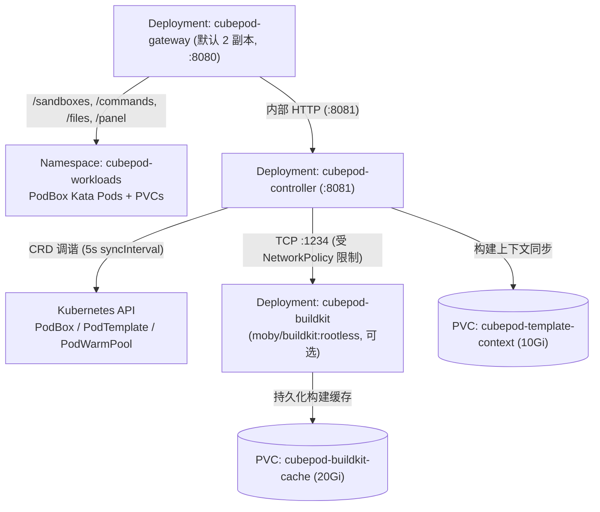

在 Kubernetes 环境中，CubePod 通过位于 `deploy/helm/cubepod/` 的 Helm Chart（`cubepod`，`version: 0.6.0`，`appVersion: "0.6.0"`）进行统一打包交付，涵盖 `PodBox`、`PodTemplate`、`PodWarmPool`、`SandboxWebhook` 四类 CRD、RBAC 权限、工作负载命名空间、Control Plane Gateway、Kubernetes Controller 以及可选的无特权 BuildKit 模板构建流水线。

由 `deploy/helm/cubepod/values.yaml` 自动生成的完整字段说明，请参阅 [Helm Values 参考](/zh/reference/helm-values/)与 [Kubernetes CRD 参考](/zh/reference/crds/)。

## 前置条件

- 已配置可用集群并安装 `kubectl` 与 `helm`（`v3+`）。
- 如运行生产级 MicroVM 沙箱，节点需提前配置 [Kata Containers 运行时与裸块 CSI 存储](/zh/deployment/kata-and-block-storage/)（例如 Longhorn V2 SPDK `longhorn-v2-block-thin` 或 OpenEBS LVM-LocalPV `cubepod-lvm-block`）。

## 快速安装

可直接从已发布的 GHCR OCI 仓库一键安装到控制面命名空间（无需先克隆源码仓库）：

```bash
helm install cubepod oci://ghcr.io/cubeplexai/charts/cubepod \
  --version 0.6.0 \
  --namespace cubepod-system \
  --create-namespace
```

如需基于本地仓库源码目录安装，可执行：

```bash
helm install cubepod ./deploy/helm/cubepod \
  --namespace cubepod-system \
  --create-namespace
```

首次执行 `helm install` 时，Helm 会自动安装位于 `deploy/helm/cubepod/crds/` 下的全部四项 CRD：

- `cubepod.io_podboxes.yaml`
- `cubepod.io_podtemplates.yaml`
- `cubepod.io_podwarmpools.yaml`
- `cubepod.io_sandboxwebhooks.yaml`

:::note
Helm 在后续执行 `helm upgrade` 时不会自动更新 `crds/` 目录中的文件。升级 CubePod 版本前，请先显式应用最新 CRD 清单：
```bash
kubectl apply -f deploy/helm/cubepod/crds/
```
升级到 v0.7.0 时，至少需要重新执行 `kubectl apply -f deploy/helm/cubepod/crds/cubepod.io_sandboxwebhooks.yaml`，使 `SandboxWebhook` CRD 获得 `k8s` 事件后端所需的 `status.deadLetters` 字段定义。
:::

## 部署资源架构



| 模板文件 | 创建的 Kubernetes 资源 | 说明 |
| :--- | :--- | :--- |
| `namespace.yaml` | `Namespace`（`controller.workloadNamespace`，默认 `cubepod-workloads`） | 附带标签 `cubepod.io/role: workloads` |
| `rbac.yaml` | `ServiceAccount`、`ClusterRole`（`<fullname>-controller`）、`ClusterRoleBinding` | 授予核心资源 `pods`、`pods/exec`、`pods/log`、`persistentvolumeclaims`、`events`、`configmaps`、`secrets` 及 `cubepod.io`/`pod.cubeplex.ai` CRD（`podboxes`、`podtemplates`、`podwarmpools`、`sandboxwebhooks`）及其 `status` 子资源的增删改查权限，以及 `apps` `deployments`/`statefulsets` 只读权限 |
| `gateway-deployment.yaml` | `Deployment`（`gateway.replicaCount`，默认 `2`） | 提供 `/health` 存活（`initialDelaySeconds: 5, periodSeconds: 10`）与就绪（`initialDelaySeconds: 2, periodSeconds: 5`）探针；统一注入运行时/存储/出站镜像参数、`--feature-gate`、`secrets.*`、`e2bVolumes.*`、`global.imagePullSecrets`、`egress.caSecretName` 与可选的 `gateway.persistence` |
| `pdb.yaml` *(v0.6.0 新增)* | `PodDisruptionBudget`（`<fullname>-gateway`） | 当 `gateway.podDisruptionBudget.enabled` 为 `true`，或为 `null` 且 `gateway.replicaCount > 1` 时渲染（默认 `minAvailable: 1`） |
| `controller-deployment.yaml` | `Deployment`（`controller.replicaCount`，仅在 `templateBuild.enabled=true` 且 `contextStore.backend=local` 时锁定为 `1`；设为 `s3` 时支持多副本 HA） | 提供 `/livez` 与 `/healthz`；按 `--sync-interval`（默认 `5s`）执行调谐；注入运行时/存储/出站镜像参数、`--feature-gate`、`global.imagePullSecrets`、`egress.caSecretName`、S3 上下文存储（`--context-store-backend=s3`）及 BuildKit mTLS 参数，开启本地构建时挂载 `cubepod-template-context` PVC |
| `gateway-state-pvc.yaml` | `PersistentVolumeClaim`（`<fullname>-gateway-state`，可选） | 仅当 `gateway.persistence.enabled: true` 且未指定 `existingClaim` 时渲染；用于持久化 Gateway `stateDir`（本地模板、文件密钥与生命周期事件/Webhook） |
| `secrets-key-secret.yaml` *(v0.6.0 新增)* | `Secret`（`<fullname>-secrets-key`，可选） | 当内联设置 `secrets.encryptionKey` 且未设置 `secrets.existingSecret` 与 `gateway.secretsKeySecret` 时渲染 |
| `e2b-volumes-pvc.yaml` | `PersistentVolumeClaim`（`e2bVolumes.pvcName`，`ReadWriteMany`） | 当 `e2bVolumes.rwxStorageClassName` 非空时创建，并通过 `helm.sh/resource-policy: keep` 在卸载时保留数据 |
| `service.yaml` | `<fullname>-gateway`（`:8080`）、`<fullname>-controller`（`:8081`） | 默认均为 `ClusterIP`；切换为 `NodePort` 时支持通过 `gateway.service.nodePort` 固定端口 |
| `buildkit.yaml` | `Deployment`（当 `buildkit.replicaCount > 1` 时切换为 `StatefulSet` + Headless `Service`）、`Service`（`:1234`）、缓存 `PVC` / `volumeClaimTemplates`、可选 `cubepod-template-context` PVC 与 `NetworkPolicy` | 仅当 `templateBuild.enabled: true` 时渲染 *(v0.7.0 变更)* |

## 生产环境核心配置示例

建议通过独立的 `my-values.yaml` 覆盖默认配置，而非直接修改 Chart 文件：

```yaml
gateway:
  replicaCount: 2
  port: 8080
  panelSecret: "replace-with-random-hmac-secret"
  service:
    type: ClusterIP

runtime:
  runtimeClassName: kata-qemu
  defaultTemplate: cubeplex-ubuntu24-desktop
  poddInjectorImage: ghcr.io/cubeplexai/cubepod-podd:v0.6.0
  defaultSandboxImage: ghcr.io/cubeplexai/cubeplex-sandbox:v0.4.0

storage:
  storageClassName: longhorn-v2-block-thin
  volumeMode: Block
  rootfsSize: "10Gi"
  workspaceSize: "20Gi"

warmPool:
  enabled: true
  replicas: 3

egress:
  enabled: true
  image:
    registry: "ghcr.io"
    repository: "cubeplexai/cubepod-egress"
    tag: "v0.6.0"
  port: 18080
  exchangeUrl: "https://cubeplex-backend.cubeplex.svc:8443/api/v1/internal/egress/exchange"
```

使用自定义 Values 文件安装或升级：

```bash
helm upgrade --install cubepod ./deploy/helm/cubepod \
  --namespace cubepod-system \
  --create-namespace \
  -f my-values.yaml
```

### 关键运行时与存储默认配置

- **运行时注入（`runtime.poddInjectorImage`）**：默认为 `ghcr.io/cubeplexai/cubepod-podd:v0.6.0`。每个沙箱 Pod 都会通过 `initContainer` 将 `podd-init` 与 `podd` 拷贝至共享 `emptyDir`（`/opt/cubepod/bin`），从而保持基础业务镜像纯净。
- **私有仓库凭证（`global.imagePullSecrets`、`runtime.templatePullSecret`）**：自 `v0.5.2` 起支持，统一为控制面 Pod（`controller`、`gateway`、`buildkit`）与工作负载沙箱 Pod 注入镜像拉取凭证（即使关闭 `templateBuild.enabled` 也生效）。
- **Egress CA 与状态持久化（`egress.caSecretName`、`gateway.persistence`）**：自 `v0.5.2` 起支持，可挂载持久化根 CA Secret 至控制面，并为 Gateway 持久化 `stateDir`（`CUBEPOD_STATE`）以保存模板目录、E2B Secrets 与生命周期事件/Webhook 状态。
- **双裸块 PVC（`storage.*`）**：默认 `storageClassName: longhorn-v2-block-thin`、`volumeMode: Block`、`rootfsSize: "10Gi"`、`workspaceSize: "20Gi"`。
- **WarmPool 预热池（`warmPool.*`）**：默认启用并维持 `3` 个预热副本，确保 `POST /sandboxes` 可亚秒级认领已就绪的 MicroVM。
- **Gateway PodDisruptionBudget（`gateway.podDisruptionBudget.*`）** *(v0.6.0 新增)*：当 `gateway.podDisruptionBudget.enabled` 为 `null`（默认值）且 `gateway.replicaCount > 1` 时，`pdb.yaml` 会自动创建 `PodDisruptionBudget`（默认 `minAvailable: 1`，也可显式配置 `maxUnavailable`）。
- **Zero-Trust 出站代理（`egress.*`）** *(v0.6.0 变更)*：默认启用（`egress.enabled: true`、`egress.transparent: true`），为沙箱注入监听 `:18080` 的 `cubepod-egress` 边车容器（`egress.image.*`），并通过 `egress.exchangeUrl` 按单沙箱 mTLS 置换 `cpodref_` 占位符。仅当 `egress.transparent` 与 `featureGates.transparentEgress` 均为 `true` 时，才启用 `TransparentEgress`（`CUBEPOD_TRANSPARENT=1` + `NET_ADMIN`）。详情请参阅[零信任出站代理与密钥隔离](/zh/concepts/zero-trust-egress/)。
- **E2B 密钥 HA 存储（`secrets.*`）** *(v0.6.0 新增)*：配置 `CUBEPOD_SECRETS_BACKEND`（默认 `"k8s"`，使用 `KubeSecretBackend` 实现多副本 HA；或 `"file"` 配合 `secrets.dir`；或 `"disabled"`）及加密密钥引用（`secrets.existingSecret`、内联 `secrets.encryptionKey` 或旧版回退 `gateway.secretsKeySecret`）。
- **沙箱事件与 Webhook HA 存储（`events.*`）** *(v0.7.0 新增)*：`events.enabled`（默认 `true`）、`events.backend`（默认 `"k8s"`，渲染为 `CUBEPOD_EVENTS_BACKEND`）与 `events.dir`（默认 `/var/lib/cubepod/events`，仅在 `events.backend` 为 `"file"` 时使用）。当 `events.enabled` 或 `featureGates.sandboxEventsAndWebhooks` 为 `false` 时禁用事件功能。使用 `k8s` 后端时，所有 Gateway 副本通过 Kubernetes API 共享状态：每个 Webhook 存储为 `SandboxWebhook` CR（`cubepod-whk-<hex>`），HMAC `signatureKey` 仅保存在配套 `Secret`（`cubepod-whk-sec-<hex>`）中；生命周期事件写为挂载在 `PodBox` 上的 core/v1 `Event`（标签 `cubepod.io/resource=sandbox-event`，受 apiserver 事件 TTL 限制，默认 `1h`）；投递失败或被丢弃的事件以死信形式保存在 `status.deadLetters`（每个 Webhook 最多 50 条）。各副本每 `5s` 同步一次 Webhook。详见 [API 概览](/zh/reference/api-overview/)。
- **统一特性开关（`featureGates.*`）** *(v0.7.0 变更)*：`featureGates` 下的所有开关（`e2bTemplateAPI`、`transparentEgress`、`desktopStack`、`statelessGatewayHA`、`e2bFilesystemWatch`、`e2bSecretsAPI`、`sandboxEventsAndWebhooks`、`k8sE2BVolumeMounts`）会统一渲染为 `--feature-gate=...` 传入 `cubepod-gateway` 与 `cubepod-controller`。其中 `e2bTemplateAPI` 自 `v0.7.0` 起默认开启（GA；设为 `false` 可回滚）。
- **共享 E2B RWX 持久化卷（`e2bVolumes.*`）** *(v0.6.0 变更)*：只要将 `e2bVolumes.rwxStorageClassName` 设为非空值（如 `"longhorn-rwx"` 或 `"nfs-storage"`），Chart 就会自动创建 `ReadWriteMany` PVC（`e2bVolumes.pvcName`）、挂载到 `cubepod-gateway` 并**自动开启 `K8sE2BVolumeMounts`**，即使 `e2bVolumes.enabled` 与 `featureGates.k8sE2BVolumeMounts` 保持默认 `false` 也会生效。

## Webhook 投递告警（`PrometheusRule`）

*v0.7.0 新增。* `deploy/monitoring/webhook-alerts.yaml` 提供了一个参考用的 `monitoring.coreos.com/v1` `PrometheusRule`，适用于部署了 Prometheus Operator 的集群，基于 Gateway `/metrics` 指标告警：

| 告警 | 表达式 | 持续时间 | 级别 |
| :--- | :--- | :--- | :--- |
| `CubePodWebhookDeliveriesFailed` | `increase(cubepod_webhook_deliveries_total{result="failed"}[10m]) > 0` | `5m` | `warning` |
| `CubePodWebhookDeliveriesDropped` | `increase(cubepod_webhook_deliveries_total{result="dropped"}[10m]) > 0` | `5m` | `critical` |
| `CubePodWebhookDeadLettersPending` | `cubepod_webhook_dead_letters_pending > 0` | `30m` | `info` |

```bash
kubectl -n cubepod-system apply -f deploy/monitoring/webhook-alerts.yaml
```

请按需调整 `metadata.labels`（例如 `release: kube-prometheus-stack`）以匹配 Prometheus 的 `ruleSelector`。可通过 `GET /webhooks/dead-letters` 查看失败投递，并通过 `POST /webhooks/{webhookID}/dead-letters/{deadLetterID}/retry` 重新投递。

## 开启集群内模板构建（`BuildKit` 与高可用 S3 上下文存储）

`featureGates.e2bTemplateAPI` 自 *v0.7.0* 起默认为 `true`，而 `templateBuild.enabled` 在未配置目标 OCI 仓库前默认保持 `false`。开启后，Chart 会部署隔离的无特权 `moby/buildkit:rootless` 构建 Pod：

```yaml
controller:
  replicaCount: 2

featureGates:
  e2bTemplateAPI: true

templateBuild:
  enabled: true
  contextStore:
    backend: "s3"                  # "local"（单副本 RWO PVC）或 "s3"（多副本高可用对象存储）
    s3:
      endpoint: "https://minio.cubepod-system.svc:9000"
      bucket: "cubepod-template-contexts"
      region: "us-east-1"
      prefix: "prod/"
      forcePathStyle: true
      credentialsSecretName: "cubepod-s3-creds" # 包含 accessKeyId、secretAccessKey 及可选 sessionToken
  cacheSize: "20Gi"
  probeTimeout: "120s"
  buildkit:
    replicaCount: 2                # >= 2 时渲染为带 volumeClaimTemplates 的 StatefulSet
    image: "moby/buildkit:rootless"
    address: "tcp://cubepod-buildkit.cubepod-system.svc:1234"
    nodeSelector: {}
    tls:
      enabled: true
      secretName: "cubepod-buildkit-tls" # 包含 ca.crt、tls.crt、tls.key
      serverName: "cubepod-buildkit"
  registry:
    url: "ghcr.io/your-org"
    repositoryPrefix: "cubepod-templates"
    pushSecret: "cubepod-buildkit-push"
    pullSecret: "cubepod-buildkit-pull"
```

开启 `templateBuild.enabled: true` 时的关键运维约束与高可用行为：

1. **HA Controller 与 S3 对象存储 *(v0.7.0 新增)***：采用 `contextStore.backend: "local"` 时，由于 `cubepod-template-context`（`10Gi`）为 `ReadWriteOnce` PVC，`controller-deployment.yaml` 会锁定为单副本；切换为 `contextStore.backend: "s3"` 后不再创建 RWO PVC，可直接支持 `controller.replicaCount > 1`，并通过 `PodTemplate` `ResourceVersion` 乐观锁 CAS 协调避免多副本重复构建。
2. **BuildKit 多副本 `StatefulSet` 与 `:1234` mTLS *(v0.7.0 新增)***：当 `templateBuild.buildkit.replicaCount > 1` 时，`buildkit.yaml` 渲染为带独立缓存卷 `volumeClaimTemplates` 的 `StatefulSet` 及 Headless Service（`cubepod-buildkit-headless`），Controller 自动轮询与故障转移。开启 `templateBuild.buildkit.tls.enabled: true` 时会为 `buildkitd` 与 `cubepod-controller` 挂载 `ca.crt`/`tls.crt`/`tls.key` 并启用双向 mTLS。
3. **Rootless BuildKit 安全上下文**：`cubepod-buildkit` 以 `1000:1000` 运行，配置 `--oci-worker-no-process-sandbox`、`seccompProfile: Unconfined` 与 `appArmorProfile: Unconfined`，无需容器内 root 权限即可执行嵌套 `RUN` 构建步骤。
4. **入口网络策略（NetworkPolicy）**：`cubepod-buildkit-netpol` 将 TCP `1234` 端口的入站流量严格限定为仅来自标签含 `app.kubernetes.io/component: controller` 的 Pod。
5. **镜像推拉凭证 Secret**：触发构建前，请确保已在控制面命名空间与工作负载命名空间提前创建 `templateBuild.registry.pushSecret` 与 `pullSecret` 对应的 Docker Registry Secret。

SDK 与 CLI 构建工作流请参阅[模板目录与构建](/zh/sdks/templates/)。

## 沙箱指标采样与监控

*v0.7.0 新增。*

`cubepod-gateway` 会在后台定期轮询每个 `Running` 沙箱的 `podd /metrics`，持续填充 `GET /sandboxes/{sandboxID}/metrics` 背后的每沙箱环形缓冲区，即使无人查询也能保留历史。已暂停或已终止的沙箱会被跳过。

```yaml
gateway:
  metricsSampleInterval: "10s"   # Go duration；"0" 表示关闭（参数 --metrics-sample-interval，环境变量 CUBEPOD_METRICS_SAMPLE_INTERVAL）
```

网关 `/metrics` 会暴露 `cubepod_sandbox_metrics_samples_total{result="ok|error"}` 以及带 `sandbox_id` 标签的每沙箱指标（`cubepod_sandbox_cpu_used_pct`、`cubepod_sandbox_memory_used_bytes`、`cubepod_sandbox_memory_total_bytes`、`cubepod_sandbox_disk_used_bytes`、`cubepod_sandbox_disk_total_bytes`、`cubepod_sandbox_cpu_count`）。

`deploy/monitoring/` 提供开箱即用的 Prometheus Operator 规则与 Grafana 仪表盘：

```bash
kubectl apply -f deploy/monitoring/sandbox-metrics-rules.yaml
# 在 Grafana 中导入 deploy/monitoring/sandbox-metrics-dashboard.json
```

规则会记录 `cubepod:sandbox_cpu_used_pct:avg5m`、`cubepod:sandbox_memory_utilization_ratio`、`cubepod:sandbox_disk_utilization_ratio`，并提供 `CubePodSandboxHighMemoryPressure`、`CubePodSandboxDiskNearFull`、`CubePodMetricsSamplerFailing` 告警。

## 验证部署状态

确认控制面 Pod、CRD 及健康探针均处于正常状态：

```bash
kubectl -n cubepod-system get pods
kubectl get crds | grep cubepod.io
kubectl -n cubepod-system port-forward svc/cubepod-gateway 8080:8080
curl -fsS http://localhost:8080/health
```

## 下一步

- 按照 [Kata Containers 与块存储配置](/zh/deployment/kata-and-block-storage/) 准备计算节点的虚拟化运行时与裸块 CSI 驱动。
- 查阅 [Helm Values 参考](/zh/reference/helm-values/)与 [Kubernetes CRD 参考](/zh/reference/crds/)了解完整参数说明。
