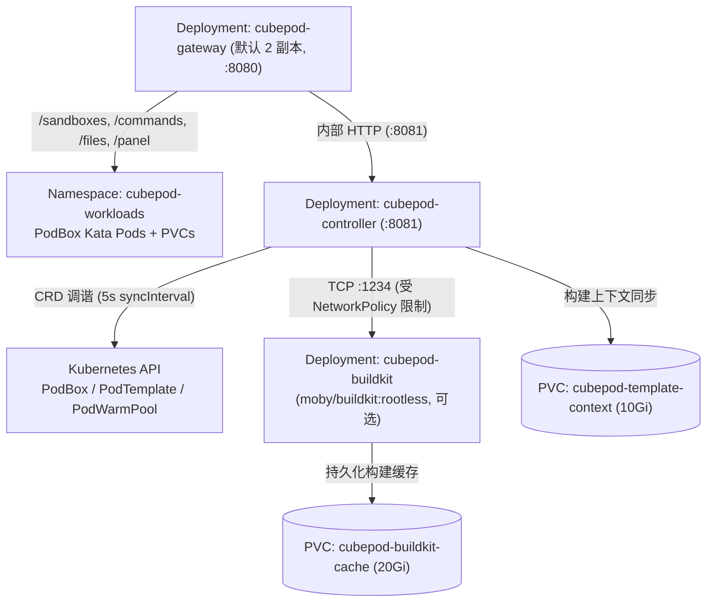

在 Kubernetes 环境中，CubePod 通过位于 `deploy/helm/cubepod/` 的 Helm Chart（`cubepod`，`version: 0.4.0`，`appVersion: "0.4.0"`）进行统一打包交付，涵盖 `PodBox`、`PodTemplate`、`PodWarmPool` 三类 CRD、RBAC 权限、工作负载命名空间、Control Plane Gateway、Kubernetes Controller 以及可选的无特权 BuildKit 模板构建流水线。

由 `deploy/helm/cubepod/values.yaml` 自动生成的完整字段说明，请参阅 [Helm Values 参考](/zh/reference/helm-values/)与 [Kubernetes CRD 参考](/zh/reference/crds/)。

## 前置条件

- 已配置可用集群并安装 `kubectl` 与 `helm`（`v3+`）。
- 如运行生产级 MicroVM 沙箱，节点需提前配置 [Kata Containers 运行时与裸块 CSI 存储](/zh/deployment/kata-and-block-storage/)（例如 Longhorn V2 SPDK `longhorn-v2-block-thin` 或 OpenEBS LVM-LocalPV `cubepod-lvm-block`）。

## 快速安装

从本地仓库检出目录将 Chart 安装到控制面命名空间（例如 `cubepod-system`）：

```bash
helm install cubepod ./deploy/helm/cubepod \
  --namespace cubepod-system \
  --create-namespace
```

首次执行 `helm install` 时，Helm 会自动安装位于 `deploy/helm/cubepod/crds/` 下的全部 CRD：

- `cubepod.io_podboxes.yaml`
- `cubepod.io_podtemplates.yaml`
- `cubepod.io_podwarmpools.yaml`

:::note
Helm 在后续执行 `helm upgrade` 时不会自动更新 `crds/` 目录中的文件。升级 CubePod 版本前，请先显式应用最新 CRD 清单：
```bash
kubectl apply -f deploy/helm/cubepod/crds/
```
:::

## 部署资源架构



| 模板文件 | 创建的 Kubernetes 资源 | 说明 |
| :--- | :--- | :--- |
| `namespace.yaml` | `Namespace`（`controller.workloadNamespace`，默认 `cubepod-workloads`） | 附带标签 `cubepod.io/role: workloads` |
| `rbac.yaml` | `ServiceAccount`、`ClusterRole`（`<fullname>-controller`）、`ClusterRoleBinding` | 授予核心资源 `pods`、`pods/exec`、`pods/log`、`persistentvolumeclaims`、`events`、`configmaps`、`secrets` 及 `cubepod.io`/`pod.cubeplex.ai` CRD 及其 `status` 子资源的增删改查权限，以及 `apps` `deployments`/`statefulsets` 只读权限 |
| `gateway-deployment.yaml` | `Deployment`（`gateway.replicaCount`，默认 `2`） | 提供 `/health` 存活（`initialDelaySeconds: 5, periodSeconds: 10`）与就绪（`initialDelaySeconds: 2, periodSeconds: 5`）探针；配置 `gateway.panelSecret` 后自动注入 `CUBEPOD_PANEL_SECRET` |
| `controller-deployment.yaml` | `Deployment`（`controller.replicaCount`，若 `templateBuild.enabled` 为 true 则强制锁定为 `1`） | 提供 `/livez` 与 `/healthz`；按 `--sync-interval`（默认 `5s`）执行调谐；开启 `templateBuild.enabled` 时挂载 `cubepod-template-context` PVC |
| `service.yaml` | `<fullname>-gateway`（`:8080`）、`<fullname>-controller`（`:8081`） | 默认均为 `ClusterIP`；切换为 `NodePort` 时支持通过 `gateway.service.nodePort` 固定端口 |
| `buildkit.yaml` | `Deployment`、`Service`（`:1234`）、2 个 `PVC`、`NetworkPolicy` | 仅当 `templateBuild.enabled: true` 时渲染 |

## 生产环境核心配置示例

建议通过独立的 `my-values.yaml` 覆盖默认配置，而非直接修改 Chart 文件：

```yaml
gateway:
  replicaCount: 2
  port: 8080
  panelSecret: "replace-with-random-hmac-secret"
  service:
    type: ClusterIP

runtime:
  runtimeClassName: kata-qemu
  defaultTemplate: cubeplex-ubuntu24-desktop
  poddInjectorImage: ghcr.io/cubeplexai/cubepod-podd:v0.4.0
  defaultSandboxImage: ghcr.io/cubeplexai/cubeplex-sandbox:v0.4.0

storage:
  storageClassName: longhorn-v2-block-thin
  volumeMode: Block
  rootfsSize: "10Gi"
  workspaceSize: "20Gi"

warmPool:
  enabled: true
  replicas: 3

egress:
  enabled: true
  image:
    registry: "ghcr.io"
    repository: "cubeplexai/cubepod-egress"
    tag: "v0.4.0"
  port: 18080
  exchangeUrl: "https://cubeplex-backend.cubeplex.svc:8443/api/v1/internal/egress/exchange"
```

使用自定义 Values 文件安装或升级：

```bash
helm upgrade --install cubepod ./deploy/helm/cubepod \
  --namespace cubepod-system \
  --create-namespace \
  -f my-values.yaml
```

### 关键运行时与存储默认配置

- **运行时注入（`runtime.poddInjectorImage`）**：默认为 `ghcr.io/cubeplexai/cubepod-podd:v0.4.0`。每个沙箱 Pod 都会通过 `initContainer` 将 `podd-init` 与 `podd` 拷贝至共享 `emptyDir`（`/opt/cubepod/bin`），从而保持基础业务镜像纯净。
- **双裸块 PVC（`storage.*`）**：默认 `storageClassName: longhorn-v2-block-thin`、`volumeMode: Block`、`rootfsSize: "10Gi"`、`workspaceSize: "20Gi"`。
- **WarmPool 预热池（`warmPool.*`）**：默认启用并维持 `3` 个预热副本，确保 `POST /sandboxes` 可亚秒级认领已就绪的 MicroVM。
- **Zero-Trust 出站代理（`egress.*`）**：默认启用，为沙箱注入监听 `:18080` 的 `cubepod-egress` 边车容器，并通过 `egress.exchangeUrl` 按单沙箱 mTLS 置换 `cpodref_` 占位符。详情请参阅[零信任出站代理与密钥隔离](/zh/concepts/zero-trust-egress/)。

## 开启集群内模板构建（`BuildKit`）

`featureGates.e2bTemplateAPI` 与 `templateBuild.enabled` 默认均为 `false`。开启后，Chart 会同步部署隔离的无特权 `moby/buildkit:rootless` 构建 Pod：

```yaml
featureGates:
  e2bTemplateAPI: true

templateBuild:
  enabled: true
  cacheSize: "20Gi"
  probeTimeout: "120s"
  buildkit:
    image: "moby/buildkit:rootless"
    address: "tcp://cubepod-buildkit.cubepod-system.svc:1234"
    nodeSelector: {}
    # 可选 nodeSelector: { role: builder }
  registry:
    url: "ghcr.io/your-org"
    repositoryPrefix: "cubepod-templates"
    pushSecret: "cubepod-buildkit-push"
    pullSecret: "cubepod-buildkit-pull"
```

开启 `templateBuild.enabled: true` 时的关键运维约束：

1. **Controller 副本数锁定**：由于 `cubepod-template-context`（`10Gi`）以 `ReadWriteOnce` 模式挂载在 `/var/lib/cubepod/context`，`controller-deployment.yaml` 会强制将 Controller 副本数锁定为 `1`。
2. **Rootless BuildKit 安全上下文**：`cubepod-buildkit` 以 `1000:1000` 运行，配置 `--oci-worker-no-process-sandbox`、`seccompProfile: Unconfined` 与 `appArmorProfile: Unconfined`，无需容器内 root 权限即可执行嵌套 `RUN` 构建步骤。
3. **入口网络策略（NetworkPolicy）**：`cubepod-buildkit-netpol` 将 TCP `1234` 端口的入站流量严格限定为仅来自标签含 `app.kubernetes.io/component: controller` 的 Pod。
4. **镜像推拉凭证 Secret**：触发构建前，请确保已在控制面命名空间与工作负载命名空间提前创建 `templateBuild.registry.pushSecret` 与 `pullSecret` 对应的 Docker Registry Secret。

SDK 与 CLI 构建工作流请参阅[模板目录与构建](/zh/sdks/templates/)。

## 验证部署状态

确认控制面 Pod、CRD 及健康探针均处于正常状态：

```bash
kubectl -n cubepod-system get pods
kubectl get crds | grep cubepod.io
kubectl -n cubepod-system port-forward svc/cubepod-gateway 8080:8080
curl -fsS http://localhost:8080/health
```

## 下一步

- 按照 [Kata Containers 与块存储配置](/zh/deployment/kata-and-block-storage/) 准备计算节点的虚拟化运行时与裸块 CSI 驱动。
- 查阅 [Helm Values 参考](/zh/reference/helm-values/)与 [Kubernetes CRD 参考](/zh/reference/crds/)了解完整参数说明。
