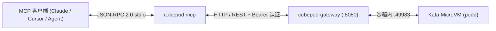

`cubepod` 二进制内置了原生 **Model Context Protocol (MCP)** JSON-RPC 2.0 stdio 服务端（`cubepod mcp`）。任何兼容 MCP 的客户端——包括 Claude Desktop、Cursor、Windsurf 或自定义 Agent 编排器——均无需编写额外胶水代码，即可直接拉起持久化 MicroVM 沙箱、执行命令、读写文件、暂停计算以及重置 RootFS。

## 架构与协议规范

- **传输协议**：通过 `stdin` / `stdout` 传输的按行分隔 JSON-RPC 2.0
- **协议版本**：`2024-11-05`
- **服务端标识**：`{"name": "cubepod-mcp", "version": "<cubepod-version>"}`
- **声明能力**：`tools`（支持 `initialize`、`notifications/initialized`、`ping`、`tools/list`、`tools/call`）
- **目标 Gateway**：通过 `--gateway-url` / `$CUBEPOD_GATEWAY_URL`（默认 `http://127.0.0.1:8080`）与 `--api-key` / `$CUBEPOD_API_KEY` 配置



## 暴露的 MCP 工具列表（`tools/list`）

`cubepod mcp` 共注册了 8 个直接映射至 `pkg/client` 的工具：

### 1. `cubepod_create_sandbox`
创建新的持久化 MicroVM 执行沙箱。

| 参数 | 类型 | 必填 | 说明 |
| :--- | :--- | :--- | :--- |
| `templateID` | `string` | 否 | 沙箱基础镜像模板 ID（默认：`cubeplex-ubuntu24-desktop`）。 |
| `timeout` | `integer` | 否 | 可选空闲超时秒数，超时后自动暂停。 |

### 2. `cubepod_list_sandboxes`
列举当前处于运行中或已暂停状态的 CubePod 沙箱，支持按模板过滤。

| 参数 | 类型 | 必填 | 说明 |
| :--- | :--- | :--- | :--- |
| `templateID` | `string` | 否 | 可选模板 ID 过滤条件。 |

### 3. `cubepod_run_command`
在指定 CubePod 沙箱内部执行 Shell 命令。

| 参数 | 类型 | 必填 | 说明 |
| :--- | :--- | :--- | :--- |
| `sandboxID` | `string` | **是** | 目标沙箱 ID。 |
| `command` | `string` | **是** | 待执行的 Shell 命令字符串。 |
| `workdir` | `string` | 否 | 沙箱内工作目录（默认：`/workspace`）。 |
| `background` | `boolean` | 否 | 是否放到后台异步执行。 |

### 4. `cubepod_read_file`
读取 CubePod 沙箱内指定文件的内容。

| 参数 | 类型 | 必填 | 说明 |
| :--- | :--- | :--- | :--- |
| `sandboxID` | `string` | **是** | 目标沙箱 ID。 |
| `path` | `string` | **是** | 沙箱内文件绝对路径。 |

### 5. `cubepod_write_file`
向 CubePod 沙箱内指定路径写入文件内容。

| 参数 | 类型 | 必填 | 说明 |
| :--- | :--- | :--- | :--- |
| `sandboxID` | `string` | **是** | 目标沙箱 ID。 |
| `path` | `string` | **是** | 沙箱内目标文件绝对路径。 |
| `content` | `string` | **是** | 待写入的文本或内容。 |
| `mode` | `string` | 否 | 文件权限模式（默认：`0644`）。 |

### 6. `cubepod_pause_sandbox`
暂停运行中的沙箱以释放 CPU/内存占用，同时完好保留持久卷。

| 参数 | 类型 | 必填 | 说明 |
| :--- | :--- | :--- | :--- |
| `sandboxID` | `string` | **是** | 要暂停的沙箱 ID。 |

### 7. `cubepod_reset_rootfs`
重置沙箱持久化 RootFS Upper 层并恢复初始系统镜像，同时完整保留 `/workspace`。

| 参数 | 类型 | 必填 | 说明 |
| :--- | :--- | :--- | :--- |
| `sandboxID` | `string` | **是** | 目标沙箱 ID。 |

### 8. `cubepod_delete_sandbox`
永久终止并删除指定 CubePod 沙箱。

| 参数 | 类型 | 必填 | 说明 |
| :--- | :--- | :--- | :--- |
| `sandboxID` | `string` | **是** | 要删除的沙箱 ID。 |
| `deleteVolumes` | `boolean` | 否 | 是否同步删除持久化存储卷（默认：`false`）。 |

## 客户端配置示例

请先确保已编译 `cubepod` 并将其加入 `PATH`（参见 [Go SDK 与 CLI](/zh/sdks/go-and-cli/)）。

### Claude Desktop

在 `claude_desktop_config.json`（macOS 位于 `~/Library/Application Support/Claude/claude_desktop_config.json`，Linux 位于 `~/.config/Claude/claude_desktop_config.json`）中添加 `cubepod`：

```json
{
  "mcpServers": {
    "cubepod": {
      "command": "/usr/local/bin/cubepod",
      "args": [
        "--gateway-url", "http://127.0.0.1:8080",
        "mcp"
      ],
      "env": {
        "CUBEPOD_API_KEY": "your-api-key-if-configured"
      }
    }
  }
}
```

### Cursor / Windsurf / VS Code

在 `.cursor/mcp.json` 或对应 IDE 的 MCP 设置中添加 `stdio` 服务条目：

```json
{
  "mcpServers": {
    "cubepod": {
      "command": "cubepod",
      "args": ["mcp"],
      "env": {
        "CUBEPOD_GATEWAY_URL": "http://127.0.0.1:8080",
        "CUBEPOD_API_KEY": "your-api-key"
      }
    }
  }
}
```

:::tip[牢记前置全局标志]
若选择在 `args` 中传入 `--gateway-url` 或 `--api-key`，请务必放在 `mcp` 子命令**之前**（如 `["--gateway-url", "http://127.0.0.1:8080", "mcp"]`），或直接通过 `env` 中的 `CUBEPOD_GATEWAY_URL` 与 `CUBEPOD_API_KEY` 传递。
:::

## 通过 `stdin` / `stdout` 快速冒烟测试

无需启动外部 IDE，即可直接在 Shell 中验证 MCP 服务响应：

```bash
printf '%s\n' \
  '{"jsonrpc":"2.0","id":1,"method":"initialize","params":{}}' \
  '{"jsonrpc":"2.0","method":"notifications/initialized"}' \
  '{"jsonrpc":"2.0","id":2,"method":"tools/list"}' \
  | cubepod --gateway-url http://127.0.0.1:8080 mcp
```

遵循 JSON-RPC 2.0 规范，不带 `id` 的通知（如 `notifications/initialized`）不会产生输出，而 `initialize` 与 `tools/list` 会返回单行 JSON 响应。

## 基于 `reset_rootfs` 的 Agent 自愈模式

由于 `cubepod_reset_rootfs` 直接作为 MCP 工具暴露，当 AI 编程 Agent 意外破坏了沙箱系统环境（例如装坏了 `apt` 或全局 `pip` 依赖）时，可以在**完全不丢失 `/workspace` 下源码与产出文件**的前提下实现自愈：

1. 携带 `sandboxID` 调用 `cubepod_reset_rootfs`。
2. 在同一 `sandboxID` 与完好的 `/workspace` 上继续调用 `cubepod_run_command` 和 `cubepod_read_file`。
