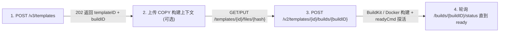

CubePod 通过 `PodTemplate` CRD（`cubepod.io/v1alpha1`）解析传入 `POST /sandboxes` 的每一个 `templateID`，并支持两种模板构建与接入路径：

1. **零 BuildKit 镜像注册（Alpha）**：将仓库中已有的 OCI 镜像直接注册为模板，并声明 CPU、内存及 RootFS 容量规格。
2. **Dockerfile 子集配方构建（Beta）**：兼容 E2B `v3`/`v2` 模板构建协议，在 Kubernetes 中使用**无特权 rootless BuildKit**（或在 `docker-loopback` 模式下使用本地 Docker 守护进程）执行镜像构建并推送到镜像仓库。

## 特性开关与 Helm 配置

模板目录与构建端点由 `cubepod-gateway` 与 `cubepod-controller` 上的两个独立开关控制：

| Helm 配置项 | CLI 标志 | 默认值 | 生效行为 |
| :--- | :--- | :--- | :--- |
| `featureGates.e2bTemplateAPI` | `--e2b-template-api` / `--feature-gate=E2BTemplateAPI=true` | `false` | 将 `GET /templates` 从旧版 3 卡片 `{"templates":[...]}` 包装切换为标准 E2B `E2BTemplate[]` 数组，并开启 `/v2/templates`、`/v3/templates`、`/templates/aliases/{alias}`、`/templates/tags`、`PATCH` 与 `DELETE`。 |
| `templateBuild.enabled` | `--template-build` | `false` | 开启 Kubernetes BuildKit 或本地 Docker 配方构建（支持带 `steps` 的 `POST /v2/templates/{id}/builds/{buildID}` 与 `PUT /templates/{id}/files/{hash}`）。为 `false` 时上述构建接口返回 HTTP `501`，但在 `e2bTemplateAPI` 开启时仍可通过空 `steps` 的 `fromImage` 注册已有镜像。 |

## 内置预置模板与别名

`cubepod-controller` 启动时会自动注入三个默认 `PodTemplate`（若集群中已存在同名对象则不会覆盖）：

| 模板名称 | 别名（Aliases） | 默认镜像 | CPU / 内存 / 磁盘 |
| :--- | :--- | :--- | :--- |
| `cubeplex-ubuntu24-desktop` | `cubeplex-ubuntu24-desktop`、`base`、`code-interpreter`、`code-interpreter-v1`、`python` | `cubeplex-ubuntu24-desktop:latest` | `2` vCPU / `2048 MB` / `10Gi` RootFS + `20Gi` Workspace |
| `ubuntu-24-04` | `ubuntu:24.04` | `ubuntu:24.04` | `2` vCPU / `2048 MB` / `10Gi` RootFS + `20Gi` Workspace |
| `debian-12` | `debian:12` | `debian:12` | `2` vCPU / `2048 MB` / `10Gi` RootFS + `20Gi` Workspace |

如果 `POST /sandboxes` 收到了未匹配的 `templateID`，且其格式形如镜像仓库引用（如 `ghcr.io/org/custom:v1`），只要它不对应一个处于构建中/未就绪状态的 `PodTemplate`，CubePod 会直接回退为按该 OCI 镜像拉起沙箱。

## 路径一：注册已有 OCI 镜像（无需 BuildKit）

当镜像已存在于集群可拉取的仓库中时，只需指定 `fromImage` 并留空 `steps` 即可完成注册：

```python
# Python SDK
from cubepod import CubePod

with CubePod(base_url="http://localhost:8080") as client:
    res = client.create_template_from_image(
        from_image="python:3.13-slim",
        alias="py313-slim",
        cpu_count=2,
        memory_mb=2048,
        min_free_disk_mb=10240,
        wait=True,
    )
    print(res["templateID"], res["aliases"])
```

```bash
# cubepod CLI
cubepod template create \
  --from-image python:3.13-slim \
  --alias py313-slim \
  --cpu 2 \
  --memory-mb 2048 \
  --disk-mb 10240
```

就绪后即可通过 `templateID` 或别名 `py313-slim` 创建沙箱。

## 路径二：自定义配方构建（`POST /v3/templates` + `POST /v2/.../builds`）

当启用 `templateBuild.enabled=true` 时，CubePod 实现完整的 E2B 多阶段模板构建协议：



### TypeScript 构建示例

```ts
import { CubePodClient } from 'cubepod';

const client = new CubePodClient({ baseUrl: 'http://localhost:8080' });

// 1. 申请模板构建槽位
const reg = await client.createTemplate({
  name: 'ml-sandbox:v1',
  cpuCount: 4,
  memoryMB: 4096,
  minFreeDiskMb: 12288,
});

// 2. 启动 BuildKit 构建
await client.startTemplateBuild(reg.templateID, reg.buildID, {
  fromImage: 'python:3.13',
  steps: [
    { type: 'ENV', args: ['PIP_NO_CACHE_DIR', '1'] },
    { type: 'RUN', args: ['pip install numpy pandas matplotlib'] },
    { type: 'WORKDIR', args: ['/app'] },
    { type: 'USER', args: ['1000:1000'] },
  ],
  startCmd: 'python3 -m http.server 8000',
  readyCmd: 'curl -fsS http://127.0.0.1:8000 >/dev/null',
});

// 3. 轮询直到 status === 'ready' 或 'error'
let status = await client.getTemplateBuildStatus(reg.templateID, reg.buildID);
while (status.status === 'waiting' || status.status === 'building') {
  await new Promise((r) => setTimeout(r, 1000));
  status = await client.getTemplateBuildStatus(reg.templateID, reg.buildID);
}
if (status.status === 'error') {
  throw new Error(`${status.reason?.step}: ${status.reason?.message}`);
}
```

### 支持的构建步骤与校验规则

`pkg/controller/template.go` 中的 `RenderDockerfile` 会在触发 BuildKit 或 Docker 之前对每个步骤执行严格校验：

| 指令类型 | 参数格式 | 行为与约束 |
| :--- | :--- | :--- |
| `RUN` | `[command, optionalUser]` | 执行 Shell 命令；前序 `ENV` 会作为内联环境变量导出至本次 `RUN`。 |
| `COPY` / `ADD` | `[src, dest, optionalChown, optionalMode]` | 从已上传的 `filesHash`（64 位小写十六进制 SHA-256）tar 包中复制文件。禁止绝对路径 `src`、`..` 路径穿越、包含 `podd`/`podd-init` 二进制或将 `dest` 指向 `/workspace`。 |
| `WORKDIR` | `[dir]` | 设置工作目录。**严禁指定 `/workspace` 或其子目录**（直接返回 HTTP `400`）。 |
| `USER` | `[uid \| uid:gid \| username]` | 设置镜像 `USER`，并同步更新 `PodTemplate` 运行时用户字段（`runAsUser` / `runAsGroup` / `runAsUsername`）。 |
| `ENV` | `[key1, val1, key2, val2, ...]` | **仅作用于构建期**（应用于后续 `RUN` 指令，不会持久化进镜像 `Config.Env`）。 |
| `ARG` | — | **禁止使用**（HTTP `400`）。仅当 `force: true` 时由系统自动注入内部 `ARG CUBEPOD_CACHEBUST`。 |

:::caution[为什么模板构建期禁止写入 `/workspace`？]
在 CubePod 中，`/workspace` 在 Pod 启动阶段由独立的沙箱 `workspace-pvc` 动态挂载（参见[双卷持久化架构](/zh/concepts/dual-volume-persistence/)）。构建期写入 `/workspace` 的内容不仅会在运行时被持久化卷遮蔽，还可能污染用户的 `/workspace` 状态，因此针对 `/workspace` 的 `WORKDIR`、`COPY` 与 `ADD` 会在校验阶段直接返回 HTTP `400`。请将预置资产放入 `/app`、`/opt` 或 `/home/user` 等路径。
:::

### 与 Firecracker 内存快照构建器的关键差异

1. **模板镜像内不得打包 `podd` 或 `podd-init`**：CubePod 在 Pod 启动时通过 `initContainer` 向 `/opt/cubepod/bin` 注入运行时二进制，若 `COPY`/`ADD` 试图写入 `podd` 或 `podd-init` 将被拒绝（HTTP `400`）。
2. **`startCmd` 与 `readyCmd` 的运行时执行模型**：CubePod 不会在构建阶段固化虚拟机内存快照；相反，`PodTemplate.spec.startCmd` 会在每次沙箱启动完成 `pivot_root` 后由 `podd` 拉起，同时按 `templateBuild.probeTimeout`（默认 `120s`）探测 `readyCmd`。若 `readyCmd` 在创建沙箱阶段超时，`POST /sandboxes` 会返回 `503` 及 `sandboxID`、`logPath: "/var/log/cubepod/start-cmd.log"` 方便排障。
3. **对存量沙箱零影响**：重新构建模板仅更新供**新建**沙箱使用的 `PodTemplate`。现有沙箱的 `rootfs-pvc` 与 `workspace-pvc` 不会被改动；若构建失败（`error`），此前已就绪的 `ready` 镜像仍会保持生效。
4. **构建状态机**：`waiting` → `building`（对外协议将内部 `uploaded` 与 `building` 统一映射为 `building`）→ `ready` 或 `error`。

## 仓库凭证与安全隔离设计

CubePod 严格分离**拉取基础镜像的私有凭证**与**集群模板目标仓库凭证**：

- **`fromImageRegistry`**：由用户在发起构建时按次传入（`{type, username, password}`）用于拉取私有基础镜像。Controller 会将其存入临时 Secret（`cubepod-template-src-<buildID>`），仅递交给 BuildKit 会话并在构建日志中脱敏（替换为 `[REDACTED]`），同时拒绝步骤中直接出现密码明文或 `cpodref_` 引用，待构建结束（`ready` 或 `error`）立即销毁该 Secret。
- **集群目标仓库（`templateBuild.registry`）**：由集群管理员通过 Helm 统一配置（`url`、`repositoryPrefix`、`pushSecret`、`pullSecret`）。构建产物通过 `pushSecret` 推送至 `<url>/<repositoryPrefix>/...`，而探活与运行沙箱 Pod 则使用 `pullSecret` 作为 `imagePullSecrets`。

完整的 `PodTemplate` 与 `templateBuild` 字段定义请参阅 [Helm Values 参考](/zh/reference/helm-values/)与 [Kubernetes CRD 参考](/zh/reference/crds/)。
